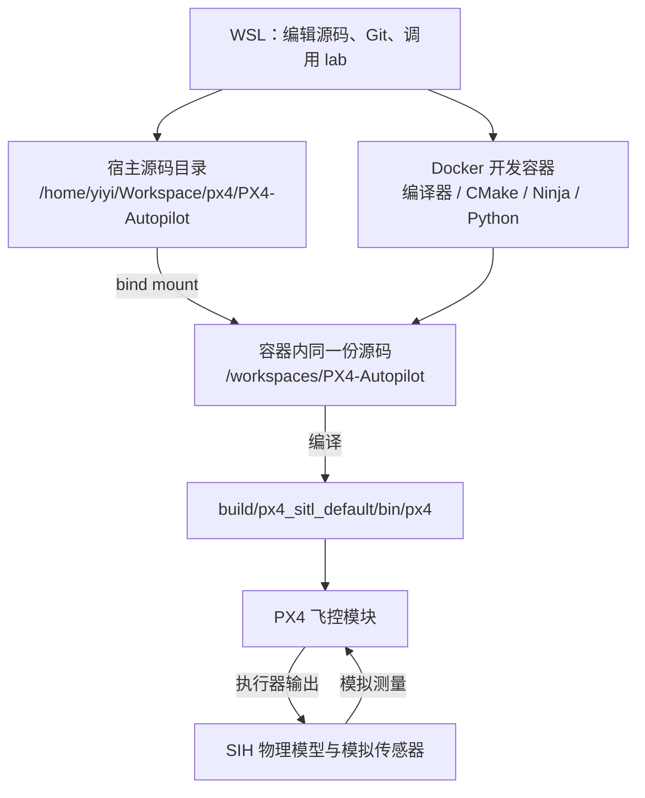
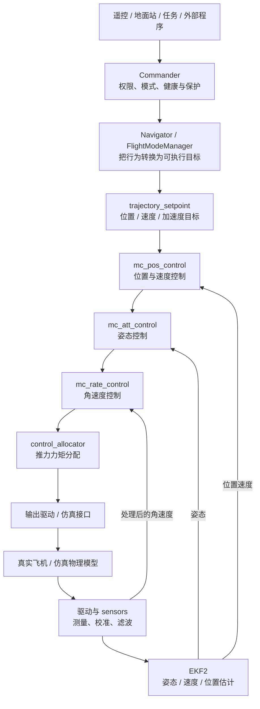

# 一、PX4 技术实现与架构

[学习入口](README.md) · [学习路线](02-learning-path.md) · [操作手册](03-practice-guide.md)

本篇先回答“它是什么、为什么这样设计”，再解释实际代码怎样实现。第一次阅读先读第 1～4 章；算法章节在对应实验前阅读。所有源码路径都相对于本仓库，不能直接套用其他版本教程里的模块名。

## 目录

1. [PX4 是什么：从一架四旋翼说起](#c1)
2. [你的开发系统：源码、子模块、Docker、仿真和地面站](#c2)
3. [一次起飞的完整链路](#c3)
4. [程序如何组织、启动和运行](#c4)
5. [读懂消息：坐标、时间、有效性和重置](#c5)
6. [传感器链：从硬件测量到可用数据](#c6)
7. [EKF2：飞机如何知道自己的状态](#c7)
8. [控制器：如何从目标算到电机](#c8)
9. [飞行行为：模式、任务、解锁与失效保护](#c9)
10. [外部通信：MAVLink、DDS、ROS 2 和 Offboard](#c10)
11. [工程验证：参数、日志、测试与调试](#c11)
12. [从四旋翼扩展到固定翼、VTOL、车辆与硬件](#c12)
13. [源码地图与子模块选择](#c13)

<a id="c1"></a>
## 1. PX4 是什么：从一架四旋翼说起

### 1.1 飞行控制必须连续解决四个问题

一架四旋翼只有四个电机。电机推力变化会改变机体的升降和转动；飞机一旦倾斜，推力就有水平分量，飞机会向侧面加速。遥控器上的“向前”无法直接变成一个固定电机转速：不同重量、电池电压、风和姿态下，同一个转速产生的运动不同。

因此飞控要重复做四件事：

1. **测量**：读取陀螺仪、加速度计、气压计、GNSS 等传感器。
2. **估计**：结合测量和运动模型，得到姿态、速度、位置，以及这些结果是否可信。
3. **决策与控制**：确定当前允许做什么、想去哪里，并根据“目标与实际的差”算出需要的推力和力矩。
4. **执行**：把总推力、力矩分配到电机，产生运动，再回到测量。

这条不断纠正误差的环路叫**闭环**。例如想在原地悬停：风把飞机吹向东，估计器得到向东的速度，控制器要求向西加速，机体向西倾斜，水平推力抵消漂移。程序并没有一条“让它绝对不动”的命令；稳定来自闭环持续工作。

**PX4 是实现这套过程的开源自动驾驶软件。** 它包含算法、模块之间的通信机制、设备驱动、运行平台、配置和测试设施。四旋翼是本教材的主线，但 PX4 也支持其他载具。

### 1.2 先分清五个常被混用的名字

| 名词 | 它是什么 | 在你的学习中对应什么 |
|---|---|---|
| PX4 | 自动驾驶软件项目 | 当前 `PX4-Autopilot` 仓库 |
| 飞控板 / Pixhawk 类硬件 | 有处理器、传感器接口和输出接口的设备 | 以后运行固件的目标硬件 |
| 固件 | 为某块板编译出的程序及配套资源 | 例如特定板型的 `.px4` 文件 |
| QGroundControl（QGC） | 地面站程序 | 查看状态、改参数、规划任务、刷写固件 |
| 仿真器 | 计算虚拟飞机的运动和测量 | 当前 SIH，以后可用 Gazebo |

QGC 不替 PX4 算姿态控制；Gazebo 不替 PX4 做飞行决策；Docker 不负责飞行算法。它们分别是交互工具、虚拟物理环境和开发环境。

### 1.3 认识四旋翼运动需要的最少知识

**位置**描述在哪里，**速度**描述位置变化多快，**加速度**描述速度变化多快。**姿态**描述朝向和倾斜，**角速度**描述转动多快。姿态中的滚转、俯仰、偏航分别对应绕机体前向、右向、下向轴的转动。

推力是力；力矩描述让机体旋转的作用。四个电机一起增加推力可以提升总升力，左右推力不同可以产生滚转力矩，对转电机的反扭矩不平衡可以产生偏航力矩。电机编号和旋转方向由机型配置决定，不能凭一张通用示意图连接真机。

四旋翼通常不能在保持完全水平时任意产生水平推力。因此位置控制器要求“向前移动”后，还要生成倾斜姿态。你以后在日志中看到“位置目标变化 → 姿态目标变化 → 电机变化”，就是这个物理约束在软件中的体现。

**第一层认识应当到这里：PX4 的核心不是执行几个飞行指令，而是让带噪声、带延迟、受物理限制的系统持续跟踪目标。**

<a id="c2"></a>
## 2. 你的开发系统：源码、子模块、Docker、仿真和地面站

### 2.1 当前电脑上实际存在的层次



宿主与容器中的两个源码路径指向同一份文件。你在宿主修改 C++，容器能立即看到；容器生成的 `build/` 也出现在宿主。容器内的绝对路径却必须固定，因为 CMake 会把它写入构建缓存。之前 `/workspace` 与 `/workspaces` 混用导致的报错，就是缓存仍指向旧路径。

镜像是一份环境模板；容器是用模板启动的运行实例。基础镜像和增加 `lab` 用户、依赖后的开发镜像可以共用底层数据，列表里两个 8 GB 镜像不等于磁盘一定占用 16 GB。镜像标签中的版本也不是当前挂载源码的版本。

### 2.2 一次可重现的实验有五组输入

| 输入 | 决定什么 | 去哪里确认 |
|---|---|---|
| 主仓库提交 | PX4 算法、启动逻辑、消息定义 | `git rev-parse HEAD` |
| 子模块提交 | MAVLink 定义、驱动库、NuttX 等依赖实现 | `git submodule status` |
| 开发镜像与工具版本 | 用什么编译器、库和生成器构建 | `lab info`、`lab snapshot` |
| 构建配置 | 编进哪些模块、面向哪个平台 | `boards/px4/sitl/default.px4board` 等 |
| 机型与运行参数 | 几个电机、控制增益、起飞高度、失效行为 | airframe 脚本与 `param show` |

因此“都是 v1.17.0，结果为什么不同”要逐项比较。修改运行参数不会改变 Git 提交；改了源码但没重新编译，也不会改变已经运行的程序。

### 2.3 子模块不是一组需要独立追新的项目

Git 子模块让主仓库记录另一个仓库的**具体提交**，这种记录叫 gitlink。`.gitmodules` 记录路径和来源地址；真正锁定版本的是主仓库提交里的 gitlink。`branch = main` 或 `master` 不会让正常的 `git submodule update --init --recursive` 自动追到最新版本。

你的日常策略是：**PX4 固定 v1.17.0 基线，依赖跟随该基线记录的提交。** 只有在明确做依赖升级时才单独更换依赖版本。没有必要把所有子仓库都复制到个人 GitHub。

五个历史遗留的未跟踪目录曾出现在你的工作区，包括 `mc_raptor`、`rl_tools`、`Micro-XRCE-DDS-Client-v3`。目录存在只能证明磁盘上有文件；是否属于当前版本，先看 `.gitmodules`、gitlink 和构建配置。它们不应因为学习仓库首次提交就被顺手加入。

### 2.4 SITL、SIH、Gazebo 各解决什么

**SITL（Software In The Loop）**表示飞控软件在电脑上运行，用仿真的测量和执行器连接形成闭环。它是一种测试形态，并不是某个特定三维软件。

**SIH（Simulation In Hardware）**本来可以把动力学模型放进飞控运行环境；你使用的 `sihsim_quadx` 则把它运行在电脑上的 SITL 中。SIH 用数学模型计算刚体运动，模拟传感器让估计器和控制器继续工作。它不需要三维窗口。

**Gazebo**是外部仿真环境，提供世界、模型、物理引擎和可视化。PX4 经 `gz_bridge` 接收传感器数据、发送执行器命令。图形画面适合观察空间关系、场景和相机等传感器，但不能代替日志中的数值证据。

当前先学 SIH 是因为它已经能跑通核心闭环。Gazebo 安装、图形转发和 ROS 环境放到后面的通信与集成阶段处理。

<a id="c3"></a>
## 3. 一次起飞的完整链路

### 3.1 同时存在“想做什么”和“当前怎样”两条链



箭头主要通过消息连接，并不是一个函数挨个调用整张图。模块有各自的运行频率。并且不同模式会跳过不需要的外环：角速度模式不要求位置控制，姿态模式不要求位置保持。

### 3.2 把你已经执行的起飞命令拆成八个动作

1. `commander takeoff` 进入 Commander 的命令入口。它形成飞行请求；命令到达和请求被接受是两件事。
2. 健康与解锁检查判断当前估计、传感器、机型和模式条件是否允许起飞。你的输出 `Preflight check: OK` 说明当时这组检查通过。
3. Commander 处理解锁和模式切换。**Armed** 表示允许执行器进入可驱动状态；它不代表飞机已经离地。
4. Navigator 的 Takeoff 行为确定起飞目的地。未指定高度时会使用 `MIS_TAKEOFF_ALT` 等当前条件，形成导航位置目标。
5. 多旋翼的 FlightModeManager 选择自动飞行任务，将导航目标转为局部坐标下连续的轨迹目标，并考虑速度、加速度等约束。
6. 位置、姿态、角速度控制器逐层计算需要的运动；分配器形成各电机输出。
7. SIH 根据电机作用计算运动，再生成测量。EKF2 估计位置变化；LandDetector 结合运动和控制状态判断离地。
8. 起飞完成后，Commander 按配置转入后续行为。你记录中进入的是 **Hold**，表示保持位置。降落完成后可以仍显示 Hold，同时已经 Disarmed。

**模式、解锁状态、落地状态是三个不同维度。** 读日志时要同时看它们，不能把 `Hold` 翻译成“正在空中悬停”，也不能把 `Armed` 翻译成“已经飞起来”。

### 3.3 用真实接口把图对应到代码

| 环节 | 主要实现 | 重点输入与输出 |
|---|---|---|
| 命令、模式与权限 | [Commander.cpp](../src/modules/commander/Commander.cpp) | `vehicle_command` → `vehicle_status`、`vehicle_control_mode`、ACK |
| 自动起飞行为 | [takeoff.cpp](../src/modules/navigator/takeoff.cpp) | 导航状态、位置 → `position_setpoint_triplet` |
| 轨迹生成 | [FlightModeManager.cpp](../src/modules/flight_mode_manager/FlightModeManager.cpp)、[FlightTaskAuto.cpp](../src/modules/flight_mode_manager/tasks/Auto/FlightTaskAuto.cpp) | 导航目标、估计 → `trajectory_setpoint` |
| 位置控制 | [MulticopterPositionControl.cpp](../src/modules/mc_pos_control/MulticopterPositionControl.cpp) | 轨迹、局部位置 → `vehicle_attitude_setpoint` |
| 姿态控制 | [mc_att_control_main.cpp](../src/modules/mc_att_control/mc_att_control_main.cpp) | 姿态目标、姿态 → `vehicle_rates_setpoint` |
| 角速度控制 | [MulticopterRateControl.cpp](../src/modules/mc_rate_control/MulticopterRateControl.cpp) | 角速度目标、测量 → `vehicle_torque_setpoint`、`vehicle_thrust_setpoint` |
| 分配 | [ControlAllocator.cpp](../src/modules/control_allocator/ControlAllocator.cpp) | 力矩、推力 → `actuator_motors`、`actuator_servos` |
| 物理仿真 | [sih.cpp](../src/modules/simulation/simulator_sih/sih.cpp) | 执行器作用 → 虚拟运动、测量和真值 |
| 状态估计 | [EKF2.cpp](../src/modules/ekf2/EKF2.cpp) | 传感器 → `vehicle_attitude`、`vehicle_local_position` 等 |

这张表是阅读入口。第一次不要打开所有文件；在阶段 2 只沿起飞高度这一个值追踪，阶段 6 再展开控制算法。

### 3.4 怎样定位“命令发了，飞机却没动”

先把问题放进链路：请求是否被接受？实际模式是否改变？是否生成有效目标？控制器是否启用？是否产生推力？执行器是否被门控？模型是否更新？估计反馈是否变化？

例如 `trajectory_setpoint.z` 没变，优先查行为和目标生成；目标变了但位置不变，再查控制模式、推力、分配和仿真；电机有输出但位置消息很旧，先查仿真与估计链。这样每一次检查都有因果依据。

<a id="c4"></a>
## 4. 程序如何组织、启动和运行

### 4.1 构建：决定哪些代码进入程序

`make px4_sitl_default` 中，`px4` 是厂商前缀，`sitl` 是板/平台目标，`default` 是配置名。`make` 是入口，CMake 生成构建规则，Ninja 执行实际编译、生成和链接。

实际顺序大致是：

```text
Makefile 解析目标
  → boards/px4/sitl/default.px4board 选择功能
  → Kconfig 解析配置依赖
  → CMakeLists.txt 注册模块、库和代码生成步骤
  → msg、参数和模块元数据生成对应代码/数据
  → 编译 C/C++、链接 px4、准备 ROMFS/rootfs
```

一个模块至少有三层名字：目录名、CMake 的 `MODULE`、Shell 命令 `MAIN`。例如 [work_item 的 CMake](../src/examples/work_item/CMakeLists.txt) 使用目录 `work_item`、目标 `examples__work_item`、命令 `work_item_example`。不要按目录名猜 Shell 命令。

**编入程序不等于已经运行。** Kconfig 决定可不可以用；启动脚本或手动 `start` 决定是否启动；参数与模式决定启动之后走哪条分支。

### 4.2 启动：决定这次要运行什么

你的 SIH 启动入口是 [init.d-posix/rcS](../ROMFS/px4fmu_common/init.d-posix/rcS)。它读取或初始化参数，根据模型找到 airframe，启动仿真、传感器、估计器和各类系统模块。

`sihsim_quadx` 对应 [10040_sihsim_quadx](../ROMFS/px4fmu_common/init.d-posix/airframes/10040_sihsim_quadx)。这个文件选择多旋翼默认配置，配置四个旋翼及输出功能，启用相关模拟传感器。多旋翼应用由 [rc.mc_apps](../ROMFS/px4fmu_common/init.d/rc.mc_apps) 启动，能直接看到控制分配、角速度、姿态、位置控制和落地检测。

读启动文件时区分：

- `param set-default`：设置这个配置提供的默认值，不等于无条件覆盖用户参数。
- `param set`：明确改变当前参数值。
- `模块 start`：启动模块的运行实例。
- `.` 加脚本路径：在当前脚本上下文继续执行另一个启动文件。

因此修改 airframe 的默认值后，如果旧参数已保存，观察结果可能不变。应确认参数实际值，而非只看文件中的数字。

### 4.3 uORB：模块之间怎样交换数据

uORB 是 PX4 内部的发布/订阅消息机制。`msg/` 下的定义生成 C/C++ 结构体；发布者写一个主题，订阅者读取这个主题。例如 EKF2 发布局部位置，位置控制器和日志模块都能订阅，彼此不必直接引用 EKF2 对象。

读取接口的区别决定了你能不能正确写模块：

| 操作 | 含义 | 常见错误 |
|---|---|---|
| `updated()` | 检查订阅是否有尚未读取的新消息 | 把“有新消息”当成“数据可用于控制” |
| `update(&data)` | 有更新时复制数据，返回是否更新 | 返回 false 后把原来的 `data` 当成新数据 |
| `copy(&data)` | 尝试取得该订阅可读取的数据 | 忽略返回值，使用未取得的内容 |
| `publish(data)` | 发布一个样本 | 忘记时间戳、单位、有效标志 |

主题不等于无限长的消息日志。有些主题只需保留最新状态，有些配置了队列深度。消费者过慢时可能错过中间样本；多实例主题还必须确认读取的是哪一实例。日志有自己的订阅与采样策略，也不保证保留所有发布。

相关实现：[Subscription.hpp](../platforms/common/uORB/Subscription.hpp)、[Publication.hpp](../platforms/common/uORB/Publication.hpp)、[SubscriptionCallback.hpp](../platforms/common/uORB/SubscriptionCallback.hpp)。

### 4.4 Task 与 WorkQueue：模块怎样得到执行时间

一个逻辑模块不必拥有独立线程。PX4 常见两种运行方式：

| 方式 | 运行形式 | 应怎样写 |
|---|---|---|
| 独立 Task | 自己的执行上下文和循环，可使用 poll 等等待 | 管理退出、阻塞时间、栈和资源 |
| WorkItem / ScheduledWorkItem | 多个工作项共享某个队列线程，调用一次 `Run()` 完成一轮工作 | 每轮有界、及时返回，不能在里面永久循环或长时间睡眠 |

`SubscriptionCallbackWorkItem` 在主题更新时调度工作项；它并不是在发布者的线程中把整个控制器同步跑完。`ScheduleOnInterval()` 则可以定时调度。

假设一个队列上有三个工作项，每轮分别耗时 0.2、0.3、0.4 ms，总耗时接近 0.9 ms。若目标周期是 1 ms，额外打印一次耗时 0.5 ms 就可能让后续工作排队。于是“在每次控制回调里 printf 调试”可能改变你正在测量的时序。

实时性关注的是在期限内完成工作，不是平均 CPU 使用率看起来低。SITL 调度、负载和计时条件与真机不同，不能把 PC 上的零耗时统计当成板卡性能结论。

### 4.5 正确的源码阅读单元是一条数据路径

拿到一个模块，按这个顺序读：构造函数的订阅/发布 → `init` 和触发条件 → `Run` 或主循环 → 参数更新 → 核心库函数 → 输出发布时间 → 退出清理。

例如阅读 `work_item_example` 时先找到它由 `sensor_accel` 回调触发，再看它订阅 `vehicle_status`、打印解锁变化、发布教学主题 `orb_test`。这样你得到的是“何时运行、用什么输入、造成什么结果”，而非只记住函数列表。

<a id="c5"></a>
## 5. 读懂消息：坐标、时间、有效性和重置

### 5.1 数值必须连着坐标系和单位一起读

PX4 常用两类坐标：

| 坐标系 | X | Y | Z | 常见数据 |
|---|---|---|---|---|
| 局部 NED | 北 North | 东 East | 下 Down | 局部位置、速度、轨迹目标 |
| 机体 FRD | 前 Forward | 右 Right | 下 Down | 角速度、机体力矩、推力 |

NED 中起飞向上运动时 `z` 变小，向上速度 `vz` 为负。机体 FRD 会随飞机旋转，NED 不跟着飞机一起转。飞机机头朝东时，机体的前向与 NED 的东向重合，不能把机体系的 x 直接当成北向量。

ROS 常见 ENU（东、北、上）和 FLU（前、左、上）。对于在同一原点表达的位置向量：

```text
NED = [ENU.y, ENU.x, -ENU.z]
FRD = [FLU.x, -FLU.y, -FLU.z]
```

姿态不能只随意交换四元数分量；它涉及参考坐标系与机体坐标系两侧的变换。真正接外部视觉时还要处理原点、时间和协方差。

### 5.2 为什么 z = -2.88696 不等于离地 2.88696 m

你此前有两次观测：

```text
地面：z = -0.59442，z_reset_counter = 2
空中：z = -2.88696，z_reset_counter = 2，dist_bottom = 2.30908
```

在同一次运行、同一参考、期间未发生未观察到的重置这一前提下，相对上升量为：

```text
Δh = z_ground - z_air
   = -0.59442 - (-2.88696)
   = 2.29254 m
```

`z` 是相对于局部原点的坐标，`dist_bottom` 是估计的离地距离。原点未必在当前地面，地形也未必平坦；两个量的误差和信息来源不同。它们接近是合理现象，不需要数值完全相等。

更关键的是：`delta_z` 表示最近一次估计重置造成的跳变量。你的 `delta_z ≈ -489` 不是飞机掉下了 489 m，不能把它每轮加到位置上。应在重置计数变化时处理它。长间隔观测还要留意计数器是有限宽度，会回绕；日志比两张快照更适合判断完整过程。

定义在 [VehicleLocalPosition.msg](../msg/versioned/VehicleLocalPosition.msg)，赋值在 `EKF2::PublishLocalPosition()`。后者从 EKF 取位置、速度、参考原点、误差、离地高度和重置信息，再发布消息。

### 5.3 姿态和角速度各表示什么

[VehicleAttitude.msg](../msg/versioned/VehicleAttitude.msg) 的 `q` 按 `[w, x, y, z]` 排列，采用 Hamilton 四元数，描述机体 FRD 到地理 NED 的旋转。`q` 与 `-q` 表示同一姿态；所以不能逐分量相减就当姿态误差。

对绕单位轴 `u` 转角 `θ`，四元数写成：

```text
q = [cos(θ/2), u.x sin(θ/2), u.y sin(θ/2), u.z sin(θ/2)]
```

它避免直接用欧拉角计算在某些姿态下的奇异问题，但仍然要考虑归一化和坐标约定。角速度主题 [VehicleAngularVelocity.msg](../msg/versioned/VehicleAngularVelocity.msg) 则包含机体系角速度 `xyz`（rad/s）及角加速度。旋转到 30° 后保持不动，姿态可以是 30°，角速度却接近零。

### 5.4 时间和有效性是接口的一部分

`timestamp` 通常表示消息时间，`timestamp_sample` 表示样本所代表的时间，单位一般为系统启动后的微秒。字段定义和发布处共同决定具体含义；SITL 的仿真时间也不必与宿主墙上时间同速。

使用状态至少需要考虑：

1. **读到了没有**：订阅读取是否成功。
2. **是否足够新**：相对于同一时钟域的当前时间，年龄是否在允许范围。
3. **数值是否有限**：NaN、Inf 是否符合该字段的接口约定。
4. **标志是否有效**：例如 `xy_valid` 和 `z_valid`。
5. **参考是否连续**：位置、速度或航向重置有没有改变坐标意义。

这些条件互不替代。`xy_valid=true` 的旧消息可能已经过期；刚发布的消息也可能带 `xy_valid=false`。

NaN 也不总是错误。[TrajectorySetpoint.msg](../msg/versioned/TrajectorySetpoint.msg) 用 NaN 表示对应状态目标不参与控制；把本来应为 NaN 的位置写成零，会变成“回到局部原点”的真实请求。而位置消息中的限制字段为 Inf，可能表示该项没有给出有限约束，不能因此断言整个估计崩溃。

### 5.5 不要把加速度计读数直接当作运动加速度

加速度计测的是**比力**。简化表达为：

```text
f_body = R_ned_to_body × (a_ned - g_ned)
```

水平静止时运动加速度 `a_ned≈0`，但 FRD 的 z 方向读数约为 `-g`。估计器需要结合姿态旋转并处理重力，才能把它用于速度预测。角度错一点就会把部分重力误当水平加速度，积分后产生速度与位置漂移，这也是姿态与位置估计相互关联的原因。

<a id="c6"></a>
## 6. 传感器链：从硬件测量到可用数据

### 6.1 先了解每种测量的能力和局限

| 传感器 | 直接测量 | 不能单独解决的问题 |
|---|---|---|
| 陀螺仪 | 角速度 | 偏置积分会造成姿态漂移 |
| 加速度计 | 比力 | 运动时不能简单把读数都当重力方向 |
| 气压计 | 气压，进一步换算气压高度 | 气流、温度、天气影响绝对高度 |
| GNSS | 位置、速度和质量信息 | 室内、遮挡、干扰、低更新率和延迟 |
| 磁力计 | 磁场向量 | 电机、电流、铁磁材料会干扰 |
| 距离传感器 | 沿测量方向的距离 | 量程、倾斜、地面材质和地形限制 |
| 光流 / 外部视觉 | 图像运动或视觉位姿 | 纹理、照明、尺度、坐标和时间对齐 |

驱动负责把具体设备变成规范消息；传感器处理负责校准、选择、滤波和积分；估计器负责融合并判断状态。这三层出现故障时的排查对象不同。

### 6.2 以 BMI088 陀螺仪读通一个真实驱动

打开 [BMI088_Gyroscope.cpp](../src/drivers/imu/bosch/bmi088/BMI088_Gyroscope.cpp)，先看 `RunImpl()` 的状态机：

```text
RESET → WAIT_FOR_RESET → CONFIGURE → FIFO_RESET → FIFO_READ
                 ↑          失败 / 超时 / 寄存器异常 → 恢复或重置
```

复位后芯片需要时间准备，读取 FIFO 也需要等待样本；状态机把这些等待分成多次调度，避免长时间占住工作队列。数据就绪中断只触发后续工作，不应该在中断里完成整个算法链。

FIFO 可以一次读出多个样本以降低总线开销。它同时带来时间问题：读完 SPI 的时刻不是每个样本的采样时刻。驱动需要利用中断时间、采样率、FIFO 长度重建样本时序。时间错了，数据即使数值看着正常，也会影响估计和控制。

`ConfigureGyro()` 依据量程设置比例因子，把寄存器数转换为 rad/s；后续通用驱动封装还处理发布、旋转等共性。应沿 `FIFORead()` 继续追到 [PX4Gyroscope](../src/lib/drivers/gyroscope/PX4Gyroscope.cpp)，而不是在看到 SPI 读成功后就认为“驱动完成了”。

### 6.3 同一组 IMU 数据为何分成两条处理路径

```text
陀螺仪 / 加速度计消息
  ├─ VehicleIMU：积分、校准、增量和积分时间 → EKF2
  └─ VehicleAngularVelocity：选中陀螺仪、校准/偏置修正、滤波 → 角速度控制
```

[VehicleIMU.cpp](../src/modules/sensors/vehicle_imu/VehicleIMU.cpp) 形成 `delta_angle`、`delta_velocity` 及相应积分时长。EKF 关心一个时间段内的运动增量，不应把增量字段直接当 rad/s 或 m/s²。

[VehicleAngularVelocity.cpp](../src/modules/sensors/vehicle_angular_velocity/VehicleAngularVelocity.cpp) 为控制环提供低延迟、适当滤波的角速度及其导数。控制器没有必要先差分估计姿态再还原角速度；那会引入额外延迟与噪声。

校准解决尺度、安装方向、零偏等测量模型问题；EKF 在线估计的偏置处理运行中剩余的慢变化。低通滤波抑制高频噪声，却会增加相位滞后；陷波针对特定频段的振动。不能因为曲线更光滑就认定控制更好。

### 6.4 多传感器与多估计器是两种冗余

一块板可有多组 IMU。每个设备有 `device_id`，消息可能有多个实例。系统需要辨认具体设备、检查错误与新鲜度、选择可用输入。还可以配置多个 EKF 实例，由选择器比较估计健康状况。

“有多个实例”不等于“随时都在自动切换”，也不等于“多传感器数据被简单平均”。检查顺序应为：设备是否发布 → 哪个实例在更新 → 哪个设备被选中 → EKF 使用哪组输入 → 是否发生估计器切换或重置。

你的 SIH 可以用来学习消息链与有效性；它不验证实际电气连接、SPI 时序、FIFO 中断线或安装振动。真实驱动能力需要后面的无桨台架实验补足。

<a id="c7"></a>
## 7. EKF2：飞机如何知道自己的状态

### 7.1 为什么不能只信一个传感器

GNSS 能约束长期位置漂移，但低频、延迟较大；IMU 高频且响应快，却有偏置，积分会积累误差。估计器利用 IMU 快速预测，再用 GNSS、气压、磁场、距离或视觉校正。

EKF 是扩展卡尔曼滤波。它维护状态及其不确定性，用运动模型预测，用传感器模型比较观测。在 PX4 中，`EKF2` 是模块封装，`src/modules/ekf2/EKF/` 是主要算法实现。模块层负责订阅、时间处理、参数、调用和发布；算法层负责预测、融合、故障与重置逻辑。

### 7.2 先算一次最简单的更新

假设只估计一个高度，预测为 `h⁻=2.0 m`、预测方差 `P⁻=0.25 m²`；传感器观测为 `y=2.4 m`、观测方差 `R=0.75 m²`。标量卡尔曼更新为：

```text
残差 r = y - h⁻ = 0.4 m
残差方差 S = P⁻ + R = 1.0 m²
增益 K = P⁻ / S = 0.25
更新高度 h⁺ = h⁻ + K r = 2.1 m
更新方差 P⁺ = (1 - K) P⁻ = 0.1875 m²
```

观测不确定性较大，所以结果只向观测移动一部分。方差的单位是物理量单位的平方，不能把“标准差 0.5 m”直接填成“方差 0.5 m²”。

多状态情形把数字变成矩阵，并通过模型的雅可比描述状态之间的关系。噪声协方差 Q 影响预测不确定性如何增长，R 影响观测被信任的程度。增大 R 会减弱对应观测作用；它不能修复坐标符号错误、时间错位或持续错误测量。

PX4 某些 aid-source 的 innovation 使用“预测减观测”的符号，与上面的教学残差相反。读代码或日志必须核对定义；平方检验比不受这一符号变化影响，直接使用创新方向却会受影响。

### 7.3 创新、门限与拒绝观测

如果观测与预测差得太多，滤波器不应立即把状态拉过去。对一个标量观测，可用归一化检验理解：

```text
test_ratio = innovation² / (gate² × innovation_variance)
```

比率大于 1 表示超出所设门限，常见结果是拒绝该观测。持续拒绝可能引起融合超时、停止某项辅助，或在满足条件时重置状态。实际不同观测路径还有各自条件，不能把一次 ratio 超限等同于立即触发整机失效保护。

例如 GNSS 高度瞬间偏离 200 m：飞控不能仅因消息还在发布就信任它。应同时看质量检查、innovation、rejected、最后成功融合时间及备用高度源。

### 7.4 把一个 GNSS 高度样本追到底

按这个顺序阅读：

1. [EKF2.cpp](../src/modules/ekf2/EKF2.cpp) 的 `UpdateGpsSample`：把 uORB GNSS 数据变成算法输入，确认单位、质量字段与时间。
2. [estimator_interface.cpp](../src/modules/ekf2/EKF/estimator_interface.cpp) 的 GNSS 输入处理：按配置的延迟进入缓冲。
3. [gps_control.cpp](../src/modules/ekf2/EKF/aid_sources/gnss/gps_control.cpp)：决定当前样本是否可以用于相关融合。
4. [gnss_height_control.cpp](../src/modules/ekf2/EKF/aid_sources/gnss/gnss_height_control.cpp)：高度观测、噪声、杆臂和偏置修正，开始/继续/停止条件。
5. 回到 `EKF2::PublishLocalPosition()`：算法状态怎样变成控制器看到的消息。

第 4 步值得逐个解释：

- GNSS 天线和 IMU 不在同一个位置，旋转机体时天线位置会随之变化，代码用两者安装位置差进行杆臂修正。
- GNSS 高度向上为正，NED z 向下为正，观测进入垂直位置接口时要处理符号。
- 观测方差含测量噪声及相关偏置估计不确定性。
- “可以开始融合”除了满足配置和质量条件，还要求最近确实有新数据。
- 已经融合时，持续失配会影响 `time_last_fuse`，进而进入停止或重置分支。

这说明 EKF2 不只是“跑一次矩阵计算”；它同时是一个管理不同信息源可用性的系统。

### 7.5 延迟融合与输出预测

不同传感器延迟不同。若把 100 ms 前的视觉位置与当前 IMU 状态直接比较，快速运动时会出现系统性误差。EKF 使用缓冲在合适的融合时间处理观测，并通过输出预测把结果向当前时间传播，满足控制器的低延迟需要。

多实例配置下，EKF2 可以直接接收特定 `vehicle_imu`；单实例路径也可使用 `sensor_combined`。代码中存在两条入口，不能根据某一次输出断言所有配置都只走其中一条。

### 7.6 高度突然变化时，正确的诊断顺序

先找同一时间附近的 `z`、`vz`、`z_reset_counter`、观测与 innovation。如果 z 跳变、reset 计数增加，而速度没有对应的物理变化，优先研究估计重置。再看参考源是否切换、观测是否恢复、是否发生实例切换。

若 z 连续变化且速度、IMU、目标和推力也支持该运动，再判断它是控制响应。不要看到位置曲线变化就先改 PID。

源码中的 [test_EKF_height_fusion.cpp](../src/modules/ekf2/test/test_EKF_height_fusion.cpp) 提供可控的模拟测量和时间推进。阅读测试的 `SetUp`、输入扰动和断言，比直接拿真实飞行噪声猜算法更容易建立确定认识。

<a id="c8"></a>
## 8. 控制器：如何从目标算到电机

### 8.1 为什么分成位置、速度、姿态和角速度

四旋翼要改变位置，先要有速度；改变速度需要加速度；产生水平加速度要改变推力方向；改变推力方向需要机体旋转；旋转由电机力矩造成。因此 PX4 使用嵌套控制环，把一个慢的空间目标逐步转换为快的执行器作用。

外环的输出成为内环的目标。内环不稳定时，外环再“聪明”也无法准确执行。学习和调试通常从角速度环向外展开，同时始终记住它在整条链中的位置。

### 8.2 角速度环：PX4 的 PID 实际做了什么

[RateControl::update](../src/lib/rate_control/rate_control.cpp) 的核心可写为：

```text
e = ω_sp - ω
u = Kp ⊙ e + I - Kd ⊙ α_measured + Kff ⊙ ω_sp
```

符号 `⊙` 表示按轴相乘；`ω` 是 rad/s，`α` 是 rad/s²。这里 D 项使用测得的角加速度，带负号；并不是简单对整条误差差分。这可以避免目标突然变化直接造成很大的微分冲击。FF 是目标前馈。

单轴例子：`ω_sp=1`、`ω=0.8`、`Kp=0.1`、`I=0.02`、`Kd=0.01`、`α=0.5`、`Kff=0`，本轮输出为：

```text
u = 0.1 × 0.2 + 0.02 - 0.01 × 0.5 = 0.035
```

这是控制链中的归一化力矩请求，不能直接读成 0.035 N·m。外层模块还会做参数缩放、限制和滤波，真实输出以整个调用路径为准。

源码先计算本轮输出，再更新积分供下一轮使用。落地时不继续正常累积积分；积分有幅值限制，大误差还会降低积分因子。分配器报告某方向无法实现更多力矩时，积分器会抑制把该方向继续推向饱和的误差。

### 8.3 姿态环：四元数误差变成角速度目标

[AttitudeControl::update](../src/modules/mc_att_control/AttitudeControl/AttitudeControl.cpp) 比较当前姿态 `q` 与期望姿态 `qd`：

```text
qe = inverse(q) × qd
e_att = 2 × imaginary(canonical(qe))
ω_sp = K_att ⊙ e_att + yaw 前馈
```

`canonical` 用于处理 q 与 -q 的等价表示。实现还先对齐推力方向，再按权重混入偏航误差，避免偏航需求抢占保持推力方向的重要性，最终限制目标角速度。

如果姿态目标没跟上，先检查角速度目标是否已达到限制、实际角速度是否能跟踪、分配是否饱和。不能只增加姿态增益。

### 8.4 位置与速度环：目标如何受到物理约束

[PositionControl.cpp](../src/modules/mc_pos_control/PositionControl/PositionControl.cpp) 内的位置环主要是 P 控制，加上速度前馈：

```text
v_sp = Kp_position ⊙ (p_sp - p) + v_feedforward
```

速度环形成加速度请求：

```text
a_sp = Kp_velocity ⊙ (v_sp - v) + I_velocity
       - Kd_velocity ⊙ a_measured + a_feedforward
```

位置、速度、加速度目标哪些有效，由 NaN 约定和输入校验共同决定。水平轴需要成对满足要求，每个轴必须有可控制的目标；状态也必须满足对应控制层的需要。

随后 `_accelerationControl()` 把加速度转为期望推力向量，考虑重力、悬停推力比例、倾角和总推力限制；`ControlMath::thrustToAttitude()` 再把推力方向与航向转换为姿态目标。

请求水平加速度越大，通常需要更大倾角，同时需要更多总推力维持高度。推力有限时，源码会按约束处理垂直和水平需求。速度环还要做抗积分饱和，防止目标无法实现时积分一直增长，解除限制后造成过冲。

### 8.5 起飞目标为什么没有一步跳到最终高度

“上升到 3 m”是行为目标；轨迹生成器会考虑速度、加速度、jerk（加速度变化率）等约束，让控制输入随时间变化。位置控制模块本身还有起飞状态管理、倾角/推力限制和异常输入处理。

因此需要区分导航终点、`trajectory_setpoint`、控制器内部 `vehicle_local_position_setpoint` 和实际位置。实验中“目标已经是 3 m，但实际还没到”可能是正常的受限上升；要结合时间和约束判断，而非把瞬时差值都当稳态误差。

### 8.6 分配器：总力矩与推力怎样变成多个电机

控制器给出期望整体作用，分配器知道机型几何和执行器能力。简化关系为：

```text
w = B u
```

`u` 是各执行器命令，`w` 是期望力矩与推力，B 是控制有效性矩阵。一个旋翼的安装位置 r、推力方向 F 会产生 `r × F` 的力矩，旋转阻力还产生反扭矩。改变旋翼方向或力臂就会改变 B。

[ControlAllocationPseudoInverse](../src/lib/control_allocation/control_allocation/ControlAllocationPseudoInverse.cpp) 提供伪逆分配；[ControlAllocationSequentialDesaturation](../src/lib/control_allocation/control_allocation/ControlAllocationSequentialDesaturation.cpp) 处理限幅与去饱和。伪逆不能创造电机没有的能力，超出约束后某些请求仍无法完全实现。

`control_allocator_status.unallocated_torque` 等信息把未实现部分反馈回控制链。最终 [ActuatorMotors.msg](../msg/versioned/ActuatorMotors.msg) 表示逻辑电机的归一化推力请求，不是物理引脚上的 PWM 微秒值，也不保证等同于实际转速。

### 8.7 逻辑电机到物理通道还差一层

`Motor 1` 是逻辑功能，`PWM_MAIN_FUNC1=101` 把某个输出通道分配给这个功能。实际输出还涉及解锁门控、最小/最大值、停止值、斜率、推力模型以及 PWM、DShot、CAN 等协议。

所以排查“电机顺序不对”要分清：机型几何、逻辑电机编号、功能到通道映射、接线、旋转方向。只改控制矩阵补偿错误接线，会让系统越来越难以理解。

<a id="c9"></a>
## 9. 飞行行为：模式、任务、解锁与失效保护

### 9.1 谁负责决定，谁负责生成目标

| 组件 | 负责的问题 | 不应放进这一层的事情 |
|---|---|---|
| Commander | 能否解锁、当前模式、健康要求、保护动作 | 每个电机的 PID 计算 |
| Navigator | Mission、Takeoff、Land、RTL 等自动导航行为 | 传感器寄存器读取 |
| FlightModeManager / FlightTask | 多旋翼当前模式怎样生成轨迹目标 | 绕过解锁检查直接驱动电机 |
| 控制器 | 根据启用标志和状态跟踪目标 | 擅自决定所有失效后的飞行策略 |
| LandDetector | 根据运动与控制信号判断接地/落地 | 仅凭高度低就自动认定安全 |

它们之间由 `vehicle_status`、`vehicle_control_mode`、目标和检测结果连接。源码入口分别位于 [commander](../src/modules/commander)、[navigator](../src/modules/navigator)、[flight_mode_manager](../src/modules/flight_mode_manager)、[land_detector](../src/modules/land_detector)。

### 9.2 从控制层级理解飞行模式

| 模式 | 用户主要给什么 | PX4 主要负责什么 |
|---|---|---|
| Acro | 角速度与推力意图 | 角速度稳定 |
| Stabilized | 姿态与推力意图 | 姿态和角速度稳定 |
| Altitude | 姿态与垂直运动意图 | 增加高度/垂直速度控制 |
| Position | 水平/垂直运动意图 | 增加水平位置/速度控制 |
| Hold | 保持当前位置的行为 | 生成保持目标并运行所需控制环 |
| Mission / RTL | 航点任务 / 返航意图 | 导航规划及轨迹执行 |
| Offboard | 外部程序持续提供目标 | 按所选目标层级启用下游控制 |

这是理解控制职责的表，不替代各模式对操纵杆、可用估计和机型的精确定义。四旋翼的 Hold 可以原地悬停；固定翼通常需要盘旋。

### 9.3 请求模式与实际模式可能不同

`user intended navigation mode` 表示用户想要的模式，实际 `navigation mode` 可能因失效保护而变化。外部程序发出模式请求后，不能只检查“发送成功”；还要检查命令确认、实际模式、解锁状态和目标是否真正被执行。

多种异常同时发生时，保护逻辑会结合严重程度、模式需求、可执行能力和延时作出选择。比如没有可用位置时，要求 Hold 未必可执行；返航也依赖定位和返航条件。

阅读顺序是 [HealthAndArmingChecks](../src/modules/commander/HealthAndArmingChecks/HealthAndArmingChecks.cpp) → [mode_requirements](../src/modules/commander/ModeUtil/mode_requirements.cpp) → [failsafe.cpp](../src/modules/commander/failsafe/failsafe.cpp)。先找异常标志如何形成，再看策略怎样使用它。

### 9.4 为什么不能为了解锁把检查全关掉

预检失败本身就是一条诊断信息：哪一种估计不可用、哪项配置缺失、哪个模式的前提不成立。强制解锁可能绕过本来需要学习的输入问题。

实验中应先复现一个具体失效，例如模拟 GNSS 卫星数降低，再观察“测量质量 → 融合状态 → 位置有效性 → 模式需求 → 行为”的传递过程。不同配置的备用观测不同，触发的动作也可能不同；记录实际链路比背“掉 GPS 就降落”更有价值。

### 9.5 落地不是一个单独的高度阈值

多旋翼落地检测会结合低推力、垂直/水平运动、旋转、接地等条件，形成 ground contact、maybe landed、landed 等状态。Commander 再根据状态与延时处理自动上锁。

你此前出现 `Landing detected`，随后 `Disarmed by landing`，并观察到 `landed=true`、`at_rest=true`，这才构成“已经降落并自动上锁”的完整证据。单独一个 `z≈0` 不足以证明落地。

<a id="c10"></a>
## 10. 外部通信：MAVLink、DDS、ROS 2 和 Offboard

### 10.1 两条外部通信路径


uORB 是内部消息机制；MAVLink 是载具通信协议；DDS 是另一类分布式数据通信体系。ROS 2 可以经 DDS 与 PX4 交换消息，但 PX4 的核心控制模块并不因此变成 ROS 节点。

### 10.2 MAVLink 的四层问题要分开检查

1. **传输**：UDP/串口通不通，端口和目标地址对不对。
2. **身份**：消息来自哪个 system/component，目标指向谁。
3. **协议**：消息类型、字段、坐标系、掩码和 ACK 是否正确。
4. **飞控行为**：请求是否符合当前状态，实际模式/目标是否改变。

你曾看到本地 UDP 14580、远端 14540 的 Onboard 实例。客户端通常监听远端 14540，PX4 实例在本地 14580 接收返回数据。“PX4 用 14540”这样的简称容易混淆方向；应以 `mavlink status` 为准。

`HEARTBEAT` 能说明通信和部分模式状态；它不证明位置估计有效。`COMMAND_ACK` 说明对应命令处理结果；它不保证请求的飞行动作已完成。

代码入口：[mavlink_main.cpp](../src/modules/mavlink/mavlink_main.cpp) 管理实例与流，[mavlink_receiver.cpp](../src/modules/mavlink/mavlink_receiver.cpp) 处理接收，[streams](../src/modules/mavlink/streams) 把内部状态编码成输出消息。

### 10.3 一条位置目标消息进入飞控会发生什么

在 `MavlinkReceiver::handle_message_set_position_target_local_ned()` 中：

1. 检查是否允许外部 setpoint、system/component 是否匹配。
2. 根据 `coordinate_frame` 解释位置、速度和加速度。
3. 根据 `type_mask` 把忽略字段设为 NaN。
4. 从有效目标推导 `offboard_control_mode` 并更新时间。
5. 只有在实际 Offboard 状态中，才按该路径发布 `trajectory_setpoint`。

所以预先持续发送目标，能够建立 Offboard 可用信号；还没切入 Offboard 时不一定能看到该消息成为当前轨迹。这是代码中的门控行为，不应误判为 UDP 丢包。

### 10.4 DDS 为什么还需要匹配消息版本

[dds_topics.yaml](../src/modules/uxrce_dds_client/dds_topics.yaml) 明确列出 PX4 与 DDS 之间桥接哪些消息，不是所有 uORB 主题都会自动暴露。ROS 工作区的 `px4_msgs` 必须与 PX4 消息结构对应；名称相同但字段布局不同也会产生兼容问题。

本版本根据 `MESSAGE_VERSION` 生成主题版本后缀。版本大于 0 时带 `_vN`；版本 0 或没有该字段时使用无后缀名称。例如：

| PX4 消息 | 本版本对应 ROS 主题 |
|---|---|
| VehicleLocalPosition，version 1 | `/fmu/out/vehicle_local_position_v1` |
| VehicleStatus，version 1 | `/fmu/out/vehicle_status_v1` |
| VehicleAttitude，version 0 | `/fmu/out/vehicle_attitude` |
| TrajectorySetpoint，version 0 | `/fmu/in/trajectory_setpoint` |
| OffboardControlMode | `/fmu/in/offboard_control_mode` |

命名空间会进一步改变完整主题名，具体实现见 [dds_topics.h.em](../src/modules/uxrce_dds_client/dds_topics.h.em) 和 [utilities.hpp](../src/modules/uxrce_dds_client/utilities.hpp)。订阅还需要匹配 QoS；实时传感器流常使用 best effort，不能只看到 topic list 就认为已经收到数据。

ROS 环境搭建和兼容策略以 [v1.17 ROS 2 官方指南](https://docs.px4.io/v1.17/en/ros2/user_guide) 为补充；本教材的行为分析以本地源码为准。

### 10.5 Offboard 是一种持续控制关系

外部程序可以提供位置、速度、姿态、角速度等不同层级的目标。选择越靠内的控制层级，外部程序需要自己承担的职责越多。第一次实验选**位置保持**，保留 PX4 的位置、姿态和角速度控制器。

工作顺序是：取得可信当前位置 → 连续发送可实现目标 → 请求 Offboard → 确认实际状态 → 持续监测 → 正常退出或触发已验证的断流处理。

[offboardCheck.cpp](../src/modules/commander/HealthAndArmingChecks/checks/offboardCheck.cpp) 检查信号新鲜度和对应估计需求。`COM_OF_LOSS_T` 与失效策略相关；[commander_params.c](../src/modules/commander/commander_params.c) 中 `COM_OBL_RC_ACT=4` 是 Land，`5` 是 Hold。不要凭其他版本文章记一个数字。

ROS 路径中保活的 OffboardControlMode 与目标消息可以分开发；MAVLink setpoint 路径同时建立对应控制信号。无论哪条路径，程序退出之前都应该有可理解的模式转移。操作手册给出仅用于 SIH 的保持与断流实验。

<a id="c11"></a>
## 11. 工程验证：参数、日志、测试与调试

### 11.1 参数从定义到运行值经过哪些层

参数可以来自 `PARAM_DEFINE_*` 或模块元数据；构建生成参数信息。运行中加载保存值、应用默认值和显式设置。模块通过 `ModuleParams`、`DEFINE_PARAMETERS` 等取得值，并订阅 `parameter_update` 处理变化。

定义里写默认 2.5，并不能证明当前值是 2.5。是否立即生效取决于模块何时更新、参数是否要求重启、当前行为是否已经把参数转换成目标。某些值在起飞开始时读取，飞行中改变不会自动重做此前的计划。

参数常会自动保存。因此对照实验必须先记录原值，实验结束明确恢复并查询确认。通过重启“猜测它会恢复”会污染下一次实验。

### 11.2 日志把多条异步消息重新放到时间轴上

ULog 保存飞行状态、目标、参数、事件及相关元信息。日志模块的主题配置见 [logged_topics.cpp](../src/modules/logger/logged_topics.cpp)。一个主题在 `listener` 中存在，不代表它已被当前日志配置记录。

起飞分析的最小组合是：

| 要回答的问题 | 对照信息 |
|---|---|
| 何时开始和结束动作 | 命令/事件、vehicle_status、vehicle_land_detected |
| 想飞到哪里 | trajectory_setpoint、vehicle_local_position_setpoint |
| 估计飞到哪里 | vehicle_local_position、valid、reset counters |
| 怎样实现动作 | 姿态/角速度目标与测量、推力力矩、执行器 |
| 有没有达到限制 | 控制限制、积分、control_allocator_status |
| 数据能否信任 | 时间戳、丢样、dropout、估计状态 |

不同主题频率不同，导出的 CSV 第 100 行通常不是同一时刻。应按时间戳对齐，遇到缺失或长时间空洞要标出来，而非跨空洞插值制造连续飞行。

### 11.3 测试分层决定你能证明什么

| 验证层 | 适合验证 | 不能据此推断 |
|---|---|---|
| 单元测试 | 一个算法对可控输入的数学行为和边界 | 整套系统时序、真机驱动正确 |
| 功能测试 | 模块与参数、平台设施组合行为 | 真实气动、机械和电气可靠性 |
| SIH / Gazebo | 模式、数据链、控制和外部接口的集成 | 仿真模型未覆盖的现实条件 |
| 台架 | 板型、传感器方向、通信、输出映射 | 实际带载飞行性能 |
| 受控飞行 | 在已检查条件下的真实闭环表现 | 所有环境中的普遍可靠性 |

本仓库测试由 [px4_add_gtest.cmake](../cmake/px4_add_gtest.cmake) 生成名称。比如 `PositionControlTest.cpp` 对应 `unit-PositionControl`，分配去饱和对应 `functional-ControlAllocationSequentialDesaturation`。筛选表达式命中零项不能算通过。

### 11.4 一次修改应如何证明有效

假设你修复一个状态观察模块把旧位置当成当前位置的问题：

1. 正常数据下，输出应保留原来的位置含义。
2. 数据停止后，超过阈值应显示 stale，而不是继续说 valid。
3. 无效标志或 NaN 时，不应报告可用位置。
4. stop/start 后不能保留上次会话的参考基准。
5. 日志/打印频率应受限，不能影响控制队列。

这五项来自真实行为边界，比“编译成功截图”更能说明功能。调试时先把问题缩小到能确定输入和时间的测试，再用 GDB 看状态；不要在飞行中对高频控制器随意断点，把暂停导致的保护误当算法故障。

<a id="c12"></a>
## 12. 从四旋翼扩展到固定翼、VTOL、车辆与硬件

### 12.1 共用平台，改变的是运动约束和控制组织

| 机型 | 关键物理差异 | 应额外学习的控制问题 |
|---|---|---|
| 四旋翼 | 推力方向受姿态约束，可悬停 | 姿态/角速度、位置、推力分配 |
| 固定翼 | 依赖空速和机翼升力，通常必须持续前飞 | 空速、能量、航迹、起降 |
| VTOL | 多旋翼和固定翼能力随过渡变化 | 状态协调、控制权重与执行器分配 |
| Ackermann 车辆 | 转向几何限制、不能横向平移 | 曲率、速度、转向与前后运动 |
| 差速 / 麦克纳姆车辆 | 左右轮速或全向轮结构不同 | 对应运动学及执行器约束 |

### 12.2 固定翼：总能量与能量分配

高度对应势能，空速对应动能。简化为单位质量的：

```text
E_p = g h
E_k = 0.5 V²
E_total = E_p + E_k
```

TECS 用油门和俯仰协调总能量与能量分配，不能把四旋翼的“竖直推力控制高度”照搬过来。横向导引把路径与风、空速条件转换为转弯需求。

本标签的启动脚本 [rc.fw_apps](../ROMFS/px4fmu_common/init.d/rc.fw_apps) 启动 `fw_mode_manager`、`fw_lat_lon_control`、`fw_att_control`、`fw_rate_control` 等。核心入口为 [FwLateralLongitudinalControl.cpp](../src/modules/fw_lateral_longitudinal_control/FwLateralLongitudinalControl.cpp)、[TECS.cpp](../src/lib/tecs/TECS.cpp) 和 [npfg](../src/lib/npfg) 中的导引组件。旧文章中的文件结构可能不同。

### 12.3 VTOL：重点是过渡，不只是两套控制器并排

[vtol_att_control](../src/modules/vtol_att_control) 管理多旋翼/固定翼状态、过渡以及相关目标协调。速度建立、推力方向变化、舵面逐渐有效、旋翼作用变化，都影响什么时候可以把控制职责交给另一套控制链。

读取某个 VTOL 类型时，先画状态转换图，再找每个状态下哪些执行器有效、哪些目标被混合、失败时何种条件触发回退。只验证两个端点都能运行，还没有验证过渡。

### 12.4 真机上多了哪些必须重新验证的东西

SITL 使用电脑平台；许多飞控板使用 NuttX。相同控制模块之外，板级代码决定引脚、时钟、总线、传感器、定时器、DMA、存储与启动资源。

从 [boards/px4/fmu-v6x](../boards/px4/fmu-v6x) 可以学习一个具体板型怎样组织 `default.px4board`、板级头文件和初始化代码，但只有实际硬件匹配时才能把它当刷写目标。“都是 Pixhawk”不足以选择固件。

硬件学习的顺序是：确认板型 → 编译固件 → 建立控制台 → 识别传感器与方向 → 检查通信和供电 → 拆桨验证输出映射 → 检查 CPU/栈/日志 → 受控飞行。无桨条件下也要确认驱动设备的电源和机械风险；操作手册不会让未知板卡直接执行刷写或带桨输出命令。

<a id="c13"></a>
## 13. 源码地图与子模块选择

### 13.1 根目录按职责查，不按目录顺序背

| 目录 | 职责 | 什么时候打开 |
|---|---|---|
| [src/modules](../src/modules) | 估计、控制、模式、通信等系统模块 | 追踪飞行行为 |
| [src/drivers](../src/drivers) | 具体设备、总线和输出驱动 | 测量异常、增加设备 |
| [src/lib](../src/lib) | 算法库、数学、通用设备与输出支持 | 深入核心算法 |
| [platforms](../platforms) | POSIX/NuttX 适配、uORB、任务、工作队列 | 调度、移植、平台问题 |
| [msg](../msg) | 内部消息及版本化定义 | 查字段语义、单位、接口 |
| [ROMFS](../ROMFS) | 启动脚本与 airframe 配置 | 解释“为什么启动这些模块” |
| [boards](../boards) | 板型和构建配置 | 选目标、增加模块、板级移植 |
| [Tools](../Tools) | 开发、仿真、生成和维护工具 | 构建与开发流程 |
| [test](../test) | 测试设施及相关依赖 | 自动验证；具体测试也分布在模块旁 |
| build | 本机生成的产物、缓存和 SITL 运行状态 | 查看编译/运行结果；不作为源码编辑入口 |

### 13.2 子模块按“何时需要”选择，不单独挑最新版

下面按 v1.17.0 的 [.gitmodules](../.gitmodules) 分组。版本统一采用主仓库锁定的提交，表中的时机是学习优先级。

| 子模块路径 / 类别 | 用途 | 学习时机 |
|---|---|---|
| `src/modules/mavlink/mavlink` | MAVLink 消息定义与生成相关内容 | 阶段 8 通信 |
| `src/drivers/gps/devices` | GNSS 协议解析和设备支持 | 阶段 4 驱动 |
| `platforms/nuttx/NuttX/nuttx`、`apps` | 真机 RTOS 及配套应用 | 阶段 9 硬件 |
| `Tools/simulation/gz` | Gazebo 模型和世界 | 阶段 8 可视化 |
| `Tools/simulation/jmavsim/jMAVSim` | jMAVSim 仿真 | 使用该仿真后再研究 |
| `Tools/simulation/gazebo-classic/sitl_gazebo-classic` | Gazebo Classic 接口 | 维护相关旧环境时研究 |
| `Tools/simulation/jsbsim/jsbsim_bridge`、`Tools/simulation/flightgear/flightgear_bridge` | 其他飞行动力学/可视化桥接 | 对应机型与仿真专题 |
| `src/modules/uxrce_dds_client/Micro-XRCE-DDS-Client` | DDS 轻量客户端 | 阶段 8 ROS/DDS |
| `src/lib/cdrstream/cyclonedds`、`rosidl` | 序列化和消息工具依赖 | 深入 DDS 编码时 |
| `src/modules/zenoh/zenoh-pico` | Zenoh 通信支持 | 通信扩展专题 |
| `src/drivers/cyphal/libcanard`、两组 data_types | Cyphal 协议栈与数据类型 | CAN 设备集成 |
| `src/drivers/uavcan/libdronecan/dsdl`、嵌套 `pydronecan` | DroneCAN 数据类型与生成 | DroneCAN 设备集成 |
| `src/lib/events/libevents` | 结构化事件支持 | 事件定义与地面站显示 |
| `src/lib/crypto/monocypher`、`libtomcrypt`、`libtommath` | 加密、签名及大整数等支持 | 对应安全/日志功能 |
| `src/lib/heatshrink/heatshrink` | 压缩支持 | 对应存储/压缩功能 |
| `test/fuzztest` | 测试依赖 | 首次构建相关测试 |
| `src/lib/tensorflow_lite_micro/tflite_micro` | 嵌入式推理 | 机器学习控制专题 |
| `boards/modalai/voxl2/libfc-sensor-api` | VOXL2 传感器接口 | 使用该平台时 |
| `src/drivers/actuators/vertiq_io/iq-module-communication-cpp` | Vertiq 执行器通信 | 使用该设备时 |
| `src/drivers/ins/microstrain/mip_sdk`、`sbgECom` | 特定组合惯导设备 SDK | 使用对应 INS 时 |

PX4 核心算法并不都藏在子仓库里。当前 EKF 主要代码就在 `src/modules/ekf2/EKF`；控制器和分配器也可直接在主仓库阅读。先掌握主线，再按遇到的设备或协议进入依赖，学习范围才会始终服务于具体问题。

### 13.3 独立阅读一个新模块的七个问题

对任何未学过的模块，写清：谁启动它、何时运行、读哪些输入、单位和坐标是什么、异常时怎么处理、发布什么、谁使用输出。最后找一个现有测试或设计一个可控实验验证这条路径。

能对估计、控制、通信和驱动分别这样工作，才形成可以迁移到新功能的 PX4 能力。下一篇把这条主线拆成十个连续阶段。
