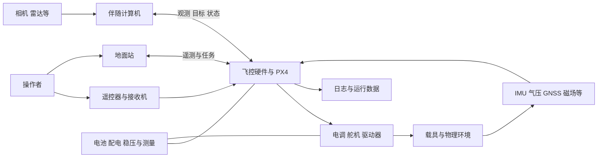
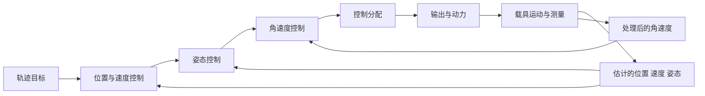

# PX4 技术架构详解：硬件、外设、实现与仿真

[学习首页](README.md) · [当前工程全景导读](PROJECT_GUIDE.md) · [算法与系统原理](TECHNICAL.md) · [开发调试实战](DEBUGGING.md)

本文回答一组具体问题：PX4 能运行在哪些硬件上；搭建不同载具需要哪些外设；传感器、电源、计算平台和执行器怎样连接；软件怎样把这些器件组织成闭环；有哪些仿真方式，各自验证什么。读完后，应能为一个目标场景画出系统组成图，并从图中的每个部件追到当前工程实现。

**版本依据：2026-11-02，本地 `learn/px4-v1.17.0` 分支，主仓库提交 `3e4c67df8a1518a13ca661f06d9ff8cb8393009b`，上游基线 `v1.17.0`。** 硬件目标和接口以本仓库为准；板卡商品、硬件修订和维护状态还应核对对应厂商与版本文档。本文列出的配置不是已经在本机完成的全部硬件或仿真验收。

## 阅读导航

| 主题 | 章节 |
|---|---|
| 全系统组成 | [1. 系统边界](#system)、[2. 计算与部署架构](#deployment) |
| 支持什么硬件 | [3. 飞控与板型](#hardware)、[4. 飞控内部结构](#board-internals) |
| 需要什么外设 | [5. 按功能确定器件](#peripherals)、[6. 接口与电气连接](#interfaces)、[7. 测量体系](#sensing)、[8. 动力、供电与载荷](#actuation) |
| 技术怎样实现 | [9. 软件平台](#software)、[10. 估计与控制](#algorithms)、[11. 模式与可靠性](#reliability)、[12. 通信与外部智能](#communication) |
| 仿真怎样选 | [13. 仿真体系](#simulation)、[14. 仿真闭环实现](#simulation-internals)、[15. 模型与实验设计](#models) |
| 怎样组成项目 | [16. 四套参考方案](#systems)、[17. 扩展与移植](#porting)、[18. 选型与查证](#selection) |

<a id="system"></a>
## 1. PX4 在完整系统中的位置

### 1.1 从真实载具理解架构

PX4 是自动驾驶软件。真实运动由机械结构、动力系统和环境共同决定；软件读取测量、估计状态、接收目标、计算执行器作用，再观察运动结果。



这张图中的连线有三类：信息、电能和机械作用。MAVLink 只解决部分信息交换；电调信号线也不能代替电机供电。排查系统时必须同时保留这三类关系。

### 1.2 容易混淆的名称

| 名称 | 是什么 | 在系统中承担什么 |
|---|---|---|
| PX4 | 自动驾驶软件 | 测量处理、估计、控制、导航、管理与通信 |
| Pixhawk | 硬件标准与相应产品体系 | 定义或实现飞控计算、传感器和接口等硬件约定 |
| NuttX | 实时操作系统 | 在很多 MCU 飞控上提供任务、驱动、同步和系统服务 |
| QGroundControl | 地面站应用 | 配置、校准、任务规划、遥测显示与用户操作 |
| ROS 2 | 外部机器人软件生态与通信设施 | 感知、规划、应用节点与 PX4 集成 |
| MAVSDK | 面向 MAVLink 系统的应用 SDK | 用程序操作任务、遥测、Offboard 等能力 |
| Gazebo / SIH | 仿真系统或模型机制 | 用计算模型替代部分物理系统 |
| Docker / lab | 开发环境管理 | 固定工具链、依赖、路径和运行入口 |

PX4 不要求 ROS 2 才能稳定飞行，也不要求地面站持续计算每个电机的输出。外部应用参与到哪一层，由接口和模式决定。

<a id="deployment"></a>
## 2. 三类主要计算与部署架构

### 2.1 MCU 飞控独立运行

典型结构是 Cortex-M 微控制器、板载 IMU/气压计、NuttX 和 PX4。估计、控制、导航与保护主要在飞控上完成，外部连接 GNSS、接收机、遥测和执行器。

优势是资源和时序边界较明确，接口为自动驾驶设备设计；限制是 RAM、Flash 和算力有限，不适合把通用大规模视觉计算直接搬进高速控制线程。

### 2.2 飞控加伴随计算机

飞控继续承担实时稳定控制。Jetson、Raspberry Pi、工业计算机等通过 UART/USB/Ethernet 接入，运行视觉定位、识别、地图、规划或业务程序。

```text
相机/雷达 → 伴随计算机上的感知与规划
                     ↓ 有契约的观测或目标
              飞控上的 PX4
          估计 / 模式管理 / 实时控制
                     ↓
                  执行器
```

伴随计算机的 CPU/GPU 性能不能代替飞控的总线、时间同步和输出能力。还需设计其启动顺序、断链处理、供电散热、时间戳和计算延迟。

### 2.3 Linux 或异构平台直接承载 PX4

仓库存在面向 Linux 的具体板级目标，也存在把功能分布到不同处理器环境的方案。例如 [VOXL2 的 Linux 配置](../boards/modalai/voxl2/default.px4board) 和 [VOXL2 SLPI 配置](../boards/modalai/voxl2-slpi/default.px4board) 分别选择 POSIX 与 QuRT，配置中还有 `muORB` 和参数主从角色。

这表示需要匹配厂商 SDK、处理器间通信、设备驱动和部署流程。不能把一个 Linux 可执行文件复制到任意 ARM 板，就认为已经获得完整飞控能力。

PC 上的 `px4_sitl_default` 则是开发仿真目标：控制代码运行在电脑，测量和动力来自模拟路径。它不是可以刷入 Pixhawk 的固件。

<a id="hardware"></a>
## 3. 支持哪些飞控与硬件平台

### 3.1 “支持”需要分别确认四件事

1. **源码有目标**：存在对应 `.px4board`、板级与平台代码。
2. **当前版本能构建**：工具链、依赖、资源和编译配置匹配。
3. **具体硬件可部署**：型号、修订、bootloader、板 ID、驱动和引脚兼容。
4. **功能有验证依据**：需要的机型、接口、传感器和场景已被相应版本验证。

随仓库的[硬件支持指南](../docs/en/hardware/board_support_guide.md)区分 Pixhawk 标准、厂商支持、实验性和不支持等类别。这些类别与“目录是否存在”不是同一个判断。

### 3.2 当前仓库中的代表性飞控目标

下面列出可在当前树中找到的代表，目标名采用完整形式。型号名称相近时仍应查板卡页面；例如 Cube Orange 与 Orange+ 使用不同目标。

| 硬件或系列示例 | 当前构建目标 | 源码依据与说明 |
|---|---|---|
| Pixhawk 6X | `px4_fmu-v6x_default` | [配置](../boards/px4/fmu-v6x/default.px4board)，STM32H753 系列 MCU；对应硬件修订需核对 |
| Pixhawk 6C | `px4_fmu-v6c_default` | [配置](../boards/px4/fmu-v6c/default.px4board)，STM32H743 系列 MCU |
| Pixhawk 5X | `px4_fmu-v5x_default` | [配置](../boards/px4/fmu-v5x/default.px4board)，STM32F7 系列 |
| Pixhawk 4 / 相应 FMUv5 设计 | `px4_fmu-v5_default` | [配置](../boards/px4/fmu-v5/default.px4board)，物理接口仍按具体产品核对 |
| NXP MR-VMU-RT1176 / FMUv6X-RT | `px4_fmu-v6xrt_default` | [配置](../boards/px4/fmu-v6xrt/default.px4board)，i.MX RT1176；不同于 STM32 的 v6x |
| Cube Orange | `cubepilot_cubeorange_default` | [配置](../boards/cubepilot/cubeorange/default.px4board) |
| Cube Orange+ | `cubepilot_cubeorangeplus_default` | [配置](../boards/cubepilot/cubeorangeplus/default.px4board) |
| CUAV X7 系列 | `cuav_x7pro_default` | [配置](../boards/cuav/x7pro/default.px4board)；本版 [X7 页面](../docs/en/flight_controller/cuav_x7.md)给出此目标 |
| CUAV Nora | `cuav_nora_default` | [配置](../boards/cuav/nora/default.px4board) |
| CUAV FMUv6X | `cuav_fmu-v6x_default` | [配置](../boards/cuav/fmu-v6x/default.px4board) |
| ARK FMUv6X | `ark_fmu-v6x_default` | [配置](../boards/ark/fmu-v6x/default.px4board) |
| Holybro Durandal | `holybro_durandal-v1_default` | [配置](../boards/holybro/durandal-v1/default.px4board) |
| Holybro Kakute H7 | `holybro_kakuteh7_default` | [配置](../boards/holybro/kakuteh7/default.px4board)；Mini、V2、Wing 等另有目标 |
| Matek H743 系列 | `matek_h743_default` 等 | [H743](../boards/matek/h743/default.px4board)、[Mini](../boards/matek/h743-mini/default.px4board)、[Slim](../boards/matek/h743-slim/default.px4board) 分别配置 |
| 较早 FMU 系列 | `px4_fmu-v2_default`、`px4_fmu-v3_default`、`px4_fmu-v4_default` 等 | [boards/px4](../boards/px4) 保留相应目标；资源、功能裁剪与维护情况需要单独核对 |

这不是购买排名。选型还要比较可用传感器、接口数量、输出能力、供电、机械安装、文档与调试条件。支持多核的芯片也不意味着 PX4 在该目标中已经同时利用了所有核心。

### 3.3 Linux、异构板与外设节点

| 类别 | 当前路径示例 | 需要怎样理解 |
|---|---|---|
| Raspberry Pi/PilotPi 相关 | [boards/px4/raspberrypi](../boards/px4/raspberrypi) | 专门的 Linux 板级集成，需匹配扩展硬件、驱动和系统配置 |
| BeagleBone Blue | [boards/beaglebone/blue](../boards/beaglebone/blue) | 特定板卡目标；不是所有 BeagleBone 都等价 |
| VOXL2 异构平台 | [boards/modalai/voxl2](../boards/modalai/voxl2)、[voxl2-slpi](../boards/modalai/voxl2-slpi) | 厂商平台与处理器间分工，需要专用工具和部署 |
| CAN GNSS / 光流等节点 | [boards/ark](../boards/ark)、[boards/holybro/can-gps-v1](../boards/holybro/can-gps-v1) | 外设固件目标，通常不承担整机飞行控制 |
| IO 协处理器 | [boards/px4/io-v2](../boards/px4/io-v2) | 输出/输入等辅助固件，与主飞控固件职责不同 |
| SITL | [boards/px4/sitl](../boards/px4/sitl) | 开发电脑上的仿真目标 |

列出完整候选配置可以在源码根目录运行：

```bash
rg --files boards -g '*.px4board' | sort
```

一个板目录可能含 `default`、bootloader、外设节点、裁剪配置或专项测试配置。数量不能直接当作支持的完整飞控商品数量。

### 3.4 沿 FMUv6X 看硬件支持怎样落到代码

| 文件 | 回答的问题 |
|---|---|
| [default.px4board](../boards/px4/fmu-v6x/default.px4board) | 选哪些模块、驱动和串口映射 |
| [nuttx-config/nsh/defconfig](../boards/px4/fmu-v6x/nuttx-config/nsh/defconfig) | 选择哪种 MCU、NuttX 能力与系统配置 |
| [src/board_config.h](../boards/px4/fmu-v6x/src/board_config.h) | 板级引脚、设备与硬件约定 |
| [src/spi.cpp](../boards/px4/fmu-v6x/src/spi.cpp)、[src/i2c.cpp](../boards/px4/fmu-v6x/src/i2c.cpp) | 总线设备、片选和相关资源 |
| [src/timer_config.cpp](../boards/px4/fmu-v6x/src/timer_config.cpp) | 定时器与输出通道资源 |
| [init/rc.board_sensors](../boards/px4/fmu-v6x/init/rc.board_sensors) | 实际怎样启动板上测量设备 |
| [firmware.prototype](../boards/px4/fmu-v6x/firmware.prototype) | 固件打包需要的板级信息 |

该默认配置包含多个型号的 IMU/气压计驱动，不表示一块实体板上装了所有这些器件。代码可能服务于硬件修订或外接设备，实际枚举和启动结果才说明本次使用了什么。

<a id="board-internals"></a>
## 4. 飞控内部有哪些组成部分

### 4.1 FMU、IO 与伴随计算机的分工

FMU 是主要飞行管理与控制计算部分。某些板还具有独立 IO MCU，承担部分输出、接收机输入和安全相关逻辑。也有板不带独立 IO，相关工作直接由主 MCU 完成。

IO 协处理器不应被理解为一套拥有独立导航、估计和动力权限的完整备份飞控。它能提供的失效处理取决于固件、输出路径和配置。

伴随计算机又是另一层：通常承担复杂应用计算，通过明确协议连接。即使三者装在一个载板上，也应区分各自供电、复位、软件生命周期和通信路径。

### 4.2 板内组成及其技术作用

| 部件 | 技术作用 | 设计或排错时的关注点 |
|---|---|---|
| MCU、RAM、Flash | 执行代码、保存状态、存储固件 | 计算预算、栈、缓存、链接布局和容量 |
| 定时器、DMA、中断 | 采样、输出和数据搬运 | 引脚与通道冲突、优先级、延迟 |
| 板载 IMU | 测量角速度与比力 | 安装方向、振动、温漂、采样同步 |
| 气压计、磁力计等 | 提供高度/航向相关观测 | 气流、磁干扰、外置与内置来源选择 |
| 电源与复位电路 | 稳定供电、监督欠压和复位 | 电压跌落、瞬态、电源切换 |
| SD/非易失存储 | 日志、参数、任务等 | 写入延迟、容量、介质质量与后端 |
| CAN/UART/USB 收发接口 | 外部设备与调试通信 | 信号标准、电压、终端和接线 |
| 状态灯、蜂鸣器、安全按键 | 人机反馈与安全状态输入 | 功能依板卡与参数而异 |

多套 IMU、独立总线或稳压能减少部分共因故障，但不自动消除机械振动、电池供电、软件缺陷等共同风险。冗余的实际收益来自独立性、检测和选择策略的组合。

<a id="peripherals"></a>
## 5. 需要哪些外设：从功能反推器件

### 5.1 不存在适合所有任务的单一采购清单

“能稳定姿态”“能定高”“能室外航点飞行”“能在室内定位”和“能识别目标后自主绕障”需要不同的信息。先列需要估计和控制的状态，再为这些状态选择可用观测。

| 目标能力 | 通常需要的信息/器件 | 不是自动成立的部分 |
|---|---|---|
| 电脑学习、源码调试 | 电脑、lab、SITL 与模拟模型 | 不需要实体飞控；不能验证电气与实物动力 |
| 多旋翼姿态稳定 | 飞控 IMU、动力/电调、供电、控制输入途径 | 通常不要求 GNSS 参与内环；解锁仍受配置检查 |
| 多旋翼定高 | 上述基础加可用垂直状态观测，常为气压计等 | 有气压值不等于知道精确离地距离 |
| 室外定点/航点/返航 | 可用全局或相应定位状态，常用 GNSS、可靠航向、高度与通信配置 | GNSS 有输出不等于质量达到模式要求 |
| 室内局部定点 | 光流+距离，或 VIO/外部定位等可用组合 | 纯 IMU 长期位置会漂移；需要尺度、时间与参考系 |
| 固定翼自动飞行 | IMU、位置/高度/航向、动力与舵面；空速测量通常很有价值 | 无空速传感器的方案需专门配置与验证，不能等价看待 |
| VTOL 任务 | 多旋翼与固定翼所需能力，加转换机构与条件 | 转换阶段的控制和可观测性需要独立验证 |
| 地面车辆导航 | 定位/航向、底盘驱动和相应转向反馈等 | 需要机型正确；轮速不会自动进入所有估计器 |
| 复杂避障/目标识别 | 合适相机或雷达、计算资源、感知规划和 PX4 接口 | 接上相机不等于获得 SLAM 或路径规划 |

“通常需要”是系统设计建议。具体模式的硬条件由当前健康检查、估计器、机型和参数共同决定，不能仅靠表格跳过源码与配置。

### 5.2 一套室外四旋翼的器件清单

| 类别 | 典型组成 | 作用与是否常见板载 |
|---|---|---|
| 飞控 | 主处理器、IMU、气压等 | 很多测量器件已板载，无需再次重复购买 |
| 机械与动力 | 机架、4 电机、螺旋桨、4 路 ESC 或四合一 ESC | 形成载具的力和力矩 |
| 供电 | 电池、配电、电源模块/稳压 | 同时满足动力、飞控和外设电源需求 |
| 能量测量 | 电压、电流或智能电池信息 | 电量估算和低电保护依据 |
| 定位与航向 | GNSS 模块，常带外置磁力计 | 提供位置/速度、时间和部分航向信息 |
| 人工输入 | 遥控器与匹配接收机，或经过设计的其他输入方案 | 控制与接管途径；应考虑独立性 |
| 地面通信 | USB 或遥测链路、QGC | 配置、任务、状态与日志获取 |
| 数据记录 | 支持的 SD 卡或其他日志介质 | 实验和故障分析 |
| 辅助器件 | 蜂鸣器、按键、状态灯等 | 依板型和任务设置 |

远程数传与遥控不必是同一链路，也不必每次都各用独立硬件；某些系统可共用设备传输不同信息。但设计时必须分别描述命令来源、数据链状态和失联后行为。

### 5.3 什么情况下再加其他外设

- **精确离地控制/降落**：增加适合量程、地表和光照条件的距离传感器。
- **低空室内速度约束**：光流结合距离、姿态和质量检查；纹理差或超量程时会退化。
- **RTK 定位**：接收机、天线、改正源与传输链共同工作；固定解也不保证所有环境下不受遮挡和多路径影响。
- **GNSS 航向**：需相应双天线/基线方案与驱动支持，普通双接收机冗余不自动等价于双天线航向。
- **视觉自主**：相机、时间同步、伴随计算机、VIO/SLAM/规划程序及观测或控制接口。
- **航测载荷**：相机触发、曝光反馈、云台和任务动作；实际拍摄反馈与命令发送分开验证。

<a id="interfaces"></a>
## 6. 接口、总线、电气与时间同步

### 6.1 常见接口各适合连接什么

| 接口 | 常见用途 | 技术特性与限制 |
|---|---|---|
| SPI | 板内 IMU、存储等 | 速率高、独立片选，受布局和线长限制；常用于低延迟采样 |
| I²C | 磁力计、空速、部分测距与电源监测 | 地址和上拉需要匹配；设备可能占用相同地址，长线抗干扰有限 |
| UART | GNSS、遥测、RC、外部设备 | 点对点字节流；双方波特率、协议、电平、流控需一致 |
| CAN | 分布式 GNSS、传感器、ESC 等 | 差分总线，需正确拓扑/终端；上层协议必须一致 |
| PWM | 电调、舵机、触发等 | 定时输出；更新率、范围、定时器组与设备要求相关 |
| DShot | 支持该协议的电调 | 数字化电调指令；输出定时器、DMA 和双向遥测支持取决于板型 |
| ADC | 模拟电压、电流、传感器信号 | 需匹配电压范围、缩放、参考和采样噪声 |
| USB | 配置、刷写、MAVLink、开发连接 | 枚举正常不等于 PX4 完整启动；WSL/容器还涉及设备透传 |
| Ethernet | 支持网络的飞控与计算机 | 需要板端网络支持、地址和路由；并非每块板都提供 |
| GPIO/PPS/Capture | 同步脉冲、触发、事件时间记录 | 方向、电平、定时器和时间戳语义需要明确 |

### 6.2 连接器名称不是完整协议说明

TELEM1、GPS1、I2C、CAN、MAIN、AUX 是板上的接口标签。实际引脚、供电能力和软件设备名需从板卡文档映射。

例如当前 FMUv6X 默认配置把 GPS1 映射到 `/dev/ttyS0`，TELEM1 映射到 `/dev/ttyS6`。这些映射来自该目标配置，不能照抄到另一块飞控。串口还需分配给具体模块，避免两个驱动同时占用同一端口。

电气核对包含信号电平、TX/RX、地、供电方向和电流能力。普通 UART 逻辑电平不能直接连接 RS-232 电压接口；CAN 插头也不能仅按颜色接线。具体数值使用板卡与外设手册。

### 6.3 DroneCAN 与 Cyphal

当前工程有 [uavcan/](../src/drivers/uavcan) 和 [cyphal/](../src/drivers/cyphal) 两类实现。前者涉及 DroneCAN 体系，后者是不同的协议/数据类型体系。两端都写着 CAN，并不代表消息可以互认。

CAN 集成依次检查：收发器与接线、总线终端、位速率、节点 ID/分配、协议版本、消息类型、参数、运行状态和 PX4 消费结果。分布式节点固件也需要独立维护版本。

### 6.4 同步与延迟是接口的一部分

一条测量应说明“什么时候采到”，不只是“什么时候收到”。传感器 FIFO、串口传输、视觉计算和网络排队都会使采样时刻早于到达时刻。

外部设备时钟与 PX4 时钟可能有偏移和漂移。需要根据接口使用时间同步、PPS、曝光反馈或时间换算。坐标正确但时间错位的视觉观测，仍可能造成融合拒绝或控制不稳。

<a id="sensing"></a>
## 7. 测量体系：每类传感器提供什么信息

### 7.1 传感器功能与实现入口

| 测量来源 | 提供的信息 | 当前主要入口 | 常见限制 |
|---|---|---|---|
| 陀螺仪 | 机体角速度 | [imu/](../src/drivers/imu) | 偏置、温漂、振动与饱和 |
| 加速度计 | 比力 | 同 IMU 驱动、[sensors/](../src/modules/sensors) | 不是直接的位置/速度测量；旋转、重力和动态加速度需区分 |
| 气压计 | 压力与温度，辅助高度 | [barometer/](../src/drivers/barometer) | 天气、气流、桨洗和温漂 |
| 磁力计 | 地磁场向量，辅助航向 | [magnetometer/](../src/drivers/magnetometer) | 电流和金属干扰、安装方向 |
| GNSS | 位置、速度、时间、质量等 | [gps/](../src/drivers/gps)、[gnss/](../src/drivers/gnss) | 遮挡、多路径、更新率与延迟 |
| 空速传感器 | 压差等，推导空速 | [differential_pressure/](../src/drivers/differential_pressure)、[airspeed_selector/](../src/modules/airspeed_selector) | 皮托管方向、堵塞、漏气、零偏和密度 |
| 距离传感器 | 某方向的距离 | [distance_sensor/](../src/drivers/distance_sensor) | 反射、量程、视场、安装角度与地形 |
| 光流 | 视野运动的角变化/积分 | [optical_flow/](../src/drivers/optical_flow) | 需要距离/姿态等解释尺度，受纹理和照明影响 |
| 视觉/外部里程计 | 姿态、位置、速度等及其不确定性 | `vehicle_visual_odometry` 等接口、EKF 外部观测路径 | 时间、坐标、尺度、重置与协方差 |
| 外部 INS | 厂商设备的测量或融合状态 | [ins/](../src/drivers/ins) | 是原始测量还是已融合结果必须分清 |

当前代码中可找到 ICM42688P、BMI088 等 IMU 驱动，MS5611/BMP388 等气压计驱动，PMW3901 等光流驱动，以及多类距离设备。具体驱动是否编入、总线是否可用和芯片修订是否匹配，要结合板型检查。

### 7.2 数据从驱动到融合的处理过程

```text
设备寄存器/报文
 → 驱动校验与缩放、设备 ID 和采样时间
 → 原始传感器主题
 → 校准、安装旋转、选择、滤波与积分
 → 估计器输入 / 低延迟角速度反馈
 → 融合状态、有效性与诊断
```

加速度计近似测量 `Rᵀ(a - g)` 加上偏置和噪声；静止时也有比力输出。算法需要姿态、重力模型和其他观测，才能把它用于运动估计。陀螺仪积分可以传播姿态，但偏置会使结果漂移。

`vehicle_imu` 中的角增量、速度增量与积分时间共同描述一段运动，不应当作瞬时角速度和加速度。控制内环的角速度路径还需要针对延迟和噪声取舍，未必与估计器使用相同滤波结果。

### 7.3 数据发布、质量良好与正在融合是三种状态

看到 GNSS 消息，说明接口至少提供了数据；定位精度、卫星几何和更新时效决定其质量；估计器还要检查一致性和当前融合条件。

同理，外部视觉数据可以通过 DDS 进入 PX4，却因为帧类型、时间、协方差或创新异常未被融合。排查需要同时观察原始输入、aid source 状态和最终估计，而不是只看一个位置数字。

<a id="actuation"></a>
## 8. 动力、执行器、供电与任务载荷

### 8.1 多旋翼和固定翼怎样产生作用

多旋翼通过改变各旋翼推力和反扭矩形成升力与姿态力矩。固定翼通过动力、机翼气动力和舵面改变速度与姿态。VTOL 则需要在不同阶段协调两类作用或改变旋翼方向。

软件首先计算总体推力/力矩需求，再根据几何和有效性模型分配到逻辑执行器，最后映射到真实通道。

```text
姿态/角速度等控制器
 → 归一化力矩与推力需求
 → Control Allocator：几何、约束、失效/饱和处理
 → actuator_motors / actuator_servos
 → 输出功能映射、解锁和失效门控
 → PWM / DShot / CAN / 专用设备协议
 → ESC、电机、舵机及实际反馈
```

入口包括 [control_allocator/](../src/modules/control_allocator)、[control_allocation/](../src/lib/control_allocation)、[mixer_module/](../src/lib/mixer_module) 和相应输出驱动。

### 8.2 PWM、DShot 与 CAN 输出怎样选择

PWM 以设备约定的脉宽和周期传递指令；DShot 使用数字帧；CAN 把控制指令发给相应协议的节点。它们影响配置、接线、更新时序和反馈方式，但都不能替代正确的电机编号、方向和几何。

FMU 和 IO 的能力可能不同。某些板的 DShot 只能使用 FMU 输出，而物理插头在不同产品上可能标 MAIN 或 AUX。双向 DShot 还对 MCU、输出组和定时器有额外限制，应按本版本 [DShot 文档](../docs/en/peripherals/dshot.md) 和板级资源核对。

ESC 遥测可提供转速、电流、温度等信息。指令值、遥测转速和真实推力不是同一个量；推力还受到电池、电机、螺旋桨和气流影响。

### 8.3 电源树与测量树

动力电源、飞控稳压供电、舵机电源轨和伴随计算机电源可能来自同一电池，但有不同稳压和配电路径。大电流负载的瞬态会影响供电和传感器环境。

电源模块往往同时承担供电和电压/电流测量，但不同产品功能不同。电池状态处理入口包括 [battery_status/](../src/modules/battery_status)、[battery/](../src/lib/battery)、[power_monitor/](../src/drivers/power_monitor) 和智能电池驱动。电流偏置、容量参数和电压模型会影响剩余能量判断。

冗余供电需要检查切换路径和故障独立性；两根线接同一个会整体掉电的稳压器，并不等于两套独立电源。

### 8.4 载荷不是飞行控制的附属数字

云台、相机、夹爪等有自己的机械限制、供电和反馈。相机流程可包含“任务到达 → 触发命令 → 电气触发/协议 → 实际曝光反馈 → 地理标记”。缺少反馈时，软件只能确认请求已经发送。

相关实现包括 [gimbal/](../src/modules/gimbal)、[camera_trigger/](../src/drivers/camera_trigger)、[camera_capture/](../src/drivers/camera_capture)、[camera_feedback/](../src/modules/camera_feedback)。选择哪个路径取决于设备和目标构建。

<a id="software"></a>
## 9. 软件平台如何把硬件组织起来

### 9.1 分层与职责

| 层 | 负责的技术问题 | 主要源码 |
|---|---|---|
| 芯片/RTOS/操作系统 | 线程、中断、内存、系统设备与底层执行 | [platforms/nuttx](../platforms/nuttx)、[platforms/posix](../platforms/posix) |
| 板级适配 | 引脚、时钟、总线、板载器件与启动资源 | [boards](../boards) |
| 设备驱动 | 器件协议、采样、缩放、错误恢复与输出 | [src/drivers](../src/drivers) |
| 公共运行设施 | uORB、任务/工作队列、参数、时间、性能与事件 | [platforms/common](../platforms/common)、[src/lib](../src/lib) |
| 功能模块 | 传感器、估计、控制、导航、管理与通信 | [src/modules](../src/modules) |
| 配置与资源 | 机型、默认值、启动组合与模块选择 | [ROMFS](../ROMFS)、Kconfig、CMake、`.px4board` |

### 9.2 为什么同一套算法能用于多个平台

驱动把设备转换成约定的测量，平台接口封装时间和运行资源，算法主要消费结构化数据。这样可以在 PC 仿真和嵌入式飞控上复用大量上层代码。

平台抽象并没有抹掉资源差异：MCU 的栈、DMA、总线延迟和缓存问题仍需平台实现与实际测量。桌面运行良好只能证明对应的软件环境行为。

### 9.3 uORB、调度和参数怎样配合

uORB 发布者不直接调用所有下游算法，而是更新主题并触发相应通知。消费者在独立任务或工作队列中处理数据。一个工作队列线程可以执行多个工作项，因此某一项阻塞会拖延同队列其他项。

参数系统保存配置并通知模块更新；启动脚本决定运行哪些模块；控制模式决定模块当前采用哪条分支。需要同时看编译选择、启动状态、数据和模式，才能判断功能是否生效。

例如消息已存在，但消费者订阅错实例、没有注册回调或因模式门控退出，仍不会产生预期输出。定位方法见[开发调试实战](DEBUGGING.md#runtime)。

<a id="algorithms"></a>
## 10. 核心算法怎样形成闭环

### 10.1 EKF2：从不同测量形成一致状态

[EKF2](../src/modules/ekf2) 将惯性预测与 GNSS、气压、磁场、视觉、光流等观测结合。预测负责传播运动状态和不确定性，观测更新利用新信息约束漂移，一致性检查决定测量是否可接受。

不同观测延迟不同，估计器通过缓冲和融合时序组织它们，再由输出预测机制提供适合当前控制时刻的状态。结果还包含有效性、重置和诊断信息。

多实例估计可使用不同传感器组合，由选择器比较状态并选择系统输出。它增加资源消耗，也需要足够独立和有效的测量来源。

### 10.2 多旋翼的串级控制



外层根据位置/速度误差形成加速度和推力方向需求，姿态层形成角速度目标，内环生成力矩需求。当前角速度算法使用比例、积分、测量角加速度反馈和前馈，另有积分限幅、饱和反馈和状态处理。

限速、倾角、最大推力、积分抗饱和、估计重置和模式切换都是完整控制技术的一部分。只改变 PID 数值无法补偿错误坐标、过期状态或执行器编号。

### 10.3 固定翼、VTOL 和车辆的差异

固定翼需要考虑空速、风、升力、转弯半径与能量。当前实现由 [fw_mode_manager](../src/modules/fw_mode_manager)、[fw_lateral_longitudinal_control](../src/modules/fw_lateral_longitudinal_control)、姿态和角速度模块等协作；[NPFG 组件](../src/lib/npfg)处理路径方向相关引导，[TECS](../src/lib/tecs)协调高度与速度所需的俯仰和油门。

VTOL 的 [vtol_att_control](../src/modules/vtol_att_control) 协调多旋翼、固定翼与转换阶段，转换过程需要独立的条件和执行器处理。地面车辆分别有 Ackermann、差速与麦克纳姆轮控制，实现需要遵守底盘几何和运动约束。

### 10.4 导航与控制之间还有轨迹生成

任务“飞到某个点”由 Navigator 解释当前行为和推进条件，再由机型对应的目标生成逻辑形成受约束目标。航点不是一条天然连续的轨迹；速度、加速度和转弯约束决定怎样接近它。

多旋翼常通过 Flight Mode Manager 和 FlightTask 生成 `trajectory_setpoint`；Offboard 则可接入指定控制层。具体输入来源随模式变化，而不是所有模式统一经过完全相同的链。

<a id="reliability"></a>
## 11. 模式、安全状态与可靠性机制

### 11.1 控制权限怎样决定

Commander 综合人工请求、任务、健康和失效状态，决定当前模式与解锁条件。`vehicle_control_mode` 等信息告诉下游启用哪些控制层。请求某个模式、请求得到接受、实际进入模式和动作完成需要分别判断。

典型链路是：`vehicle_command → 对应处理者 → vehicle_command_ack → 实际模式/任务状态`。ACK 里的结果也可能是拒绝或暂不可执行；收到消息本身不是成功证据。

### 11.2 故障检测与失效动作

| 条件 | 主要需要判断的信息 | 行为依赖 |
|---|---|---|
| RC 丢失 | 输入是否新鲜、来源是否有效 | 当前模式、接管途径和 RC 失联配置 |
| 地面数据链丢失 | 链路/心跳状态 | 任务类型、链路失联策略 |
| Offboard 丢失 | 控制标志、活动时间和所需状态 | 超时、控制层级和保护策略 |
| 定位或估计失效 | 有效性、一致性、质量、重置 | 仍能维持哪些闭环 |
| 低电量 | 电压/电流、能量估算与参数 | 阈值、返航/降落可行性 |
| 执行器能力不足 | 饱和、失效检测、反馈 | 几何、剩余控制能力和机型支持 |

源代码入口为 [HealthAndArmingChecks](../src/modules/commander/HealthAndArmingChecks) 与 [failsafe](../src/modules/commander/failsafe)。故障发生后的动作不是固定答案，应结合当前参数和可用能力解释。

### 11.3 系统可靠性为什么跨越软硬件

软件可以拒绝异常观测、切换实例、限制输出或改变模式，但无法补足错误供电、安装不牢、真实动力不足和所有冗余都受影响的共同故障。完整验证包括正常条件、退化条件、检测延迟、恢复行为和可追溯日志。

<a id="communication"></a>
## 12. 外部通信、ROS 2 与自主应用

### 12.1 三种不同的数据出口

| 通路 | 典型结构 | 主要用途 |
|---|---|---|
| MAVLink | PX4 模块 ↔ 串口/UDP ↔ QGC/MAVSDK/其他设备 | 遥测、参数、任务、命令和部分观测/控制接口 |
| uXRCE-DDS | PX4 Client ↔ XRCE Agent ↔ DDS/ROS 2 | 被选中消息的外部发布订阅 |
| Zenoh | PX4 Zenoh 模块 ↔ 对应网络组件/应用 | 按配置桥接数据，需相应构建和部署 |

内部 uORB 不自动跨网络，也不自动导出全部主题。DDS 的映射范围由 [dds_topics.yaml](../src/modules/uxrce_dds_client/dds_topics.yaml) 等配置确定，消息版本、QoS、命名空间和时间必须匹配。

### 12.2 感知与控制的两种接入方式

**外部观测接入**提供视觉里程计、距离或其他观测，由 PX4 估计器融合并继续产生状态。重点是测量语义、时间、坐标、质量和重置。

**外部目标接入**提供位置、速度、姿态等控制目标，让 PX4 在相应模式下执行。重点是控制权限、更新频率、轨迹可行性、超时和结果反馈。

一个应用可以同时使用两种接口，但需要分别设计。VIO 的输出不是 Offboard 轨迹；规划器的目标也不是载具实际位置。

### 12.3 视觉避障怎样组成完整系统

```text
图像/深度/雷达 → 标定和同步 → 感知/定位/地图
 → 规划与约束检查 → 坐标/时间/接口转换
 → PX4 模式与控制目标 → 稳定控制与执行器
 → 反馈状态 → 外部程序重新规划
```

相机帧率与规划更新率、目标发送率和内环频率属于不同层。必须分别考虑计算延迟、数据丢失与恢复。PX4 包含部分碰撞预防或相关接口，不应把它们等同于任意环境的自主绕障系统。

<a id="simulation"></a>
## 13. 有哪些仿真方式，应该怎样选择

### 13.1 先分清执行位置和模型来源

SITL/HITL 描述 PX4 在哪里运行以及硬件参与程度；SIH、Gazebo、JSBSim 等描述模型和仿真基础设施。SIH 既可以在 PC 的 SITL 内运行，也可以在符合条件的飞控上运行。

| 方式 | PX4 在哪里 | 模型在哪里 | 覆盖与限制 |
|---|---|---|---|
| 算法单元测试 | 电脑测试进程 | 测试构造输入 | 精确边界与公式行为；没有完整载具闭环 |
| SIH SITL | 电脑 PX4 进程 | PX4 内部模型模块 | 轻量闭环、接口、状态机和开发调试 |
| Gazebo 等 SITL | 电脑 PX4 进程 | 外部仿真进程 | 物理、场景、传感器与集成实验 |
| 板上 SIH | 实体飞控 | 飞控内部模型 | 实际计算平台与模型共同运行，需板端资源与配置支持 |
| HITL | 实体飞控 | 外部电脑模型 | 硬件执行和仿真桥接；测量注入与正常驱动链可能不同 |
| 台架/真实运行 | 实体飞控 | 真实器件或真实载具 | 电气、动力、机械和环境验证 |

HITL 不天然比 SITL 覆盖更多正常软件路径：它为了注入测量可能绕过部分真实传感器处理。需要明确被替代的是哪一层。

### 13.2 当前仓库的仿真生态

维护分类参考随版本的[仿真说明](../docs/en/simulation/index.md)和[社区仿真列表](../docs/en/simulation/community_supported_simulators.md)，不作为未来版本的支持保证。

| 仿真器 | 重点能力 | 当前集成入口/例子 | 使用条件与定位 |
|---|---|---|---|
| SIH | 内部动力学、轻量闭环；四/六旋翼、固定翼、VTOL、Ackermann 等 | [simulator_sih](../src/modules/simulation/simulator_sih)，`sihsim_quadx`、`sihsim_airplane` | 本机已有 lab 入口；版本文档归入社区方案 |
| Gazebo（新体系） | 物理世界、传感器、相机、车辆、多实例 | [gz_bridge](../src/modules/simulation/gz_bridge)，`gz_x500`、`gz_standard_vtol` 等 | 当前 lab 配方提供 Harmonic，场景仍需逐个验证 |
| Gazebo Classic | 旧版模型和测试集成体系 | [sitl_gazebo-classic](../Tools/simulation/gazebo-classic/sitl_gazebo-classic)，`gazebo-classic_iris` | 与新版 Gazebo 不是同一套依赖；部分现有集成测试仍使用它 |
| jMAVSim | 较简单的四旋翼仿真 | [jMAVSim](../Tools/simulation/jmavsim/jMAVSim)，`jmavsim_iris` | Java/Ant 等依赖；社区维护，不能仅因子模块存在就认为环境齐全 |
| JSBSim | 专注飞行动力学，可用于固定翼等 | [jsbsim_bridge](../Tools/simulation/jsbsim/jsbsim_bridge)，`jsbsim_rascal` 等 | 专用库与桥接依赖，社区方案 |
| FlightGear | 飞行、气象、视觉和相应模型 | [flightgear_bridge](../Tools/simulation/flightgear/flightgear_bridge)，`flightgear_rascal` 等 | 独立软件与桥接，社区方案 |
| AirSim 等外部方案 | 外部生态的视觉/物理仿真 | 本仓库有 [AirSim 说明](../docs/en/sim_airsim/index.md) | 不等于已集成和验证了任意最新分支；单独核对兼容版本与接口 |

以上目标名用于定位当前源码；是否生成目标还受 CMake 依赖检查影响。不要依次执行所有命令作为环境验收。

### 13.3 Gazebo 中可研究哪些模型和传感器

当前 POSIX airframe 目录包含 `gz_x500`、带单目/深度/激光雷达的 X500、固定翼、标准 VTOL/尾座式/倾转、Ackermann/差速/麦克纳姆车辆，以及其他专项模型配置。

可在源码根目录查询：

```bash
rg --files ROMFS/px4fmu_common/init.d-posix/airframes | rg '_gz_'
rg --files Tools/simulation/gz -g '*.sdf' | head -60
```

airframe、模型文件、插件、桥接和 PX4 消费者需要一起配套。模型装了相机，可能只是输出图像；要产生视觉里程计，还需要感知算法和对应数据通路。

### 13.4 本机推荐的学习推进顺序

1. SIH：启动、观察状态、追数据和学习控制链。
2. 单元测试与 GDB：研究确定输入下的算法和代码分支。
3. Gazebo X500：建立外部仿真器与桥接的基础闭环。
4. 增加需要的传感器与外部程序：按接口逐层验证。
5. 需要板端时序或设备能力时，再进入对应硬件/SIH/HITL/台架方案。

HITL 当前[版本文档](../docs/en/simulation/hitl.md)明确说明由社区维护且不保证与所有当前版本兼容，主要列出 jMAVSim/Gazebo Classic 相关流程。不能用 Harmonic 已安装推导出同样的 HITL 流程可用。

<a id="simulation-internals"></a>
## 14. 仿真技术具体怎样实现

### 14.1 SIH：模型在 PX4 内部

[sih.cpp](../src/modules/simulation/simulator_sih/sih.cpp) 根据执行器作用推进模型，配合模拟传感器形成反馈。正常估计与控制代码仍需要处理这些测量。真实状态和带噪声/延迟的测量应区分，控制通常使用估计反馈。

本机的 `sihsim_quadx` 对应 [10040_sihsim_quadx](../ROMFS/px4fmu_common/init.d-posix/airframes/10040_sihsim_quadx)。它把模型类型、模拟测量、分配几何和输出配置连接起来。

### 14.2 Gazebo：外部物理引擎与桥接


新版 Gazebo 集成主要使用 Gazebo Transport 和相应消息/插件接口，不应画成所有数据都经过 MAVLink。即使物理桥接不用 MAVLink，PX4 与地面站仍可同时通过 MAVLink 通信。

入口为 [GZBridge.cpp](../src/modules/simulation/gz_bridge/GZBridge.cpp)、同目录的执行器接口、[gz_plugins](../src/modules/simulation/gz_plugins)、[px4-rc.gzsim](../ROMFS/px4fmu_common/init.d-posix/px4-rc.gzsim)。

### 14.3 MAVLink 仿真桥：测量注入和输出回传

jMAVSim、Gazebo Classic 等相关集成使用模拟器 MAVLink 数据路径。SITL 的关键实现是 [SimulatorMavlink.cpp](../src/modules/simulation/simulator_mavlink/SimulatorMavlink.cpp)。

典型消息包含模拟 IMU、GNSS、光流、真值和执行器请求。具体支持的报文、坐标、时间和故障注入机制需读对应处理函数。普通遥测链路与模拟器接口虽然都可能使用 MAVLink，但地址、端口和职责不同。

### 14.4 Lockstep 和加速仿真

锁步协调模型推进与相关软件计算，使指定步骤按同步条件推进。它不保证所有外部应用都使用同一个时钟，也不表示每个模块在同一线程运行。

加速仿真应同时考虑仿真时间、PX4 时间和宿主墙钟时间。外部程序如果使用墙钟发送目标，而内部模型加速运行，目标时效和超时可能与正常速度不同。断点暂停也会破坏正常时间关系，因此代码调试与性能评估应使用不同实验安排。

<a id="models"></a>
## 15. 模型、场景与验证指标怎样设计

### 15.1 一个可用模型至少包含哪些部分

| 部分 | 需要的参数或行为 | 不一致时的典型表现 |
|---|---|---|
| 刚体 | 质量、质心、惯量、坐标 | 姿态响应或加速度明显异常 |
| 动力/气动 | 电机推力、反扭矩、响应延迟、阻力、升力等 | 悬停点、转弯、爬升和饱和失真 |
| 执行器 | 编号、方向、位置、协议映射 | 某一轴反向、翻转、无法稳定 |
| 传感器 | 安装、频率、噪声、偏置、延迟、失效条件 | 估计质量与真实系统差别过大 |
| 环境 | 重力、风、地面、碰撞、光照和纹理 | 任务或感知结果不能解释 |
| PX4 配置 | airframe、分配器、参数、桥接 | 模型虽能加载但闭环无法形成 |

模型越复杂不代表越可信；参数需要依据，验证需要区分模型误差与飞控问题。

### 15.2 如何比较算法或配置

固定源码、模型、参数、初始状态和输入，只改变一个研究变量。指标可以包含跟踪误差、响应时间、最大倾角、饱和占比、估计创新、模式变化、超时和日志丢包。

记录真值有助于量化估计误差，记录目标与反馈有助于评价控制。不能只看三维画面中的“飞得像正常”，也不能只看最终落点。

### 15.3 故障注入需要确认作用层

传感器停止发布、发布冻结值、精度降低、坐标错误和通信延迟是不同故障。当前 `failure` 命令是否生效取决于仿真后端有没有处理对应请求。

每个场景记录：故障注入点、发生时刻、预计检测信息、预计模式/输出行为、恢复方式和判据。收到 ACK 后仍要验证输入真的发生变化；恢复后还要确认估计和控制重新满足条件。

<a id="systems"></a>
## 16. 四套参考系统方案

### 16.1 方案 A：当前电脑上的基础学习系统

组成是 WSL、已有 `embedded-lab` 任务、当前源码、SITL/SIH，按需加入 QGC。无需购买飞控、GNSS 或遥控器，就能研究模块、消息、参数、模式和基础控制。

WSL 宿主入口：

```bash
cd ~/embedded-lab
./bin/lab run px4-main build px4_sitl_default
./bin/lab run px4-main smoke
./bin/lab run px4-main sitl
```

先确认 Docker 与数据盘已就绪。详细操作、终端区别与环境检查见 [PROJECT_GUIDE 第 20 章](PROJECT_GUIDE.md#environment)。本次写文档没有重新执行这些构建/仿真命令。

### 16.2 方案 B：室外四旋翼学习台架

选择本版本有明确支持和文档的飞控，配电源测量、GNSS/航向来源、匹配的电机电调、机械动力、日志存储与人工接管/通信途径。

台架先完成板卡身份、固件、供电、测量方向、输出编号、通信和日志，再逐步验证动力。涉及电机输出和调试暂停时，应拆除螺旋桨并控制动力使能；台架验证不直接等价于飞行验收。

### 16.3 方案 C：室内视觉定位与自主系统

在飞控之外加入相机、伴随计算机和视觉程序；按场景加入距离或光流。外部定位提供观测，规划程序提供目标，PX4 负责匹配模式下的稳定控制。

最早应验证静止与手动移动时的坐标、尺度、姿态、时间和重置，再研究自主轨迹。不要一开始把定位、规划、Offboard、动力和全部参数同时接入后只检查能否起飞。

### 16.4 方案 D：固定翼或 VTOL 研究系统

除了飞控、位置/高度/航向与通信，需要对应机翼/机体、动力、舵面、舵机电源和空速方案；VTOL 另需转换机构或复合动力及其几何配置。

先在 SIH 或合适的 Gazebo/JSBSim 模型中建立正常飞行基线，再分别研究起飞、盘旋、着陆和转换。多旋翼调好的参数不能直接用于固定翼，稳态通过也不能替代转换过程验证。

<a id="porting"></a>
## 17. 扩展设备、板卡和机型需要做什么

| 扩展对象 | 必须完成的工作 | 主要验证方式 |
|---|---|---|
| 已支持外设接入新板 | 接线、电源、总线资源、驱动配置、启动和校准 | 原始数据 → 标准主题 → 消费者状态 |
| 新传感器驱动 | 协议、识别、时间、单位、方向、错误恢复、构建入口 | 设备台架、错误情况、上层融合 |
| 新飞控板 | MCU/RTOS、时钟、引脚、总线、存储、bootloader、资源和打包 | 分阶段 bring-up、板端调试、系统验证 |
| 新机型 | 动力模型、分配几何、执行器、控制/模式、airframe | 模型、台架、闭环与退化场景 |
| 新外部应用 | 消息/版本、坐标/时间、控制权限、启动/断链/恢复 | 只读数据、接口测试、控制场景 |

同一型号 IMU 或同一 MCU 只是复用线索，不能替代完整板级移植。入口见[移植指南](../docs/en/hardware/porting_guide.md)与[开发调试实战](DEBUGGING.md#hardware-debug)。

<a id="selection"></a>
## 18. 选型与查证：把需求变成技术方案

### 18.1 建立一张系统设计表

| 要回答的问题 | 应留下的设计结果 |
|---|---|
| 载具要执行什么行为 | 机型、场景、运动和任务指标 |
| 需要哪些状态 | 姿态、角速度、位置、速度、航向、高度等有效性要求 |
| 谁提供这些状态的观测 | 传感器组合、安装、时间与质量条件 |
| 谁计算、在哪里计算 | 飞控、伴随计算机与地面站职责 |
| 怎样产生物理作用 | 动力、执行器、通道、几何和供电 |
| 需要哪些接口 | 总线、引脚、协议、带宽、电气和时间契约 |
| 条件丢失时怎么办 | 检测、剩余能力、保护动作与恢复 |
| 怎样证明工作正常 | 仿真、日志、测试、台架与硬件验证计划 |

### 18.2 查证优先顺序

先查当前 `.px4board`、板级代码和驱动；再查当前 `docs/` 中的板卡/外设说明；最后核对厂商对应硬件修订和官方目标版本文档。产品接口和性能数值以实际修订资料为准，不从名字推断。

本文介绍系统组成与实现。源码阅读看 [PROJECT_GUIDE.md](PROJECT_GUIDE.md)，数学和原理看 [TECHNICAL.md](TECHNICAL.md)，动手修改和定位问题看 [DEBUGGING.md](DEBUGGING.md)。
