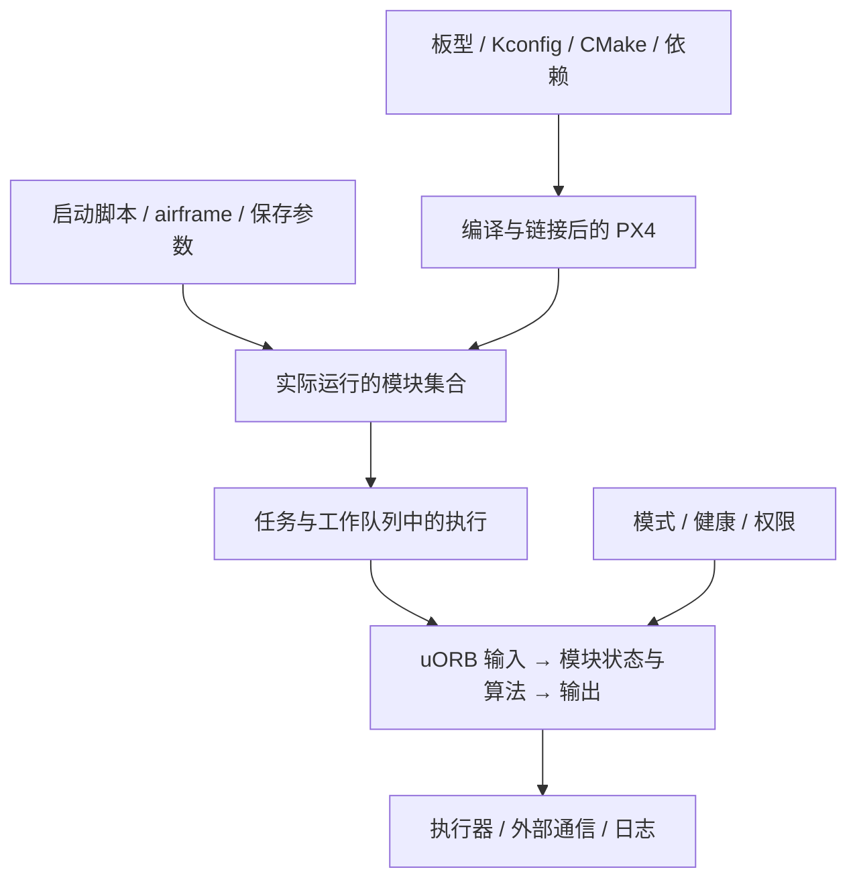

# PX4 代码架构与开发指南

配套实操：[开发调试实战](DEBUGGING.md)，覆盖 lab/VS Code、第一次源码修改、GDB、日志、测试、性能以及板端调试。硬件与仿真系统的组成见[技术架构详解](ARCHITECTURE.md)。

[文档首页](README.md) · [系统架构与技术原理](TECHNICAL.md) · [学习路线](ROADMAP.md) · [操作与调试手册](OPERATIONS.md)

本篇面向第一次进入 PX4 工程、希望最终能够独立定位和开发功能的读者。先建立源码与运行系统的对应关系，再理解构建、启动、调度和接口，随后沿真实功能路径阅读，最后完成一个包含参数、运行行为和验证的开发练习。

系统原理回答“需要哪些能力、为何这样设计”；本篇回答“代码如何实现这些能力、从哪里改、会影响什么”。实际工具步骤在操作手册中，阅读时会给出直接入口。源码基线用于复现，见[环境约定](OPERATIONS.md#environment)。

## 目录

1. [软件架构与工程全景](#d1)
2. [目录、模块与外部依赖](#d2)
3. [从构建配置到可执行程序](#d3)
4. [从进程启动到模块运行](#d4)
5. [执行模型与模块生命周期](#d5)
6. [uORB、参数、事件与持久化](#d6)
7. [核心功能与代码模块对应](#d7)
8. [贯通三条实际实现路径](#d8)
9. [完成第一个工程改动](#d9)
10. [不同类型功能的开发方法](#d10)
11. [验证与调试的工程闭环](#d11)
12. [源码学习与问题研究方法](#d12)

<a id="d1"></a>
## 1. 软件架构与工程全景

### 1.1 同一套代码需要三张图

**构建图**回答哪些文件成为程序：板型配置选模块，模块声明源文件和库依赖，生成器处理消息和参数，编译器生成目标文件，链接器组成程序。没有进入构建图的源码不会改变当前固件。

**运行图**回答哪些功能在执行：启动脚本创建模块，模块通过独立任务或工作队列运行，消息连接它们。已编入的模块可能未启动；已启动的控制器可能被当前模式停用。

**功能图**回答行为如何产生：测量处理和估计形成状态，管理与导航形成行为和目标，控制与分配形成执行器作用。一个功能可能穿过多个模块，一个模块也可能执行多种模式下的逻辑。



例如新增控制模块后，必须分别确认它被构建、被启动、取得执行时间、读到有效输入、获准产生输出。把这些检查压缩为“编译成功”会遗漏大部分运行条件。

### 1.2 模块、算法库与平台服务

以多旋翼位置控制为例：`MulticopterPositionControl` 订阅状态与目标，管理采样间隔、参数、起飞状态和控制启用条件；`PositionControl` 计算位置/速度误差与受约束推力；`ControlMath` 处理推力方向和姿态的转换。uORB、时间接口与工作队列提供运行设施。

这使算法能够在没有整架飞机的测试中验证，也使模块能够替换数据来源而复用算法。开发时应保持这种分离：网络收包和设备读写不属于纯控制数学函数；算法测试通过也不能证明订阅、调度和模式门控正确。

PX4 的大量模块通过消息协作，而不是由一个中心函数依次调用全部模块。代码调用图适合分析单个模块内部；跨模块关系需要看发布/订阅、触发源、时间与状态。

### 1.3 POSIX 与 NuttX 的共同部分和差异

SITL 在宿主操作系统运行，通常把多个 PX4 模块组织在一个进程的不同执行上下文中；NuttX 使用嵌入式任务、驱动和有限硬件资源。相同 C++ 算法可以复用，但调度、设备、时钟、内存边界和启动路径不同。

不要假设一个 Shell 命令就是一个 Linux 进程，也不要假设一个 C++ 类就是一个线程。先找到模块采用的基类、启动函数与执行方式，再判断它的并发和阻塞行为。NuttX 的构建模式还可能引入内核/用户空间区别，不能把所有板型当成相同的地址空间模型。

<a id="d2"></a>
## 2. 目录、模块与外部依赖

### 2.1 目录承担什么职责

| 目录 | 工程职责 | 阅读或修改的典型目的 |
|---|---|---|
| [src/modules](../src/modules) | 估计、控制、管理、导航、通信等运行模块 | 改变系统行为或追踪消息 |
| [src/lib](../src/lib) | 数学、控制、设备封装与公共库 | 研究算法、复用能力、独立测试 |
| [src/drivers](../src/drivers) | 具体设备与输出接口 | 集成传感器、电调和总线设备 |
| [src/systemcmds](../src/systemcmds) | Shell 系统工具 | listener、perf、failure 等诊断入口 |
| [src/examples](../src/examples)、[src/templates](../src/templates) | 示例与模块模板 | 学习生命周期和注册方式 |
| [platforms](../platforms) | 公共运行设施与 NuttX/POSIX 适配 | 调度、时间、uORB、平台移植 |
| [boards](../boards) | 板级资源和功能配置 | 确定固件身份、启用模块、适配硬件 |
| [ROMFS](../ROMFS) | 启动资源与机型配置 | 解释实际启动集合及默认值 |
| [msg](../msg) | 消息定义 | 核对字段、单位、队列、版本和接口 |
| [cmake](../cmake)、根 Makefile/CMakeLists | 构建设施 | 分析选择、依赖和代码生成 |
| [Tools](../Tools) | 构建、生成、仿真、格式与维护工具 | 工程自动化 |
| [test](../test) | 测试基础设施与集成测试 | 找到可控验证入口 |
| `build/` | 本机构建与运行产物 | 可执行文件、生成头、缓存、SITL 数据 |

算法不一定全在 `src/lib`。例如 EKF 的主要实现位于 `src/modules/ekf2/EKF`，姿态与位置算法分别在对应模块的子目录。应依据依赖和接口理解分层，不按目录名字机械判断。

### 2.2 一个模块的文件组合

以 [work_item](../src/examples/work_item) 为例，`Kconfig` 描述可选功能，`CMakeLists.txt` 声明编译目标与运行命令，头文件保存状态和接口，`.cpp` 实现生命周期与处理。其他模块还可能包含 `module.yaml`、参数 `.c`、算法库和测试。

三个名称应分别记录：目录 `work_item`、构建目标 `examples__work_item`、命令 `work_item_example`。编译器错误通常引用源文件或构建目标，Shell 使用 MAIN 命令，搜索目录名不能替代核对这三者。

### 2.3 子模块的用途与版本原则

主仓库 gitlink 锁定依赖提交，`.gitmodules` 记录来源。学习主工程时先使用锁定组合；只有明确修改依赖接口时，才单独管理该依赖的分支与兼容性。不能把每个子模块各自升级到最新版本，再期待它们自然匹配。

| 子模块路径 / 类别 | 用途 | 学习时机 |
|---|---|---|
| `src/modules/mavlink/mavlink` | MAVLink 消息定义与生成相关内容 | MAVLink 通信集成 |
| `src/drivers/gps/devices` | GNSS 协议解析和设备支持 | GNSS 与设备驱动 |
| `platforms/nuttx/NuttX/nuttx`、`apps` | 真机 RTOS 及配套应用 | 板级平台与硬件部署 |
| `Tools/simulation/gz` | Gazebo 模型和世界 | 场景建模与仿真验证 |
| `Tools/simulation/jmavsim/jMAVSim` | jMAVSim 仿真 | 使用该仿真后再研究 |
| `Tools/simulation/gazebo-classic/sitl_gazebo-classic` | Gazebo Classic 接口 | 维护相关旧环境时研究 |
| `Tools/simulation/jsbsim/jsbsim_bridge`、`Tools/simulation/flightgear/flightgear_bridge` | 其他飞行动力学/可视化桥接 | 对应机型与仿真专题 |
| `src/modules/uxrce_dds_client/Micro-XRCE-DDS-Client` | DDS 轻量客户端 | ROS/DDS 集成 |
| `src/lib/cdrstream/cyclonedds`、`rosidl` | 序列化和消息工具依赖 | 深入 DDS 编码时 |
| `src/modules/zenoh/zenoh-pico` | Zenoh 通信支持 | 通信扩展专题 |
| `src/drivers/cyphal/libcanard`、两组 data_types | Cyphal 协议栈与数据类型 | CAN 设备集成 |
| `src/drivers/uavcan/libdronecan/dsdl`、嵌套 `pydronecan` | DroneCAN 数据类型与生成 | DroneCAN 设备集成 |
| `src/lib/events/libevents` | 结构化事件支持 | 事件定义与地面站显示 |
| `src/lib/crypto/monocypher`、`libtomcrypt`、`libtommath` | 加密、签名及大整数等支持 | 对应安全/日志功能 |
| `src/lib/heatshrink/heatshrink` | 压缩支持 | 对应存储/压缩功能 |
| `test/fuzztest` | 测试依赖 | 首次构建相关测试 |
| `src/lib/tensorflow_lite_micro/tflite_micro` | 嵌入式推理 | 机器学习控制专题 |
| `boards/modalai/voxl2/libfc-sensor-api` | VOXL2 传感器接口 | 使用该平台时 |
| `src/drivers/actuators/vertiq_io/iq-module-communication-cpp` | Vertiq 执行器通信 | 使用该设备时 |
| `src/drivers/ins/microstrain/mip_sdk`、`sbgECom` | 特定组合惯导设备 SDK | 使用对应 INS 时 |

PX4 核心算法并不都藏在子仓库里。当前 EKF 主要代码就在 `src/modules/ekf2/EKF`；控制器和分配器也可直接在主仓库阅读。先掌握主线，再按遇到的设备或协议进入依赖，学习范围才会始终服务于具体问题。


<a id="d3"></a>
## 3. 从构建配置到可执行程序

### 3.1 构建输入与选择过程

`make px4_sitl_default` 选择厂商 `px4`、板/平台 `sitl`、配置 `default`。Make 是用户入口，实际配置交给 CMake，编译通常由 Ninja 执行。真机目标如 `px4_fmu-v6x_default` 会选择不同平台、工具链、资源和打包步骤。

构建输入包含源码、依赖提交、`.px4board`、Kconfig、编译工具及构建类型。Kconfig 决定功能集合和依赖，CMake 将所选模块目录加入构建，再汇总公共库与生成步骤。入口可沿 [Makefile](../Makefile) → [kconfig.cmake](../cmake/kconfig.cmake) → [CMakeLists.txt](../CMakeLists.txt) 阅读。

`CONFIG_EXAMPLES_WORK_ITEM=y` 表示允许编入工作队列示例。其 `.cpp` 存在并不意味着被编译；即使编入，也要通过 start 或脚本启动。条件编译还可能使同一文件在不同目标中保留不同分支。

使用 `make px4_sitl_default boardconfig` 打开本实现提供的板级配置界面；修改前先读 [kconfig.cmake](../cmake/kconfig.cmake) 中对应目标，修改后检查 `.px4board` 差异。NuttX 系统配置与 PX4 模块配置属于不同层，不能把两套配置菜单混为一谈。

### 3.2 模块和库怎样进入链接

模块的典型注册形式如下，名字仅作结构示意：

```cmake
px4_add_module(
    MODULE examples__example_name
    MAIN example_name
    SRCS Example.cpp
    DEPENDS px4_work_queue
)
```

`MODULE` 是构建目标，`MAIN` 关联运行入口，`SRCS` 是输入，`DEPENDS` 连接需要的库和相关构建属性。实现见 [px4_add_module.cmake](../cmake/px4_add_module.cmake)。不要依靠某个偶然的全局 include 路径或间接链接来隐藏模块真实依赖。

纯算法可用 `px4_add_library` 组织，再由模块和测试共同链接。位置控制的 [CMakeLists.txt](../src/modules/mc_pos_control/PositionControl/CMakeLists.txt) 同时注册算法库和 GTest，就是这种分离的实际例子。

### 3.3 自动生成的接口

消息定义生成结构体与 uORB 元信息，参数定义生成参数表及包装接口，模块元数据也参与配置与文档生成。外部 DDS 接口另有选题和类型生成过程。

编辑 `.msg` 后应重新构建其消费者；添加参数后要确保定义文件进入对应构建/扫描范围。修改 `build/` 中的生成头文件会在重新生成时丢失。`msg/` 中的文件还需按 [msg/CMakeLists.txt](../msg/CMakeLists.txt) 的规则注册，不能仅创建文件就认定它已成为可用主题。

消息结构改变会影响发布、订阅、日志和外部桥接。参数改变会影响默认值、已有保存配置及行为。接口改动的验证范围通常比本次源代码行数更大。

### 3.4 产物、编译类型与缓存

| 产物 | 用途 | 不能混淆的对象 |
|---|---|---|
| SITL `bin/px4` | 在宿主平台执行 | MCU 固件 |
| 板级 ELF | 链接结果、符号、地址和调试 | 可直接交给所有刷写工具的包 |
| `.px4` 固件包 | 对应板型的打包结果 | 启动加载器或其他板型固件 |
| `compile_commands.json` | 每个源文件的真实编译参数 | 手工填写的一组 include 猜测 |
| `CMakeCache.txt`、Ninja 规则 | 构建状态和绝对路径 | 可随意搬到另一挂载路径的通用文件 |
| `rootfs` | SITL 启动和运行状态 | 永久源码目录 |

Debug 便于检查变量和单步，RelWithDebInfo 保留符号且启用优化，板卡常使用适合资源约束的配置。优化后的变量可能消失或移动，不能把源码行与机器指令一一等同。

增量构建依据依赖图重编受影响目标；ccache 复用编译结果。二者都不是“没有重新运行代码”的证据。路径变更、配置变更或旧运行参数会形成不同种类的状态问题，需要分别处理。实际构建与恢复方法见[操作手册第 3 章](OPERATIONS.md#s3)。

<a id="d4"></a>
## 4. 从进程启动到模块运行

### 4.1 POSIX 启动链

POSIX 的程序入口位于 [main.cpp](../platforms/posix/src/px4/common/main.cpp)。它解析实例、工作目录、启动脚本与数据路径，建立平台环境，再运行默认或指定脚本。`rootfs` 用于参数、dataman、日志等运行数据。

默认 SITL 脚本 [init.d-posix/rcS](../ROMFS/px4fmu_common/init.d-posix/rcS) 根据模型/配置确定 airframe、准备参数、选择仿真路径，并启动需要的模块。`make px4_sitl sihsim_quadx` 先确保构建成立，再由 SIH 自定义目标带模型环境变量执行 PX4；它不是另一份飞控算法。

跟踪启动时至少核对：使用哪个二进制、从哪个目录运行、选择哪个 airframe、加载什么保存参数、启动哪些模块。直接双击某个 ELF 或从另一个目录执行，可能没有恢复这组条件。

### 4.2 NuttX 启动链

板卡从复位和启动加载器进入固件，完成操作系统和板级初始化，再启动 PX4 服务与应用。平台入口见 [px4_init.cpp](../platforms/nuttx/src/px4/common/px4_init.cpp)，主启动资源见 [init.d/rcS](../ROMFS/px4fmu_common/init.d/rcS)。具体启动加载器、内核模式和外设初始化取决于板型。

板级代码描述总线和资源，板级启动脚本启动设备，机型脚本配置载具几何与默认值，应用脚本选择控制模块。这几层共同决定最终系统。增加设备时既要进入构建，也要匹配实际总线与启动探测。

### 4.3 机型与参数的作用

以多旋翼为例，airframe 设置几何、执行器功能和默认配置，[rc.mc_apps](../ROMFS/px4fmu_common/init.d/rc.mc_apps) 启动多旋翼控制链。固定翼与 VTOL 使用对应脚本和模块组合。

`param set-default` 修改配置提供的默认值，`param set` 明确设置实际参数；已有保存值可能影响结果。参数的定义、默认值、保存值、模块缓存和行为已经捕获的目标属于不同层。修改默认值后行为没变，应沿这些层核对，不应先反复重编。

### 4.4 Shell 与模块入口

PX4 Shell 将命令交给已注册的入口。典型模块入口调用 `ModuleBase<T>::main()`，进一步分派 start、stop、status 或自定义命令。`start` 负责创建运行实例，后续实际处理可能发生在另一个线程/队列。

SITL 的 `pxh>`、板上 NSH/系统控制台、MAVLink Shell、Linux Bash 与 GDB 都是不同入口。MAVLink Shell 依赖固件及通信已经正常运行，因此不能代替捕获早期启动故障的物理控制台。具体连接方式见[调试专题](OPERATIONS.md#e1)。

<a id="d5"></a>
## 5. 执行模型与模块生命周期

### 5.1 独立任务与工作队列

独立任务拥有自己的执行上下文，可以在有界循环中等待事件；WorkItem 由队列线程调用，每轮 `Run()` 应迅速完成并返回。同队列其他工作项会受到阻塞、打印、锁竞争和计算时间的影响。

`ScheduledWorkItem` 可按周期或延迟调度；`SubscriptionCallbackWorkItem` 可在主题更新时安排执行。回调是触发机制，不意味着整个消费者在生产者的上下文同步执行。多次调度也不保证与每个发布样本一一对应，消费策略仍由订阅和队列决定。

代码里的 4 ms 周期是设计意图，实际完成时间受负载和调度影响。算法 dt 应来自正确的时间依据，不能永远假设固定间隔。模拟时间、宿主时间和外部设备时间又是不同的时钟域。

### 5.2 以 WorkItemExample 阅读完整生命周期

沿 [WorkItemExample.cpp](../src/examples/work_item/WorkItemExample.cpp) 的顺序阅读：

1. 入口交给 `ModuleBase` 处理命令。
2. `task_spawn()` 分配对象，记录工作队列类型，调用 `init()`。
3. 分配对象时会先运行构造函数，选择队列并初始化参数与成员。
4. `init()` 注册加速度消息回调，建立运行触发。
5. `Run()` 先检查退出，再处理参数、状态、测量，最后发布教学主题。
6. stop 请求需要被执行轮次处理；清理调度后释放对象和资源。

订阅回调析构会注销回调；实时模块常在退出路径显式注销，使清理顺序清楚。若采用新的触发源，必须一起检查退出和重新启动，不能只改计算部分。

### 5.3 输入、状态与输出的寿命

局部变量只服务本轮，成员变量保存跨轮状态，参数缓存保存配置，uORB 保存消息，dataman 保存任务等数据。把它们混用会产生典型错误：上一轮无效数据仍被使用、stop/start 沿用旧参考、参数已更新而内部派生值未重算。

每个模块应明确五种状态：未初始化、等待输入、正常处理、输入退化、停止清理。对于控制模块，还要说明当前模式停用时如何处理积分、旧目标和输出。恢复数据后是否允许立即继续，由行为契约决定。

### 5.4 并发和时效问题

发布一条消息不会使所有消费者同时完成。某个模块的两个输入也可能来自不同时刻：最新姿态和最近一次位置可能具有不同采样时间。应明确谁触发执行、允许使用多旧的辅助输入、是否需要时间补偿。

排查时把“没有调度”“调度后没有新输入”“新输入无效”“处理后被输出门控”分开。对应证据分别是队列/执行统计、订阅代次或时间戳、有效性标志、控制模式与发布条件。

<a id="d6"></a>
## 6. uORB、参数、事件与持久化

### 6.1 消息定义与消费语义

消息是模块间的数据契约。阅读一个主题时，同时看 `.msg`、发布点和消费点：字段注释解释单位和约定，发布点说明实际数据来源，消费点说明有效性和时效要求。名称相近不能代替这三处证据。

`update(&data)` 在有新数据时读取；返回 false 时不能把保留的旧结构当成本轮新样本。`copy()` 尝试复制可读取数据，不代表它刚产生；队列主题与普通状态主题还存在不同消费行为。

```cpp
vehicle_local_position_s position{};
if (_local_position_sub.update(&position)) {
    // 这里只证明取得了更新。
    // 使用前仍需检查单位、时间、valid、有限值和参考重置。
}
```

一个主题可有多个实例；选择传感器或 EKF 时要确认实例身份。消息队列只能容纳有限样本，慢消费者可能丢失中间值。增加队列深度会消耗内存，并可能让消费者处理过期状态；它不是所有丢样问题的统一答案。

### 6.2 参数如何影响实际功能

参数通过定义与生成进入参数系统，模块用 `ModuleParams`/`DEFINE_PARAMETERS` 获取缓存值，通过 `parameter_update` 刷新。参数元数据可声明范围和重启要求，但控制代码仍要处理异常或不适用的配置。

以起飞高度为例，默认值进入参数系统，Navigator 在适当时机读取，随后形成导航目标和轨迹。行为启动后修改参数是否改变当前轨迹，必须看消费者读取时机。把“读回成功”解释为“正在执行的动作一定立即变化”是不成立的。

参数实验应记录原值、修改值、实际消费时机与恢复结果。日志中的初始参数和动态参数变化可用于重建实验条件，不能只保存一张 QGC 截图。

### 6.3 命令、事件与状态

`vehicle_command` 表示请求，ACK 表示命令处理结果，`vehicle_status` 等表示运行状态，事件提供结构化诊断。命令接受后还要等待动作完成；事件出现也不等于可以忽略实际状态。

需要跨断线或重复发送的命令，应考虑请求身份、幂等性、超时和重试。连续状态通常消费最新样本；离散事件则更关注顺序和遗漏。选择消息和队列时，应先确定语义，再决定结构体字段。

### 6.4 存储与日志

参数、任务数据、运行状态和日志具有不同寿命。dataman 支持任务等数据的持久化；ULog 保存运行证据；uORB 的最后一个样本不是历史数据库。保存参数也不会自动保存全部模块内部状态。

日志主题、采样间隔、实例和写入吞吐共同决定可分析的信息。新模块能被 `listener` 看到，不意味着已被 logger 记录。增加日志应说明要验证哪个问题及所需频率，并核对不会挤占关键实时资源。

### 6.5 一条 uORB 消息在内部怎样传递

理解 API 后，再沿内部实现追踪一次发布与读取。主线是消息元信息、主题实例节点、数据缓冲与订阅者的读取进度：

```text
消息定义 → 生成结构体和元信息
发布者 → advertise 找到/建立主题实例 → publish 拷贝样本、推进 generation
                                            ↓
                         通知 poll 等待者或调用已注册回调
                                            ↓
订阅者 → 比较自己的 generation → copy/update 取样 → 更新读取进度
```

| 实现入口 | 要理解的机制 |
|---|---|
| [Publication.hpp](../platforms/common/uORB/Publication.hpp) | 第一次发布可先 advertise；发布把结构体交给 Manager |
| [uORBManager.cpp](../platforms/common/uORB/uORBManager.cpp) | 主题与实例查找、发布及内部订阅接口 |
| [uORBDeviceNode.cpp](../platforms/common/uORB/uORBDeviceNode.cpp)、[头文件](../platforms/common/uORB/uORBDeviceNode.hpp) | 按元信息分配/使用缓冲，保护拷贝，推进代次并通知 |
| [Subscription.hpp](../platforms/common/uORB/Subscription.hpp)、[实现](../platforms/common/uORB/Subscription.cpp) | 保存实例和自己的读取代次，区分 updated、copy 与 update |
| [SubscriptionCallback.hpp](../platforms/common/uORB/SubscriptionCallback.hpp) | 在新数据通知中安排工作项运行 |

每个订阅者拥有自己的读取进度，一个消费者读取消息不会把另一个消费者的样本“拿走”。队列深度为 1 时，中间发布可被新状态覆盖；更深队列只能保留有限历史，慢消费者仍会落后。模块需要根据语义选择“处理全部保留事件”或“采用最新状态”，而不是默认每个发布都会触发一次完整计算。

`DeviceNode::write()` 在保护区域内写数据并调用注册回调；`SubscriptionCallbackWorkItem::call()` 的关键工作是 `ScheduleNow()`，真正的 `Run()` 随后由工作队列执行。回调函数本身应短小，不能在这个发布路径上加入阻塞计算。跨平台的保护实现不同，也不能把“结构体拷贝被保护”理解为多个主题构成原子快照。

同一主题的多个发布者不会自动获得控制权仲裁；多实例也不会自动替系统选择最佳传感器。实例选择、模式门控和超时判断仍由相应模块负责。到这里，才能把“消息总线”与调度、控制权、数据一致性三个问题分清楚。

<a id="d7"></a>
## 7. 核心功能与代码模块对应

下表用于从系统问题进入实现。先选负责该行为的层，再沿输入输出追踪；不要把整表当成需要一次读完的文件清单。

| 功能域 | 主要实现入口 | 对外职责与重点接口 |
|---|---|---|
| 传感器组织 | [sensors](../src/modules/sensors) | 校准、选择、聚合，形成 IMU/角速度等输入 |
| 姿态、速度和位置估计 | [EKF2](../src/modules/ekf2/EKF2.cpp)、[EKF](../src/modules/ekf2/EKF) | 观测接入、融合和估计输出 |
| 多估计器选择 | [EKF2Selector](../src/modules/ekf2/EKF2Selector.cpp) | 实例健康比较与输出选择 |
| 飞行管理 | [Commander](../src/modules/commander/Commander.cpp) | 模式、解锁、命令处理和系统状态 |
| 健康与保护 | [HealthAndArmingChecks](../src/modules/commander/HealthAndArmingChecks)、[failsafe](../src/modules/commander/failsafe) | 可用性与动作选择 |
| 手动输入 | [manual_control](../src/modules/manual_control)、[rc_update](../src/modules/rc_update) | 输入源、操纵意图与超时 |
| 自动导航 | [navigator](../src/modules/navigator) | Mission、Takeoff、Land、RTL 与导航目标 |
| 多旋翼目标生成 | [flight_mode_manager](../src/modules/flight_mode_manager) | 将模式输入转为 trajectory_setpoint |
| 多旋翼位置控制 | [mc_pos_control](../src/modules/mc_pos_control) | 局部状态与轨迹 → 姿态/推力目标 |
| 多旋翼姿态控制 | [mc_att_control](../src/modules/mc_att_control) | 姿态误差 → 角速度目标 |
| 多旋翼角速度控制 | [mc_rate_control](../src/modules/mc_rate_control) | 角速度 → 力矩与推力请求 |
| 执行器分配 | [control_allocator](../src/modules/control_allocator) | 整体作用 → 逻辑电机/舵机 |
| 输出功能与驱动 | [mixer_module](../src/lib/mixer_module)、[pwm_out](../src/drivers/pwm_out)、[dshot](../src/drivers/dshot) | 功能映射、门控与电气协议 |
| 固定翼 | [fw_mode_manager](../src/modules/fw_mode_manager)、[fw_lateral_longitudinal_control](../src/modules/fw_lateral_longitudinal_control) | 路径、空速与能量控制；下接姿态/角速度链 |
| VTOL | [vtol_att_control](../src/modules/vtol_att_control) | 过渡和控制/执行器协调 |
| 车辆 | [rover_ackermann](../src/modules/rover_ackermann)、[rover_differential](../src/modules/rover_differential)、[rover_mecanum](../src/modules/rover_mecanum) | 运动学约束与驱动控制 |
| 着陆状态 | [land_detector](../src/modules/land_detector) | 接地、可能落地、落地判定 |
| MAVLink | [mavlink](../src/modules/mavlink) | 遥测编码、命令/参数/任务协议 |
| DDS | [uxrce_dds_client](../src/modules/uxrce_dds_client) | 选定 uORB 消息与外部 DDS 通信 |
| 载荷 | [camera_trigger](../src/drivers/camera_trigger)、[gimbal](../src/modules/gimbal)、[payload_deliverer](../src/modules/payload_deliverer) | 触发、云台和业务动作 |
| 存储与证据 | [dataman](../src/modules/dataman)、[logger](../src/modules/logger)、[replay](../src/modules/replay) | 任务数据、历史记录与离线重算 |
| 仿真接口 | [simulator_sih](../src/modules/simulation/simulator_sih)、[gz_bridge](../src/modules/simulation/gz_bridge) | 物理模型或外部仿真数据接入 |

进一步阅读时，每个模块只先记录：谁启动、何时执行、关键输入、内部状态、输出、异常行为。然后再进入算法或协议细节。

<a id="d8"></a>
## 8. 贯通三条实际实现路径

### 8.1 IMU 到控制输出：数据与时间的路径

从 [BMI088_Gyroscope.cpp](../src/drivers/imu/bosch/bmi088/BMI088_Gyroscope.cpp) 的状态机和 FIFO 读取进入，追到 [PX4Gyroscope.cpp](../src/lib/drivers/gyroscope/PX4Gyroscope.cpp)，确认量程换算、样本时间、设备标识及消息发布。

之后分成两条重要路径：[VehicleIMU.cpp](../src/modules/sensors/vehicle_imu/VehicleIMU.cpp) 积分并形成供估计器使用的运动增量；[VehicleAngularVelocity.cpp](../src/modules/sensors/vehicle_angular_velocity/VehicleAngularVelocity.cpp) 形成供角速度控制使用的低延迟测量。不要把积分量当角速度，也不要根据位置估计器的频率推断角速度环频率。

角速度测量进入 [MulticopterRateControl.cpp](../src/modules/mc_rate_control/MulticopterRateControl.cpp)，与目标比较后调用 [RateControl](../src/lib/rate_control/rate_control.cpp)，发布力矩/推力；[ControlAllocator.cpp](../src/modules/control_allocator/ControlAllocator.cpp) 再使用几何和限制生成执行器请求。输出驱动完成逻辑功能到物理通道的转换。

学习产出是一张带单位、采样时间、触发源和消费者的图。若最终电机异常，能沿它区分设备、测量、控制、分配和输出问题。

### 8.2 航点任务到运动：行为与目标的路径

[mavlink_mission.cpp](../src/modules/mavlink/mavlink_mission.cpp) 接收任务协议，dataman 和任务状态保存完整任务；[mission_feasibility_checker.cpp](../src/modules/navigator/mission_feasibility_checker.cpp) 检查相应可行性；Navigator 的 Mission 行为决定当前任务项。

自动导航通过 `position_setpoint_triplet` 提供目标关系。多旋翼 [FlightTaskAuto.cpp](../src/modules/flight_mode_manager/tasks/Auto/FlightTaskAuto.cpp) 结合估计、限制和路径关系生成轨迹。位置控制模块取得轨迹，检查模式、时间和状态，再调用 PositionControl。

这里存在两个闭环：任务层检查是否到达并推进任务，控制层连续跟踪运动目标。地图上“经过某点”、任务项“已到达”和位置控制“误差为零”不是同一判据。研究到达行为应读任务状态机，研究超调才进一步进入轨迹和控制。

### 8.3 Offboard 到控制模式：接口与权限的路径

在 [mavlink_receiver.cpp](../src/modules/mavlink/mavlink_receiver.cpp) 中定位 `handle_message_set_position_target_local_ned()`。阅读目标身份、坐标系和 type mask 的处理，再看 `offboard_control_mode` 与 `trajectory_setpoint` 的发布条件。

之后读 [offboardCheck.cpp](../src/modules/commander/HealthAndArmingChecks/checks/offboardCheck.cpp) 对信号时间及估计需求的判断，以及 Commander 对实际模式的选择。预先发送 setpoint 可以建立可用信号，只有实际进入对应模式才按该路径发布可执行轨迹；接收端看到 UDP 不足以证明目标生效。

把程序断流放进同一条路径：最后目标时间 → 可用性检查 → 保护动作选择 → 实际模式 → 新的目标生成。这条路径解释的是控制权交接，不能只用 Python 的 send 返回值判断成功。

### 8.4 参数横跨上述路径

以 `MIS_TAKEOFF_ALT` 为例，从定义搜索消费者，再连接 Takeoff 的目标建立和轨迹。以 `MPC_XY_CRUISE` 为例，连接导航运动限制与轨迹生成。以角速度增益为例，连接参数刷新、缩放和 RateControl。

这三类参数分别影响行为终点、运动计划和闭环响应。先定位影响层，再设计对照实验，才能避免把所有变化都解释为“调 PID”。

<a id="d9"></a>
## 9. 完成第一个工程改动

本练习串起参数定义、构建注册、模块状态、调度、消息和运行验证。它只使用教学主题，不接管控制目标。完成后仍需学习真实算法与系统模块，不能把这个练习当作掌握飞控的终点。

### 9.1 行为要求

修改现有 `work_item_example`：启动后按参数指定周期发布计数样本；周期允许 20～2000 ms；参数变化后更新调度；停止后不再发布，重新启动从初始计数开始。先保存该目录已有改动，避免混入两个不同实验。

### 9.2 参数定义与构建输入

在 `src/examples/work_item/` 新建 `learn_period_params.c`：

```c
/**
 * Teaching module publication period
 *
 * @unit ms
 * @min 20
 * @max 2000
 * @group Learning
 */
PARAM_DEFINE_INT32(LEARN_PERIOD, 100);
```

这个 `.c` 文件是参数扫描器的输入，**不加入模块的 `SRCS` 编译列表**。本实现的 [parameters/CMakeLists.txt](../src/lib/parameters/CMakeLists.txt) 根据启用模块路径扫描参数定义，并收集 `*params.c` 等文件作为生成依赖；`work_item` 已在默认 SITL 配置中启用。宏由生成器解析，这份文件不是普通的独立 C 编译单元。

在 `WorkItemExample.hpp` 的 `DEFINE_PARAMETERS` 中保留原参数并增加新成员，注意逗号：

```cpp
DEFINE_PARAMETERS(
    (ParamInt<px4::params::SYS_AUTOSTART>) _param_sys_autostart,
    (ParamInt<px4::params::SYS_AUTOCONFIG>) _param_sys_autoconfig,
    (ParamInt<px4::params::LEARN_PERIOD>) _param_learn_period
)
```

在 private 区域增加：

```cpp
void update_schedule();
uint32_t _period_us{0};
uint32_t _sample_count{0};
```

### 9.3 实现调度与单轮处理

在 `.cpp` 加入 `update_schedule()`，替换原 `init()` 和 `Run()`，其余入口、状态输出和析构保持原结构：

```cpp
void WorkItemExample::update_schedule()
{
    updateParams();
    const int32_t requested_ms = _param_learn_period.get();
    const int32_t bounded_ms = requested_ms < 20 ? 20
        : (requested_ms > 2000 ? 2000 : requested_ms);
    const uint32_t period_us = static_cast<uint32_t>(bounded_ms) * 1000U;

    if (period_us != _period_us) {
        _period_us = period_us;
        ScheduleOnInterval(_period_us);
    }
}

bool WorkItemExample::init()
{
    update_schedule();
    return true;
}

void WorkItemExample::Run()
{
    if (should_exit()) {
        ScheduleClear();
        exit_and_cleanup();
        return;
    }

    perf_begin(_loop_perf);
    perf_count(_loop_interval_perf);

    if (_parameter_update_sub.updated()) {
        parameter_update_s update{};
        _parameter_update_sub.copy(&update);
        update_schedule();
    }

    orb_test_s sample{};
    sample.timestamp = hrt_absolute_time();
    sample.val = static_cast<int32_t>(_sample_count % 100000U);
    ++_sample_count;
    _orb_test_pub.publish(sample);
    perf_end(_loop_perf);
}
```

新 `init()` 不再注册原 sensor_accel 回调；否则可能同时由传感器与定时器触发。原有其他成员可在后续清理，但不能把有其他用途的真实模块订阅照此删掉。

周期在运行时再次限幅，是因为参数元数据不应成为唯一边界。计数使用有限范围的教学输出；停止和重新创建对象会重新初始化成员。参数更新订阅有节流，变化生效可能晚于输入命令，需等待若干轮并核对实际频率。

### 9.4 编译与验证

新增参数文件后，先重新配置，让文件集合和生成依赖包含新文件，再构建。在宿主执行：

```bash
git status --short -- src/examples/work_item
git diff -- src/examples/work_item
~/embedded-lab/bin/lab exec px4-main -- cmake -S . -B build/px4_sitl_default -DCONFIG=px4_sitl_default
~/embedded-lab/bin/lab exec px4-main -- make px4_sitl_default -j2 PX4_MAKE_ARGS=-j2
```

`git diff` 不显示尚未跟踪文件的内容，因此新参数文件也需直接打开审查。编译后可在宿主执行 `rg -n 'LEARN_PERIOD' build/px4_sitl_default/parameters.xml` 确认进入生成参数表；无需手工编辑该产物。

启动 SIH 后，在 PX4 记录当前参数，再按步骤操作：

```text
param show LEARN_PERIOD
param set LEARN_PERIOD 100
work_item_example start
listener orb_test
work_item_example status
```

用 `uorb top` 观察接近 10 Hz 的发布率，按回车退出。把周期改为 200 ms，等待更新后观察接近 5 Hz。随后 stop，检查时间戳停止推进；再 start，检查计数重新开始。实验结束 stop，并恢复记录的参数值。

若参数找不到，检查定义是否进入构建与生成；参数读回正确但频率不变，检查参数更新、调度来源及是否运行新二进制；频率正确但 stop 无效，检查退出处理。每种失败对应不同工程层，不应统一归因于编译缓存。

<a id="independent-module"></a>
### 9.5 扩展为独立模块

理解本例后，可以在 `src/examples/learn_periodic/` 建立独立教学模块。复制本次练习的头文件、实现和参数定义，保留原许可信息；将新目录中的标识按下表统一替换：

| 原标识 | 独立模块标识 | 要修改的位置 |
|---|---|---|
| `WorkItemExample` | `LearnPeriodic` | 类名、模板参数、所有成员定义、对象创建 |
| `WorkItemExample.hpp/.cpp` | `LearnPeriodic.hpp/.cpp` | 文件名与 include |
| `work_item_example` | `learn_periodic` | MAIN、入口 `learn_periodic_main`、帮助输出 |
| `LEARN_PERIOD` | `LEARN_PER_MS` | 新参数定义与包装成员引用，避免两个启用模块重复定义 |

新 `CMakeLists.txt` 可以使用：

```cmake
px4_add_module(
    MODULE examples__learn_periodic
    MAIN learn_periodic
    SRCS LearnPeriodic.cpp LearnPeriodic.hpp
    DEPENDS px4_work_queue
)
```

新 `Kconfig` 内容为：

```kconfig
menuconfig EXAMPLES_LEARN_PERIODIC
    bool "learn_periodic"
    default n
    help
        Enable the periodic learning example
```

[examples/Kconfig](../src/examples/Kconfig) 使用 `rsource "*/Kconfig"` 纳入这些子目录。在目标 `boards/px4/sitl/default.px4board` 启用 `CONFIG_EXAMPLES_LEARN_PERIODIC=y`，重新配置并构建。检查编译数据库包含 `LearnPeriodic.cpp`，生成参数表包含 `LEARN_PER_MS`；在 SIH 执行 `learn_periodic start/status/stop` 验证相同生命周期。命令要分别输入，例如 `learn_periodic start`。

第一次只运行两个教学模块中的一个，因为它们都发布 `orb_test`，不能让两个生产者的样本混在一起后再评价频率。完成独立模块后，逐段审查并清理之前对 `work_item` 的教学改动，保留不属于本练习的已有工作。

此过程说明新增运行功能需要同时完成文件、注册、配置与启动。框架细节继续参考 [ModuleBase](../platforms/common/include/px4_platform_common/module.h) 和 [template_module](../src/templates/template_module)。

如果新增消息，应在消息目录及 CMake 列表注册，并更新订阅者和日志配置；使用教学主题完成首次练习可以先减少这些变量。若采用外部模块目录，研究 `EXTERNAL_MODULES_LOCATION` 的目录与 CMake 契约，不能简单传入一个任意 `.cpp` 路径。

<a id="message-exercise"></a>
### 9.6 为独立模块定义自己的消息

完成 9.5 后，再让 `learn_periodic` 使用自己的状态接口。先写接口含义：每个样本报告本模块的发布时间、当前计数和实际采用的周期；这些字段不表示飞行位置或控制目标。

在 `msg/LearnStatus.msg` 定义：

```text
uint64 timestamp       # Publication time, microseconds since system start
uint32 sample_count    # Counter for this module run; wraps at uint32 maximum
uint32 period_ms       # Applied publication period, milliseconds
```

在 [msg/CMakeLists.txt](../msg/CMakeLists.txt) 的 `set(msg_files ...)` 中加入 `LearnStatus.msg`。按该文件的命名生成规则，头文件为 `uORB/topics/learn_status.h`，类型为 `learn_status_s`，主题为 `learn_status`。不要手工创建生成头文件。

在独立模块的头文件中，用新 include 和发布成员替换原来的 `orb_test` 对应部分：

```cpp
#include <uORB/topics/learn_status.h>
uORB::Publication<learn_status_s> _status_pub{ORB_ID(learn_status)};
```

在 `Run()` 中，用下列代码替换原来的 `orb_test` 发布段，保留退出、参数更新和性能计数：

```cpp
learn_status_s sample{};
sample.timestamp = hrt_absolute_time();
sample.sample_count = _sample_count++;
sample.period_ms = _period_us / 1000U;
_status_pub.publish(sample);
```

重新配置并编译 SITL，启动后分别执行 `learn_periodic start`、`listener learn_status -n 5`，核对时间、计数和周期；修改 `LEARN_PER_MS` 后，字段与实际发布频率应一起改变。停止/重启后计数应重新开始。计数的 uint32 回绕属于这里的接口约定，消费者不能永远假设数值严格递增。

新主题不会因为生成成功就自动进入 MAVLink、DDS 或默认日志。用[日志配置方法](OPERATIONS.md#e3)明确记录它，再用 `ulog_info` 确认日志实际包含该主题。若以后桥接外部应用，单独检查类型生成、版本与订阅者，不把内部接口改动当成纯文件重命名。

**通过标准**：能够从 `.msg` 追到生成结构、发布者、运行样本和日志；能够区分“生成失败”“没有发布”“没有消费”“没有记录”四类问题。

<a id="algorithm-exercise"></a>
### 9.7 把算法与模块分开，并写自己的测试

本节在学习路线[阶段 5](ROADMAP.md#s5)使用，承接[阶段 2](ROADMAP.md#s2)的模块开发基础。目标是学会把一个有明确行为的算法做成库，接入 PX4 测试，再决定怎样接入模块。示例只研究一维参考值的速度限制，不连接飞行控制目标；它不包含加速度或 jerk 平滑。

先定义行为：输入当前参考、目标、非负速度上限和 `0 < dt ≤ 0.2 s`，输出向目标移动一步的参考；每步距离不超过速度上限乘时间，不越过目标；非法输入返回 false，且不改写输出。dt 上限是本教学算法的约定，不是 PX4 全系统限制。

在独立模块下建立 `ReferenceLimiter/`，放置四个文件。`ReferenceLimiter.hpp`：

```cpp
#pragma once
namespace learning
{
bool advance_reference(float current, float target, float speed_limit,
                       float dt, float &next);
}
```

`ReferenceLimiter.cpp`：

```cpp
#include "ReferenceLimiter.hpp"
#include <algorithm>
#include <cmath>

bool learning::advance_reference(float current, float target, float speed_limit,
                                 float dt, float &next)
{
    if (!std::isfinite(current) || !std::isfinite(target)
        || !std::isfinite(speed_limit) || !std::isfinite(dt)
        || speed_limit < 0.f || dt <= 0.f || dt > 0.2f) {
        return false;
    }

    const double delta = static_cast<double>(target) - current;
    const double bound = static_cast<double>(speed_limit) * dt;
    const double step = std::max(-bound, std::min(delta, bound));
    next = static_cast<float>(static_cast<double>(current) + step);
    return true;
}
```

这里用 double 计算中间差值，避免两个合法 float 极值相减时先溢出。算法不读取参数、不访问时钟、不发布消息；调用者负责提供这些输入，并在返回 false 时执行明确的行为。

`ReferenceLimiterTest.cpp`：

```cpp
#include "ReferenceLimiter.hpp"
#include <gtest/gtest.h>
#include <limits>

TEST(ReferenceLimiter, DirectionAndArrival)
{
    float next = 0.f;
    ASSERT_TRUE(learning::advance_reference(0.f, 1.f, 2.f, 0.1f, next));
    EXPECT_NEAR(next, 0.2f, 1e-6f);
    ASSERT_TRUE(learning::advance_reference(0.f, -1.f, 2.f, 0.1f, next));
    EXPECT_NEAR(next, -0.2f, 1e-6f);
    ASSERT_TRUE(learning::advance_reference(0.f, 0.05f, 2.f, 0.1f, next));
    EXPECT_FLOAT_EQ(next, 0.05f);
    ASSERT_TRUE(learning::advance_reference(0.05f, 0.05f, 2.f, 0.1f, next));
    EXPECT_FLOAT_EQ(next, 0.05f);
    ASSERT_TRUE(learning::advance_reference(0.f, 1.f, 0.f, 0.1f, next));
    EXPECT_FLOAT_EQ(next, 0.f);
}

TEST(ReferenceLimiter, SameElapsedTime)
{
    float fine = 0.f;
    float coarse = 0.f;
    for (int i = 0; i < 10; ++i) {
        ASSERT_TRUE(learning::advance_reference(fine, 10.f, 1.f, 0.1f, fine));
    }
    for (int i = 0; i < 5; ++i) {
        ASSERT_TRUE(learning::advance_reference(coarse, 10.f, 1.f, 0.2f, coarse));
    }
    EXPECT_NEAR(fine, 1.f, 1e-6f);
    EXPECT_NEAR(coarse, fine, 1e-6f);
}

TEST(ReferenceLimiter, InvalidInputDoesNotWriteOutput)
{
    float next = 42.f;
    EXPECT_FALSE(learning::advance_reference(0.f, 1.f, 1.f, 0.f, next));
    EXPECT_FLOAT_EQ(next, 42.f);
    EXPECT_FALSE(learning::advance_reference(0.f, 1.f, 1.f, -0.1f, next));
    EXPECT_FLOAT_EQ(next, 42.f);
    EXPECT_FALSE(learning::advance_reference(0.f, 1.f, 1.f, 0.3f, next));
    EXPECT_FLOAT_EQ(next, 42.f);
    EXPECT_FALSE(learning::advance_reference(0.f, 1.f, -1.f, 0.1f, next));
    EXPECT_FLOAT_EQ(next, 42.f);
    EXPECT_FALSE(learning::advance_reference(
        0.f, std::numeric_limits<float>::quiet_NaN(), 1.f, 0.1f, next));
    EXPECT_FLOAT_EQ(next, 42.f);
}
```

这些断言分别检查物理方向与到达、时间尺度一致性、错误输入契约，期望值来自行为要求。继续补充目标反向、极值与模块停止/恢复的验证；上述算法测试不能证明工作队列、消息和模式正确。

子目录 `CMakeLists.txt`：

```cmake
px4_add_library(LearnReference ReferenceLimiter.cpp ReferenceLimiter.hpp)
target_include_directories(LearnReference PUBLIC ${CMAKE_CURRENT_SOURCE_DIR})
px4_add_unit_gtest(SRC ReferenceLimiterTest.cpp LINKLIBS LearnReference)
```

在 `learn_periodic/CMakeLists.txt` 的模块声明之前加入 `add_subdirectory(ReferenceLimiter)`，并在模块 `DEPENDS` 中增加 `LearnReference`。本实现的测试配置叠加于 SITL 默认配置，因此还需保留 9.5 中的模块启用项。测试名由 [px4_add_gtest.cmake](../cmake/px4_add_gtest.cmake)从文件名生成，为 `unit-ReferenceLimiter`。

在宿主构建并验证测试确实命中：

```bash
~/embedded-lab/bin/lab exec px4-main -- cmake -S . -B build/px4_sitl_test -DCONFIG=px4_sitl_test -DTESTFILTER='^unit-ReferenceLimiter$'
~/embedded-lab/bin/lab exec px4-main -- make tests -j2 PX4_MAKE_ARGS=-j2 TESTFILTER='^unit-ReferenceLimiter$'
~/embedded-lab/bin/lab exec px4-main -- ctest --test-dir build/px4_sitl_test --output-on-failure --no-tests=error -R '^unit-ReferenceLimiter$'
```

为验证测试具有区分能力，临时把一次输出改成始终等于目标，应看到限速相关用例失败；恢复实现后重跑。此时不要接入真实控制主题。下一步才在教学模块中维护当前参考、获取实际 dt、调用算法并通过独立状态主题观察，分别验证初始化、参数变化、超长间隔和 stop/start。

**通过标准**：能解释模块与算法的边界，独立注册一个测试，确认故意违反要求时会失败，再用模块运行证据补上算法测试未覆盖的部分。

<a id="d10"></a>
## 10. 不同类型功能的开发方法

### 10.1 修改算法或控制行为

先写清输入、状态、输出和约束，再找纯算法与模块封装的边界。改增益、限制与结构属于不同变化；应明确哪个变化能解决需求。先在小输入测试中检查方向、单位、边界和异常，再接入真实消息进行仿真。

例如加入新的轨迹限制，需要验证不同 dt 下的速度/加速度上限、目标反向、目标变化、初始状态与停止。只用静态正常输入证明函数返回有限数值，不足以证明连续运动正确。控制算法还要检查饱和反馈、积分、起飞/落地和模式切换。

### 10.2 增加模式或自动行为

先定义进入条件、控制权、目标层级、完成条件、人工取消和失效出口。再判断它属于 Navigator 的自动导航、FlightTask 的目标生成、外部模式接口还是伴随计算机应用。不能因为某个控制器文件容易改，就把任务状态机塞进去。

完整改动可能涉及状态枚举、模式需求、Commander、目标生成、地面站语义与日志。用正常进入、拒绝进入、主动退出、异常退出和恢复覆盖状态机。每个状态都要说明谁负责当前目标，避免多个生产者同时控制同一接口。

<a id="driver-development"></a>
### 10.3 集成设备与驱动

先核对物理接口、型号、量程、采样、时序与现有驱动支持。驱动应包括探测、初始化、读取、错误统计、超时恢复和停止；输出设备还需要门控、范围、方向与反馈。

传感器的寄存器读值必须转换为标准单位、方向和时间，设备 ID 与校准要保持一致。阅读 FIFO 驱动时检查批量样本时间重建；阅读 UART 驱动时检查分包、校验、丢帧和重同步。总线可通信只是集成的一部分。

### 10.4 板级移植与机型适配

板级移植处理处理器、启动、时钟、内存、总线和输出资源；机型适配处理几何、动力、控制与飞行行为。它们不能靠复制同一份参数文件互相替代。

先建立最小启动与控制台，再逐项接入定时、存储、传感器、通信和输出，检查资源预算。机型实验则先确认坐标、执行器几何和运动能力，再进入控制及任务验证。操作步骤见[硬件阶段](OPERATIONS.md#s9)和[板上调试](OPERATIONS.md#e8)。

### 10.5 外部应用和协议扩展

优先使用已有 MAVLink/DDS 契约完成应用，再判断是否真的需要新增消息。MAVLink 消息定义、编码/解码、流配置、路由和外部客户端需要一起验证；DDS 还涉及选题、类型生成、版本和 QoS。

应用应把连接、状态检查、控制权请求、执行、取消、超时和恢复组织成显式状态机。配置与任务协议可以使用库处理传输，但实际行为确认仍由应用负责。参考[通信实践](OPERATIONS.md#s8)。

<a id="d11"></a>
## 11. 验证与调试的工程闭环

### 11.1 开发流程

```text
需求与约束 → 输入输出与状态 → 修改位置与依赖影响
→ 可控测试 → 构建 → 单模块验证 → 仿真集成
→ 需要时台架/真实验证 → 回归 → 保存证据
```

这个顺序可缩短反馈：算法错误先在测试里暴露，接口错误在模块层暴露，状态机问题在系统场景中暴露，硬件时序问题用板上证据处理。不是每个改动都要跑全部平台，但应覆盖改动影响的边界。

### 11.2 按问题选择观察方式

| 要回答的问题 | 方法 | 操作入口 |
|---|---|---|
| 文件是否编入、使用什么宏 | Kconfig/CMake、编译数据库、符号 | [工程实践](OPERATIONS.md#s3) |
| 模块是否运行、数据是否更新 | Shell、uORB、状态、时间戳 | [控制台与消息](OPERATIONS.md#e1) |
| 某次计算为什么错 | 可控测试、GDB 条件断点/观察点 | [调试器](OPERATIONS.md#e2) |
| 实际过程在哪一层偏离 | 目标、反馈、模式、事件的时间轴 | [日志分析](OPERATIONS.md#log-analysis) |
| 相同传感器数据下算法怎样变化 | EKF/模块回放 | [回放](OPERATIONS.md#e4) |
| 超时或偶发抖动来自哪里 | perf、队列、栈、采样间隔 | [性能分析](OPERATIONS.md#e5) |
| 内存与并发错误 | Sanitizer、core、线程栈 | [内存与回归](OPERATIONS.md#e6) |
| 退化条件下系统如何选择动作 | 可控故障、功能测试、仿真 | [故障实验](OPERATIONS.md#e7) |
| 板卡为何启动失败或硬故障 | 系统控制台、SWD、HardFault | [板上调试](OPERATIONS.md#e8) |

### 11.3 三个定位示例

**参数改了行为没变**：先读回参数，再检查模块是否收到更新，之后检查派生值和行为是否已捕获旧目标。若启动时才读取，应按契约重启相应行为；无须先清空整个构建目录。

**目标有效但不运动**：检查实际模式和控制启用，确认控制器使用的目标与状态，再看推力、分配、解锁门控和仿真/硬件输出。不要从位置不变直接跳到 PID 增益。

**模块偶发无数据**：先比较生产者与消费者时间，再检查实例、队列丢样、调度间隔和阻塞。输出中有旧样本并不证明链路正在更新。增加打印可能改变时序，优先采用计数和有时间戳的低开销证据。

<a id="d12"></a>
## 12. 源码学习与问题研究方法

### 12.1 三遍阅读法

第一遍只建立边界：模块职责、启动、触发、输入和输出；第二遍研究正常路径：关键状态变化和算法调用；第三遍检查异常与边界：无输入、过期、无效、饱和、重置、退出与重启。

每遍都回答具体问题。不要第一天试图理解所有 EKF 推导或每个模板展开；先把模块放进系统，再深入对当前问题起决定作用的计算。

### 12.2 有效搜索与验证

先搜索主题或参数的精确名字，再限定到生产者/消费者目录。找到多个命中时，用构建配置和模式条件判断当前路径。`rg` 结果只是候选位置，调用时机和启用条件仍需阅读。

```bash
rg -n 'ORB_ID\(trajectory_setpoint\)' src/modules
rg -n '_trajectory_setpoint_sub|_setpoint' src/modules/mc_pos_control
rg -n 'MPC_XY_CRUISE' src/modules ROMFS
```

写下一个可证伪的预测再操作，例如“周期从 100 ms 改到 200 ms，教学主题频率应约减半，传感器采样率不应改变”。若结果不同，围绕这项预测检查，避免无目标地连续改参数。

### 12.3 学习记录与迁移检验

一份有效记录只需说明问题、预测、关键实现、操作、观察、解释和未覆盖条件。截图或命令输出应支持其中一个判断；重复粘贴全部日志不会自动形成理解。

学完一个模块后，用相同方法分析另一个模块：从 WorkItem 迁移到位置控制，从一个 IMU 驱动迁移到气压计，从 MAVLink 目标迁移到 DDS 目标。能够独立识别不同点，才表明方法已经掌握。具体进阶要求见[学习路线](ROADMAP.md)。
