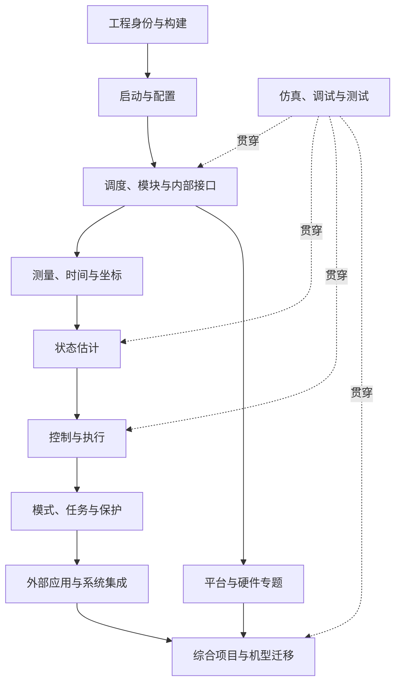

# PX4 系统掌握：课程、文档与工程实践建设规范

[学习首页](README.md) · [现有学习路线](ROADMAP.md) · [系统导读](SYSTEM_GUIDE.md) · [开发指南](DEVELOPMENT.md) · [调试实战](DEBUGGING.md)

**状态：课程与工程材料已实施，个人学习验收按实证推进。核对日期：2026-11-04。** 本文保留建设范围与验收要求，当前交付与实际测试见第 12 节；实物、外部系统和独立学习成绩不由文档交付替代。工程核对基于提交 `310e5c30ee64784b13c94de430c463ebe4656024` 及当前工作区，已有未提交文档和编辑器设置改动，需要与提交版本一起记录。

用户已经确认能够启动仿真、读取数据，目标是系统掌握 PX4 并具备独立开发能力。当前采用的具体仿真启动命令、模型和硬件条件尚未确认，课程应沿用已经跑通的实际入口；SIH 和 Gazebo 的示例不能冒充该入口的实测记录。

## 1. 问题定义与现状诊断

本方案要解决的问题是：读者已能完成基本操作，却无法把工具、源码、接口、执行条件和飞行行为连起来，遇到新需求或故障时仍不知道从哪里分析。

现有 `learn/` 在新增本方案前有 10 份 Markdown、约 2.1 万行，其中 C++ 指南约 1.1 万行。已有十阶段学习路线、模块索引、开发练习、数学示例、调试方法和阶段验收。它们是可复用资产；主要缺口在连续讲解、跨文档一致性、运行证据和能力迁移。

| 反馈或观察 | 可确认的问题 | 建设要求 | 完成判据 |
|---|---|---|---|
| 读了介绍仍不能开展工作 | 部分单元依赖读者自行拼接原理、文件和命令 | 每课完成一个具体工程问题的完整推演 | 读者能解释每个操作的目的与结果 |
| 不知道每次启动哪些代码参与 | 构建选择、启动选择、调度与分支执行混在一起理解 | 建立四层追踪，并注明证据范围 | 能区分已编入、已启动、得到调度、进入具体行为 |
| 有调试文档仍不知道怎样调试 | 调试器操作与诊断假设的联系不够稳定 | 用故障问题选择观测点和工具 | 能说明为什么在这里下断点、为什么这时看日志 |
| 希望完整掌握系统 | 目录覆盖与实现深度不一致 | 建立知识、源码、实验与能力覆盖表 | 每个域都有可追踪的学习状态与缺项 |
| 不明白工作区文件及删除影响 | 辅助文件的来源、作用范围与依赖说明滞后 | 配置文件采用统一说明模板 | 能脱离快捷配置复现其主要操作 |
| 当前工作区文件已不存在，三份文档仍引用它 | 文档操作入口与当前工程不一致 | 第一批修复入口和引用，保留必要的原理说明 | 当前推荐步骤不依赖不存在的文件 |

课程设计将“起点已经具备的能力”与“尚未确认的能力”分开。能读消息不能推导出已经理解调度；没有确认算法基础，也不能直接推断其缺失。基础内容通过具体例子补足，已经成立的能力继续复用。

## 2. 总体目标与掌握程度

### 2.1 最终工程能力

完成主线后，应能够独立完成以下任务：

1. 描述一套实际 PX4 系统的物理组成、软件组成、部署位置、接口和配置来源。
2. 从启动入口追到实际程序、机型、模块、调度和功能分支，判断运行程序是否包含指定改动。
3. 从一个数据字段追到生产者、处理链、消费者、坐标、时间、有效性与异常行为。
4. 从一个飞行现象提出可区分的解释，选取证据，定位到责任层与具体条件。
5. 从需求确定改动边界，完成实现、测试、仿真验证、影响分析和恢复说明。
6. 将同样的方法迁移到陌生模块、不同机型或真实板卡，并明确尚未验证的条件。

“完整掌握”按系统能力和源码覆盖持续评价。关键路径需要能独立开发；其他实现需要逐步达到可独立追踪、实验和扩展的深度。具体设备和平台的实测结论仍绑定相应硬件与环境。

### 2.2 五级能力记录

| 等级 | 能力描述 | 所需证据 |
|---|---|---|
| L0 未建立 | 尚不能稳定解释对象的职责与位置 | 记录待学习问题 |
| L1 能解释 | 能说明职责、边界、主要输入输出和典型行为 | 自己的机制说明及例子 |
| L2 能追踪 | 能从工程入口找到实现，完成有指导的观察与实验 | 源码路径、运行记录与结果解释 |
| L3 能独立开发 | 能独立完成局部需求或故障定位，并验证影响 | 改动、测试或实验、根因和回归证据 |
| L4 能综合设计 | 能跨模块设计功能，处理异常，迁移并复现 | 综合项目、设计取舍、部署或迁移记录 |

主线关键域以 L3 为阶段目标，综合项目以 L4 为目标。等级按具体能力记录；一个算法测试通过，不自动提高整个估计域或整个平台的等级。当前只确认用户能运行和读数据，其他能力待实验逐项建立。

### 2.3 文档完成与学习完成分别验收

**文档完成**关注讲解是否闭合、来源是否准确、步骤是否可执行、异常是否可判断、证据是否诚实。**学习完成**关注读者能否独立解释、修改、诊断和迁移。文档写完、命令执行成功、某次测试通过，都只支持相应范围的结论。

## 3. 知识与源码范围

保留现有十阶段框架，在每阶段内部明确源码、核心问题和工程成果。调试、仿真与数学是贯穿主线的能力，相关工具从第一次实验开始使用。

| 阶段 | 必须讲清的内容 | 源码范围或入口 | 实践成果 |
|---|---|---|---|
| 1 工程与构建 | 目标选择、Kconfig、CMake、子模块、生成代码、链接、构建类型与缓存 | 根 Makefile/CMake、`boards`、`cmake`、`msg`、生成产物 | 源文件到二进制的对应关系，以及一次改动生效的证据 |
| 2 启动、运行与模块开发 | POSIX 入口、启动脚本、机型、参数装载、命令分发、对象生命周期、任务与工作队列、uORB | `platforms/posix`、`ROMFS`、`platforms/common`、`src/examples` | 启动图、执行图、独立模块、消息与参数 |
| 3 测量与设备 | 设备协议、采样、FIFO、校准、滤波、积分、设备选择、时间与坐标 | `src/drivers`、`src/modules/sensors`、模拟传感器 | IMU 估计/控制双路径、驱动状态机与异常输入分析 |
| 4 状态估计 | 状态与观测模型、预测与融合、创新与门限、时间补偿、偏置、重置、多实例选择 | `src/modules/ekf2` 及其 `EKF`、测试与传感器模拟器 | 一条融合路径、确定输入测试、失效与恢复解释 |
| 5 控制与执行 | 目标生成与算法输入、位置/速度、姿态、角速度、抗饱和、控制分配、输出映射 | 多旋翼控制模块、算法库、`control_allocator`、输出驱动 | 从目标到电机命令的闭环，算法修改及边界验证 |
| 6 模式、导航与保护 | 请求与确认、解锁、健康检查、模式选择、FlightTask、任务、返航、落地与失效保护 | `commander`、`flight_mode_manager`、`navigator`、`land_detector` | 一次任务的状态时间线、保护条件及恢复矩阵 |
| 7 通信与外部应用 | MAVLink、消息/命令/任务/参数协议、DDS、ROS 2、Offboard、外部定位、载荷接口 | `mavlink`、`uxrce_dds_client`、相关消息、相机与云台等 | 外部应用及接口说明，超时、拒绝、取消与恢复测试 |
| 8 调试、性能与回归 | 断点、日志、Replay、测试层次、采样延迟、调度负载、资源、崩溃与回归 | `logger`、`replay`、性能工具、算法与集成测试 | 一个根因明确的修复与可复现的回归验证 |
| 9 硬件与平台 | NuttX、板级启动、时钟/中断/DMA、总线、参数存储、bootloader、固件与 SWD | `platforms/nuttx`、`boards`、设备与输出驱动、IO 固件 | 对应板卡的构建、部署、台架与故障定位记录 |
| 10 机型迁移与综合开发 | 固定翼控制与导航、VTOL 过渡、车辆及其他机型的差异、完整功能交付 | 固定翼/VTOL/车辆等模块与机型脚本 | 跨模块功能、机型迁移、重建与独立问题处理 |

### 3.1 仿真专题贯穿哪些阶段

仿真是被研究的系统组成，也是实验平台。它需要单独讲清 SIH 动力学、Gazebo 世界/模型/桥接、模拟测量与真值、执行器回传、Lockstep、实时倍率、噪声与故障注入，以及 SITL/HITL 的替换边界。

阶段 1～2 用已经跑通的环境建立运行身份；阶段 3 研究模拟测量；阶段 4～5 对比模型真值与估计/控制；阶段 7 研究外部桥接；阶段 8 建立自动场景与复现；阶段 9 比较真实硬件和仿真时序。先选择一条稳定的主线，另一套模拟器在相应专题中对照。

### 3.2 全工程覆盖的统计口径

当前 `src/modules` 有 56 个一级目录，已有[目录索引](SYSTEM_GUIDE.md#module-index)。有些目录是实现集合或依赖目录，不能机械解释为 56 个可启动模块。

覆盖表还必须包含 `src/drivers`、`src/lib`、`platforms`、`boards`、`ROMFS`、`msg`、`Tools` 和测试设施。覆盖表的记录字段为：对象、职责、实际入口、输入输出、所处课程、源码核对基线、实验链接、能力等级、待解释问题。

同一类设备先完整研究一个代表实现，再以差异表扩展到其他实现。每个模块目录至少明确职责和接口；主线模块继续深入到调度、算法、失败路径、测试和扩展点。未展开的可选功能保留明确条目与后续课程，不以一个目录链接充当完整讲解。

## 4. 知识依赖与贯穿主题



箭头表示学习依赖。第一轮贯通课可以提前展示下游概念，后续再进入实现深度。无需在理解位置控制模块的启动条件之前完成全部控制理论。

以下主题在每条实际链路中重复应用：

| 贯穿主题 | 必须追问的内容 |
|---|---|
| 身份与配置 | 运行哪个二进制，来自哪些源码/依赖，哪套参数最终生效 |
| 数据语义 | 单位、坐标、参考点、NaN、有效性、重置、多实例和所有者 |
| 时间与实时性 | 采样时刻、发布时间、消费时刻、队列、延迟、调度与超时 |
| 状态与控制权 | 当前模式允许谁产生目标、谁接受请求、谁决定保护动作 |
| 资源与生命周期 | 对象、线程、共享队列、锁、内存、退出清理与重启 |
| 物理与数学 | 坐标变换、动力学、离散时间、估计与控制假设及适用条件 |
| 失效与恢复 | 数据缺失、非法输入、饱和、设备失败、通信中断后的行为 |
| 可观测性与验证 | 哪个观测支持哪个结论，哪些状态仍不可见或未验证 |

数学按需求补足：先用数值与单位建立判断，再推导关系，最后对应源码变量和测试。C++ 按真实表达式解释作用域、模板、继承、原子操作和对象生命周期，再链接语言参考。

## 5. 文档架构与迁移办法

### 5.1 三种材料的分工

**课程**负责一项能力的完整学习过程；**参考**负责概念、接口与实现的权威解释；**实验记录**保存某个版本和环境中的实际证据。课程包含当前任务所需的核心解释，参考链接用于继续深入。运行记录能够回指课程与源码。

最终以一本主文档组织连续教学，不以新增文件数量作为交付标准：

```text
learn/
  README.md                 唯一学习入口
  WORKBOOK.md               连续讲解、完整实验、验收与记录方法
  SYSTEM_GUIDE.md            系统、模块、接口和配置参考
  既有专题文档               按问题深入查阅
  labs/                     可执行代码与检查工具，不另拆操作文档
  records/IMPLEMENTATION.md  作者实际验证、身份、覆盖与限制
  records/evidence/          原始输出、数据摘录和校验值
```

主文档需要把“操作—源码—状态—原因—验证”放在一起，不能只合并标题或要求读者自行拼接。重复目录清单与机械主题枚举应删减；重点路径采用完整代码、真实调用栈和具体失败条件。作者验证与学习者掌握分别评价，记录模板在书内按需使用。

### 5.2 现有文档的处理清单

| 文档 | 保留与复用 | 需要调整 |
|---|---|---|
| [README](README.md) | 导航、问题入口、阅读约定 | 为当前学习者提供一个主入口；区分课程、参考与记录；修正失效链接 |
| [ROADMAP](ROADMAP.md) | 十阶段依赖、已有任务、三次综合验收 | 长篇课程统一放入 WORKBOOK；保留旧锚点，避免并列多套主线 |
| [SYSTEM_GUIDE](SYSTEM_GUIDE.md) | 整体系统、术语、模块索引、控制与接口图 | 成为全局概念参考；为模块索引关联覆盖表，收拢重复操作步骤 |
| [PROJECT_GUIDE](PROJECT_GUIDE.md) | 当前工程身份、目录、依赖、环境、入口 | 工程事实与通用原理分开；版本、路径、配置采用统一事实来源 |
| [TECHNICAL](TECHNICAL.md) | 物理、数学、估计、控制与系统原理 | 补假设、数值例子、变量与源码对应；被课程按需引用 |
| [ARCHITECTURE](ARCHITECTURE.md) | 硬件、外设、平台、仿真架构 | 明确硬件约束与系统边界，减少和全局软件导读重复 |
| [DEVELOPMENT](DEVELOPMENT.md) | 构建、模块框架、uORB、参数、扩展方法 | 形成机制参考；示例补完整执行推演和失败条件 |
| [OPERATIONS](OPERATIONS.md) | 工具命令、环境操作、实验步骤 | 维护统一的操作说明；每条步骤注明环境、前提、结果和恢复方式 |
| [DEBUGGING](DEBUGGING.md) | GDB、日志、性能、板端诊断和工作区解释 | 按问题组织诊断案例；通用环境命令回指操作手册；修复已失效入口 |
| [CPP_GUIDE](CPP_GUIDE.md) | 已有语言讲解与 PX4 语法示例 | 作为按需参考；课程内先解释关键写法，再链接深入内容 |

### 5.3 迁移规则

一次迁移一个主题，先核对内容与来源，再确定唯一维护位置。旧章节保留短说明和新位置链接，已有链接与锚点继续可用。当前未提交改动分别审阅，不用整文件覆盖清除其他工作。

重复出现一个概念时，允许课程保留理解本课必需的短解释；长命令序列、完整参数表和接口定义只维护一处。迁移后同时检查首页、路线、课程和引用。

目前已不存在的 `px4-sih-debug.code-workspace` 不作为课程前提。先修正文档依赖，使用已有可运行入口或明确的终端步骤；可选 VS Code 配置可以作为完整解释过的示例。新增包装脚本或配置，必须说明来源、可选性、实际命令、生成覆盖关系和删除影响。

## 6. 课程与专题的编写规范

### 6.1 每课固定结构

| 项目 | 必须交付的内容 |
|---|---|
| 课程问题与目标 | 一个明确问题，以及学完后能独立完成的动作 |
| 前置条件 | 已需掌握的概念、工程状态、工具与适用机型 |
| 系统位置 | 当前对象与整机、上下游、模式和平台的关系 |
| 概念与基础 | 解释首次出现的关键术语、语法与数学假设 |
| 源码推演 | 入口、关键代码片段、状态变化、条件、调用或消息关系 |
| 正常过程 | 用明确输入推演中间值和输出，解释为什么产生这个结果 |
| 异常过程 | 至少分析与本课目标相关的拒绝、缺失、超时或边界情形 |
| 实验步骤 | 执行位置、命令或界面动作、预期现象、观测位置 |
| 证据与判断 | 哪项证据支持哪个判断，观察失败后怎样继续定位 |
| 修改与恢复 | 涉及修改时给出完整差异、影响范围、重建与恢复方法 |
| 独立迁移 | 更换模块或条件，要求读者独立解释或实现 |
| 参考分析与后续 | 解释答案与常见错误，注明下一课依赖和待解决问题 |

课程先给出完成本课所需的讲解，再要求读者推演和实践。不能把“自己找到所有调用关系、自己画完整系统图”当作未讲解内容的替代。

### 6.2 模块说明的必备内容

每个重点模块都应回答：业务职责、目录/构建名/命令名、编入条件、启动来源、对象创建、任务或队列、触发方式、输入、状态、参数、核心算法、输出、保护与退出、测试、可观测点、扩展点。

同时区分模块外壳与算法库。例如 `MulticopterPositionControl` 管理订阅、模式、目标、时间与起飞条件；`PositionControl` 实现相关控制计算；工作队列和 uORB 提供执行与传输机制。三层各自需要合适的验证方法。

### 6.3 接口说明的必备内容

每个重点接口说明生产者与消费者、传输机制、字段类型、单位、坐标、参考、时钟域、发布/消费节奏、队列、多实例、有效性、重置、超时、兼容性，以及观察方法。消息存在、内容有效、被选中、被消费和参与算法分别判断。

对外协议增加连接拓扑、端点、序列化、发现或握手、版本/QoS、请求确认、控制权、失联与恢复。新增 uORB 字段不会自动获得日志或外部传输；课程要展开相应注册与桥接路径。

### 6.4 文件与配置说明的必备内容

文件必须说明：由谁维护或生成、由谁读取、读取时机、相对路径基准、字段含义、覆盖优先级、持久化位置、修改何时生效、生成时是否覆盖、删除影响、等价基础操作和验证方法。

对于 `.code-workspace`，解释 VS Code、扩展、任务、GDB、PX4 各自的职责；对于 `.px4board`，解释构建选择；对于机型脚本，解释运行配置。文件扩展名与功能层次不能混用。

## 7. 实验设计、证据与复现

### 7.1 每个实验的记录结构

实验身份至少包含源码提交和相关未提交差异、相关子模块版本、构建目标/类型、工具环境、程序路径、启动命令、模拟器与机型、运行目录、关键参数、初始模式与状态。工具版本按实验依赖记录，避免每次收集与结论无关的信息。

```text
实验问题：
关联课程 / 模块 / 接口：
源码与环境身份：
初始状态和输入：
预测，以及支持预测的源码或公式：
唯一计划改变的因素：
操作和观测位置：
实际记录的位置、时间范围和相关片段：
预期与实际的差异：
结论、适用范围和仍未确认的条件：
恢复操作与恢复后的检查：
```

实验记录允许得出“证据不足”。此时要指出缺少哪项观测，以及下一步怎样区分现有解释。一次实验可有多次排查，但需保留每次配置与结论之间的对应关系。

### 7.2 选择能回答问题的验证层次

| 验证层次 | 适合回答的问题 | 证据的边界 |
|---|---|---|
| 源码与构建分析 | 注册、依赖、条件、路径、接口定义是否成立 | 不能证明本次运行走到该路径 |
| 独立算法测试 | 确定输入、边界、非法输入、限幅与重置的计算行为 | 不覆盖整个模块的调度和外部集成 |
| 模块实验 | 生命周期、订阅、参数更新、发布、清理是否正确 | 不能直接推出完整任务的动态性能 |
| 系统仿真 | 模式、估计、控制、通信、模型之间的协作 | 物理可信度取决于模型与配置 |
| 日志与 Replay | 连续时序、状态变化，以及支持回放的算法重计算 | 受记录集合、频率、丢样和回放能力限制 |
| 板端台架与实际平台 | 总线、设备、输出、资源和真实时序 | 结论绑定板型、设备和测试条件 |

每项改动选择能验证其行为的最小充分组合，再覆盖相关系统影响。已有有效检查通过后，只有新变化或未解决问题才需要扩大验证范围。

可复用的当前工程测试入口包括 [PositionControlTest.cpp](../src/modules/mc_pos_control/PositionControl/PositionControlTest.cpp)、[rate_control_test.cpp](../src/lib/rate_control/rate_control_test.cpp)、[test_EKF_height_fusion.cpp](../src/modules/ekf2/test/test_EKF_height_fusion.cpp) 和 [MAVSDK 集成测试](../test/mavsdk_tests)。课程需要核对测试注册、过滤条件和实际执行用例，不能仅凭目录存在声称测试已运行。

### 7.3 运行证据怎样支持“哪些代码参与”

| 需要判断的状态 | 建议证据 | 不能据此扩大到的结论 |
|---|---|---|
| 某源码参与当前构建 | 当前目标配置、真实编译条目、必要时符号或链接结果 | 该模块已经启动 |
| 启动逻辑选择了某模块 | 配置与参数、启动脚本条件和实际命令轨迹 | 启动一定成功 |
| 模块成功建立运行状态 | start 返回、模块 status、实例或队列状态 | 每个业务分支都在执行 |
| 模块得到执行机会 | `Run()`/任务循环断点、调用栈、计数或适当埋点 | 所有输入有效、算法启用 |
| 进入了具体算法 | 算法调用处的条件与变量、对应测试或运行轨迹 | 计算一定成功或已影响执行器 |
| 输出确实更新并被使用 | 发布时间与内容、消费者读取及下游行为 | 所有时刻、所有模式都有相同行为 |

静态关系图描述可能路径，启动轨迹描述该次选择，断点和日志描述观察范围内的执行。若要证明一个时间段中某个分支从未执行，需要相应覆盖手段与完整观察窗口；少量断点未命中只能支持有限判断。

### 7.4 实验必须处理的时序问题

连续几次 `listener` 读取并非同一时刻的系统快照。对时序敏感的判断使用连续日志、明确的时间戳或一次暂停内的变量。日志记录频率与模块运行频率分别核对。

GDB 暂停会改变线程、通信和仿真推进状态，不能用暂停后的表现直接推断正常运行性能。高频打印和埋点也会影响运行；性能实验需说明观测开销。模型真值与估计值比较前，先对齐坐标、原点、时间和重置。

### 7.5 结果标记

每条重要结论注明来源：**源码核对、理论推演、示例预期、实际观察、自动测试或硬件实测**。这些标记描述证据类型，不互相替代。实际观察附实验身份；失败或受环境限制时记录原始现象和未完成部分。

## 8. 首批六课的详细设计

这六课解决当前最迫切的理解缺口，并连接现有十阶段课程。它们是入口课程，相关底层机制和算法在后续专题继续深化。

### 第 1 课：一次启动的工程身份

**问题**：按下一个启动按钮或执行一条命令，实际运行了哪个程序、哪些工具和哪套配置？

**讲解范围**：源码目录、构建目录、可执行程序、运行目录；宿主与容器；VS Code、CMake Tools、make、GDB、PX4、模拟器、QGC 的职责；环境变量、命令行参数与保存参数。展开可选快捷配置，给出基础命令之间的对应关系。

**源码与材料**：[Makefile](../Makefile)、[POSIX CMake 配置](../platforms/posix/CMakeLists.txt)、[SITL 构建配置](../boards/px4/sitl/default.px4board)、实际使用的编辑器/启动入口。生成的 `.vscode/launch.json` 与其模板分别说明。

**实验**：记录实际启动入口和程序路径，核对构建目标、类型、模型、工作目录及关键参数；解释构建类型缓存和运行参数为何会跨会话保留。此处复用已有可运行环境。

**产物与验收**：一张工具与产物关系图、一份运行身份记录。读者能判断“编辑器索引错误”“构建错误”“启动错误”分别属于哪一层，能说明删除一个辅助配置的准确影响。

### 第 2 课：从进程入口到模块启动

**问题**：本次启动为什么选择这些模块，模块在什么条件下加入运行？

**讲解范围**：[POSIX main.cpp](../platforms/posix/src/px4/common/main.cpp) 的入口与 `run_startup_script()` → [rcS](../ROMFS/px4fmu_common/init.d-posix/rcS) → 实际机型脚本 → [rc.vehicle_setup](../ROMFS/px4fmu_common/init.d/rc.vehicle_setup) → [rc.mc_apps](../ROMFS/px4fmu_common/init.d/rc.mc_apps)。展开机型默认值、保存参数和条件启动，不把所有脚本中的 start 行都算成本次运行集合。

**实验**：选三个自动启动模块和一个未自动启动的已编入模块，对照脚本、参数、状态与必要的启动轨迹。记录命令发出但未成功的情况及其判断依据。

**产物与验收**：一张本次启动关系图和一张模块选择表。读者能从另一个模块的运行命令反查注册、入口与启动来源，并解释启动顺序和数据流顺序的区别。

### 第 3 课：从 start 到 Run，再到退出

**问题**：对象创建以后，谁让业务代码执行，为什么有的模块没有独立线程？

**讲解范围**：命令分发、`ModuleBase`、`task_spawn()`、构造、`init()`、回调、定时调度、工作队列、退出清理；对象生命周期与执行上下文分别画图。以 [WorkItemExample](../src/examples/work_item/WorkItemExample.cpp) 展开机制，再迁移到 [MulticopterPositionControl](../src/modules/mc_pos_control/MulticopterPositionControl.cpp)。

**实验**：观察启动、首次执行、重复执行和停止后的状态；记录一次调用栈与队列状态。解释消息触发、首次安排和备用调度的区别，以及停止后最后一条消息仍可读的原因。

**产物与验收**：对象生命周期图、执行上下文图和停止/重启记录。读者能够判断阻塞共享工作队列会影响哪些任务，并为类似模块找到正确断点。

### 第 4 课：从一个字段追踪完整消息链

**问题**：`listener` 显示的数据由谁产生、表示什么、什么时候会被消费？

**讲解范围**：消息定义和生成结构、发布器、订阅器、回调、缓存/队列、多实例、时间、有效性；逐步区分存在、更新、读取和用于计算。先用简单主题讲机制，再追 `vehicle_local_position` 与控制消费者。

**源码与材料**：[消息定义](../msg)、[uORB 实现](../platforms/common/uORB)、[SubscriptionCallback.hpp](../platforms/common/uORB/SubscriptionCallback.hpp) 及实际生产者和消费者。

**实验**：比较发布、消费与记录的时间；分析未启动发布者、停止后旧值、实例不匹配三个情形。真实状态主题的发布者选择要结合当前估计器配置确认。

**产物与验收**：一份字段/接口说明和一张跨模块数据图。换一个主题后，读者能够独立找到其定义、生产者和消费者，说明数据是否足以支持当前判断。

### 第 5 课：位置控制显示运行，为何算法未执行

**问题**：如何区分模块运行、数据到达、控制启用、算法计算和输出更新？

**讲解范围**：`mc_pos_control` 的调度、局部位置输入、目标来源、`vehicle_control_mode`、目标时间条件、起飞约束、估计重置、算法失败回退和姿态目标发布。完整展开一个正常分支与一个未进入算法的分支。

**实验**：在仿真中关联模块状态、控制标志、输入时间戳以及两个不同层次的断点。模式或输入条件是否满足由本次证据决定；算法断点未命中时按条件回查，不通过无目的修改配置强行命中。

**产物与验收**：一份条件与证据对应表，能够解释同一模块在不同状态下的行为。随后迁移到 `mc_att_control`，独立找到调度来源、目标、反馈、启用条件和输出。

### 第 6 课：独立完成一次可验证的工程改动

**需求**：建立一个独立教学模块，按受限参数周期发布计数与运行状态，能够停止、重启，并把所需信息记录到日志。

**讲解范围**：目录与命名、CMake/Kconfig 注册、消息与参数生成、调度、发布、日志选择、调试和恢复。复用[已有开发练习](DEVELOPMENT.md#d9)，将其整理为完整课程与可审阅差异。

**实验**：验证默认周期、周期变更、边界输入、停止和重启；区分实际发布频率与日志采样频率。实验身份中记录改动与构建产物，证明运行的是本次代码。

**产物与验收**：实现差异、构建记录、消息/日志证据、生命周期分析和恢复步骤。独立练习增加一个新状态字段，读者自行找到修改点并说明对消费者、日志和外部接口的影响。

## 9. 一节重点课程应达到的讲解深度

以第 5 课为例，课程需要交付以下四层分析。

**第一层：启动关系。** 从实际启动参数解释为何进入多旋翼配置，追到 `mc_pos_control start`、命令入口、模块框架、对象创建和 `init()`。区分源代码文件、命令表、Shell 客户端和模块对象。

**第二层：运行关系。** 构造函数选择 `nav_and_controllers` 工作队列；`init()` 注册局部位置回调并安排首次执行；`Run()` 安排 100 ms 备用执行。说明备用间隔不等于正常算法频率，说明为什么调用栈可来自工作队列。

**第三层：条件与状态。** 在当前源码中检查局部位置是否更新、`flag_multicopter_position_control_enabled` 是否成立、目标时间是否满足当前启用时刻要求。继续解释目标缺失时的后备目标生成，以及起飞、限制与重置处理。三个条件是诊断入口，不能替代其间全部处理逻辑。

**第四层：算法与输出。** 状态、目标和约束进入 `PositionControl`；`_control.update(dt)` 可能成功，也可能进入回退；结果通过 `vehicle_attitude_setpoint` 等消息提供给下游。追踪姿态控制消费者，说明数据传递与同步函数调用的区别。

课程中的诊断表应达到以下具体程度：

| 现象 | 候选解释 | 优先观察 | 判断后的下一步 |
|---|---|---|---|
| 模块 status 显示运行，Run 断点未命中 | 程序/符号不一致、断点未绑定、调度路径异常等 | 程序身份、断点绑定、队列与调用栈 | 先确认当前会话，再调查调度 |
| Run 命中，读取位置后的分支未进入 | 此次没有取得新位置样本 | 订阅更新结果、实例和样本时间 | 追发布者、选择和消费状态 |
| 有新位置数据，算法调用处未命中 | 模式未启用或目标时间条件未满足 | 同次执行中的控制标志、目标与启用时间 | 追 Commander/目标生成及中间处理 |
| 算法执行但走回退 | 目标/状态组合不满足算法输入要求等 | 算法返回、有限值检查、回退条件 | 用确定输入在算法测试中复现 |
| 发布了目标，机体行为不符预期 | 下游模式、反馈、限制、分配、输出或模型问题 | 对齐目标、反馈和执行器链的连续证据 | 根据最早分歧定位责任层 |

不能仅凭单一症状直接确定根因。每个候选解释都要列出能支持或排除它的观测。参考分析应解释为何某项证据足够，以及还缺哪些信息。

## 10. 阶段验收与综合项目

### 10.1 每课与每阶段的通过条件

每课检查四件事：能否讲清机制、能否预测变化、能否解释实际结果、能否独立迁移。允许查源码和参考文档；独立性体现在能选择路径并作出判断。

每阶段使用一个未逐步给出答案的新任务。存在未解释的关键条件、无法确认运行身份、没有恢复方法或证据不能支持结论时，记录为待完成，并指明需要补哪一项。已通过的能力继续保留。

### 10.2 三次综合验收

| 验收 | 独立任务 | 必需交付 |
|---|---|---|
| 模块开发验收 | 给独立模块增加状态，完成生成、发布、记录、停止与重启分析 | 需求、差异、接口说明、运行证据、失败排查与恢复 |
| 系统行为验收 | 对一段任务中的行为变化，区分目标、估计、控制、模式与执行问题 | 同一时间轴的证据、至少两个可区分假设、根因与验证 |
| 综合开发验收 | 实现跨模块功能或外部应用，增加异常处理，并迁移或重建验证 | 设计、实现、正常/边界/异常结果、回归、部署或迁移说明 |

推荐综合项目采用现有操作手册的任务场景逐步扩展：完成起飞、访问观察点、停留、返回、降落，并支持中途取消。先做系统行为解释，再增加一个内部改动或外部功能，最后研究通信中断、观测退化或执行限制等具体异常。载荷、视觉等扩展按实际设备与接口条件选择。

### 10.3 覆盖与掌握分开记录

覆盖表记录“有没有讲到、有没有源码依据、有没有实验”；能力表记录“当前是否能独立完成”。不要把 56 个目录都列出来换算成整套 PX4 已掌握，也不要用完成全部仿真实验替代板端能力。每个结论都限定在相应版本、平台、机型与任务范围。

## 11. 交付批次、依赖与质量要求

| 批次 | 具体工作 | 交付物 | 进入下一批的依据 |
|---|---|---|---|
| A 工程与文档基线 | 核对当前入口、版本与改动；修复失效引用；明确文件来源和默认操作路径 | 工程身份说明、修正后的导航、内容迁移清单、初版覆盖表 | 主入口能落到现存材料，关键事实无冲突 |
| B 完整样课 | 优先制作前 3 课，按真实启动入口核对；用一课验证完整编写与实验流程 | 工具关系、启动追踪、调度生命周期三课及相应记录 | 讲解与操作闭合，问题能够落实到证据 |
| C 完成首轮贯通 | 完成第 4～6 课、模块改动和第一次综合验收 | 消息链、控制条件、完整开发练习及验收结果 | 能独立追踪相似模块并完成局部改动 |
| D 深入主飞行链 | 逐阶段补测量、估计、控制、模式、通信和复杂调试 | 专题课程、算法测试、系统任务与故障案例 | 完成系统行为验收，关键域达到 L3 |
| E 平台与综合交付 | 硬件、机型差异、综合功能、重建与迁移 | 台架/平台记录、综合项目、迁移和回归证据 | 对应范围内完成 L4 综合任务 |

各批次内部以完整课程或具体修复为最小交付单元。先交付可审阅的一课，再扩展同主题；避免先产生大量尚无证据的章节。整体节奏根据前两课的实际耗时、基础补足和设备条件校准，阶段通过以能力和证据为依据。

### 11.1 文档质量要求

1. 每课有明确前置条件、工程问题、讲解、操作、解释和迁移任务。
2. 关键源码结论能定位到文件、函数和核对基线；行号作为辅助，不能成为唯一定位方式。
3. 推荐操作中的文件和锚点有效，生成文件与源文件、教学辅助文件与必要依赖区分清楚。
4. 命令明确执行环境，变量、路径和参数有定义；Shell、PX4 Shell 与 GDB 命令不混用。
5. 预期输出标为预期，实测结果附身份和证据；静态检查通过不称为仿真通过。
6. 图中的箭头说明是调用、数据、配置、调度还是控制权；不同关系不能混画成一个串行主循环。
7. 修改与恢复都可执行，不依赖隐藏的包装脚本、临时文件或未解释的配置。
8. 新术语和必要语法在当前课有足够解释，关键推理不留给无提示的跨文档搜索。

### 11.2 实验与代码质量要求

实验先写预测与判据，再操作。正常、边界和异常场景按行为需要选择；算法改动应有能够识别相关错误的测试，接口改动覆盖相应生产者、消费者、记录和桥接。不要为了通过而任意放宽断言。

仿真中的故障注入与动态实验先说明恢复方法。板端实验注明板型、接线、供电、输出状态与实际设备边界；仿真结果迁移到硬件时重新判断时间和资源假设。

## 12. 协作方式与当前交付状态

讲解方负责核对源码、解释原理与配置、设计实验、提供带理由的参考分析、审阅结果和维护文档。学习者亲手完成预测、操作、改动和独立练习，并保留关键证据。环境可访问时由实际运行验证；环境或设备不可访问时，继续完成源码分析与实验准备，运行结论保持待验证。

每次学习结束记录当前能力、已成立结论、未解释现象及下一项任务。后续问题优先回到这份记录，避免已经学会启动和读数后又被反复带回环境入门。

本轮交付如下，源文件与实际结果均可直接审阅：

| 建设要求 | 已实现材料 | 验证与范围 |
|---|---|---|
| A 入口、基线与迁移 | [首页](README.md)、ROADMAP 旧锚点、调试入口修复 | 旧 workspace 不再是前提；原长课整合到 WORKBOOK |
| B/C 首轮贯通 | [主文档前六章](WORKBOOK.md#course-map)、[完整模块](WORKBOOK.md#build-example) | 外部模块、参数、消息已编译并实际运行检查 |
| D 主链与外部接口 | [主文档主飞行链](WORKBOOK.md#course-map)、[接口契约](SYSTEM_GUIDE.md#interface-contracts) | 算法测试与教学日志实测；通信/闭环场景按记录限定 |
| E 平台与综合课程 | [主文档平台与综合开发](WORKBOOK.md#course-map)、[三次验收](WORKBOOK.md#assessment) | 提供硬件/迁移设计与操作；实物和个人项目待执行 |
| 全工程范围 | [56 个模块](SYSTEM_GUIDE.md#module-index)、[覆盖表](records/IMPLEMENTATION.md#coverage) | 源码索引覆盖全部一级目录，运行覆盖逐项标注 |
| 证据与能力分离 | [作者实施记录](records/IMPLEMENTATION.md)、[个人进度](WORKBOOK.md#mastery-record)、[模板](WORKBOOK.md#experiment-record) | 不预填个人通过，不把作者实验换算为学习等级 |

已删除的工作区未恢复，主飞行算法未改动。后续学习按每课独立任务与三次验收推进；平台、机型和外部设备尚未实测的条件保持明确记录。
