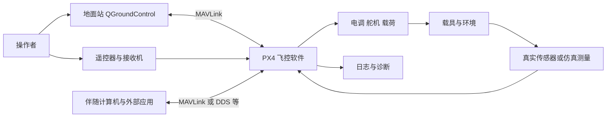
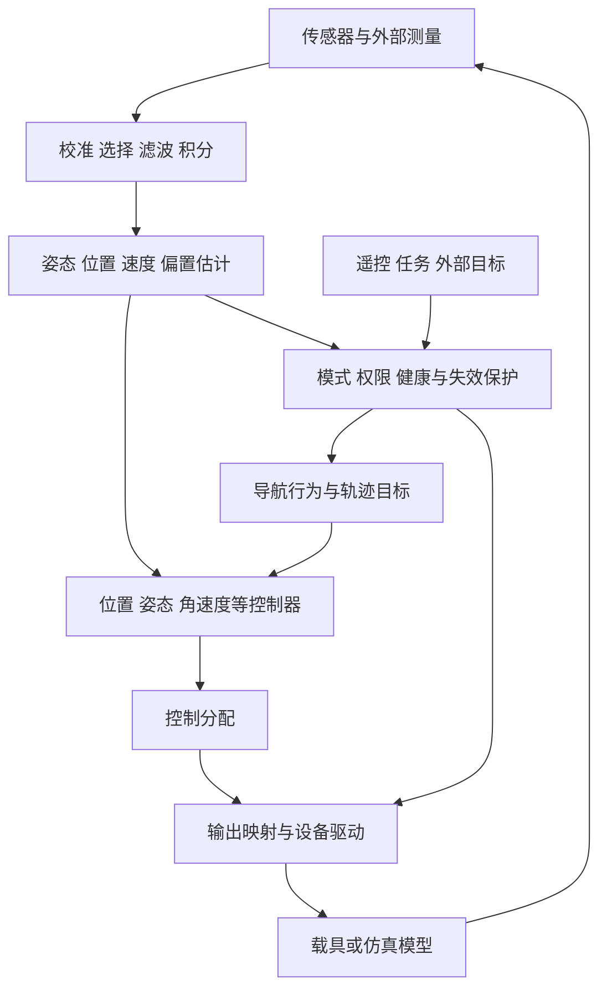
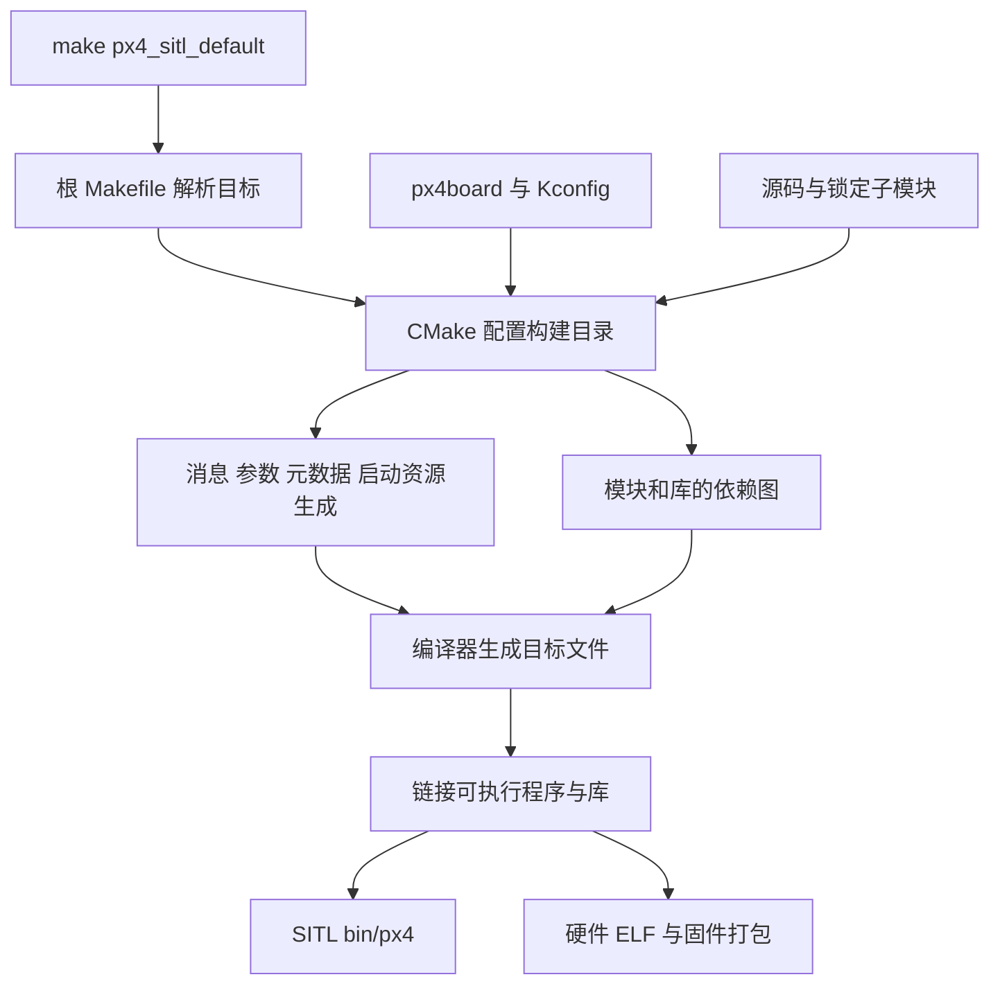
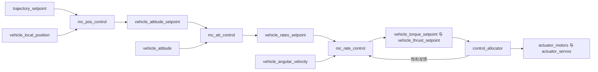

# 当前 PX4 工程全景导读

这篇文档从当前仓库出发，解释一套 PX4 工程怎样组织、怎样变成程序、怎样启动，以及各部分怎样协作完成载具控制。阅读目标是形成可以用于查代码、做实验和定位问题的完整工程地图。

全文以多旋翼为贯穿示例，同时介绍固定翼、VTOL、地面车辆和其他载具的差异。介绍一种能力时，会说明它在系统中的职责、输入输出、源码位置，以及它与其他部分的联系。物理和数学推导可继续阅读 [TECHNICAL.md](TECHNICAL.md)，完整开发练习见 [DEVELOPMENT.md](DEVELOPMENT.md)，详细命令与调试实验见 [OPERATIONS.md](OPERATIONS.md)。

需要进一步了解支持的飞控、外设需求、技术实现和仿真方案，阅读 [ARCHITECTURE.md](ARCHITECTURE.md)；需要按步骤修改源码、使用 GDB、分析日志或进行板端调试，阅读 [DEBUGGING.md](DEBUGGING.md)。

**核对基准：2026-11-02，学习分支 `learn/px4-v1.17.0`，文档编写前主仓库提交 `3e4c67df8a1518a13ca661f06d9ff8cb8393009b`，对应上游基线标签 `v1.17.0`。** 本文提交后提交号会变化；这里的提交号用于说明阅读依据，不要求以后把分支回退到这个提交。

## 阅读导航

初次学习可以先读第 1～3 章建立全景，再按“构建与启动 → 运行与数据 → 飞行功能 → 环境与实践”的顺序继续。已经遇到具体问题时，可直接进入对应章节。

| 主线 | 章节 |
|---|---|
| 工程是什么 | [1. 版本与仓库身份](#identity)、[2. 系统边界与总体架构](#architecture)、[3. 目录全景](#directories) |
| 工程怎样成为程序 | [4. 配置层次与目标](#configuration)、[5. 构建与生成物](#build)、[6. 子模块与依赖](#dependencies)、[7. 启动过程](#startup) |
| 程序怎样持续运行 | [8. 模块、任务与工作队列](#runtime)、[9. uORB 与数据契约](#uorb)、[10. 参数、命令、事件与存储](#configuration-runtime) |
| 飞行能力怎样实现 | [11. 测量与驱动](#sensors)、[12. 状态估计](#estimation)、[13. 模式与安全管理](#commander)、[14. 导航与轨迹](#navigation)、[15. 多旋翼控制](#multicopter)、[16. 分配与输出](#actuators)、[17. 其他机型](#vehicles) |
| 怎样连接和理解整机 | [18. 通信与外部应用](#communication)、[19. 六条端到端链路](#end-to-end) |
| 怎样在本机使用与开发 | [20. lab Docker 与编辑器](#environment)、[21. 仿真与实验](#simulation)、[22. 观测、调试与测试](#verification)、[23. 开发与性能方法](#development)、[24. 阅读与学习顺序](#reading) |
| 查阅与自检 | [25. 概念速查与常见误解](#reference) |

<a id="identity"></a>
## 1. 先确认自己在研究哪一份工程

### 1.1 当前仓库的身份

| 对象 | 当前约定 | 工程意义 |
|---|---|---|
| 上游项目 | `PX4/PX4-Autopilot` | PX4 官方源码及演进历史 |
| 个人仓库 | `orbits-yiyi/px4-system` | 学习文档、实验和个人修改的保存位置 |
| 本地主远程 `origin` | `https://github.com/PX4/PX4-Autopilot.git` | 查询和获取官方更新 |
| 本地个人远程 `personal` | `https://github.com/orbits-yiyi/px4-system.git` | 同步自己的学习分支 |
| 学习分支 | `learn/px4-v1.17.0` | 当前主要阅读和开发分支 |
| 上游源码基线 | `v1.17.0`，提交 `d6f12ad1c4f70ad3230afd7d86e971421e02fef4` | 确定本篇介绍的接口和实现范围 |
| 宿主源码目录 | `/home/yiyi/Workspace/px4/PX4-Autopilot` | WSL 中实际保存 Git 仓库的位置 |
| lab 任务 | `px4-main` | 固定工具环境并挂载这份源码的任务名 |

`px4-main` 是环境任务名，并不表示 Git 正在 `main` 分支。文件夹仍叫 `PX4-Autopilot`，也不妨碍它同时关联个人仓库。远程名称是本地 Git 配置，GitHub 上不会自动保存你机器上的 `origin`、`personal` 命名关系。

当前个人分支在 `v1.17.0` 上加入了学习资料等提交。它与不断更新的官方 `release/1.17` 分支不是同一个提交集合。阅读新版网页时，应当核对模块、参数和消息是否存在于本仓库。

在 **WSL 宿主的源码目录**检查身份：

```bash
cd ~/Workspace/px4/PX4-Autopilot
git status --short --branch
git remote -v
git branch -vv
git describe --tags --always --dirty
git rev-parse HEAD
git submodule status --recursive
```

`git describe` 末尾带提交数是正常的；带 `dirty` 表示还有工作区修改。复现实验时需要同时记录提交和未提交差异，仅记录“PX4 1.17”不够精确。

### 1.2 一个可复现结果至少有六部分身份

1. **主仓库源码**：分支、提交、工作区差异。
2. **依赖版本**：各子模块的提交，而不只是下载地址。
3. **编译目标**：例如 `px4_sitl_default` 或 `px4_fmu-v6x_default`。
4. **工具环境**：容器镜像、编译器、Python/CMake 等工具版本。
5. **运行配置**：airframe、保存参数、启动方式、传感器和通信配置。
6. **实验输入**：模型、任务、操作步骤、故障条件以及所记录的数据。

同一份源码可以编译出多个不同程序；同一个程序可以因参数和启动模型不同而表现不同。分析问题时，先把这些身份放在同一张记录表里。

<a id="architecture"></a>
## 2. PX4 的系统边界与总体架构

### 2.1 PX4 在一套载具系统中承担什么职责

PX4 的核心职责是把任务或操作者意图，转换成满足当前状态与安全条件的执行器指令。它持续接收测量，估计运动状态，选择可执行行为，计算控制输出，并监视能否继续执行。



这些对象在真机上可能是不同硬件，在仿真时也可能是同一台电脑上的不同进程。

- **飞控硬件**提供 MCU、存储、传感器、总线和电气输出；PX4 是运行在相应平台上的软件。
- **QGroundControl**负责配置、任务规划、遥测与操作界面。地面站不承担 PX4 内部的高速姿态闭环。
- **伴随计算机**常运行视觉、规划、业务逻辑或 ROS 2 程序，通过明确接口与飞控交换信息。
- **仿真器**根据执行器作用计算运动和传感器读数。只有三维画面并不等于已形成仿真闭环。
- **电调和舵机**把数字输出变成实际作用；通信正常、输出有数值和物理作用正确，是不同的检查层。

### 2.2 PX4 内部的功能分层



这是一张功能关系图，不是严格的函数调用顺序。实际软件中，多数跨模块信息由 uORB 传递，模块在不同任务或工作队列中按各自节奏运行。

在所有功能层旁边，还贯穿着参数、时间、日志、事件、设备管理、平台适配与测试设施。这些基础设施决定系统能否稳定运行，也决定出了问题能否解释清楚。

### 2.3 理解工程时需要同时保留四种视图

| 视图 | 主要问题 | 应查证据 |
|---|---|---|
| 构建视图 | 哪些源码进入当前程序 | `.px4board`、Kconfig、CMake、编译数据库 |
| 运行视图 | 哪些模块已启动，在哪执行 | 启动脚本、模块生命周期、任务和工作队列状态 |
| 数据视图 | 谁生产和消费数据，数据有多新 | `.msg`、发布订阅代码、时间戳、实例、日志 |
| 行为视图 | 为什么执行这个模式和输出 | 状态机、目标、控制启用标志、健康条件、保护策略 |

例如，`mc_pos_control` 已经编译并启动，但载具处于不使用位置闭环的模式时，它不会按位置模式那样决定运动。源码里有一个驱动目录，也不说明当前 SITL 目标编入了这个驱动。

### 2.4 从需求反推系统组成

“飞到某个点”至少涉及目标的坐标定义、估计是否有效、模式是否允许、轨迹是否可实现、控制是否有足够执行能力，以及中途失去条件时怎么办。一个简单任务通常会跨越多个模块。

因此，学习 PX4 不只是背目录或读一个 PID 类。需要能够解释：**目标由谁提出，谁决定是否接受，谁把目标细化，谁闭环执行，谁报告结果和处理失败。**

<a id="directories"></a>
## 3. 当前源码目录全景

### 3.1 顶层目录与文件

| 路径 | 主要职责 | 什么情况下进入 |
|---|---|---|
| [README.md](../README.md)、[learn/](README.md) | 个人工程入口、系统学习资料 | 建立整体认识、安排实践 |
| [src/modules/](../src/modules) | 估计、控制、管理、导航、通信与仿真模块 | 研究实际行为 |
| [src/drivers/](../src/drivers) | 传感器、通信设备、执行器与板上外设驱动 | 研究设备数据怎样进入系统 |
| [src/lib/](../src/lib) | 算法、公共设施和可复用组件 | 深入计算方法或复用功能 |
| [src/systemcmds/](../src/systemcmds) | `listener`、`param`、`perf` 等系统命令 | 运行时观测和诊断 |
| [src/examples/](../src/examples)、[src/templates/](../src/templates) | 示例、模块模板 | 学习一个模块的最小完整结构 |
| [boards/](../boards) | 板型配置、硬件资源、板级启动与实现 | 选择目标、裁剪功能、移植板卡 |
| [platforms/](../platforms) | 公共平台接口与各操作系统实现 | 理解运行环境和移植边界 |
| [ROMFS/](../ROMFS) | 固件运行所需的启动脚本与资源 | 解释为什么某个模块会启动 |
| [msg/](../msg) | uORB 消息定义、版本化接口和相关生成配置 | 核对数据字段和接口 |
| [srv/](../srv) | 服务接口定义，如 `VehicleCommand.srv` | 研究对应外部服务接口 |
| [cmake/](../cmake)、[Makefile](../Makefile)、[CMakeLists.txt](../CMakeLists.txt) | 目标解析、构建图、代码生成与打包 | 编译与配置问题 |
| [Kconfig](../Kconfig) | 功能配置树的根入口 | 理解模块选择和依赖 |
| [Tools/](../Tools) | 安装、生成、仿真、上传、格式、分析等工具 | 工程自动化 |
| [test/](../test) | 测试基础设施、仿真集成测试、测试依赖等 | 验证行为和回归 |
| [integrationtests/](../integrationtests) | 另一组集成测试相关内容 | 使用对应测试链时查阅 |
| [test_data/](../test_data) | 测试输入和样本 | 复现实验与测试 |
| [validation/](../validation) | 配置等数据的校验规则 | 检查元数据格式 |
| [docs/](../docs) | 随源码保存的多语言 PX4 文档及站点配置 | 对照本版本官方说明 |
| [.github/](../.github) | CI、工作流与协作配置 | 查询官方如何检查工程 |
| [.vscode/](../.vscode)、[.devcontainer/](../.devcontainer) | 编辑器和容器开发入口 | 配置索引与调试环境 |
| [launch/](../launch)、[package.xml](../package.xml) | 对应 ROS 启动与包集成内容 | 研究具体 ROS 集成方式 |
| [posix-configs/](../posix-configs) | POSIX 相关的附加配置资源 | 沿实际构建或启动引用查阅 |
| `build/` | 本机构建输出、生成代码和仿真运行数据 | 查看产物与构建状态 |

`build/` 需要通过本机编译产生，不属于新克隆仓库必然具有的源码内容。顶层多个测试或 ROS 目录也不表示当前容器安装了所有对应依赖。

### 3.2 `src` 的三个主要层次

以位置控制为例：

- [MulticopterPositionControl.cpp](../src/modules/mc_pos_control/MulticopterPositionControl.cpp) 是运行模块：订阅消息、判断模式、管理参数和时间、调用算法、发布结果。
- [PositionControl.cpp](../src/modules/mc_pos_control/PositionControl/PositionControl.cpp) 是算法实现：依据状态与目标计算受约束的加速度、推力等结果。
- 工作队列、uORB 和参数接口来自公共设施，负责让上述代码能在系统里持续运行。

目录与抽象层并非一一对应。EKF 主体在 `src/modules/ekf2/EKF`，位置和姿态算法在对应模块子目录；不能只去 `src/lib` 寻找算法。

### 3.3 公共库应怎样分类阅读

| 分类 | 代表目录 | 关注点 |
|---|---|---|
| 数学与数值计算 | `matrix`、`mathlib`、`controllib`、`pid` | 向量矩阵、滤波、离散计算、数值边界 |
| 控制与规划 | `rate_control`、`control_allocation`、`motion_planning`、`npfg`、`tecs`、`rover_control` | 控制律、约束、轨迹和机型特性 |
| 地理与环境 | `geo`、`lat_lon_alt`、`world_magnetic_model`、`atmosphere`、`terrain_estimation` | 坐标、高度、地理参考和环境模型 |
| 测量与设备 | `drivers`、`sensor_calibration`、`airspeed`、`battery` | 设备封装、校准、测量和能量状态 |
| 系统设施 | `parameters`、`perf`、`events`、`systemlib`、`version` | 配置、性能、事件、平台信息 |
| 输出与接口 | `mixer_module`、`dataman_client`、`cdrstream`、`timesync` | 输出功能、持久化、编码、时间同步 |
| 通用容器与辅助 | `ringbuffer`、`hysteresis`、`slew_rate`、`tinybson` | 缓冲、滞回、变化率限制与数据表示 |
| 可选专题 | `crypto`、`tensorflow_lite_micro` 等 | 对应功能的安全、推理或依赖支持 |

先从正在研究的模块进入其 `DEPENDS` 和 `#include` 指向的库，通常比把所有库目录逐个读完更有效。

<a id="configuration"></a>
## 4. 配置层次：板型、功能、机型与运行参数

### 4.1 四层配置分别决定什么

| 层次 | 典型位置 | 决定的事情 |
|---|---|---|
| 平台和板级硬件 | `platforms/`、`boards/<厂商>/<板型>/src/` | CPU、操作系统、总线、引脚、存储和设备资源 |
| PX4 构建功能 | `.px4board`、各级 `Kconfig`、CMake | 哪些模块、驱动和库进入程序 |
| airframe 与启动 | `ROMFS/.../airframes/`、`rc.*` | 机型默认值、几何、应用组合、启动条件 |
| 运行时配置 | 参数系统、保存参数、命令与模式 | 当前实例实际采用什么值和行为 |

一个 FMUv6X 飞控板可以安装到不同机型上；一个四旋翼机型也可以运行在不同板卡或 SITL 上。选择硬件目标与选择 airframe 是两个步骤。

### 4.2 编译目标名称怎样读

`px4_sitl_default` 可以拆成：厂商/命名空间 `px4`、板/平台 `sitl`、配置 `default`。其直接配置文件是 [boards/px4/sitl/default.px4board](../boards/px4/sitl/default.px4board)。

`px4_fmu-v6x_default` 对应 [boards/px4/fmu-v6x/default.px4board](../boards/px4/fmu-v6x/default.px4board)。这份板型配置指定 `arm-none-eabi` 工具链和 `cortex-m7` 架构，并选择实际设备驱动。

| 比较项 | `px4_sitl_default` | `px4_fmu-v6x_default` |
|---|---|---|
| 主要运行平台 | 当前宿主架构上的 POSIX/Linux | 对应 ARM 微控制器上的 NuttX |
| 传感器与输出 | 仿真测量、仿真输出及相关桥接 | 实际 IMU、气压计、PWM、DShot 等设备 |
| 核心算法 | 所选估计、控制和管理模块 | 大量复用相同算法与模块 |
| 主要产物 | `build/px4_sitl_default/bin/px4` | 板型 ELF 和 `.px4` 固件包 |
| 资源限制 | 宿主与容器 CPU、内存、调度 | MCU Flash/RAM、线程栈、总线和实时预算 |
| 典型用途 | 学习、开发、自动化实验 | 对应硬件部署和验证 |

`make px4_sitl` 是默认配置的简写；`sihsim_quadx`、`gz_x500` 是启动仿真模型的附加目标，不是新的硬件型号。

### 4.3 Kconfig、CMake 与启动脚本之间的关系

Kconfig 描述“功能可否选择、依赖什么、默认是否启用”。`.px4board` 提供目标配置输入，解析后形成完整配置；其中还可能通过 `select` 带入其他功能。

例如 SITL 配置中的 `CONFIG_COMMON_SIMULATION=y`，会由 [simulation/Kconfig](../src/modules/simulation/Kconfig) 选中 SIH、模拟传感器、电池与输出等模块。不能只搜索 `.px4board` 有没有某个模块名字，就判断最终是否启用。

CMake 根据配置建立编译图。启动脚本进一步决定运行哪些已编入的命令，以及何时运行。模块内部还会检查当前模式、输入和参数，决定是否产生输出。

**判定一个功能实际生效，应沿五步核对：源码存在 → 配置选中 → 构建成功 → 模块启动 → 当前状态下执行有效工作。**

### 4.4 当前工程中特别容易混淆的例子

- SITL 默认配置包含 `camera_trigger`，而 `camera_capture` 硬件采集驱动不在这一默认目标中。它的代码分析需要匹配实际目标。
- 同一个 SITL 程序可以包含多旋翼和固定翼控制模块，真正启动哪套组合由机型脚本决定。
- 目录 `Micro-XRCE-DDS-Client-v3` 存在，不表示当前 `uxrce_dds_client` 使用它；本分支的 CMake 指向 `Micro-XRCE-DDS-Client`。
- `mc_raptor` 等目录中的依赖残留或 gitlink，不能单独证明有一套已接入当前目标的可运行控制模块。

<a id="build"></a>
## 5. 从源码到程序：完整构建过程

### 5.1 构建主链



根 [Makefile](../Makefile) 是易用入口，实际构建由 CMake 组织，通常使用 Ninja 执行。`make -j6` 并不意味着工程内部全部通过传统 Makefile 编译。

主要入口包括 [cmake/kconfig.cmake](../cmake/kconfig.cmake)、[cmake/px4_config.cmake](../cmake/px4_config.cmake)、根 [CMakeLists.txt](../CMakeLists.txt) 以及各平台 CMake 文件。遇到编译错误时，要先判断失败发生在配置、生成、编译、链接还是打包阶段。

### 5.2 一个运行模块怎样注册

以真实的 [work_item/CMakeLists.txt](../src/examples/work_item/CMakeLists.txt) 为例，它使用：

```cmake
px4_add_module(
    MODULE examples__work_item
    MAIN work_item_example
    SRCS
        WorkItemExample.cpp
        WorkItemExample.hpp
    DEPENDS
        px4_work_queue
)
```

- 目录名 `work_item` 用来组织源码。
- 构建目标 `examples__work_item` 用来组织链接与依赖。
- 运行命令 `work_item_example` 由 `MAIN` 指定。
- `SRCS` 和 `DEPENDS` 明确实现文件及依赖。

运行命令、类名、目录名和 CMake 目标名可能不同。查询一个模块时，要把这几个名字关联起来。

公共算法通常通过 `px4_add_library` 组织。模块调用算法库，测试也可以链接同一算法库，这有助于把算法正确性和运行集成分开验证。

### 5.3 哪些内容是在构建时生成的

| 生成物 | 原始输入 | 作用 |
|---|---|---|
| `px4_boardconfig.h` 等配置头 | Kconfig 与目标配置 | 给 C/C++ 提供当前功能选择 |
| `uORB/topics/*.h`、主题元信息和相关源文件 | `msg/`、模板、生成器 | 定义消息结构、注册主题和支持序列化/打印等 |
| 参数表、参数枚举与元数据 | 参数定义、模块 YAML 等 | 连接固件参数系统与地面站元数据 |
| 模块命令注册内容 | 各模块的构建声明 | 让命令入口进入最终程序 |
| ROMFS 与启动配置 | `ROMFS/`、板级资源、生成脚本 | 提供目标运行时资源 |
| DDS 主题桥接代码 | `dds_topics.yaml`、消息定义、模板 | 生成被选中外部接口的转换代码 |
| 版本信息 | Git 提交、标签和构建信息 | 支持 `ver all` 等身份查询 |

这些生成物解释了为什么“刚克隆源码时找不到某些头文件”很常见。正确做法是用相应目标生成它们，并让编辑器读到对应构建配置。修改生成头文件不会形成稳定的源码改动。

### 5.4 构建目录中的对象分别是什么

| 对象 | 用途 |
|---|---|
| `bin/px4` | SITL 的可执行程序 |
| `compile_commands.json` | 每个翻译单元实际使用的编译器、宏、包含路径与选项 |
| `CMakeCache.txt`、`build.ninja` | 该目标的配置和构建规则，含环境相关路径 |
| `uORB/`、生成参数头等 | 自动生成的接口 |
| `src/` 下的目标文件和库 | 中间编译产物 |
| `etc/`、`rootfs/` 等 | 启动资源及运行工作区；具体布局由启动方式决定 |
| `.elf`、`.map`、`.px4` 等 | 相应硬件目标的符号、内存布局和固件产物 |

有调试符号的 ELF 不等于没有优化。`RelWithDebInfo` 中，变量可能被优化掉，源码单步也可能跳行；需要结合构建类型解释 GDB 的表现。

### 5.5 增量构建与可复现性

增量构建根据依赖重做受影响步骤，ccache 则复用匹配的编译结果。切换分支后应重新编译，让版本头、变化的源文件和配置重新进入依赖图。

源码提交、工具链、编译目标、挂载路径和构建类型变化，都可能影响已有输出的可复用性。运行参数和日志是另一层状态，清理编译缓存不等于清空实验配置。

学习时优先使用正常增量构建。需要创建新的构建目录时，先保存其中需要的参数和日志，并遵守 lab 对工具镜像与构建目录的匹配检查。

<a id="dependencies"></a>
## 6. 子模块与第三方依赖

### 6.1 主仓库与子模块共同组成源码版本

Git 主仓库中的 gitlink 保存子模块的特定提交，`.gitmodules` 保存路径和来源映射。完整复现需要两者一致，并让目录实际检出到指定提交。

```bash
# WSL 宿主，位于源码根目录
git submodule status --recursive
```

状态前缀空格表示检出提交与主仓库记录一致，`-` 表示尚未初始化，`+` 表示当前提交不同，`U` 表示冲突。目录内还有未提交修改时，也需要单独检查对应子仓库的 `git status`。

确认没有需要先保存的依赖改动后，使用：

```bash
git submodule update --init --recursive
```

该命令按主仓库指定的版本恢复依赖。`--remote` 的含义不同，会沿依赖远程分支更新，不能作为日常恢复当前工程版本的替代命令。

### 6.2 当前依赖的功能地图

| 类别 | 代表路径 | 在工程中的作用 |
|---|---|---|
| 嵌入式系统 | `platforms/nuttx/NuttX/nuttx`、`apps` | NuttX RTOS、配套应用和系统接口 |
| 飞控通信 | `src/modules/mavlink/mavlink` | MAVLink 消息定义与生成相关依赖 |
| GNSS 与 INS | `src/drivers/gps/devices`、MicroStrain `mip_sdk`、`sbgECom` | 设备协议、驱动库和惯导 SDK |
| Gazebo | `Tools/simulation/gz` | 对应模型、世界和仿真资源 |
| 其他仿真器 | `jMAVSim`、`sitl_gazebo-classic`、`jsbsim_bridge`、`flightgear_bridge` | 不同仿真平台的实现及嵌套资源 |
| DDS 与编码 | `Micro-XRCE-DDS-Client`、`src/lib/cdrstream/cyclonedds`、`rosidl` | 轻量客户端及序列化支持 |
| Zenoh | `src/modules/zenoh/zenoh-pico` | 对应发布订阅通信能力 |
| CAN | `src/drivers/cyphal/` 的协议栈与数据类型、DroneCAN DSDL 和 `pydronecan` | CAN 网络消息与协议支持 |
| 执行器与板卡 SDK | Vertiq 通信库、VOXL2 `libfc-sensor-api` | 特定设备和平台接口 |
| 事件 | `src/lib/events/libevents` | 结构化事件及相关工具支持 |
| 加密与压缩 | `monocypher`、`libtomcrypt`、`libtommath`、`heatshrink` | 被选中功能需要的算法依赖 |
| 测试与推理 | `test/fuzztest`、`tensorflow_lite_micro` | 测试基础设施及可选嵌入式推理 |
| 学习分支另有的 gitlink | `libmodal-json`、`libmodal-pipe`、`rl_tools`、`mc_raptor/blob`、`PX4-OpticalFlow`、`Micro-XRCE-DDS-Client-v3` | 需要结合该分支的实际 CMake 引用判断是否参与当前目标 |

最后一组目录在当前学习分支中被记录为 gitlink，之前缺少路径映射；本地同步时已补齐 `.gitmodules`。补齐映射保证 Git 能正确管理这些依赖，不会自动为 SITL 启用相应功能。换机前应把需要保留的映射修复纳入自己的版本记录。

### 6.3 修改一个依赖意味着维护两层历史

假设要修改 GNSS 协议库：先在该子模块里管理代码和提交，再让主仓库记录新的 gitlink。仅提交主仓库，不会把子模块内部的未提交代码一并上传；只上传子模块，不更新主仓库指针，也不会让其他人自动使用新实现。

新提交还必须能从配置的远程获取。一个只存在于自己电脑上的依赖提交，即使主仓库记录了它，也无法在另一台电脑复现。

<a id="startup"></a>
## 7. 从程序入口到整套飞控启动

### 7.1 POSIX/SITL 启动路径

POSIX 程序入口是 [platforms/posix/src/px4/common/main.cpp](../platforms/posix/src/px4/common/main.cpp)。它处理实例、工作目录、启动脚本和运行模式等参数，并通过相应平台设施建立 PX4 环境。

常规 SITL 启动脚本是 [ROMFS/px4fmu_common/init.d-posix/rcS](../ROMFS/px4fmu_common/init.d-posix/rcS)。可以按下面顺序理解其主要阶段；实际脚本包含 replay、参数恢复等条件分支。

1. 准备命令环境，识别模型、实例和启动配置。
2. 选择并导入保存参数，根据 `SYS_AUTOSTART` 等条件处理机型配置。
3. 加载相应 airframe，设置默认值和仿真条件。
4. 启动 dataman，选择仿真后端及测量来源。
5. 启动传感器处理、Commander 和被启用的估计器。
6. 通过 `rc.vehicle_setup` 选择机型应用，启动相应控制模块。
7. 启动 Navigator、外部通信、可选功能和日志，宣布启动完成。

“Startup script returned successfully”表示脚本执行结束。之后仍需检查关键模块、数据和健康状态，因为某个可选命令失败不一定使整段脚本立即终止。

### 7.2 SIH 四旋翼的具体例子

运行 `sihsim_quadx` 时，相关启动配置是 [10040_sihsim_quadx](../ROMFS/px4fmu_common/init.d-posix/airframes/10040_sihsim_quadx)。它引入多旋翼默认配置，选择 SIH，设置模拟测量、四旋翼几何和输出功能。

其中 `CA_ROTOR_COUNT`、各旋翼位置与力矩系数描述控制分配需要的几何信息；`PWM_MAIN_FUNC1` 等选择输出通道对应的逻辑功能。数字 `101` 起对应电机功能的约定，应对照 [output_functions.yaml](../src/lib/mixer_module/output_functions.yaml) 理解。

随后 [rc.vehicle_setup](../ROMFS/px4fmu_common/init.d/rc.vehicle_setup) 会进入对应机型应用脚本。多旋翼的 [rc.mc_apps](../ROMFS/px4fmu_common/init.d/rc.mc_apps) 包括控制分配、角速度控制、姿态控制、悬停推力估计、Flight Mode Manager 和位置控制等启动步骤。

这里描述的是模块启动关系。实际控制数据每一轮按订阅和调度推进，并不是脚本每执行一次就完成一轮飞行控制。

### 7.3 NuttX 真机启动路径


平台初始化入口可从 [px4_init.cpp](../platforms/nuttx/src/px4/common/px4_init.cpp) 读起。系统脚本位于 [init.d/rcS](../ROMFS/px4fmu_common/init.d/rcS)。板型还提供自己的启动资源，如 `rc.board_defaults`、`rc.board_sensors`、`rc.board_extras` 等。

真机比 SITL 多了启动加载器、芯片时钟、总线、中断、DMA、存储和电气接口等层。SITL 验证控制算法有价值，但无法直接证明这些硬件路径正确。

### 7.4 启动配置与保存参数为什么要一起看

`param set-default` 提供默认值；`param set` 设置参数值；之前保存的参数也会参与启动。某个 airframe 默认值改了，运行行为仍没变化，可能是保存参数覆盖、模块未刷新或行为在启动时已经捕获目标。

同样，切换仿真模型时，应确认 `SYS_AUTOSTART`、模型环境变量和实际输出的机型信息一致。机型名字、二进制目标和保存参数三者必须能解释同一次运行。

### 7.5 为什么不能只找一个“总 main 循环”

系统启动后，核心模块分别按自己的输入事件或周期执行。`main.cpp` 负责建立和管理程序环境；估计、控制和导航并不全部写在它里面。

研究启动问题看入口和脚本；研究持续行为看模块的 `Run()` 或任务循环；研究跨模块关系看主题与状态。三种问题对应不同的阅读入口。

<a id="runtime"></a>
## 8. 模块、任务、线程与工作队列

### 8.1 常见的模块对象结构

许多 C++ 模块组合使用三个角色：

| 角色 | 典型接口 | 职责 |
|---|---|---|
| 生命周期与命令 | `ModuleBase<T>` | 分派启动、停止、状态和自定义命令，管理实例 |
| 参数访问 | `ModuleParams`、`DEFINE_PARAMETERS` | 保存参数包装对象并刷新模块使用的值 |
| 执行上下文 | 独立任务、`WorkItem`、`ScheduledWorkItem` | 决定何时、在哪个线程执行处理 |

`ModuleBase` 不是调度器。一个类继承了它，仍需要自己的 `task_spawn()`、初始化和运行逻辑。不同模块也不一定使用完全相同的模板。

### 8.2 独立任务与工作队列的差别

独立任务有自己的执行上下文和栈，适合需要等待事件、执行独立循环的工作。工作队列线程则共享给多个 WorkItem：队列安排执行某个对象的 `Run()`，函数处理一轮后返回，队列继续处理其他对象。

同队列上的对象并不会同时执行各自的 `Run()`。一个工作项做长时间文件写入、网络等待、长循环或大量打印，会拖延同队列上的其他工作。

| 机制 | 适合的使用方式 | 需要特别检查 |
|---|---|---|
| 独立任务循环 | 有界等待、复杂生命周期、独立阻塞工作 | 栈、优先级、退出与同步 |
| 定期调度 | 周期性采样、维护和超时检查 | 实际执行间隔、任务堆积、dt |
| 消息回调调度 | 输入更新后安排消费者执行 | 输入速率、丢样、注销回调 |
| 延迟调度 | 状态机的下一阶段、重试、退避 | 超时、重入、状态是否仍有效 |

### 8.3 回调触发与算法执行不是同一步

`uORB::SubscriptionCallbackWorkItem` 可以在主题发布时安排消费者工作。发布者触发通知，不表示消费者的整套计算立即在发布者线程内完成。

同一对象在尚未执行时可能收到多次数据更新。最终消费多少数据，取决于主题队列、订阅读取方式以及 `Run()` 的逻辑。不能只统计“回调调用了几次”，就认定每个传感器样本都被完整处理。

### 8.4 真实的模块阅读示例

从 [WorkItemExample.cpp](../src/examples/work_item/WorkItemExample.cpp) 和 [WorkItemExample.hpp](../src/examples/work_item/WorkItemExample.hpp) 可以看到完整生命周期：

1. 构造对象，选择 `test1` 工作队列，建立成员和参数对象。
2. `init()` 注册 `sensor_accel` 更新回调。
3. `Run()` 检查退出请求，再处理参数、输入和发布。
4. `task_spawn()` 负责对象创建和初始化失败处理。
5. 模块停止时退出调度并释放资源。

学习生命周期时，应把初始化失败、无输入、正常运行、停止和再次启动都读到。只看主计算函数容易漏掉实际集成错误。

### 8.5 时间、优先级和执行预算

控制系统同时存在采样时刻、消息发布时间、调度时刻和处理结束时刻。算法执行只用了很短时间，不代表输入从采样到输出的总延迟很小。

`hrt_absolute_time()` 提供 PX4 使用的高分辨率时间接口。SITL 锁步和仿真加速还会影响模拟时间与墙钟时间的关系；外部设备的时钟需要另外同步或换算。

每轮处理至少关注：输入时间、采样间隔、等待延迟、执行耗时、输出时间和可接受的截止时间。优先级的绝对数值与语义要按平台实现核对，不应把某个平台的设置直接套到另一个平台。

### 8.6 平台抽象与资源边界

[platforms/common/](../platforms/common) 提供共享接口，`platforms/posix` 和 `platforms/nuttx` 分别落实到宿主操作系统和嵌入式系统。其他平台目录需要按具体目标判断成熟度与使用范围。

SITL 中的多个模块通常属于同一个 PX4 进程中的不同执行上下文；模块命令不一定对应单独的 Linux 进程。NuttX 的任务、保护模式、内核/用户边界则由实际配置决定。

内存预算需要同时看静态数据、堆、线程栈、消息缓存、驱动 FIFO 和算法历史缓冲。一个功能编译进固件与运行后消耗多少资源，也是两个不同问题。

<a id="uorb"></a>
## 9. uORB：模块间的数据契约

### 9.1 uORB 解决什么问题

uORB 是 PX4 内部的发布订阅机制。传感器、估计器、控制器、管理模块、日志和外部桥接通过主题交换结构化数据，从而允许各自独立组织执行。

主要实现位于 [platforms/common/uORB](../platforms/common/uORB)。阅读公共 API 可以从 `uORB.h`、`Publication.hpp`、`Subscription.hpp` 开始，深入实现则查看 `uORBManager`、`uORBDeviceMaster`、`uORBDeviceNode`。

uORB 本身不负责远程网络连接，也不自动进行所有坐标转换和业务有效性判断。它把数据交给消费者，消费者仍要根据自己的职责解释数据。

### 9.2 一条消息从定义到运行的路径

```text
msg/*.msg 或 msg/versioned/*.msg
        ↓ 构建生成
uORB/topics/<topic>.h 与主题元信息
        ↓ 编译进发布者和订阅者
Publication.publish(...) → 主题数据/队列 → Subscription.update(...)
        ↓                         ↓
其他模块消费                 listener / logger / 协议桥接
```

一个 `.msg` 可以通过 `# TOPICS` 对应多个主题名称。例如 [VehicleOdometry.msg](../msg/versioned/VehicleOdometry.msg) 对应 `vehicle_odometry`、`vehicle_visual_odometry` 等主题。主题名、消息类型名和文件名不能机械地当成同一个字符串。

### 9.3 当前工程中的版本化消息

常用消息有些在 `msg/`，有些在 `msg/versioned/`。例如：

| 文件 | 主要语义 |
|---|---|
| [SensorGyro.msg](../msg/SensorGyro.msg) | 设备级角速度测量 |
| [VehicleImu.msg](../msg/VehicleImu.msg) | 积分角增量、速度增量和积分时间 |
| [VehicleAttitude.msg](../msg/versioned/VehicleAttitude.msg) | 姿态与相关重置信息 |
| [VehicleLocalPosition.msg](../msg/versioned/VehicleLocalPosition.msg) | 本地位置、速度、参考与有效性 |
| [VehicleStatus.msg](../msg/versioned/VehicleStatus.msg) | 载具运行、解锁、导航等状态 |
| [TrajectorySetpoint.msg](../msg/versioned/TrajectorySetpoint.msg) | 位置、速度、加速度和航向目标 |
| [VehicleCommand.msg](../msg/versioned/VehicleCommand.msg) | 动作或配置请求 |
| [ActuatorMotors.msg](../msg/versioned/ActuatorMotors.msg) | 电机归一化推力指令 |

版本化接口与 [msg/translation_node](../msg/translation_node) 的存在，为外部消息兼容提供了相应机制；它不意味着任意版本的 `px4_msgs` 与固件都可以不经核对直接混用。

### 9.4 读取一条消息必须回答的八个问题

1. 谁发布它，在哪个条件下发布？
2. 字段的物理含义和单位是什么？
3. 使用哪个坐标系，参考原点由谁建立？
4. 时间戳表示采样、发布还是其他时刻？
5. 哪些标志或 NaN 值表示无效、未指定或不参与控制？
6. 是否有多个实例，当前使用哪一个设备或估计器？
7. 是否有队列，慢消费者会漏掉什么？
8. 参考重置或实例切换后，需要怎样修正历史状态？

仅能编译通过，说明数据结构可以被使用；上述语义正确，才说明数据被正确使用。

### 9.5 更新、复制、队列与多实例

`update(&data)` 通常用于检查并取得更新；返回 false 时，旧结构体中的值不能被解释为本轮新样本。`copy(&data)` 取得可读取的数据，但“能够复制”本身不说明数据足够新。

状态主题通常关心最近状态，而命令或事件可能需要保留队列中的多条消息。队列容量有限，慢消费者仍可能丢失中间样本。增加队列也会增加内存和潜在积压时间。

多实例常用于多套传感器或估计器。订阅 `sensor_gyro` 的实例 0，不等于永远订阅当前被选中的主陀螺仪；设备身份和选择状态需要一起检查。

### 9.6 时间、坐标与无效值

PX4 很多消息用微秒表示相对系统时间，内部本地导航常采用 NED（北、东、地），机体系常采用 FRD（前、右、下）。具体字段仍以消息定义为准，例如某些外部里程计消息明确带有帧类型字段。

NED 的向上运动对应 z 减小，绝对海拔、本地高度、相对 Home 高度和离地距离也不是同一个量。机体角速度与欧拉角变化率并非在所有姿态下都相等。

`TrajectorySetpoint` 的某些 NaN 表示该状态不要求控制。把这些字段全部填零，会把“未指定”变成“要求为零”，从而改变控制意义。

位置、速度、航向和姿态估计可以发生参考重置。控制器使用相应 reset counter 和 delta 保持目标连续性，外部应用也需要处理参考变化。

<a id="configuration-runtime"></a>
## 10. 参数、命令、事件与持久化

### 10.1 参数从定义走到行为

参数实现主要位于 [src/lib/parameters](../src/lib/parameters)。参数可以由源码定义或模块 YAML 等输入生成，模块通过 C API 或 C++ 参数包装对象使用它们。

```text
定义与元数据 → 编译生成的参数表 → 启动默认值与保存值
                                      ↓
                              参数系统中的当前值
                                      ↓ parameter_update
                         模块参数缓存与派生量重新计算
                                      ↓
                                  实际算法行为
```

修改参数后，模块可能立即使用，也可能在下一次更新、重新初始化或下次行为开始时才应用。标记需要重启的参数要遵循相应约定。

参数名称的前缀通常提示所属领域，如 `EKF2_`、`MC_`、`MPC_`、`COM_`、`NAV_`、`CA_`、`PWM_`、`MAV_`。这些只是搜索入口，真正的含义由定义、单位和消费代码决定。

### 10.2 用一个参数建立完整追踪方法

以 `MIS_TAKEOFF_ALT` 为例，先搜索定义和使用位置，再区分：默认值是多少、当前保存值是多少、谁在何时读取、读取后形成了哪个目标。

```bash
# WSL 宿主，源码根目录
rg -n 'MIS_TAKEOFF_ALT' src ROMFS
```

在 `pxh>` 中，`param show MIS_TAKEOFF_ALT` 查看当前值。它证明参数系统的读回结果；要证明动作受影响，还应观察生成的目标与实际运动。一次完整参数实验应保存原值、修改值、执行条件和恢复结果。

### 10.3 命令请求、ACK 与完成状态

`vehicle_command` 表示请求；对应处理方可以发布 `vehicle_command_ack`；实际运行状态由 `vehicle_status`、任务结果或具体模块状态反映。

例如“请求进入某模式”和“模式已经切换”不是同一时刻，“起飞命令被接受”和“到达指定高度”也不是同一结果。外部应用应依据状态推进流程，而不是只收到 ACK 就认定任务结束。

并非所有 `vehicle_command` 都由 Commander 完成。Navigator、载荷或其他模块会处理属于自己职责的命令。阅读时需要找到具体命令编号的处理位置。

### 10.4 事件、文本日志与飞行日志

结构化事件具有事件标识、等级和参数，可由地面站结合元数据解释。相关源码包括 [src/lib/events](../src/lib/events) 与 [src/modules/events](../src/modules/events)。

`PX4_INFO` 等文本输出适合开发诊断；ULog 记录持续的结构化状态与数据；事件解释某个条件或状态变化。三者各有用途，不能把一条终端文本当成完整的飞行过程证据。

### 10.5 数据存在哪里

| 数据 | 常见管理者 | 生命周期 |
|---|---|---|
| 模块成员、积分器、滤波器状态 | 模块或算法对象 | 当前实例运行期间 |
| uORB 消息 | 主题和订阅设施 | 运行时、受缓冲容量限制 |
| 参数 | 参数系统及存储后端 | 可跨重启保存 |
| 航点任务、围栏、安全点等 | dataman 与对应功能模块 | 依后端和业务设计持久化 |
| ULog | Logger 与日志后端 | 实验记录和事后分析 |
| 构建缓存与生成文件 | CMake/Ninja/ccache | 编译过程，可重建 |

[dataman](../src/modules/dataman) 提供面向相关记录的存储服务，调用方通过直接接口或 [dataman_client](../src/lib/dataman_client) 访问。它不是替代所有参数和任意文件存储的通用数据库。

SITL 中的参数、dataman 和日志通常落在启动指定的工作目录；真机常用板上存储、MTD 或 SD 卡。查看数据位置时，应依据实际启动参数和后端配置。

<a id="sensors"></a>
## 11. 设备驱动与测量处理

### 11.1 从设备字节到飞控可用测量

一个传感器驱动需要完成设备识别、寄存器或协议配置、采样读取、单位换算、设备身份管理和错误统计。随后还要经过安装方向、校准、选择、滤波或积分等处理，才能成为估计和控制的输入。

```text
传感器 / 总线 / 中断或轮询
        ↓
设备驱动：读取、时间记录、缩放、校验
        ↓
sensor_gyro / sensor_accel / sensor_baro / sensor_gps ...
        ↓
校准、安装旋转、设备选择、滤波或积分
        ↓
估计器输入                         控制器输入
```

传感器硬件、驱动发布和上层消费的频率可能不同。FIFO 允许一次读取多个样本，消息中的采样间隔与单次发布时刻也可能不同。

### 11.2 驱动层的职责地图

| 设备类别 | 典型源码位置 | 主要研究问题 |
|---|---|---|
| IMU | [src/drivers/imu](../src/drivers/imu) | FIFO、时间戳、量程、溢出、总线速率 |
| 气压计 | [src/drivers/barometer](../src/drivers/barometer) | 压力与温度补偿、采样延迟 |
| 磁力计 | [src/drivers/magnetometer](../src/drivers/magnetometer) | 测量方向、校准、磁干扰 |
| GNSS | [src/drivers/gps](../src/drivers/gps) | 协议、定位质量、速度、时间同步 |
| 外部 INS | [src/drivers/ins](../src/drivers/ins) | 设备坐标、外部解算和测量语义 |
| 距离与光流 | `src/drivers/distance_sensor`、`src/drivers/optical_flow` | 安装方向、有效范围、质量和延迟 |
| 电源与执行器反馈 | `src/drivers/power_monitor`、对应 ESC 驱动 | 电压、电流、转速、温度和故障 |
| RC 与辅助设备 | `src/drivers/rc` 及对应设备目录 | 输入解析、掉线、通道映射和载荷接口 |

驱动采用 SPI、I²C、UART、CAN 或其他总线时，要结合 `boards/` 的资源描述和启动参数，判断实际访问的是哪个总线和设备。

### 11.3 IMU 的估计链与控制链

当前工程中，以下实现值得分别阅读：

- [VehicleIMU.cpp](../src/modules/sensors/vehicle_imu/VehicleIMU.cpp)：把 IMU 数据组织为积分角增量、速度增量及时间信息，发布 `vehicle_imu`。
- [VehicleAngularVelocity.cpp](../src/modules/sensors/vehicle_angular_velocity/VehicleAngularVelocity.cpp)：形成供角速度控制等使用的处理后角速度，以及相关变化信息。
- [VehicleAcceleration.cpp](../src/modules/sensors/vehicle_acceleration/VehicleAcceleration.cpp)：形成处理后的加速度信息。
- [sensors.cpp](../src/modules/sensors/sensors.cpp)：协调传感器处理与相关子功能。

估计器需要时间一致的运动积分和其他观测；角速度内环需要低延迟、适当滤波的角速度反馈。因此两者虽然来自 IMU，并不必然消费相同消息或采用相同处理节奏。

`vehicle_imu.delta_angle` 是积分期间的角增量，`delta_velocity` 是速度增量；不能把它们直接当成 rad/s 和 m/s²。积分时间字段也是数据契约的一部分。

### 11.4 多传感器、选择与校准

多个 IMU 的存在可以支持冗余和多实例估计，但每个传感器仍有独立的设备 ID、偏置、噪声和延迟。设备实例编号与硬件身份不能混用。

校准解决零偏、比例、安装等误差中的一部分；滤波改变噪声与延迟；选择逻辑决定当前使用哪个来源。把这些机制合起来看，才能解释“原始读数正常，控制输入却异常”的问题。

典型观测主题包括 `sensor_selection`、`vehicle_imu_status`、`sensors_status_imu`、`sensor_preflight_mag` 等。具体目标是否发布这些主题，需要在运行时核对。

### 11.5 集成新传感器的完整工作量

完成设备通信只是第一步。还需要明确设备坐标与安装变换、时间戳、单位、有效性、错误恢复、发布实例、构建入口、板级启动以及上层消费者。

检查时应先确认原始测量，再确认处理后数据，最后确认估计器是否融合。直接看“飞机有没有位置”无法区分协议、驱动、坐标、时延与融合条件各层问题。

<a id="estimation"></a>
## 12. 状态估计：从测量得到可控制的状态

### 12.1 为什么控制器不能只用原始测量

陀螺仪和加速度计提供局部、短时运动信息，GNSS、气压计、磁力计、测距和视觉等提供不同类型的约束。它们具有不同噪声、延迟、失效方式和可观测范围。

估计器把这些信息组织成姿态、位置、速度、传感器偏置等状态，并给出一致性、有效性和重置信息。控制器还要根据状态是否有效决定能执行哪一层闭环。

### 12.2 当前 EKF2 的代码层次

| 层次 | 源码入口 | 职责 |
|---|---|---|
| PX4 运行模块 | [EKF2.cpp](../src/modules/ekf2/EKF2.cpp)、[EKF2.hpp](../src/modules/ekf2/EKF2.hpp) | 订阅测量、管理参数和实例、调用算法、发布结果 |
| 估计算法 | [EKF/](../src/modules/ekf2/EKF) | 预测、融合、协方差、状态管理和诊断 |
| 输入与缓冲 | [estimator_interface.cpp](../src/modules/ekf2/EKF/estimator_interface.cpp) | 接收并组织不同时序的测量 |
| 各类融合来源 | [aid_sources/](../src/modules/ekf2/EKF/aid_sources) | GNSS、气压、磁场、视觉、光流等具体处理 |
| 输出预测 | [output_predictor/](../src/modules/ekf2/EKF/output_predictor) | 将延迟融合结果向当前控制时刻传播 |
| 多实例选择 | [EKF2Selector.cpp](../src/modules/ekf2/EKF2Selector.cpp) | 比较与选择估计实例，发布系统使用的结果 |
| 测试 | [ekf2/test/](../src/modules/ekf2/test) | 可控传感器输入、融合和边界情况验证 |

算法核心就在本仓库的 `src/modules/ekf2/EKF`。阅读其他版本教程时，不应只根据旧的外部 EKF 库名称寻找实现。

### 12.3 预测、融合与输出三个阶段

**预测**用 IMU 运动信息传播状态，同时传播不确定性。积分可以保持短期连续性，但偏置和噪声会导致长期漂移。

**融合**使用其他测量约束预测。创新是“观测与预测观测之间的差异”；创新方差和门限帮助判断观测是否一致。观测被收到，不表示它已经被接受并用于状态更新。

**输出**需要兼顾融合时序与实时控制。不同来源的测量延迟不同，EKF 可以在延迟时间线上融合，再由输出预测器形成供当前控制使用的估计。给输入随意填当前时间，会改变这套时序含义。

因此，分析估计问题时至少区分：未收到数据、数据无效、条件未满足、观测被拒绝、融合正常但状态或参考发生变化。

### 12.4 单实例与多实例的输出路径

当前 `EKF2.cpp` 会根据运行模式选择不同输入和发布接口。单实例路径可直接发布 `vehicle_attitude` 等系统主题；多实例路径使用 `estimator_attitude` 等实例结果，再由 Selector 转成系统输出。

不要把“实例 0”永久当成当前主估计器。阅读 `estimator_selector_status`、设备身份和系统主题，才能把某份估计日志与控制实际使用的数据对应起来。

### 12.5 可观测性、有效性与参考重置

有姿态不等于有可靠位置，有本地位置不等于已经建立全球坐标，有高度估计不等于知道离地距离。不同模式需要的状态能力不同。

估计器还可能重设位置、速度、航向或姿态参考。观察到位置跳变时，应先检查重置计数与增量，区分参考变化、实例切换和真实运动。

固定写死“EKF 一共有多少个状态”也容易误导，因为名义状态、误差状态和配置启用项并非同一个概念。研究算法维数时，应直接核对本分支状态定义和对应矩阵。

### 12.6 估计问题应怎样观察

先看 `vehicle_attitude`、`vehicle_local_position` 和 `vehicle_global_position` 的结果与有效性，再看 `estimator_status`、`estimator_status_flags`、创新和 aid source 诊断，最后回到原始测量及其时间戳。

例如研究高度异常时，分别确认气压、GNSS、测距或视觉来源是否有效，当前高度参考如何配置，以及相应测量的创新是否持续异常。只调整一个噪声参数，通常无法解决错误坐标或延迟的问题。

<a id="commander"></a>
## 13. Commander、模式与失效保护

### 13.1 系统管理的职责

[Commander.cpp](../src/modules/commander/Commander.cpp) 汇集命令、人工输入、健康状态和各类条件，协调解锁、模式、失效保护等系统级决策。它决定当前允许什么行为，以及控制链应启用哪些部分。

与它紧密相关的输出包括 `vehicle_status`、`vehicle_control_mode`、`actuator_armed`、健康报告和失效标志。控制模块依据这些状态决定是否运行某种闭环和怎样处理内部状态。

Commander 不逐个计算电机的转速。导航、控制和分配模块分别完成目标细化、闭环计算和执行器分配。

### 13.2 模式是一组能力与权限的组合

| 行为类型 | 主要目标来源 | 典型反馈要求 | 实际控制链特点 |
|---|---|---|---|
| 人工角速度/姿态控制 | 遥控或人工输入 | 对应角速度/姿态能力 | 可能绕过位置外环 |
| 高度或位置辅助控制 | 人工输入转成运动目标 | 高度、速度或位置能力 | 按模式启用外环与限幅 |
| Mission、RTL、Takeoff、Land 等 | 导航行为 | 各行为规定的定位和状态条件 | 导航与轨迹模块生成连续目标 |
| Offboard | 外部程序 | 与所选控制层级匹配的状态能力 | 外部目标接入指定层级 |

模式名称只是入口。理解一个模式需要进一步看目标由谁发布、哪些控制标志被打开、人工输入如何影响它，以及条件失效后怎样退出。

### 13.3 健康检查与解锁检查

主要入口是 [HealthAndArmingChecks](../src/modules/commander/HealthAndArmingChecks)。该目录包含估计器、传感器、电源、任务、定位、日志、RC/数据链、Offboard 等检查。

“模块存在”“数据有效”“允许解锁”和“允许进入某模式”是不同条件。某些异常会阻止解锁，某些会限制特定模式，某些在空中触发相应保护。

看到拒绝解锁或拒绝模式请求时，应读具体健康报告和事件，再定位条件来源。这样才能解释为什么拒绝，以及应该修复哪一层输入或配置。

### 13.4 失效保护不是单个 if 语句

实现位于 [commander/failsafe](../src/modules/commander/failsafe)。系统要综合当前模式、失效条件、可用能力、延时、用户接管和动作优先级，形成最终处理。

例如遥控丢失、数据链丢失、Offboard 信号超时和本地位置失效不是同一种故障。是否触发保持、返航、降落或其他动作，取决于配置和当时仍然具备的能力。

保护动作本身也需要反馈条件：无法可靠保持位置时，继续要求位置悬停可能不成立。应通过事件、`failsafe_flags`、模式状态和实际目标一起解释最终行为。

### 13.5 落地检测与故障检测

[land_detector](../src/modules/land_detector) 根据机型相关的运动、推力等条件判断落地状态，影响起飞/降落阶段、积分处理、日志和自动上锁等逻辑。

故障检测与健康检查则从不同角度提供状态：前者识别运行中的异常，后者形成系统能力和条件判断。多个模块的结果最终还需要由模式和保护逻辑解释。

<a id="navigation"></a>
## 14. 导航、任务与轨迹生成

### 14.1 Navigator 解决“下一步做什么”

[navigator](../src/modules/navigator) 包含任务、返航、起飞、降落、保持、围栏等导航行为。它管理目标之间的推进和完成条件，并向下游提供导航意图。

常见入口有 `navigator_main.cpp`、`mission.cpp`、`mission_base.cpp`、`takeoff.cpp`、`land.cpp`、`rtl.cpp` 和各 RTL 策略文件。返航不只是把目标设为 Home 点，还涉及高度、路线、降落点和当前条件。

`position_setpoint_triplet` 常用于表达前一个、当前和下一个导航目标及其属性。它不是每个电机的指令，也不是多旋翼位置控制器每轮唯一消费的轨迹消息。

### 14.2 任务数据的完整生命周期

```text
地面站规划 → 协议上传 → 任务检查和存储
                         ↓
                 当前任务项与推进状态
                         ↓
                   导航行为目标
                         ↓
                   轨迹与控制目标
                         ↓
              实际状态反馈 → 到达/完成/失败
```

任务上传成功、任务被接受、当前任务项被执行和整份任务完成，分别是不同的结果。分析时需要结合任务读回、`mission_result`、模式、目标和实际位置。

### 14.3 Flight Mode Manager 与 FlightTask

多旋翼的 [FlightModeManager.cpp](../src/modules/flight_mode_manager/FlightModeManager.cpp) 根据状态选择相应 FlightTask，把人工输入或导航目标转成适合下游使用的轨迹与约束。

FlightTask 相关代码位于 [flight_mode_manager/tasks](../src/modules/flight_mode_manager/tasks)。不同任务处理人工位置输入、自动行为等情况，并维护目标连续性、限制和所需状态。

常见输出包括 `trajectory_setpoint` 和 `vehicle_constraints`。位置控制器负责跟踪这些目标；目标如何随时间变化，则很大程度上由上游轨迹逻辑决定。

Offboard 可以把目标直接接入相应控制层级，并不要求所有外部目标都先经过 Navigator 和 FlightTask。

### 14.4 航点与连续轨迹之间还有工作

一个航点只给出了空间或行为目标。载具需要连续的速度、加速度和姿态变化才能到达它。速度、加速度、jerk、转弯半径、机型动力能力和到达判据共同决定实际路径。

因此，“航点之间连一条直线”与“生成一条可以被载具平稳跟踪的轨迹”是不同问题。目标不连续会直接传递到控制需求，不能全部靠内环增益补救。

### 14.5 围栏、避障与规划的边界

围栏判断位置和任务是否越过规定边界；碰撞预防使用障碍信息限制某些运动；全局路径规划需要另外考虑环境和路线。

这些能力的输入、适用模式和失效行为不同。仓库中存在相关模块或消息，不表示系统已经具备任何场景下的自主绕障能力。具体集成要沿发布者、消费者、目标和模式逐项核对。

<a id="multicopter"></a>
## 15. 多旋翼控制链

### 15.1 控制链的完整连接



图中省略了参数、模式门控和部分辅助输入。实际某些人工或 Offboard 模式会从姿态、角速度或更低层直接提供目标，所以不能认为每一轮都必须经过全部外环。

### 15.2 位置与速度控制

运行模块是 [MulticopterPositionControl](../src/modules/mc_pos_control/MulticopterPositionControl.cpp)，主要算法位于 [PositionControl](../src/modules/mc_pos_control/PositionControl)。

位置误差用于生成速度修正，速度误差、积分、加速度反馈与前馈形成加速度需求，再考虑重力、悬停推力和限制，转换为推力向量与姿态目标。

概念上可以写成：

```text
速度目标 = 位置误差的比例修正 + 速度前馈
加速度目标 = 速度误差反馈 + 积分项 + 加速度反馈/前馈
推力与姿态目标 = 加速度需求、重力、悬停推力和约束的组合
```

真实实现还需要处理未指定字段、水平/垂直限幅、最大倾角、推力预算、积分抗饱和、估计重置和输入失效。公式有意义，但完整行为取决于这些边界条件。

`trajectory_setpoint` 中哪些字段有限、哪些为 NaN，会改变被控制的层次。某轴只有速度目标时，不应凭空为它补上零位置目标。

### 15.3 姿态控制

运行模块位于 [mc_att_control_main.cpp](../src/modules/mc_att_control/mc_att_control_main.cpp)，算法位于 [AttitudeControl](../src/modules/mc_att_control/AttitudeControl)。

姿态控制比较期望姿态与当前姿态，形成期望机体角速度。四元数用于处理三维旋转，推力方向和航向的处理具有不同作用。它并不是把三个欧拉角误差各自直接送到电机。

阅读时重点看姿态误差构造、偏航权重、角速度限制、人工姿态目标生成以及估计器姿态重置后的处理。

### 15.4 角速度控制

运行模块是 [MulticopterRateControl.cpp](../src/modules/mc_rate_control/MulticopterRateControl.cpp)，算法库是 [rate_control.cpp](../src/lib/rate_control/rate_control.cpp)。

当前算法的核心结构可以概括为：

```text
角速度误差 e = 期望角速度 - 测量角速度
控制量 = Kp × e + 积分项 - Kd × 测量角加速度 + Kff × 期望角速度
```

这里的 D 项使用测量角加速度，不宜不加区分地解释成“直接对目标误差求导”。积分更新还考虑落地状态、分配器饱和反馈、较大误差时的积分增益缩放与积分限幅。

输出消息中的力矩/推力是接口约定的归一化控制量。即使变量名叫 torque，也不能未经量纲核对就把数值解释为牛·米。

### 15.5 起飞、悬停推力与控制器状态

位置模块中的起飞状态管理使控制器能够处理地面、起飞过渡和空中状态。悬停推力估计由 [mc_hover_thrust_estimator](../src/modules/mc_hover_thrust_estimator) 等机制支持，用于改善推力与加速度之间的关系。

控制启用、落地、解锁、模式切换和估计重置，会影响积分器、限幅和参考状态。评价控制器时必须记录这些条件，不能只比较某一组增益。

### 15.6 怎样判断问题在哪一层

| 观测现象 | 优先对照 |
|---|---|
| 目标位置本身跳变 | 导航、FlightTask、Offboard 输入、参考重置 |
| 位置目标正常但速度目标异常 | 位置外环、输入有效性、限制和坐标 |
| 姿态目标持续受限 | 推力/倾角限制、轨迹可行性、悬停推力 |
| 姿态跟踪差 | 姿态目标、角速度目标、角速度实际值和执行能力 |
| 角速度目标跟踪差且电机饱和 | 内环、分配器、几何、推力预算和动力模型 |
| 高频振荡 | 传感器振动/滤波、延迟、内环增益、输出与动力特性 |

沿目标和反馈逐层定位，能够避免在外层目标错误时反复调整内环参数。

<a id="actuators"></a>
## 16. 控制分配、输出功能与实际执行器

### 16.1 分配器负责把总体需求分给执行器

[ControlAllocator.cpp](../src/modules/control_allocator/ControlAllocator.cpp) 接收机体力矩和推力需求，结合机型几何与执行器能力，计算电机或舵面的控制量。

算法和有效性模型主要位于 [src/lib/control_allocation](../src/lib/control_allocation)。概念关系可以写为：

```text
期望的力矩/推力 ≈ 控制有效性矩阵 B × 执行器作用向量 u
```

求解还受到执行器上下限、可逆性、变化率、机型状态和失效信息等约束。某些姿态或故障条件下，所有需求可能无法同时满足，分配器需要报告剩余控制需求或饱和情况。

有效性矩阵不是脱离机型的固定常量。旋翼位置、旋转方向、力矩系数、倾转机构、舵面和状态都会影响它。

### 16.2 为什么几何配置是控制的一部分

某个电机安装位置填错、旋转方向与配置不符，或者输出功能映射到错误通道，即使控制算法计算正确，也会形成错误的物理反馈。

这条关系应完整核对：

```text
控制轴定义 → 有效性模型 → 逻辑电机/舵面编号
          → 输出通道功能 → 设备协议 → 实际执行器位置和方向
```

在仿真中模型几何也需要与分配器一致；只有模型名称相同，不足以证明坐标和编号都一致。

### 16.3 分配结果怎样到达输出驱动

现代控制链主要通过 `actuator_motors` 和 `actuator_servos` 等主题表达逻辑执行器需求。输出设施根据通道功能选择数据来源，再处理解锁、安全、失效值、限幅和协议转换。

共享实现可从 [mixer_module.cpp](../src/lib/mixer_module/mixer_module.cpp)、[functions/](../src/lib/mixer_module/functions) 和 [output_functions.yaml](../src/lib/mixer_module/output_functions.yaml) 阅读。

目录名仍含 mixer，不代表应把本版本所有控制输出都解释成旧教程中的固定 mixer 文件。需要沿当前分配器和实际驱动连接确认路径。

### 16.4 几个输出层不能混为一谈

| 层 | 示例 | 含义 |
|---|---|---|
| 机体控制需求 | `vehicle_torque_setpoint`、`vehicle_thrust_setpoint` | 想让载具获得怎样的归一化作用 |
| 逻辑执行器需求 | `actuator_motors`、`actuator_servos` | 对各逻辑执行器分配的指令 |
| 通道映射与门控 | 输出功能、解锁状态、安全和失效处理 | 哪个物理通道当前允许输出什么 |
| 协议或电气输出 | PWM、DShot、CAN 等 | 怎样把指令送达设备 |
| 实际执行结果 | ESC 反馈、转速、舵角、载具运动 | 设备和物理系统真正做了什么 |

`ActuatorMotors.msg` 规定归一化推力及 NaN 等语义。一个有限值不是 PWM 微秒数；是否允许负推力取决于可逆配置和输出支持。

### 16.5 输出检查应与反馈一起做

有控制消息但没有电气输出时，应检查功能映射和门控；有电气输出但运动方向错误时，应检查接线、编号、方向和几何；指令达到上限而运动仍达不到目标时，应检查模型或实际动力能力。

在实际硬件上验证执行器还需要对应设备的安全台架流程。仿真中的成功不证明物理通道顺序、供电或电调协议已经配置正确。

<a id="vehicles"></a>
## 17. 固定翼、VTOL、地面车辆与其他机型

### 17.1 共用基础设施，按运动约束组织控制

不同机型共用 uORB、参数、日志、部分估计和模式管理设施，但目标的可实现条件不同。多旋翼可以在合适条件下悬停；固定翼通常要维持空速和转弯半径；普通汽车不能瞬间横向平移。因此，同一个位置目标不会直接对应同一组控制算法。

| 机型 | 主要运动约束 | 重点实现 |
|---|---|---|
| 多旋翼 | 推力方向依赖姿态，推力和倾角有上限 | `mc_pos_control`、`mc_att_control`、`mc_rate_control` |
| 固定翼 | 空速、升力、失速边界、转弯半径与能量分配 | `fw_mode_manager`、`fw_lateral_longitudinal_control`、`fw_att_control`、`fw_rate_control` |
| VTOL | 多旋翼/固定翼两套飞行状态与过渡条件 | `vtol_att_control` 及两类控制器 |
| Ackermann 车辆 | 转向几何限制、曲率与速度耦合 | `rover_ackermann` |
| 差速车辆 | 左右驱动差形成转向，附着和轮速限制 | `rover_differential` |
| 麦克纳姆轮车辆 | 轮系可以合成平面横移，但受几何和摩擦约束 | `rover_mecanum` |
| 水下、飞艇、航天器等 | 受力、执行器和运行环境各不相同 | 相应可选模块和机型配置 |

### 17.2 当前固定翼代码应从哪里读

本仓库的固定翼实现已经按模式管理与横纵向控制等职责拆分。阅读旧资料中的单一固定翼位置控制模块时，应先对应到当前源码。

| 源码入口 | 主要职责 |
|---|---|
| [FixedWingModeManager.cpp](../src/modules/fw_mode_manager/FixedWingModeManager.cpp) | 根据模式、导航目标和飞行阶段组织航线、盘旋、起降等目标 |
| [FwLateralLongitudinalControl.cpp](../src/modules/fw_lateral_longitudinal_control/FwLateralLongitudinalControl.cpp) | 根据横纵向目标和反馈计算姿态、油门等需求 |
| [src/lib/npfg/](../src/lib/npfg) | 路径方向引导、风影响下的空速方向映射与控制等组成部分 |
| [src/lib/tecs/](../src/lib/tecs) | 通过总能量与能量分配协调高度、速度、俯仰和油门 |
| [fw_att_control/](../src/modules/fw_att_control)、[fw_rate_control/](../src/modules/fw_rate_control) | 姿态与角速度层控制 |
| [airspeed_selector/](../src/modules/airspeed_selector) | 空速来源的检查、选择与相关状态 |

当前 `FixedWingModeManager.hpp` 使用 `DirectionalGuidance`；`FwLateralLongitudinalControl.hpp` 使用 `CourseToAirspeedRefMapper`、`AirspeedDirectionController` 和 `TECS`。由这些实际类追入算法，比假设旧教程的文件仍存在更可靠。

固定翼中，地速和空速有不同意义：地速影响相对地面的任务进展，空速直接关联气动力。风存在时，沿目标航迹飞行所需的机头方向与地面航向可以不同。纵向控制也不能简单理解成“高度误差直接决定油门”，因为爬升和加速会共同消耗能量。

实际启动入口见 [rc.fw_apps](../ROMFS/px4fmu_common/init.d/rc.fw_apps)。其中命令名为 `fw_lat_lon_control`，源码目录却叫 `fw_lateral_longitudinal_control`，说明目录名、类名和运行命令名需要分别核对。

### 17.3 VTOL 的关键是过渡过程

[vtol_att_control/](../src/modules/vtol_att_control) 协调多旋翼、固定翼及过渡状态。不同构型，例如标准复合翼、倾转旋翼和尾座式，对姿态、推力、舵面与过渡条件有不同处理。

[rc.vtol_apps](../ROMFS/px4fmu_common/init.d/rc.vtol_apps) 同时启动相关多旋翼和固定翼模块，并使用 `vtol` 参数配置相应运行方式。模块同时运行不等于两套输出始终直接叠加；还需要看状态选择、专用主题、分配器和具体有效性模型。

研究 VTOL 应当把过渡前、过渡中、过渡后分别画出来：当前由谁提供姿态/推力需求，哪些执行器可用，空速等条件是否成立，过渡超时或失败怎样处理。仅验证悬停和固定翼巡航两个稳态，不能覆盖转换过程。

### 17.4 地面车辆与其他扩展

[rover_ackermann/](../src/modules/rover_ackermann)、[rover_differential/](../src/modules/rover_differential)、[rover_mecanum/](../src/modules/rover_mecanum) 提供不同底盘控制；共享算法还可查 [rover_control/](../src/lib/rover_control)。学习时先分清目标是位置、速度、航向、转向还是轮速，再研究对应闭环和分配。

工程还包含 [uuv_att_control/](../src/modules/uuv_att_control)、[uuv_pos_control/](../src/modules/uuv_pos_control)、[airship_att_control/](../src/modules/airship_att_control)、[spacecraft/](../src/modules/spacecraft)。这些目录表示源码提供了相关能力，不表示每个默认构建、airframe 和仿真环境都完成了相同程度的集成与验证。

评价一个机型能否用于自己的项目，至少应核对配置是否编入、启动脚本是否完整、输入传感器是否可得、执行器模型是否匹配、可用模式和保护行为是什么，以及有哪些测试证据。

<a id="communication"></a>
## 18. 通信、地面站、ROS 2 与外部应用

### 18.1 先区分通信层次

| 层次 | 代表机制 | 解决的问题 |
|---|---|---|
| PX4 内部模块交换 | uORB | 当前系统内的数据发布订阅 |
| 飞控与地面站/应用交换 | MAVLink | 遥测、参数、命令、任务等协议交互 |
| PX4 与 DDS/ROS 2 生态交换 | uXRCE-DDS Client、Agent、DDS | 将选定接口接入外部发布订阅系统 |
| 另一类外部数据交换 | Zenoh 模块 | 按其配置建立数据桥接 |
| 飞控与设备交换 | UART、SPI、I²C、CAN 等 | 设备层的数据和执行器连接 |
| 实际承载与寻址 | 串口、UDP、网络接口、地址和端口 | 字节从哪里发送、到哪里接收 |

MAVLink 可以通过串口或 UDP 承载；CAN 也可以承载不同的上层协议。知道物理接口，尚不能确定数据格式与行为语义。

### 18.2 MAVLink 在 PX4 中怎样工作

[src/modules/mavlink/](../src/modules/mavlink) 包含链路管理、消息发送、接收与协议服务。典型入口包括 [mavlink_main.cpp](../src/modules/mavlink/mavlink_main.cpp)、[mavlink_receiver.cpp](../src/modules/mavlink/mavlink_receiver.cpp) 和 [streams/](../src/modules/mavlink/streams)。

发送方向通常订阅内部状态，按所配置的消息流和速率转换成 MAVLink。接收方向解析外部消息，再转成内部命令、输入或相应协议处理。MAVLink 消息与 uORB 主题不是一一对应关系；字段、单位、坐标、速率和有效性可能在边界处转换。

QGroundControl 主要使用这些协议完成参数配置、校准、任务传输、状态显示和用户操作。MAVSDK 则提供面向应用的编程接口。外部 API 调用成功、命令得到接受、载具完成运动，应作为不同阶段判断。

排查通信时按以下顺序检查：进程和链路实例 → 地址与端口 → 是否有报文 → 消息类型与标识 → 内部主题是否更新 → 命令是否被接受 → 实际模式和执行结果。

### 18.3 uXRCE-DDS 与 ROS 2 的边界

典型结构如下：

```text
PX4 uORB
   ↕ 选定主题的序列化与映射
uxrce_dds_client（PX4 中）
   ↕ UDP 或串口上的 XRCE 协议
Micro XRCE-DDS Agent（外部进程）
   ↕ DDS
ROS 2 节点与对应消息定义
```

桥接表见 [dds_topics.yaml](../src/modules/uxrce_dds_client/dds_topics.yaml)：`publications` 表示从 PX4 发出，通常为 `/fmu/out/...`；`subscriptions` 表示进入 PX4，通常为 `/fmu/in/...`。不是每个内部主题都会自动出现在 ROS 2 中。

当前模块的 CMake 实际引用 `Micro-XRCE-DDS-Client` 子模块。ROS 2、Agent 和外部消息包属于另外的部署与版本组合，安装了 PX4 编译镜像并不代表这些外部组件都已准备好。

版本化消息需要在两端匹配。仓库中有 [msg/translation_node/](../msg/translation_node) 等转换机制，但不能据此认为任意版本的接口会自动兼容。还需要检查主题的实际名称、消息版本、QoS、命名空间、Domain ID、时间同步和转换节点是否按要求运行。

### 18.4 Offboard 是外部目标接管的一套约定

外部程序不仅要发送坐标，还要明确控制层级、持续提供所需输入，并满足相应状态估计和模式进入条件。请求进入 Offboard 与发送目标是相关但不同的动作。

在 ROS 2 典型用法中，`offboard_control_mode` 表明所请求的控制层级和持续活动，目标通过相应 setpoint 主题提供；MAVLink 的处理方式则需要查看对应接收函数。不可把一种接口的保活规则原样套到另一种接口。

当前健康检查入口为 [offboardCheck.cpp](../src/modules/commander/HealthAndArmingChecks/checks/offboardCheck.cpp)，可看到控制标志、消息新鲜度、`COM_OF_LOSS_T` 和状态有效性之间的关系。具体模式准入、丢失后的行为还要结合 Commander、Failsafe 和运行参数。

应用开发至少要明确以下契约：

- 目标使用 NED、ENU、FRD 还是其他坐标；位置相对于哪个原点。
- 控制的是位置、速度、加速度、姿态、角速度还是更低层输入。
- 哪些字段必须有效，哪些字段可以用 NaN 表示未控制。
- 时间戳来自哪种时钟，消息多久失效，程序暂停或网络中断时怎样处理。
- 怎样确认模式、解锁状态和命令结果，什么时候停止产生目标。

ROS 常用 ENU/FLU，与 PX4 常用 NED/FRD 的转换同时涉及向量、姿态和参考系；不能只改一个高度正负号。

本版本还提供外部组件/模式注册等接口，相关主题也出现在 DDS 表中。它们涉及模式生命周期和健康检查，属于比普通 setpoint 发送更进一步的集成；应沿实际注册、回复和控制配置消息阅读，不能与基础 Offboard 混用。

### 18.5 当前 SITL 的常见网络端口

下表依据 [px4-rc.mavlink](../ROMFS/px4fmu_common/init.d-posix/px4-rc.mavlink) 和 [POSIX rcS](../ROMFS/px4fmu_common/init.d-posix/rcS)，列出**实例 0、未覆盖默认配置**时的常见安排。

| 用途 | PX4 本地 UDP 端口 | 对端端口/说明 |
|---|---|---|
| 地面站 MAVLink | 18570 | 常见默认对端 14550；实际还受链路和对端学习影响 |
| API/Offboard MAVLink | 14580 | 对端 14540 |
| 相机 MAVLink | 14280 | 对端 14030 |
| 云台 MAVLink | 13030 | 对端 13280 |
| SIH 可视化 MAVLink | 19450 | 对端 19410，仅相应 SIH 启动分支 |
| XRCE Agent | 客户端本地端口由实现安排 | 启动脚本默认连接 Agent 的 8888，可由环境覆盖 |

端口表必须分清“PX4 监听/绑定的本地端口”和“发送到的对端端口”。多实例会按脚本调整端口，Offboard 在实例编号大于 9 时还有特殊处理，因此不要把整张表机械地套到所有实例。

你的 lab 当前使用 `network: host`，这里共享的是 **WSL Linux 宿主**网络。Windows 上的 QGC、WSL 中的进程和容器中的进程是否能互相访问，还取决于 WSL 网络模式、地址选择与防火墙。先用状态命令和实际数据验证，不把 `localhost` 当作跨环境通用地址。

### 18.6 CAN、Zenoh 与载荷

[uavcan/](../src/drivers/uavcan) 和 [cyphal/](../src/drivers/cyphal) 对应不同的 CAN 协议实现。连接设备时需要同时匹配协议、节点身份、数据类型、速率、总线电气条件和板级支持。“都有 CAN 接口”不足以证明能互通。

[zenoh/](../src/modules/zenoh) 是独立可选通信模块，应从其 Kconfig、CMake、配置及发布订阅实现判断支持范围。目录存在不代表当前默认启动已经打开它。

云台、相机触发与相机反馈也各有职责，可查 [gimbal/](../src/modules/gimbal)、[camera_trigger/](../src/drivers/camera_trigger)、[camera_feedback/](../src/modules/camera_feedback)。规划航点、发出拍照命令、产生触发信号、收到实际拍摄反馈，是四个不同的事件。当前 SITL 默认配置启用了相机触发相关功能，不应据此推断所有实体相机采集驱动都已启用。

<a id="end-to-end"></a>
## 19. 六条端到端链路：把目录连接成行为

这一章可作为读源码的检查表。箭头表示职责和数据依赖；具体主题、实例及分支取决于当前模式和配置。

### 19.1 链路一：IMU 测量怎样变成电机修正

```text
陀螺仪/加速度计或仿真传感器
  → 驱动与校准、选择、积分/滤波
  ├→ EKF2 → 姿态/位置/速度估计 → 外环与姿态控制
  └→ vehicle_angular_velocity → 角速度控制反馈
目标与反馈 → mc_rate_control → 力矩/推力需求
  → control_allocator → actuator_motors
  → 输出功能与门控 → 协议驱动或仿真接口 → 载具运动
```

应查证的不是“消息都存在”这么简单，而是采样时间、处理延迟、坐标、选择实例、更新速率和有效性是否贯穿一致。检查姿态估计良好，也不能替代对角速度反馈滤波和输出延迟的检查。

### 19.2 链路二：遥控杆怎样改变飞行

```text
接收机驱动或外部手动输入
  → 输入校准、映射与来源选择
  → manual_control_setpoint 等
  → 模式/开关处理与当前控制模式
  → 手动 FlightTask 或对应姿态/角速度目标逻辑
  → 当前启用的控制层 → 分配与输出
```

来源可从 [rc_input/](../src/drivers/rc_input)、[rc_update/](../src/modules/rc_update) 和 [manual_control/](../src/modules/manual_control) 追踪。在位置模式，杆量可能先变成受约束运动目标；在其他模式，杆量可能进入不同控制层。因此，同样杆量在不同模式下并不要求相同的物理响应。

实验记录应同时包含手动输入、导航状态、控制启用标志和目标值；否则只看电机变化很难解释行为来源。

### 19.3 链路三：地面站任务怎样变成轨迹

```text
QGC 任务规划与传输
  → MAVLink 任务协议 → 任务存储/状态
  → Navigator 任务项检查与当前导航行为
  → 导航目标
  → 机型对应的模式/轨迹生成
  → 控制器跟踪 → 状态反馈 → 任务推进
```

任务上传完成只表示协议与存储阶段完成。要执行还需要切入相应模式、具备状态条件、通过任务可行性检查，并满足到达判据。

当“飞到了附近却不切下一点”时，需要查看接受半径、高度/航向等任务条件和任务状态；当“飞向错误位置”时，优先核对全局/局部参考、任务项内容和当前导航目标。

### 19.4 链路四：外部程序怎样形成 Offboard 闭环

```text
外部规划/控制程序
  → 接口转换与通信
  → Offboard 活动信息、控制层级与目标
  → 健康检查和模式准入
  → 对应控制器消费目标
  → 估计、状态与命令结果返回外部程序
```

应用需要观察实际模式和反馈，而不是循环发送目标后假设系统一定在执行。调试时同时保留外部程序时间线与 PX4 日志，区分发送停止、桥接中断、内部输入失效、模式退出和控制跟踪异常。

### 19.5 链路五：一个参数怎样影响飞行行为

```text
源码中的参数定义和元数据
  → 构建生成的参数数据库
  → 固件默认值、airframe 默认设置、保存值与运行修改
  → param set 或协议参数写入
  → parameter_update 通知
  → 模块读取新值、更新算法状态或等待重启
  → 新的目标/控制/判断行为
```

查一个参数要回答四件事：定义在哪里；谁读取；何时应用；影响哪条计算或状态判断。只有在参数界面看到值改变，并不能证明模块已经按该值重新初始化。实验中还应区分参数值变化、算法动态响应和持久化保存结果。

### 19.6 链路六：一次异常怎样变成可解释的证据

```text
测量/状态/输入发生变化
  → 模块处理与状态转移
  → uORB 状态、事件、性能计数
  → Logger 选择并写入 ULog / MAVLink 遥测
  → 带版本与配置的实验归档
  → 时间对齐、定位首个异常环节、复现实验
```

日志分析应从最早偏离预期的层开始。例如先出现测量异常，再出现估计重置、模式保护和轨迹变化，最后的电机变化可能是处理后果，不能直接认定电机控制是起因。

一条完整结论应能够指向：**何时发生什么、依据哪个字段、来自哪个模块、触发哪条规则，以及通过什么实验排除了其他解释。**

<a id="environment"></a>
## 20. 你的 lab Docker、源码和 VS Code 怎样配合

### 20.1 当前本机布局

以下是编写本文时通过 lab 配置核对的布局。换机、迁移存储或更新环境后，用 `lab info` 重新确认。

| 对象 | 当前值 | 说明 |
|---|---|---|
| 环境管理工程 | `/home/yiyi/embedded-lab` | 管理镜像、任务、资源、挂载与操作配方 |
| PX4 源码 | `/home/yiyi/Workspace/px4/PX4-Autopilot` | 当前 Git 工作区 |
| 任务名 | `px4-main` | 与 Git 分支名称无关 |
| 容器内源码 | `/workspaces/PX4-Autopilot` | 同一份源码在容器中的挂载路径，注意 `workspaces` 的复数形式 |
| 当前构建输出 | 源码下的 `build/` | 此任务的 `info.state_paths.build` 指向这里 |
| 当前并行与资源 | jobs 6、6 CPU、8 GiB | lab 的资源设置，不是 PX4 控制频率 |
| 当前工具镜像标签 | `embedded-lab/px4:89a7766cbe5d-u1000-g1000` | 本机任务使用的镜像；精确镜像 ID 和 lock 可由 `info` 获取 |
| 容器用户 | lab，映射宿主 UID/GID 1000 | 保持源码写入权限一致 |
| 缓存与 home | `~/embedded-lab/data/tasks/px4-main/` 下 | 与源码、容器实例分别管理 |
| 操作日志与报告 | `~/embedded-lab/logs/tasks/px4-main`、`artifacts/tasks/px4-main` | lab 操作的日志和产物报告 |
| 编辑器入口 | `~/embedded-lab/.local/tasks/px4-main/editor` | lab 生成的 Dev Container 入口 |
| Docker 数据盘 | `/mnt/docker-external` 对应的外置 ext4 存储 | Docker 服务启动前需已挂载 |

基础工具镜像来自 `ghcr.io/px4/px4-dev:v1.18.0-beta2`。这个标签描述工具环境，不会把当前源码自动变成 PX4 1.18。实际源码仍由当前 Git 分支与提交确定。当前 lab 配方包含 Gazebo Harmonic；工具安装完成也不等于某个仿真场景已经通过。

### 20.2 三种终端，命令分别在哪里执行

| 环境 | 如何进入或识别 | 适合执行 |
|---|---|---|
| WSL 宿主 Bash | 普通 WSL 终端，进入 `~/embedded-lab` | `./bin/lab ...`、宿主 Git 和 Docker 状态检查 |
| lab 容器 Bash | `./bin/lab shell px4-main` 或容器内 VS Code 终端 | `make`、`ctest`、GDB、容器编译器；源码位于 `/workspaces/...` |
| PX4 控制台 | SITL 启动后出现 `pxh>` | `commander status`、`listener`、`param`、`shutdown` 等 PX4 命令 |

`commander status` 不是普通 Linux 命令；`make` 也不应输入到 `pxh>`。看到“command not found”时，先检查自己在哪种终端。

### 20.3 本机日常编译与运行顺序

**第一步：在 WSL 宿主检查源码身份。**

```bash
cd ~/Workspace/px4/PX4-Autopilot
git status --short --branch
git submodule status --recursive
```

确认当前分支与需要的实验一致。若有未完成修改，先理解它们，不要为了“同步干净”直接丢弃。

**第二步：在 WSL 宿主检查已有任务。**

```bash
cd ~/embedded-lab
./bin/lab info px4-main
./bin/lab doctor px4-main --runtime
```

`info` 读取任务配置；`doctor --runtime` 进一步检查容器运行条件。若 Docker 服务不可用，先恢复本机 Docker 和数据盘。本机已有的 Windows 启动入口可在 **PowerShell** 使用：

```powershell
powershell.exe -NoProfile -ExecutionPolicy Bypass -File E:\Dev\Start-EmbeddedLab.ps1
```

这是你本机的启动脚本路径，换电脑需要使用对应机器的部署流程。它与 PX4 编译命令属于不同层。

**第三步：在 WSL 宿主编译 SITL。**

```bash
cd ~/embedded-lab
./bin/lab run px4-main build px4_sitl_default
```

成功时，应生成 `build/px4_sitl_default/bin/px4`，lab 配方还会检查产物并生成大小与 SHA-256 报告。失败时先找到首个实际错误：依赖缺失、生成失败、源码编译错误、链接失败或资源不足，处理方式各不相同。

**第四步：先做启动检查，再进入交互学习。**

```bash
./bin/lab run px4-main smoke
./bin/lab run px4-main sitl
```

这里的 `smoke` 检查 SIH 启动、仿真器运行和正常退出；`sitl` 配方实际选择 `sihsim_quadx`。它们不是自动起飞任务，也不会直接证明 Gazebo、ROS 2 或实际硬件已正常工作。

**第五步：在启动后的 PX4 控制台观察。**

```text
ver all
simulator_sih status
commander status
listener vehicle_attitude -n 1
listener vehicle_local_position -n 1
shutdown
```

先读取实际版本和状态，再看数据。最后的 `shutdown` 正常结束 PX4，并返回外层命令环境。练习时也可以先保留控制台继续查询，再输入退出命令。

第一次完成环境的 `image` 和 `add` 后，日常无需反复创建镜像或注册任务。源码修改后重复的是构建与相应验证。

### 20.4 在 lab 容器中使用原生工程命令

需要测试、GDB 或其他原生命令时，在 **WSL 宿主**进入：

```bash
cd ~/embedded-lab
./bin/lab shell px4-main
```

然后在 **容器 Bash**中：

```bash
cd /workspaces/PX4-Autopilot
make -j6 px4_sitl_default PX4_MAKE_ARGS=-j6
```

这是与 lab 构建配方对应的原生入口。lab 的 `run` 还负责操作互斥、日志和报告；直接在 shell 中执行命令时，需要自己避免另一终端同时写同一个构建目录。

硬件固件应明确选择对应板型，例如 `px4_fmu-v6x_default`。这只编译固件，不代表已经完成 USB 透传、烧录或板端验证。

### 20.5 VS Code 应连接到哪一个容器

在 **WSL 宿主**执行：

```bash
cd ~/embedded-lab
./bin/lab code px4-main
```

它打开 lab 生成的编辑器入口。到新窗口执行 **Dev Containers: Reopen in Container**，连接后确认工作目录是 `/workspaces/PX4-Autopilot`。

本源码自己的 [.devcontainer/devcontainer.json](../.devcontainer/devcontainer.json) 仍指向 `px4io/px4-dev-nuttx-focal:2022-08-12`。直接从源码入口重开容器，可能进入这套不同环境。使用 lab 生成入口，才能与当前任务的镜像、挂载和用户设置保持一致。

当前编辑器入口配置了 `build/px4_sitl_default/compile_commands.json`。索引正确至少需要：完成目标配置/构建、编译数据库存在、路径能在编辑器所在环境访问、C/C++ 配置提供器使用对应目标。

若宿主上的 VS Code 正在读取包含 `/workspaces/...` 的配置，就可能找不到生成头文件而报红。进入正确容器可解决路径不一致；但当前目标未编入的硬件驱动，仍可能没有匹配的编译条目。此时应切换或建立对应硬件目标的索引，而不是往所有目录里盲目添加 include path。

### 20.6 编译通过记录的适用边界

此前本机曾在 `release/1.17` 的 `f65ddce539...` 提交完成 SITL 编译和 SIH 启动检查。当前学习分支的文档基准提交是 `3e4c67df8a...`，两者不同，因此历史记录不能作为当前源码的重新验证结果。

本文编写过程核对了源码、配置和文档引用，没有执行新的构建、飞行、Gazebo 或硬件验收。下一次执行上面的构建与 smoke 后，应把新的提交、环境身份和日志一起记录。

<a id="simulation"></a>
## 21. 仿真体系与实验设计

### 21.1 SITL、SIH、Gazebo 和 HITL 的关系

| 名称 | 主要含义 | 能研究什么 |
|---|---|---|
| SITL | PX4 软件在宿主计算机上运行 | 软件控制链、通信、自动化场景和调试 |
| SIH | PX4 内部的仿真模型机制；本机通过 SITL 使用 | 较轻量的动力学和传感器闭环、启动与算法实验 |
| Gazebo | 外部物理仿真与场景系统 | 模型、环境、传感器、交互及复杂场景 |
| HITL | 实际飞控硬件参与闭环，部分测量/物理由仿真提供 | 对应硬件运行链及仿真接口；能力取决于方案支持 |
| 实物台架/实际载具 | 真实器件和环境逐步加入 | 电气、时序、动力、振动、热和真实环境效果 |

这些词描述的维度不同。`sihsim_quadx` 是本机 SITL 使用 SIH 的一种组合；SIH 的名称包含“硬件”也不意味着此命令自动连接了实体飞控。不同 HITL 方案的维护情况和当前版本支持需要逐项确认。

### 21.2 SIH 闭环在哪里

主要代码在 [simulator_sih/](../src/modules/simulation/simulator_sih)，其中 [sih.cpp](../src/modules/simulation/simulator_sih/sih.cpp) 包含模型推进和 POSIX lockstep 路径。配套模拟传感器模块位于 [simulation/](../src/modules/simulation)。

理解闭环时应分清三个量：模型的真实状态、模拟出来的测量、EKF 估计的状态。真值适合评估误差，测量是估计器的输入，估计才是正常控制链使用的反馈。直接拿模型真值代替反馈会改变被验证的系统。

SIH 适合先建立“能启动、能看到数据、能解释链路”的基线。随后再用更复杂模型验证场景依赖行为。

### 21.3 Gazebo 闭环与当前本机入口

Gazebo 模型和世界资源在 [Tools/simulation/gz/](../Tools/simulation/gz)，PX4 桥接在 [gz_bridge/](../src/modules/simulation/gz_bridge)，相应插件在 [gz_plugins/](../src/modules/simulation/gz_plugins)。

```text
Gazebo 物理状态 → 仿真传感器/桥接 → PX4 估计与控制
       ↑                                      ↓
       └──────── 执行器模型 ← 输出桥接 ─────────┘
```

在 **lab 容器 Bash、源码根目录**，可按当前目标使用无图形入口：

```bash
HEADLESS=1 make -j6 px4_sitl_default gz_x500 PX4_MAKE_ARGS=-j6
```

这是供读者执行的场景入口，本文未实际运行它。前提是对应依赖、子模块资源和构建状态匹配，且没有另一个实例占用同一输出目录与端口。GUI 另外需要显示服务、图形套接字和相应 GPU/WSLg 转发；Docker 能启动不等于这些条件已满足。

当前 [gz_bridge/CMakeLists.txt](../src/modules/simulation/gz_bridge/CMakeLists.txt) 根据依赖发现结果配置桥接，也会建立缺依赖时给出错误信息的目标。因此，能列出某个 `gz_*` 目标并不能证明 Gazebo 依赖齐全。

### 21.4 Lockstep、仿真时间与墙上时间

Lockstep 用于协调模型推进与相关软件计算，避免简单地让各部分自由运行而丢失同步关系。它不代表每个模块都在同一线程，也不代表外部网络程序天然进入了同一个同步循环。

需要区分：

- **采样/仿真时间**：测量和模型所描述的时刻。
- **PX4 使用的运行时间**：调度、时间戳和超时判断的依据，受具体仿真实现影响。
- **宿主实际经过的时间**：人等待、容器负载和外部程序计时看到的时间。

当前 SIH POSIX 路径支持 `PX4_SIM_SPEED_FACTOR` 等机制，但加速仿真会改变对 CPU、日志吞吐和外部程序调度的要求。比较实验时应保持时间设置一致，并说明统计量基于哪种时间。

### 21.5 一个有结论的实验怎样设计

每次实验先写一个可以证伪的问题，例如“输入限速是否使位置目标在切换时连续”，然后规定初始条件、操作、记录主题和判断指标。

| 实验项 | 应写下的内容 |
|---|---|
| 版本 | 主仓库、依赖、未提交修改、镜像和目标 |
| 初始状态 | airframe、参数、位置/姿态、估计有效性、模式 |
| 输入 | 任务、杆量、外部目标、故障及其触发时刻 |
| 观察量 | 目标、反馈、模式、保护、执行器、性能和日志完整性 |
| 指标 | 稳态误差、最大偏差、响应时间、限制命中、超时或退出条件 |
| 对照 | 原实现/原参数与修改后的同一场景 |
| 结果 | 实际数据、解释、仍未覆盖的条件 |

先在同一模型中一次改变一个关键因素。状态清理也要有记录：旧参数、任务数据、初始条件和模型版本都会影响结果。多实例实验则需要各自的系统标识、端口、DDS 命名空间和运行数据目录。

<a id="verification"></a>
## 22. 运行观测、日志、调试、测试与 CI

### 22.1 从低干扰观察开始

下列命令在 **PX4 控制台**执行；某个模块未编入或未启动时，其命令或状态可能不可用。

```text
ver all
commander status
ekf2 status
mc_pos_control status
control_allocator status
mavlink status
logger status
work_queue status
uorb top -1
listener vehicle_status -n 1
listener vehicle_control_mode -n 1
listener vehicle_local_position -n 1
perf
```

先查“运行了谁、处于什么状态、数据是否有效”，再考虑断点。`listener` 的一次输出适合核对字段，不能描述长期动态；`uorb top` 看发布活动与频率，不能证明消息内容正确；`perf` 只能展示代码实际埋设的性能计数。

观察高频主题时避免持续大量打印。打印和日志本身会消耗资源，可能改变被测系统的时序。

### 22.2 ULog 怎样成为可用数据

[logger/](../src/modules/logger) 负责订阅指定主题、按相应记录配置写入日志。默认主题和速率可从 [logged_topics.cpp](../src/modules/logger/logged_topics.cpp) 查阅，还受到运行参数和日志配置影响。

ULog 可包含格式信息、数据、参数、消息和版本等内容。它与终端文本日志的用途不同：终端适合看启动和明显错误；ULog 更适合时间对齐与动态分析。

实验前检查 Logger 是否在记录、所需主题是否被包含、频率是否够用。实验后检查丢包/写入间断和数据时间范围。没有某个主题，可能是未记录、未发布或日志不完整，不能立即解释成模块没有工作。

日志位置与运行目录有关。SITL 常在目标 `rootfs` 的日志目录中产生数据，可在 **容器 Bash**查找实际文件：

```bash
cd /workspaces/PX4-Autopilot
rg --files --hidden --no-ignore build/px4_sitl_default -g '*.ulg'
```

日志尚未触发时可能没有文件。需要静止状态记录时，可以先查看当前 Logger 帮助和配置，再决定记录方式。Flight Review、PlotJuggler 或 Python 的 ULog 工具可以分析数据；其中独立工具仍需相应安装，本文不把它们视为 lab 已默认配齐。

### 22.3 分析控制日志的基本顺序

1. 对齐模式、解锁、任务和事件，确定研究哪一段行为。
2. 确认估计有效性、重置和参考系，避免把坐标变化解释成物理运动。
3. 对比目标与反馈，逐层查看位置、速度、姿态、角速度。
4. 查看推力/力矩、分配结果和饱和，判断需求是否可实现。
5. 对齐传感器、执行器反馈和性能，寻找延迟、振动或资源问题。

对比不同主题时，要留意采样时间、发布时间、记录频率和插值方式。曲线视觉上“对齐”不一定说明系统没有延迟。

### 22.4 GDB、回放和性能工具各解决什么

| 方法 | 适合的问题 | 边界 |
|---|---|---|
| 状态命令、`listener` | 模块是否运行、接口当前值是否合理 | 是局部/瞬时观察 |
| ULog 时间序列 | 状态转移、跟踪误差、保护触发的先后 | 取决于记录内容、时间与完整性 |
| GDB | 崩溃、调用栈、分支、内存和对象状态 | 暂停进程会干扰实时行为，优化可能隐藏变量 |
| Replay | 用记录输入重跑某些算法、比较改动 | 需要支持的模块、足够的日志和匹配配置 |
| `perf`、任务/工作队列统计 | 执行耗时、周期、负载及阻塞 | 需要理解计数器口径和测试环境 |
| 板端探针与硬件测量 | MCU 异常、总线、电气及时序 | 需要对应 ELF、探针、接线和测量条件 |

可以在 **容器 Bash**先检查 ELF：

```bash
gdb --batch -ex 'info files' /workspaces/PX4-Autopilot/build/px4_sitl_default/bin/px4
```

这只读取可执行文件信息。真正启动调试还需使用相应运行目录、启动参数和环境，不能只加载二进制就假设完整仿真已经建立。

回放实现可从 [replay/](../src/modules/replay)、[ReplayEkf2.cpp](../src/modules/replay/ReplayEkf2.cpp) 阅读。回放估计器时，输入通常来自记录；它并不会自动重新生成“修改控制器后载具本应走出的另一条真实轨迹”。验证改变控制输出后的闭环行为，需要相应闭环仿真。

### 22.5 测试层次与当前命令

| 层次 | 例子 | 主要验证 |
|---|---|---|
| 算法单元测试 | 位置控制、数学、滤波与控制算法 | 给定输入与状态时，输出和边界处理是否符合预期 |
| 功能测试 | 带部分 PX4 基础设施的测试 | 参数、uORB 和模块等局部组合行为 |
| 启动检查 | lab `smoke` | 程序、启动脚本和基本仿真路径能否运行并退出 |
| 仿真集成测试 | MAVSDK/ROS 等任务场景 | 完整命令、模式、任务和控制闭环 |
| 硬件验证 | 板端测试、台架与实测 | 真实设备、资源、时序和物理系统 |

当前根 `Makefile` 的 `tests` 目标配置 `px4_sitl_test` 并执行 `test_results`。在 **lab 容器 Bash、源码根目录**，例如：

```bash
make tests TESTFILTER='^unit-PositionControl$' PX4_MAKE_ARGS=-j6
```

测试名来自 [px4_add_gtest.cmake](../cmake/px4_add_gtest.cmake) 的命名规则，对应 [PositionControlTest.cpp](../src/modules/mc_pos_control/PositionControl/PositionControlTest.cpp)。`TESTFILTER` 是 CTest 的运行筛选，不保证整个测试构建只编译这一个目标；初次准备测试仍可能需要较多依赖和时间。

测试构建配置完成后，可以查看注册项和复跑选定测试：

```bash
ctest --test-dir build/px4_sitl_test -N
ctest --test-dir build/px4_sitl_test -R '^unit-PositionControl$' --output-on-failure
```

核对结果应包含实际执行的测试数量，不能把“没有匹配测试”当作通过。更多估计器测试见 [ekf2/test/](../src/modules/ekf2/test)。

`make tests_integration` 在当前源码中走 Gazebo Classic/MAVSDK 链，Harmonic 安装成功不能替代这套依赖。`make tests_coverage` 会先调用 `make clean`，涉及已有构建输出，因此不作为日常随手检查命令。

### 22.6 CI 能提供什么证据

[.github/workflows/](../.github/workflows) 描述上游自动执行的构建、测试、格式、分析和文档检查。可先读 [build_all_targets.yml](../.github/workflows/build_all_targets.yml)、[sitl_tests.yml](../.github/workflows/sitl_tests.yml) 和 [checks.yml](../.github/workflows/checks.yml)，看它们实际选择了哪些平台、镜像、目标和场景。

CI 成功只覆盖配置中的检查。个人仓库是否启用这些工作流、是否具有相同依赖和运行权限，还需要查看自己仓库的执行结果。不要用上游 README 的状态徽章代替当前个人分支的验证记录。

<a id="development"></a>
## 23. 怎样在这套工程中开展开发

### 23.1 先选修改层，再选文件

| 需求 | 优先修改位置 | 必须一并考虑 |
|---|---|---|
| 调整已有功能的行为范围 | 参数、airframe 或启动配置 | 默认值、保存值、应用时机与适用机型 |
| 改进控制或估计算法 | 对应算法类与调用模块 | 数学约定、状态初始化、限幅、时间与测试 |
| 新增持续运行的功能 | 模块、Kconfig、CMake、启动入口 | 调度、数据契约、资源和生命周期 |
| 新增内部数据 | `.msg` 与发布/订阅者 | 时间戳、单位、坐标、实例、队列及日志 |
| 新增设备 | 相关驱动及板级配置 | 总线、电气、设备 ID、时间、恢复和诊断 |
| 支持新板卡 | `boards/`、平台/RTOS 及资源 | 启动、引脚、时钟、内存、驱动和固件部署 |
| 新增机型 | airframe、控制/分配及仿真模型 | 几何、动力、输出、模式和失效行为 |
| 对接 ROS 2/MAVSDK 应用 | 外部程序与对应接口配置 | 版本、坐标、保活、结果判定和断链处理 |

先确定一个功能属于哪一层，能够减少把所有问题都塞进 Commander 或直接修改电机输出的情况。

### 23.2 新模块的完整接入路线

一个模块至少需要把下面几个环节接通：

```text
需求与数据契约
  → 类/算法实现
  → CMake 注册和 Kconfig 选择
  → 目标构建
  → 手动启动或启动脚本接入
  → 输入、输出、状态和退出行为
  → 运行验证与必要的测试
```

学习模板可从 [src/templates/](../src/templates)、[px4_simple_app/](../src/examples/px4_simple_app) 和 [work_item/](../src/examples/work_item) 选择。示例分别展示不同复杂度，不要假设复制目录后就自动加入所有板型。

决定使用独立任务还是工作队列时，先列出阻塞行为、执行周期、回调来源和耗时预算。工作队列中的 `Run()` 应尽快完成；长时间等待网络、文件、串口或互斥资源，可能影响同队列其他模块。

模块至少应能解释启动失败原因、报告状态，并正确停止调度和释放资源。读 `init()`、`Run()` 或 `run()`、`task_spawn()`、`print_status()` 与退出路径，通常比从类的第一行逐个读字段更有效。

### 23.3 新消息与新参数怎样保持可维护

新增消息前先检查是否已有语义合适的接口。为消息写清单位、坐标系、时间戳含义、NaN/无效值、更新条件和实例语义；存在消费者时，字段变更就是接口变更。

消息的接入不仅是生成一个头文件，还包括消费者、Logger、需要的协议桥接，以及对端版本。修改 `.msg` 后应重新生成和编译，不直接编辑 `build` 下的结构体定义。

新增参数时先定义范围、单位、默认值、所属组和是否需要重启，再检查运行模块何时读取。参数更新可能要求重置滤波器、重设限制或改变状态，不能只让字段赋值成功。

对外发布的消息与参数还需要考虑旧配置和旧客户端怎样继续工作。当前消息版本化机制提供了基础设施，但具体兼容策略仍需要由修改者明确。

### 23.4 算法改动的验证应覆盖动态与边界

把算法与运行包装分开，便于用确定输入检查计算，再通过模块运行验证时间和接口。值得验证的行为包括：

- 正常输入下目标与反馈的预期关系。
- 限幅、饱和和积分处理，输入恢复后是否能正常退出限制。
- 数据暂缺、失效、NaN、时间间隔变化和估计重置。
- 模式切换、启停和重新初始化时状态是否连续或按约定重置。
- 对当前机型与执行器约束的适应性。

测试应表达行为要求，例如“失效输入不会生成有限但错误的推力”，或“饱和解除后积分能恢复”；只把实现中的公式照抄到测试里，难以发现同样的逻辑错误。

### 23.5 驱动与板卡开发的附加工作

设备驱动从“读到寄存器”到“可供控制使用”还经过设备识别、复位、配置、数据就绪、采样时间、缩放、方向、错误计数和恢复等步骤。设备工作在总线上，不代表时间和校准已经适合融合。

板卡支持还需要确认引脚复用、DMA、中断优先级、总线速率、供电控制、Flash/RAM 分区和启动加载器约定。SITL 只覆盖其中的软件共用部分。

部署时保持 `.px4`、ELF、源码提交、参数和调试符号的一致性；固件升级成功也需要通过板上识别、传感器、输出映射和相应台架检查，才能逐步建立硬件证据。

### 23.6 实时性是正确性的一部分

| 问题 | 常见影响 | 开发时应观察 |
|---|---|---|
| 运行耗时过长 | 数据积压、控制延迟、队列互相影响 | 平均/最大耗时、执行间隔、队列安排 |
| 时间戳或时钟混用 | 负时间、超时误判、错误积分 | 采样时间、运行时间、单位和同步 |
| 栈或内存不足 | 崩溃、异常重启或运行不稳定 | 栈使用、分配生命周期、目标内存预算 |
| 高频动态分配/日志 | 抖动、资源压力 | 分配次数、日志频率、最坏延迟 |
| 并发共享状态 | 不一致、死锁或难复现错误 | 所有权、访问上下文、锁范围 |
| 消费速度低于输入 | 丢样、目标过期、反馈滞后 | 主题队列、消费策略和时间有效性 |

桌面容器拥有较多资源，不能用它的平均耗时直接推断 MCU 上的最坏情况。移到硬件时需要重新测量。

### 23.7 保持每次实验可比较、可回退

一次改动围绕一个清晰目的：保存原始版本和配置，定义预期行为，修改对应层，编译相关目标，执行足够覆盖该行为的测试或场景，再审阅代码与日志。

在 **WSL 宿主源码目录**可以用以下只读命令审阅：

```bash
git status --short --branch
git diff --stat
git diff --check
git diff --submodule=log
```

`git diff` 默认不包含未跟踪文件，新增内容要另外查看。提交时明确选择源码、配置和文档；构建产物、缓存、大型日志与本机环境状态应按成果归档约定管理。

当前约定保留 `origin` 指向官方，个人工作保存到 `personal`。研究新版本时先比较上游变化和依赖，不应把“学习更新”直接理解成在未完成实验的工作区中切到最新提交。具体 Git 操作见 [OPERATIONS.md](OPERATIONS.md#git)。

<a id="reading"></a>
## 24. 系统阅读与分阶段练习

### 24.1 第一遍建立地图，第二遍追一条链

不需要第一天读完所有模块。第一遍要能回答系统由谁输入、谁决策、谁估计、谁控制、谁执行、谁记录；第二遍选择 SIH 四旋翼，把每个角色落到一个真实源文件和一组主题。

每阅读一个模块，填写以下六项：**职责、输入、输出、触发条件、关键状态/参数、异常与退出路径。** 如果只能复述类名，还没有形成可以调试的认识。

### 24.2 建议的阅读顺序

| 阶段 | 阅读入口 | 当次应该产出的东西 |
|---|---|---|
| 1. 认识当前工程 | 本文第 1～6 章，根 Makefile、SITL `.px4board` | 一张版本/环境记录和一张目录职责图 |
| 2. 解释启动 | POSIX `main.cpp`、`rcS`、`10040_sihsim_quadx`、`rc.mc_apps` | 从命令到模块启动的流程图 |
| 3. 理解执行与数据 | `work_item` 示例、工作队列、uORB、`.msg` | 模块执行上下文和一条主题的发布订阅关系 |
| 4. 看懂测量与估计 | 传感器处理、`EKF2.cpp`、EKF 接口、相关消息 | 测量、估计、时间和有效性的数据表 |
| 5. 追多旋翼控制 | Flight Mode Manager、位置/姿态/角速度控制、分配器 | 从目标到执行器的逐层对照图和观测数据 |
| 6. 解释行为决策 | Commander、健康检查、Failsafe、Navigator | 一次模式进入或拒绝的证据链 |
| 7. 连接外部应用 | MAVLink、DDS 映射、Offboard 检查 | 可解释的接口契约和断链实验记录 |
| 8. 做小改动 | 选择一个算法或模块，阅读相关测试与 CI | 一次有对照数据、可复现的修改 |
| 9. 扩展机型或硬件 | 对应控制器、airframe、板级与驱动 | 共用部分和新增约束的差异说明 |

需要更细的阶段任务和验收标准时，按 [ROADMAP.md](ROADMAP.md) 推进。本文用于把每个阶段放回同一张工程地图。

### 24.3 前四次实践可以这样安排

**实践一：证明环境与身份一致。** 完成第 20 章的身份检查、构建、smoke 和交互查询，记录实际提交、镜像、目标、产物和终端输出。成果是一份能够由自己再次执行的运行记录。

**实践二：追一个消息。** 选择 `vehicle_attitude`，阅读其 `.msg`，找到发布者和消费者，观察实例和时间戳，再解释它怎样影响姿态控制。成果是一张带源码位置的数据流图。

**实践三：解释一个状态变化。** 在仿真中观察某次模式请求及其结果，关联 `vehicle_status`、`vehicle_control_mode`、估计有效性、命令 ACK 和事件。成果是“请求、条件、决策、结果”的时间线，而不是只有操作截图。

**实践四：完成一次小型开发闭环。** 先选择示例模块或有独立测试的算法，定义一个可验证行为，修改后比较输入输出和运行状态。成果包含改动目的、代码、验证方式、结果与未覆盖条件。

### 24.4 从一个名字追进源码的常用方法

以下在 **源码根目录的 Bash**中执行：

```bash
# 找消息定义，包括 versioned 子目录
rg --files msg | rg 'VehicleAttitude\.msg$|TrajectorySetpoint\.msg$'

# 找主题的发布订阅使用，再进入对应上下文阅读
rg -n 'ORB_ID\(vehicle_attitude\)' src/modules src/lib

# 找一个参数的定义和使用
rg -n 'MPC_XY_P' src ROMFS

# 从运行命令反查 CMake 注册
rg -n 'MAIN[[:space:]]+fw_lat_lon_control' src -g CMakeLists.txt

# 查默认启动及工作队列安排
rg -n 'mc_pos_control start' ROMFS
rg -n 'ScheduleOnInterval|ScheduleNow|registerCallback|wq_configurations' src/modules/mc_pos_control
```

搜索命中只是入口。确认发布或订阅后，还要读更新条件、时间检查、控制模式分支和发布位置。代码中出现一个主题名，不等于每次运行都会使用它。

<a id="reference"></a>
## 25. 概念速查、常见误解与文档边界

### 25.1 核心术语

| 术语 | 在本工程中的含义 |
|---|---|
| Firmware / 固件 | 面向目标硬件构建、打包的程序与资源；SITL 使用宿主可执行程序 |
| Board / 板型 | 计算平台和硬件资源配置 |
| Airframe / 机型配置 | 载具类型、默认参数、几何及应用组合的入口 |
| Module / 模块 | 可组织、构建和运行的功能单元，不必对应一个独立进程或线程 |
| Task / 任务线程 | 操作系统调度的执行实体 |
| WorkItem / 工作项 | 被安排到工作队列上执行的对象 |
| uORB topic / 主题 | 具有明确结构与语义的内部数据通道 |
| Instance / 实例 | 同类主题或模块的某个具体实例，需要结合上下文区分 |
| Setpoint / 目标值 | 控制期望达到或遵循的量，不等于测量或实际输出 |
| State estimate / 状态估计 | 根据测量与模型推断的载具状态，伴随有效性与不确定性 |
| Innovation / 新息 | 测量与预测观测之间的差异，用于估计更新与一致性检查 |
| Control allocation / 控制分配 | 将总体控制需求映射到受约束执行器 |
| Arming / 解锁 | 允许进入相应执行器工作状态的管理过程，不等于已经起飞 |
| Failsafe / 失效保护 | 条件丢失或故障时，按当前状态与策略选择行为 |
| Offboard | 由外部应用提供相应控制目标的一类模式和接口约定 |
| Mission | 由任务项和相关状态构成的自主任务 |
| Parameter / 参数 | 具有定义、默认值、运行值和保存规则的配置项 |
| ROMFS | 随程序构建准备的运行资源文件系统内容 |
| ELF | 可执行与链接格式，可包含调试符号，供加载与调试分析 |
| ULog | PX4 的结构化日志格式 |
| SITL / HITL | 软件在环与硬件在环，强调不同的运行和验证边界 |

### 25.2 坐标、单位与时间速查

| 约定 | 常见含义 | 核对点 |
|---|---|---|
| NED | 北、东、地向下 | 局部位置的正 z 通常向下；参考原点和重置需另查 |
| ENU | 东、北、上 | 外部 ROS 系统常用，进入 PX4 接口前核对转换 |
| FRD | 机体前、右、下 | 机体系量；不能与地理坐标直接混算 |
| FLU | 机体前、左、上 | 与 FRD 存在轴向差异 |
| Quaternion / 四元数 | 姿态或坐标旋转表示 | 元素顺序、旋转方向、参考系和归一化 |
| 角度与角速度 | 控制消息常用 rad、rad/s | 参数和协议可能使用 deg，必须看字段注释 |
| 高度 | 可能为局部 z、海拔高、椭球高或相对高 | 同名“高度”不保证同一基准 |
| `timestamp` | 常见为微秒计时 | 通常不能当成 UTC/Unix 时间；以消息定义为准 |
| `timestamp_sample` | 描述采样时刻 | 与发布时间之差包含处理链相关信息 |
| 归一化控制量 | 无量纲的控制需求或执行器命令 | 不应直接当成 N、N·m、转速或 PWM 微秒数 |
| NaN | 某些接口用于表达未控制、无效或停止等语义 | 不同消息约定不同，必须查 `.msg` |

阅读任何接口时，先看消息文件中的注释与常量，再看生产者和消费者怎样解释它。不能仅凭字段名猜单位。

### 25.3 学习中常见的误解

| 看到的现象或说法 | 更准确的判断 |
|---|---|
| 镜像写着 1.18，所以源码也是 1.18 | 工具镜像版本与源码提交分别记录 |
| 目录在仓库里，所以这个功能正在运行 | 还需确认配置、编译、启动和当前执行条件 |
| 一个类就是一个线程 | 许多类只是算法对象，WorkItem 还可能共用队列线程 |
| uORB 就是 ROS 2 | uORB 是内部机制，外部 DDS 接入需要桥接和对应部署 |
| 编译通过就代表能飞 | 编译、启动、闭环、场景和硬件验证覆盖不同问题 |
| SIH smoke 通过说明 Gazebo 已通过 | 两者后端与依赖不同，应分别记录结果 |
| 有姿态数据就说明估计健康 | 需要看有效性、延迟、来源、重置和一致性 |
| 命令收到 ACK 就表示动作完成 | ACK 的具体结果与实际状态、任务进度需要联合判断 |
| 改了参数就一定立即改变算法 | 模块可能延迟读取或要求重启，还可能受其他条件覆盖 |
| 电机值是有限数就应该转动 | 输出还受解锁、功能映射、安全与协议等条件影响 |
| 没有日志主题就说明没有执行 | 可能是记录策略、频率或数据完整性造成 |
| 切分支之后原产物仍代表当前源码 | 应重新构建并读取实际运行版本 |
| 编辑器报红一定是源码编译错 | 也可能是路径、目标、生成头和编译数据库不匹配 |
| 主仓库提交会带走所有子模块改动 | 子模块有独立历史，主仓库只记录其提交指针 |

### 25.4 维护这篇文档时怎样核对

本文以开头记录的本地源码为依据。主要可核对证据包括：目标 `.px4board` 与 Kconfig、CMake 构建声明、ROMFS 启动脚本、消息定义、模块实现、测试配置，以及本机 lab 的任务配置与操作配方。

升级 PX4 或 lab 后，优先复查以下容易变化的部分：固定翼/地面车辆模块划分、消息位置与版本、DDS 桥接表、airframe 启动链、仿真依赖、测试目标、容器路径和镜像身份。GitHub `main` 文档与本地旧版本可能不同，网页说明需要与当前代码对应。

本文给出完整工程导览和可追踪入口，不逐项替代全部驱动手册、参数字典、板卡电气说明或算法论文。深入时按 [TECHNICAL.md](TECHNICAL.md)、[DEVELOPMENT.md](DEVELOPMENT.md)、[OPERATIONS.md](OPERATIONS.md) 和随源码的 [docs/](../docs) 继续阅读，并以实际目标和实验记录确定适用范围。

**建议从今天的一个可交付成果开始：按第 20 章完成当前分支的构建和 SIH 观察，保存版本与输出，再沿第 19.1 节把观测到的主题逐个对应到源码。**
