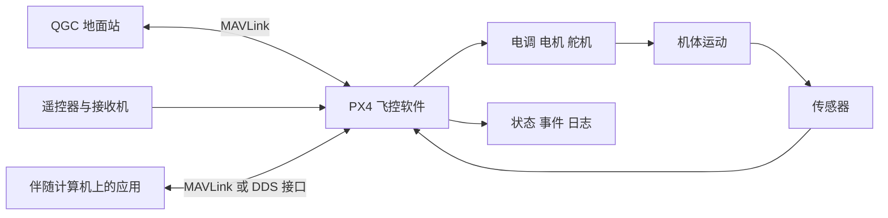
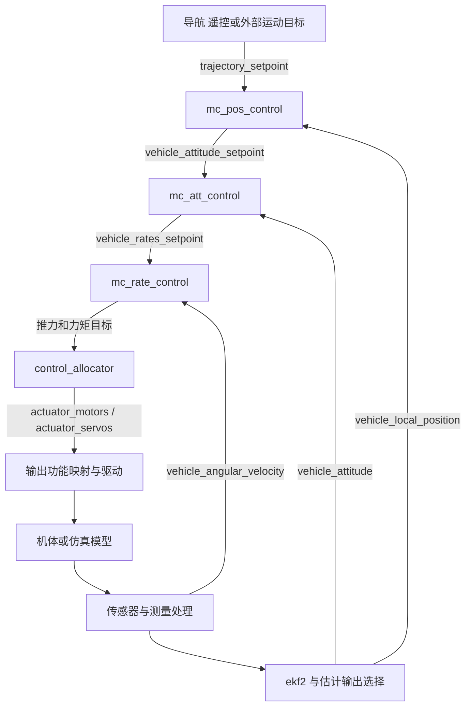

# PX4 从零系统导读：组成、源码、接口、仿真与调试

本文作为**全局组成与术语参考**。连续学习入口是[实战主文档](WORKBOOK.md)，当前环境与实际验证以[实施记录](records/IMPLEMENTATION.md)为准。

[学习首页](README.md) · [工程全景详解](PROJECT_GUIDE.md) · [学习路线](ROADMAP.md) · [调试实战](DEBUGGING.md)

本文面向第一次接触飞控工程的读者。即使还不知道 SITL、uORB、飞控固件或 Offboard 是什么，也可以从第一章连续阅读。目标是把一套系统讲清楚：每部分为什么存在、输入输出是什么、实现在哪里、怎样运行和观察，以及发生问题后沿哪条路径查找。

全文用多旋翼贯穿讲解，同时给出其他机型、硬件和辅助模块的入口。先理解系统关系，再沿链接进入实现；算法推导、板卡差异和完整开发练习由已有专题文档继续展开。

**源码依据：2026-11-04，分支 `learn/px4-v1.17.0`，编写前提交 `310e5c30ee64784b13c94de430c463ebe4656024`，基于上游标签 `v1.17.0`。** 本文中的实验步骤供读者执行。本次核对了源码、配置和本机环境入口，Docker 检查未连接到服务，因此没有重新编译、运行仿真或验证飞行。文中的“预期”与“成功条件”不是本次已执行的结果。

## 阅读导航

| 当前问题 | 阅读位置 |
|---|---|
| PX4、飞控板、地面站分别是什么 | [1. 整套系统](#system) |
| SITL、SIH、Gazebo、HITL 都是什么意思 | [2. 仿真基本概念](#simulation-basics) |
| PX4 内部有哪些部分，怎样协作 | [3. 功能地图](#architecture)、[4. 控制闭环](#flight-loop) |
| 工程文件在哪里，代码怎样运行 | [5. 目录与构建启动](#source)、[6. 模块与调度](#runtime) |
| 每次按 F5 或启动仿真，究竟有哪些代码参与 | [5.6～5.11：当前启动的源码地图](#startup-code) |
| uORB 是什么，消息长什么样 | [7. 内部数据接口](#uorb)、[8. 数据含义](#data-contracts) |
| 参数、命令、目标和状态有什么区别 | [9. 参数与行为接口](#configuration) |
| 传感器、电调、地面站、ROS 2 怎样连接 | [10. 硬件接口](#hardware-interfaces)、[11. 外部应用接口](#external-interfaces) |
| 仿真器怎样接入 PX4，怎样选择模型 | [12. 仿真实现](#simulation-internals) |
| 在当前电脑上怎样开始实验 | [13. 环境与仿真实践](#first-simulation) |
| 可以怎样调试、看日志、下断点 | [14. 调试方法](#debugging)、[15. 分层排错](#troubleshooting) |
| 怎样修改代码并验证自己的功能 | [16. 开发与验证](#development)、[17. 学习安排](#learning) |
| 其他模块做什么，有哪些术语 | [附录 A：模块目录索引](#module-index)、[附录 B：术语表](#glossary) |

<a id="system"></a>
## 1. 先认识整套系统

### 1.1 飞控硬件与飞控软件

无人机飞行时，机体姿态、速度和位置不断变化。软件需要反复读取传感器，判断当前状态，计算控制量，再让电机或舵机产生作用。承担这些职责的软硬件通常统称“飞控”，阅读工程时要把二者分开。

**飞控板是硬件。** 它提供处理器、内存、存储、传感器连接、时钟以及输入输出接口。**PX4 是软件。** 它能被编译为相应飞控板的固件，也能被编译为电脑上的程序。

“固件”可以先理解为面向特定硬件构建并部署的软件。编译出了固件，不代表已经把它刷入板卡；刷入后还需要正确的机型、参数和设备配置。

| 对象 | 通常在哪里 | 主要职责 |
|---|---|---|
| 飞控板 | 飞机上 | 执行实时程序、连接设备 |
| PX4 | 飞控板或仿真电脑上 | 估计、控制、任务、模式、设备和通信管理 |
| 传感器 | 飞控板内或外接设备 | 测量角速度、加速度、气压、位置等 |
| 电调、电机、舵机 | 飞机上 | 把控制指令变成力、力矩和机械运动 |
| QGroundControl，简称 QGC | 地面电脑或其他终端上 | 配置、校准、航线规划、状态显示、人工操作 |
| 伴随计算机 | 飞机上与飞控协作的另一台计算机 | 运行视觉、规划、业务应用等 |
| 仿真器 | 开发电脑上，或作为内部模型运行 | 计算虚拟载具运动并生成模拟测量 |
| 开发工具 | 开发电脑或容器内 | 编译、代码索引、调试、测试和日志分析 |

电调是“电子调速器”，接收控制指令后驱动电机。PX4 输出一个数字到电调，距离“螺旋桨产生预期推力”之间还隔着协议、电气、电机和机体等环节。

### 1.2 一套常见系统怎样连接



箭头表示信息或物理作用关系。QGC 负责操作与观察，PX4 内部承担正常的高速飞行控制。伴随计算机可以提供新的运动目标或外部定位测量，但使用哪类接口，决定 PX4 怎样处理这些数据。

“识别一个目标并飞过去”需要感知、目标定位、路径或轨迹生成、飞行控制等能力。PX4 提供飞控和接入机制，应用仍需明确感知与规划由哪些程序实现。

### 1.3 三种常见部署

| 部署方式 | PX4 运行在哪里 | 其他主要部分 |
|---|---|---|
| 实体飞控独立运行 | 飞控板，常见系统为 NuttX | 真实传感器、遥控、动力、地面站 |
| 飞控加伴随计算机 | 飞控板；应用在另一个 Linux 系统中 | 外部程序通过协议提供数据或目标 |
| 电脑仿真 | 电脑上的原生 PX4 程序 | 模型代替真实机体和部分设备，QGC 和应用仍可接入 |

NuttX 是面向嵌入式系统的实时操作系统。工程中的 POSIX 平台适配用于承载相应电脑/Linux 等环境中的代码。不同平台共享许多上层算法，但底层驱动、调度和可用资源会有差异。

更多硬件与部署形式见 [ARCHITECTURE 第 2～4 章](ARCHITECTURE.md#deployment)。

<a id="simulation-basics"></a>
## 2. 从闭环理解 SITL、SIH、Gazebo 与 HITL

### 2.1 “在环”中的环是什么

假设飞机向右倾斜。传感器测出变化，PX4 估计姿态并与目标比较，控制器计算纠正需求，电机改变作用，飞机产生新的运动，传感器再测量。这种“输出影响对象，测量反馈回来”的过程叫**闭环**。

仿真把其中的机体、动力和传感器等对象替换为数学模型。模型根据电机指令计算运动，再生成测量给飞控，循环继续。


三维画面帮助观察，但形成闭环的关键是控制量和测量实际交换。没有图形窗口也可以运行闭环；模型出现在窗口里也不证明飞控已经接入。

### 2.2 SITL：飞控软件在电脑上运行

**SITL = Software In The Loop，软件在环仿真。** PX4 被编译为电脑上的可执行程序，模型提供它需要的模拟测量并接收输出。这样可以在没有实体飞控板的情况下研究软件行为。

当前工程常用构建目标为 `px4_sitl_default`，主要程序是 `build/px4_sitl_default/bin/px4`。SITL 中依然运行所选择的估计、模式和控制代码；输入输出通过仿真路径连接。

SITL 适合验证程序逻辑、模块接口、任务和控制闭环。电脑上的线程调度、算力和设备路径与真实板卡不同，因此还需要相应硬件实验来验证实际总线、时序和电气行为。

### 2.3 SIH 与 Gazebo：谁来提供模型

| 名称 | 基本含义 | 与当前工程的关系 |
|---|---|---|
| SIH | Simulation In Hardware，PX4 内置的一套仿真模型机制 | 可以用于电脑 SITL；当前 `sihsim_quadx` 就属于这一组合 |
| Gazebo | 外部机器人仿真系统，包含物理模型、世界和传感器等 | 当前 `gz_x500` 通过 `gz_bridge` 与 PX4 交换数据 |
| Gazebo Classic | 另一代 Gazebo 实现及对应接入链 | 与当前 `gz` 目标的依赖、插件和桥接不同 |
| jMAVSim | 面向飞行仿真的另一种模型工具 | 工程保留其启动与仿真接入路径 |
| JSBSim、FlightGear | 飞行动力学或飞行仿真生态中的其他组件 | 按对应桥接和目标使用，不能假设与 `gz` 目标互换 |

SIH 名称中的 Hardware 不表示每次使用它都要有实体飞控。SITL 描述“飞控软件在哪里执行”，SIH/Gazebo 描述“模型由谁提供”。

### 2.4 HITL：真实飞控板参与闭环

**HITL/HIL = Hardware In The Loop，硬件在环仿真。** 一种典型方式是让真实飞控板执行 PX4，电脑模型通过支持的接口提供测量并接收输出。

它能纳入真实处理器和部分硬件运行链。哪些驱动和接口参与、哪些被模拟、支持什么板卡和模型，要按具体方案核对。它也不自动覆盖真实机体振动、电机干扰或实际飞行环境。

### 2.5 三类数据必须分清

| 数据 | 谁产生 | 作用 |
|---|---|---|
| 模型真值，ground truth | 仿真模型 | 表示模型内部的实际位置、姿态等，可用来评价误差 |
| 模拟测量 | 传感器模型 | 模拟传感器能看到的信息，可包含噪声、偏置、延迟 |
| 状态估计 | PX4 估计器 | 根据测量得到正常控制链使用的反馈 |

例如模型高度为 5 米，气压计测量带有误差，估计器融合后得到另一个高度值。要分别比较测量误差、估计误差和控制跟踪误差。把模型真值直接接到控制器，会改变正在验证的系统。

<a id="architecture"></a>
## 3. PX4 内部的功能地图

PX4 可以按“测量、估计、决策、控制、执行”理解，旁边由运行平台、通信、配置和记录提供支持。

| 功能 | 回答的问题 | 主要实现入口 |
|---|---|---|
| 设备驱动 | 如何从器件读数据或向器件发指令 | [src/drivers](../src/drivers) |
| 测量处理 | 哪个传感器可用，测量怎样校准、滤波和组织 | [sensors](../src/modules/sensors) |
| 状态估计 | 现在的位置、速度、姿态是什么，可信度怎样 | [ekf2](../src/modules/ekf2) |
| 人工输入 | 操作者给了什么杆量或模式请求 | [rc_update](../src/modules/rc_update)、[manual_control](../src/modules/manual_control) |
| 模式与安全管理 | 当前允许怎样控制，异常后采取什么动作 | [commander](../src/modules/commander) |
| 导航与任务 | 下一步飞哪个航点，怎样返航或降落 | [navigator](../src/modules/navigator) |
| 模式相关目标生成 | 把模式和操作意图变成连续运动目标 | [flight_mode_manager](../src/modules/flight_mode_manager) |
| 位置与速度控制 | 怎样接近期望位置和速度 | [mc_pos_control](../src/modules/mc_pos_control) |
| 姿态控制 | 怎样接近期望机体朝向 | [mc_att_control](../src/modules/mc_att_control) |
| 角速度控制 | 怎样接近期望旋转速度 | [mc_rate_control](../src/modules/mc_rate_control) |
| 控制分配 | 整机的推力、力矩需求分给哪些电机或舵机 | [control_allocator](../src/modules/control_allocator) |
| 输出处理 | 控制量怎样映射通道并通过设备协议发送 | [mixer_module](../src/lib/mixer_module)、输出驱动 |
| 外部通信 | 地面站和应用怎样交换数据、参数、命令与任务 | [mavlink](../src/modules/mavlink)、[uxrce_dds_client](../src/modules/uxrce_dds_client) |
| 配置与记录 | 保存哪些参数、任务和历史运行数据 | [parameters](../src/lib/parameters)、[dataman](../src/modules/dataman)、[logger](../src/modules/logger) |
| 平台与运行基础 | 哪个线程何时运行，消息和时间怎样管理 | [platforms](../platforms)、[uORB](../platforms/common/uORB) |

`mc` 表示 multicopter，多旋翼；`fw` 表示 fixed wing，固定翼。这些前缀帮助识别模块服务的机型。附录 A 给出当前 `src/modules` 的全部一级目录及职责，辅助模块也可以从那里定位。

### 3.1 模式、解锁与落地状态分别表达什么

**模式**描述当前怎样生成目标、启用哪些控制能力，例如位置保持、任务、返航或外部控制。**解锁状态**描述系统是否进入允许运行动力等的相应状态。**落地状态**是系统对是否接触地面等情况的判断。

它们不是同一个变量。飞机可以处于某个位置相关模式，但仍然上锁并停在地面。理解“模块已启动但没有电机输出”时，需要同时检查这些条件。

Commander 负责模式、健康检查、解锁与失效保护等管理；控制器负责具体计算。相关代码在 [Commander.cpp](../src/modules/commander/Commander.cpp)、[HealthAndArmingChecks](../src/modules/commander/HealthAndArmingChecks) 和 [failsafe](../src/modules/commander/failsafe)。

### 3.2 导航和轨迹生成怎样协作

航点任务描述“去哪里、到达后做什么”。Navigator 管理任务推进、返航和其他导航行为。多旋翼 Flight Mode Manager 根据模式选择 FlightTask，结合状态与限制生成相应目标。

航点是任务层目标，控制器通常需要持续更新、满足速度和加速度等限制的运动目标。对应入口为 [mission.cpp](../src/modules/navigator/mission.cpp)、[FlightModeManager.cpp](../src/modules/flight_mode_manager/FlightModeManager.cpp) 和 [FlightTaskAuto.cpp](../src/modules/flight_mode_manager/tasks/Auto/FlightTaskAuto.cpp)。

Offboard 应用可以提供自己的运动目标，进入适合该控制层级的接口，具体路径还受控制模式约束。

<a id="flight-loop"></a>
## 4. 把一次飞行沿模块串起来

### 4.1 从运动目标到电机

下面展示多旋翼位置控制的一条主要数据链。箭头表示数据关系，运行时通过消息和调度衔接，不能把它理解为一个函数顺序调用所有模块。



模式决定启用哪几层。例如角速度模式可以直接提供角速度目标，无须先经过位置控制。控制分配还会向控制器反馈无法实现的需求或饱和状态，图中省略了这些旁路。

### 4.2 四个控制层分别计算什么

| 层次 | 基本思路 | 主要算法入口 |
|---|---|---|
| 位置 | 根据位置误差得到速度修正，并与速度前馈组合 | [PositionControl::_positionControl](../src/modules/mc_pos_control/PositionControl/PositionControl.cpp) |
| 速度 | 根据速度误差和状态变化计算加速度需求，再换算为推力相关目标 | 同文件的 `_velocityControl()`、`_accelerationControl()` |
| 姿态 | 根据当前与期望姿态之间的旋转误差，得到角速度目标 | [AttitudeControl::update](../src/modules/mc_att_control/AttitudeControl/AttitudeControl.cpp) |
| 角速度 | 根据角速度误差、积分、角加速度与前馈，得到力矩需求 | [RateControl::update](../src/lib/rate_control/rate_control.cpp) |

P、I、D 分别对应比例、积分、微分作用。比例根据当前误差纠正，积分用于处理持续偏差，微分项反映变化趋势。实际工程还需要前馈、滤波、限幅、状态重置和防止积分过度累积等处理。

可以先看懂输入、输出和约束，再学习公式。姿态控制涉及四元数；四元数是一种表示三维旋转的方法，当前姿态消息使用 `w, x, y, z` 排列。

### 4.3 IMU 同时服务估计和快速控制

IMU 是惯性测量单元，核心测量通常包括陀螺仪角速度和加速度计比力。加速度计读数还与重力、姿态和器件安装有关，不能直接把某一轴读数当作世界坐标下的位置二阶导数。

经过驱动和预处理后，惯性测量形成两类主要用途：

- 估计路径将惯性测量与 GPS、气压、磁场、视觉等信息结合，产生位置、速度、姿态和偏置估计。
- 角速度控制路径使用经处理的陀螺仪数据，通过 `vehicle_angular_velocity` 等接口提供快速反馈；偏置与传感器选择等又会与其他模块协作。

具体从 [VehicleIMU.cpp](../src/modules/sensors/vehicle_imu/VehicleIMU.cpp)、[VehicleAngularVelocity.cpp](../src/modules/sensors/vehicle_angular_velocity/VehicleAngularVelocity.cpp) 和 [EKF2.cpp](../src/modules/ekf2/EKF2.cpp) 跟踪。多估计器实例时，还需看 [EKF2Selector.cpp](../src/modules/ekf2/EKF2Selector.cpp) 如何选择输出。

### 4.4 估计器为什么要融合多种测量

陀螺仪能快速反映旋转变化，但积分会积累误差；GPS 提供位置与速度信息，但更新率、精度和可用环境不同。估计器将运动模型与这些观测结合，以获得持续可用的状态。

EKF 是扩展卡尔曼滤波器。入门先掌握三个动作：**预测**根据上一状态和运动信息推进；**融合**利用新的观测修正状态；**检查**判断观测是否可信、状态是否有效、是否需要重置或退化处理。

某传感器在发布消息，并不等于估计器正在使用它。需要结合融合状态、观测残差及其统计、拒绝条件和时间信息判断。算法主体在 [ekf2/EKF](../src/modules/ekf2/EKF)，基础解释见 [TECHNICAL 第 6 章](TECHNICAL.md#c6)。

### 4.5 控制分配之后还有输出层

控制分配根据机体几何和执行器能力，把整机推力、力矩需求转换为各电机或舵机的控制量。机型参数中的电机位置、转向和作用方向会影响结果。

`actuator_motors.control` 是归一化推力控制量，其数值不是 PWM 微秒、实际转速或牛顿。随后输出层按功能映射、推力模型、输出范围和状态约束处理，再交给 PWM、DShot、CAN 或仿真接口。

实现入口为 [ControlAllocator.cpp](../src/modules/control_allocator/ControlAllocator.cpp)、[控制分配算法库](../src/lib/control_allocation) 和 [FunctionMotors.hpp](../src/lib/mixer_module/functions/FunctionMotors.hpp)。

<a id="source"></a>
## 5. 从源码目录到正在运行的 PX4

### 5.1 目录按职责阅读

| 路径 | 保存什么 | 什么时候查 |
|---|---|---|
| [src/modules](../src/modules) | 各类运行功能 | 找估计、控制、模式、通信等实现 |
| [src/drivers](../src/drivers) | 设备与输出驱动 | 接传感器、电调、外部硬件 |
| [src/lib](../src/lib) | 算法与公共库 | 查看模块复用的计算和基础能力 |
| [src/examples](../src/examples) | 小型示例 | 初次读模块、练习发布订阅 |
| [src/systemcmds](../src/systemcmds) | 控制台工具 | 查 `listener`、`param`、`perf` 等命令实现 |
| [platforms](../platforms) | 平台适配、消息和运行设施等 | 查程序入口、操作系统、线程、工作队列 |
| [boards](../boards) | 板级配置、功能选择和相关代码 | 确认编译目标支持什么 |
| [ROMFS](../ROMFS) | 启动脚本、机型配置等资源 | 追踪默认启动和参数选择 |
| [msg](../msg)、[srv](../srv) | 消息及相关服务定义 | 查字段、版本、接口约定 |
| [Tools](../Tools) | 仿真资源、开发和构建辅助工具 | 启动环境、生成元数据、分析数据 |
| [test](../test)、模块附近的测试 | 不同层次的验证代码 | 检查预期行为与回归 |
| [cmake](../cmake)、根 Makefile/CMakeLists | 构建规则 | 查配置如何变成编译和链接过程 |
| [docs](../docs)、[learn](.) | 文档 | 概念、操作、接口与学习导航 |
| `build/` | 当前目标生成的文件 | 查可执行文件、生成头、编译数据库、日志等 |

部分库算法放在模块子目录，例如位置控制算法位于 `mc_pos_control/PositionControl/`。不能仅靠“算法一定在 src/lib”来定位。

### 5.2 四类配置决定不同的事情

| 配置 | 例子 | 决定什么 |
|---|---|---|
| 平台与板型 | `px4_sitl_default`、`px4_fmu-v6x_default` | 运行平台、硬件及构建配置 |
| 功能选择 | `.px4board` 中的 `CONFIG_...`、Kconfig | 哪些模块和库被编入 |
| 机型与启动 | `SYS_AUTOSTART`、airframe、`rcS` | 默认参数、设备和模块启动组合 |
| 运行参数 | `MPC_XY_P` 等 | 当前模块使用的行为配置，是否立即生效取决于实现 |

`make px4_sitl_default gz_x500` 中，`px4_sitl_default` 选择构建目标，`gz_x500` 选择后续仿真运行目标。它们分别影响构建和启动。

### 5.3 构建实际做什么

根 [Makefile](../Makefile) 提供常用入口，CMake 根据配置组织模块、库与依赖，再由相应构建工具完成编译链接。过程中还会生成 uORB 消息头、参数元数据、模块命令表等文件。

```text
源码 + 板型/功能配置 + 固定版本的依赖
    → 配置与代码生成
    → 编译各个源文件
    → 链接可执行程序或固件
    → 部署/启动并观察行为
```

`compile_commands.json` 记录具体源文件的编译命令，编辑器用它定位头文件和宏定义。生成头可能在构建目录内；索引环境的路径必须能访问这些文件。

仓库还有 Git 子模块，即主仓库记录的独立依赖仓库。复现版本时要同时核对主仓库和子模块提交。详细说明见 [DEVELOPMENT 第 2～3 章](DEVELOPMENT.md#d2)。

### 5.4 启动怎样把功能组织起来

当前 SITL 的主要入口可以这样追踪：

```text
platforms/posix/src/px4/common/main.cpp
    → ROMFS/px4fmu_common/init.d-posix/rcS
    → 载入保存参数，按仿真模型选择 airframe
    → 启动仿真输入、测量、估计、Commander 等
    → rc.vehicle_setup 按机型选择启动组合
    → 多旋翼 rc.mc_apps 启动控制与相关模块
```

源码：[main.cpp](../platforms/posix/src/px4/common/main.cpp)、[POSIX rcS](../ROMFS/px4fmu_common/init.d-posix/rcS)、[rc.vehicle_setup](../ROMFS/px4fmu_common/init.d/rc.vehicle_setup)、[rc.mc_apps](../ROMFS/px4fmu_common/init.d/rc.mc_apps)。这是入口关系，具体先后、条件和参数覆盖以脚本为准。

真机启动还涉及芯片/板级初始化、操作系统和 [NuttX 用 rcS](../ROMFS/px4fmu_common/init.d/rcS)。同名功能在 SITL 与真机中的设备输入和启动条件可能不同。

### 5.5 存在、编入、启动、参与控制是四个状态

例如 `work_item` 有源文件，当前 SITL 配置也启用了它，但需要启动命令才能运行。再如位置控制模块已经启动，但当前模式可能不启用位置控制。

排查功能时依次检查：目录和注册 → 当前构建配置 → 运行状态 → 数据与模式条件。直接在源码里发现某个函数，不足以证明当前程序正在执行它。

<a id="startup-code"></a>
### 5.6 一次终端或 F5 启动实际选择哪套代码

以普通 Debug SITL 加 SIH 四旋翼为例。终端显式选择程序、运行目录与 `PX4_SIM_MODEL=sihsim_quadx`、`PX4_SIMULATOR=sihsim`；VS Code 则把同样信息放在 launch 配置。完整教学入口见[实验材料](WORKBOOK.md#build-example)，调试入口见[GDB 实验](WORKBOOK.md#debug-lab)。

历史 `px4-sih-debug.code-workspace` 已删除；它的字段和删除影响仍可在[工作区解释](DEBUGGING.md#workspace-explained)查阅。下面研究 PX4 自身的启动选择，教学模块需额外手动 start。

这次启动由配置中的几个值确定：

| 配置层 | 本例的值 | 对应源码或作用 |
|---|---|---|
| 构建目标 | `px4_sitl_default` | [boards/px4/sitl/default.px4board](../boards/px4/sitl/default.px4board) 及关联 Kconfig 选择代码 |
| 构建类型 | `Debug` | 显式构建命令或 preLaunchTask 生成调试程序；增量构建复用未变化产物 |
| 程序 | `build/px4_sitl_default/bin/px4` | GDB 实际启动的可执行文件 |
| 模型 | `PX4_SIM_MODEL=sihsim_quadx` | 默认按名称匹配机型编号 10040 |
| 仿真分支 | `PX4_SIMULATOR=sihsim` | 选择内部 SIH 仿真启动路径 |
| 启动资源 | `ROMFS/px4fmu_common` | 提供启动脚本与机型配置 |
| 保存参数 | 运行目录中的参数及备份文件 | 会影响条件启动和各模块内部行为 |

本例以未另行覆盖模型/机型的正常 SITL 启动为前提。继承的环境变量、保存参数、回放模式、自定义脚本以及命令失败都可能改变实际结果。下面是依据当前源码得到的启动路径，运行结果应再用状态和断点确认。

### 5.7 从程序入口到启动脚本，再到模块

```text
F5：先构建 px4_sitl_default，再由 GDB 启动 bin/px4
    │
    ▼
platforms/posix/src/px4/common/main.cpp
    ├─ 解析参数，设置运行目录与命令服务
    ├─ 平台初始化：时钟、工作队列、参数、uORB 等
    └─ run_startup_script(...)
         │
         ▼
ROMFS/px4fmu_common/init.d-posix/rcS
    ├─ 根据环境选择机型，加载/处理参数
    ├─ 执行 airframes/10040_sihsim_quadx
    │    └─ rc.mc_defaults：设 VEHICLE_TYPE=mc 和多旋翼默认值
    ├─ dataman start
    ├─ px4-rc.simulator → px4-rc.sihsim
    │    ├─ simulator_sih start
    │    └─ 按参数启动模拟气压、GPS、磁场等
    ├─ 负载、电源、人工输入等通用模块
    ├─ sensors start
    ├─ commander start
    ├─ 按参数选择估计器，例如 ekf2 start
    ├─ pwm_out_sim start -m sim
    ├─ rc.vehicle_setup → rc.mc_apps
    │    └─ 控制分配、角速度、姿态、位置等多旋翼模块
    ├─ navigator start
    ├─ DDS、可选辅助模块和 MAVLink 等
    └─ rc.logging：按日志配置启动 Logger
         │
         ▼
main.cpp 中进入 pxh 控制台；已经启动的模块继续在后台运行
```

入口代码见 [main.cpp](../platforms/posix/src/px4/common/main.cpp)，基础设施初始化见 [px4_init.cpp](../platforms/posix/src/px4/common/px4_init.cpp)。启动脚本见 [rcS](../ROMFS/px4fmu_common/init.d-posix/rcS)，机型配置见 [10040_sihsim_quadx](../ROMFS/px4fmu_common/init.d-posix/airframes/10040_sihsim_quadx)。

这张图表达脚本中的启动组织关系。某些模块在被启动后立刻执行，其他启动命令仍在进行；`ekf2 start &` 还涉及后台启动。因此它不是所有算法首次执行顺序的精确时间线。

### 5.8 这次启动中，命令对应哪些 C++ 文件

下表中的“启动方式”表示脚本会执行或按条件尝试该命令。命令可能因配置、依赖或初始化失败而不成功，需看实际输出。

| 模块命令 | 由哪里启动 / 条件 | 首先打开的源码与执行入口 |
|---|---|---|
| `simulator_sih start` | `px4-rc.sihsim`，选择 SIH 分支后 | [sih.cpp](../src/modules/simulation/simulator_sih/sih.cpp)：`Sih::run()`、仿真循环 |
| `sensor_baro_sim start` | SIH 脚本，`SENS_EN_BAROSIM=1` | [SensorBaroSim.cpp](../src/modules/simulation/sensor_baro_sim/SensorBaroSim.cpp) |
| `sensor_gps_sim start` | SIH 脚本，`SENS_EN_GPSSIM=1` | [SensorGpsSim.cpp](../src/modules/simulation/sensor_gps_sim/SensorGpsSim.cpp) |
| `sensor_mag_sim start` | SIH 脚本，`SENS_EN_MAGSIM=1` | [SensorMagSim.cpp](../src/modules/simulation/sensor_mag_sim/SensorMagSim.cpp) |
| `sensors start` | 主 `rcS` | [sensors.cpp](../src/modules/sensors/sensors.cpp)：`Sensors::Run()`，内部还组织测量处理工作项 |
| `commander start` | 主 `rcS` | [Commander.cpp](../src/modules/commander/Commander.cpp)：`Commander::run()` |
| `ekf2 start` | 主 `rcS`，`EKF2_EN=1` | [EKF2.cpp](../src/modules/ekf2/EKF2.cpp)：`EKF2::Run()`；多实例时还有选择器 |
| `pwm_out_sim start -m sim` | 主 `rcS` | [PWMSim.cpp](../src/modules/simulation/pwm_out_sim/PWMSim.cpp) |
| `control_allocator start` | `rc.mc_apps` | [ControlAllocator.cpp](../src/modules/control_allocator/ControlAllocator.cpp)：`ControlAllocator::Run()` |
| `mc_rate_control start` | `rc.mc_apps` | [MulticopterRateControl.cpp](../src/modules/mc_rate_control/MulticopterRateControl.cpp)：`MulticopterRateControl::Run()` |
| `mc_att_control start` | `rc.mc_apps` | [mc_att_control_main.cpp](../src/modules/mc_att_control/mc_att_control_main.cpp)：`MulticopterAttitudeControl::Run()` |
| `mc_hover_thrust_estimator start` | `rc.mc_apps` | [mc_hover_thrust_estimator](../src/modules/mc_hover_thrust_estimator) |
| `flight_mode_manager start` | `rc.mc_apps` | [FlightModeManager.cpp](../src/modules/flight_mode_manager/FlightModeManager.cpp)：`FlightModeManager::Run()` |
| `mc_pos_control start` | `rc.mc_apps` | [MulticopterPositionControl.cpp](../src/modules/mc_pos_control/MulticopterPositionControl.cpp)：`MulticopterPositionControl::Run()` |
| `land_detector start multicopter` | `rc.mc_apps` | [land_detector](../src/modules/land_detector) 的多旋翼实现 |
| `navigator start` | 主 `rcS` | [navigator_main.cpp](../src/modules/navigator/navigator_main.cpp)：`Navigator::run()` |
| `uxrce_dds_client start ...` | 主 `rcS` | [uxrce_dds_client](../src/modules/uxrce_dds_client)，模块启动不代表外部 Agent 已连接 |
| `mavlink start ...` | [px4-rc.mavlink](../ROMFS/px4fmu_common/init.d-posix/px4-rc.mavlink)，可能多个通信实例 | [mavlink_main.cpp](../src/modules/mavlink/mavlink_main.cpp)、接收与流处理 |
| `logger start ...` | [rc.logging](../ROMFS/px4fmu_common/init.d/rc.logging)，日志后端启用时 | [logger.cpp](../src/modules/logger/logger.cpp) |
| `work_item_example start` | 本例由你在 `pxh>` 手动执行，默认脚本没有启动它 | [WorkItemExample.cpp](../src/examples/work_item/WorkItemExample.cpp)：`WorkItemExample::Run()` |

通用辅助模块也会参与：`dataman`、`load_mon`、`system_power_simulator`、`tone_alarm`、`rc_update`、`manual_control`、`payload_deliverer`。模拟电池由 `SIM_BAT_ENABLE` 控制；主脚本还按参数选择 Zenoh、云台、相机触发/反馈、陀螺仪频谱/校准、内燃机控制等。多旋翼脚本中的自动调参由 `MC_AT_EN` 控制，神经网络控制由 `MC_NN_EN` 等配置约束。

这些辅助功能和条件的完整启动清单直接看 [rcS](../ROMFS/px4fmu_common/init.d-posix/rcS) 与 [rc.mc_apps](../ROMFS/px4fmu_common/init.d/rc.mc_apps)。自动调参模块启动不表示立即开始调参，Navigator 启动也不表示已经执行航线。

### 5.9 一行 `mc_pos_control start` 怎样走进函数

在 CMake 中，`MAIN mc_pos_control` 注册了一个命令。构建生成的命令表把字符串 `mc_pos_control` 映射到 `mc_pos_control_main()`。当前生成文件位于 `build/px4_sitl_default/platforms/posix/apps.cpp`；它属于构建产物，应查看生成结果而不是直接修改。

SITL 启动脚本通过 `px4-alias.sh` 和命令客户端把请求转给运行中的 PX4；PX4 的 [Pxh::process_line](../platforms/posix/src/px4/common/px4_daemon/pxh.cpp) 按命令表分发。于是源码路径是：

```text
脚本或 pxh：mc_pos_control start
    → 命令分发到 mc_pos_control_main(argc, argv)
    → MulticopterPositionControl::main(argc, argv)
    → 模块框架处理 start
    → task_spawn() 创建对象
    → 构造函数，接入指定工作队列、准备参数和发布器
    → init() 注册 vehicle_local_position 回调，并安排首次运行
    → 工作队列调用 Run()
    → Run() 按新数据、模式和目标条件进入位置控制算法
```

这解释了为什么只在 `main.cpp` 搜索 `mc_pos_control` 看不到完整调用链：中间经过脚本、命令表和调度。

启动之后，工作项 `Run()` 由消息和调度重复触发，通常不是重新执行一遍 C++ `main()`。在电脑 PX4 中，许多模块在主程序内部以线程或工作队列执行，不能用“一个模块目录等于一个 Linux 进程”去判断运行情况。

### 5.10 为什么打开同一工程，有时运行到的代码不同

| 变化 | 会改变什么 |
|---|---|
| 仅打开 VS Code 或源码文件 | 编辑器读取文件，本身没有启动 PX4 飞行逻辑 |
| 只执行 `make px4_sitl_default` | 构建目标；不会因此自动执行完整飞行仿真 |
| 运行当前 SIH 调试配置 | 选择 10040 机型与 SIH 路径，启动对应四旋翼系统 |
| 使用 `make px4_sitl_default gz_x500` | 通常仍构建同一 SITL 目标，但模型改为 `gz_x500`，对应机型为 4001；进入 Gazebo 启动与 `gz_bridge` 路径 |
| 修改保存参数或环境变量 | 可能改变启动条件、估计器选择、传感器或算法分支 |
| 从地面上锁进入起飞/位置模式 | 已启动模块的控制启用、目标处理、积分与输出等分支发生变化 |
| 手动启动 `work_item_example` | 在正在运行的 PX4 中增加该示例工作项 |
| 改为真实板卡目标 | 需要对应固件、入口和驱动，不再沿电脑 SITL 的同一平台启动路径 |

当前 [SITL 默认配置](../boards/px4/sitl/default.px4board) 同时启用了多旋翼和一些固定翼模块，但四旋翼启动路径选择 `rc.mc_apps`，不会因为固定翼代码编入就自动执行固定翼控制。`work_item` 也属于已编入但需要手动启动的例子。

进一步看“函数被调用”与“内部算法执行”：

- `MulticopterPositionControl::Run()` 可以因首次安排、新位置数据或备用调度进入，但还会检查 `flag_multicopter_position_control_enabled` 等条件，才进入相应位置控制处理。
- `MulticopterRateControl::Run()` 收到新的角速度数据后，还需检查 `flag_control_rates_enabled` 等条件，才进入相关角速度控制分支。
- `ControlAllocator::Run()` 有消息触发和备用调度；进入函数也不代表此刻必然产生有效的电机作用。

因此，打在 `Run()` 入口的断点回答“模块有没有被调度”；打在算法调用或发布语句上的断点回答“是否走到了这一行为”。

### 5.11 怎样亲眼确认本次启动经过了哪些代码

**先看启动配置和脚本，再用运行证据确认。** 在宿主或容器的源码根目录可以搜索：

```bash
rg -n '^CONFIG_(MODULES_(EKF2|MC_POS_CONTROL|FW_ATT_CONTROL)|EXAMPLES_WORK_ITEM)=' boards/px4/sitl/default.px4board
rg -n 'start|rc.vehicle_setup|rc.logging' ROMFS/px4fmu_common/init.d-posix/rcS
rg -n 'start' ROMFS/px4fmu_common/init.d/rc.mc_apps ROMFS/px4fmu_common/init.d-posix/px4-rc.sihsim
rg -n 'MAIN|SRCS|MulticopterPositionControl' src/modules/mc_pos_control/CMakeLists.txt
```

配置与搜索结果只能说明构建选择和可能的启动路径，必须连同周围的 `if` 条件阅读。不要把搜索到的全部 `start` 当成本次已成功启动列表。

启动后，在 **PX4 Shell**观察：

```text
param show SYS_AUTOSTART
simulator_sih status
sensors status
ekf2 status
commander status
mc_pos_control status
mc_att_control status
mc_rate_control status
control_allocator status
work_item_example status
work_queue status
listener vehicle_control_mode -n 1
```

若还未手动启动示例，预期其状态与那些自动启动的模块不同。`help` 列出的内置命令主要说明程序提供哪些命令，不能当成全部正在运行的模块；工作队列中的模块也不一定对应独立线程名。

**从程序入口调试，在 GDB run 或 VS Code F5 之前设置断点。** 按[调试实验](WORKBOOK.md#debug-lab)建立会话，用 `break 函数名`，或在 Run and Debug 的 BREAKPOINTS 区域 Add Function Breakpoint；也可设置源码行断点。

| 想确认的阶段 | 建议断点 | 命中后说明什么 |
|---|---|---|
| 程序入口 | POSIX `main.cpp` 中 `main()` 的首条可执行语句 | 当前 PX4 进程开始执行 |
| 即将执行启动脚本 | `run_startup_script` | 已到准备运行 `rcS` 的阶段，可查看 `commands_file` |
| 启动命令分发 | `mc_pos_control_main` | 收到了位置模块命令，检查参数是否为 `start`；其他动作也可调用此入口 |
| 创建位置模块 | `MulticopterPositionControl::task_spawn` | 正在创建并初始化该模块 |
| 位置模块得到调度 | `MulticopterPositionControl::Run` | 该工作项进入了执行，尚需检查内部条件 |
| 实际进入位置算法 | `PositionControl::update` | 走到了对应算法调用路径 |
| 手动启动的示例 | `WorkItemExample::Run` | 示例已启动且满足相应调度条件 |

一次选一到两个断点即可。对已经观察过的高频断点先禁用再继续，否则会不断停在同一模块，影响剩余启动过程。

`run_startup_script()` 调用外部 Shell 执行脚本，C++ 单步不会自动把 `.sh` 按 C++ 源码显示。要查看每条 Shell 命令，可在单独的启动诊断实验中临时启用 `rcS` 顶部已有的 `set -x`，重新构建并启动以记录命令轨迹，完成后恢复该修改。脚本轨迹与模块断点分别回答“发出了什么命令”和“执行到了什么 C++ 代码”。

这组断点用于启动追踪练习；本次已执行的 SIH、模块、测试与日志结果见[实施记录](records/IMPLEMENTATION.md)。运行状态观察不等于每个启动函数均有断点证据。

<a id="runtime"></a>
## 6. 模块怎样执行：任务、工作队列与生命周期

### 6.1 用一个小模块认识工程结构

[src/examples/work_item](../src/examples/work_item) 中四个文件的作用如下：

| 文件 | 作用 |
|---|---|
| `Kconfig` | 声明功能选择项 |
| `CMakeLists.txt` | 指定源文件、模块构建名、运行命令和依赖 |
| `WorkItemExample.hpp` | 声明类、方法、订阅、发布器、参数和状态 |
| `WorkItemExample.cpp` | 实现初始化、运行、状态显示与入口 |

当前 CMake 注册的构建名是 `examples__work_item`，`MAIN` 指定运行命令为 `work_item_example`。目录名、构建名和运行命令名各有用途。

### 6.2 对象、线程与工作项

C++ 类描述一类对象的数据与方法；对象被创建，不代表操作系统已经安排它持续运行。还要看模块如何启动执行上下文。

- **独立任务/线程**：拥有自己的执行流，可在循环中等待消息或事件。
- **工作队列**：一个线程执行排入队列的工作项；同一队列里的工作项共享该线程的执行时间。
- **定时或消息回调**：触发工作安排的机制。例如收到新的传感器消息后，把一个工作项安排到队列中。

共享队列里的 `Run()` 应及时完成；长时间等待或阻塞会影响同队列的其他工作项。需要等一个外部条件时，应结合框架选择适合的状态机、回调或任务方式。

### 6.3 WorkItem 的执行路径

```text
PX4 Shell：work_item_example start
    → 模块框架处理 start
    → task_spawn() 创建对象
    → init() 注册 sensor_accel 更新回调
    → 消息更新安排工作项
    → 工作队列执行 Run()
    → 检查退出、参数和订阅数据，再发布 orb_test
```

类声明中的 `ModuleBase` 提供模块命令与生命周期框架，`ModuleParams` 支持参数更新，`ScheduledWorkItem` 提供工作项调度能力。具体代码在 [WorkItemExample.hpp](../src/examples/work_item/WorkItemExample.hpp)、[WorkItemExample.cpp](../src/examples/work_item/WorkItemExample.cpp) 和 [SubscriptionCallback.hpp](../platforms/common/uORB/SubscriptionCallback.hpp)。

`status` 用来查看状态，`stop` 请求结束。停止路径需要清理调度、回调和资源，具体由各模块实现。移植示例时应完整检查退出逻辑，而不仅复制 `Run()`。

### 6.4 阅读真实模块的固定顺序

1. CMake 与 Kconfig：它叫什么、依赖什么、怎样选入目标。
2. 头文件中的输入输出：订阅谁，发布什么，保存哪些状态。
3. 初始化与触发源：由哪个消息或定时器驱动。
4. `Run()` 或任务循环：先看模式、有效性、超时和退出条件。
5. 算法调用与参数：再进入公式、限幅和更新逻辑。
6. 状态命令、日志和测试：找能观察与验证上述行为的入口。

不要假设全工程有一个固定频率的总循环。算法频率受输入发布、回调配置、工作队列和运行条件共同影响，要用实际统计核对。

<a id="uorb"></a>
## 7. 内部接口：uORB 的主题、消息与发布订阅

### 7.1 主题是有名字的数据接口

uORB 是 PX4 内部的发布订阅机制。发布者提供某种结构化数据，订阅者读取自己需要的数据，双方通常通过主题名和消息定义协作。

例如 `vehicle_attitude` 是姿态主题，`trajectory_setpoint` 是轨迹目标主题。消息定义描述字段，C++ 中生成相应结构体，运行时的发布器和订阅器负责交换数据。

```text
msg/*.msg 或 msg/versioned/*.msg
    → 构建生成 uORB 头文件和元数据
    → 模块填充消息并 publish()
    → 其他模块通过订阅 copy()/update()
    → listener、logger 或通信模块按各自配置读取
```

同一个 `.msg` 可以用 `# TOPICS` 声明多个主题名称。文件名、C++ 结构体名、主题名和外部协议消息名之间要逐项对应。

### 7.2 一个真实发布示例

在 [WorkItemExample.hpp](../src/examples/work_item/WorkItemExample.hpp) 中，发布器成员如下：

```cpp
uORB::Publication<orb_test_s> _orb_test_pub{ORB_ID(orb_test)};
```

意思是：这个对象持有一个发布器，发布 `orb_test_s` 类型的数据，目标主题为 `orb_test`。尖括号中的类型是 C++ 模板参数；花括号为对象提供初始化信息。

在 `Run()` 中填好数据再发布：

```cpp
orb_test_s data{};
data.val = 314159;
data.timestamp = hrt_absolute_time();
_orb_test_pub.publish(data);
```

`hrt_absolute_time()` 提供 PX4 相应时间基准下的微秒计数。订阅者读取到字段后，还要按消息的单位、时间和有效性规则使用它。

### 7.3 三种常见订阅

| 写法/机制 | 主要用途 | 阅读时关注 |
|---|---|---|
| `uORB::Subscription` | 在当前执行流中检查和读取数据 | 什么时候调用 `updated()`、`copy()` 或 `update()` |
| `uORB::SubscriptionInterval` | 对读取更新的节奏加间隔限制 | 间隔限制与发布频率的区别 |
| `uORB::SubscriptionCallbackWorkItem` | 新发布触发工作项调度 | 回调注册、实例选择、更新数要求、退出清理 |

普通订阅本身不会替你创建一个不断执行的线程。回调安排工作项，也不等于在发布者代码里直接执行整个控制算法。

### 7.4 缓存、队列与多实例

许多状态主题重点提供最近的数据；部分消息定义更深的队列以保留多条更新。订阅方处理得太慢仍可能丢失更新，uORB 也不是无限历史数据库。要保存连续历史，使用合适配置的 Logger。

同名主题可以有多个实例，例如多个传感器或估计器。实例编号、设备 ID、估计器选择和记录实例必须一致。观察实例 0 有数据，不证明当前控制链选择的正是实例 0。

实际字段和缓存行为可查 [消息定义](../msg)、[Publication.hpp](../platforms/common/uORB/Publication.hpp)、[Subscription.hpp](../platforms/common/uORB/Subscription.hpp) 与各模块使用处。

<a id="data-contracts"></a>
## 8. 接口里的数据究竟是什么意思

### 8.1 先区分测量、估计、目标、命令与状态

| 类型 | 例子 | 含义 |
|---|---|---|
| 测量 | `sensor_accel`、`sensor_gyro` | 传感器提供的信息，仍需结合校准、坐标和时间使用 |
| 估计 | `vehicle_attitude`、`vehicle_local_position` | 系统融合信息后得到的状态 |
| 目标 | `trajectory_setpoint`、`vehicle_rates_setpoint` | 控制系统希望达到的状态 |
| 控制输出 | `vehicle_torque_setpoint`、`actuator_motors` | 为达到目标而计算的作用需求 |
| 命令 | `vehicle_command` | 请求执行某项动作 |
| 命令结果 | `vehicle_command_ack` | 对对应命令的处理结果或进度 |
| 运行状态 | `vehicle_status`、`vehicle_control_mode` | 当前模式、解锁状态及控制启用信息 |
| 模型真值 | `vehicle_attitude_groundtruth` 等 | 仿真模型内部状态，用于评价和模拟测量等 |

它们可能都包含“位置”或“姿态”，但生产者、消费者和用途不同。把视觉测量送入目标接口，或把目标当成真实反馈，会改变系统含义。

### 8.2 沿主要控制主题理解字段

| 消息定义 | 重点字段 | 阅读时需要知道 |
|---|---|---|
| [VehicleAttitude.msg](../msg/versioned/VehicleAttitude.msg) | `q`、`timestamp_sample`、`quat_reset_counter` | 四元数为 `w,x,y,z`，表示机体 FRD 到地球 NED 的旋转；注意估计重置 |
| [VehicleLocalPosition.msg](../msg/versioned/VehicleLocalPosition.msg) | `x,y,z`、`vx,vy,vz`、`xy_valid` 等 | 局部位置和速度、有效性、参考原点与重置分别检查 |
| [TrajectorySetpoint.msg](../msg/versioned/TrajectorySetpoint.msg) | `position`、`velocity`、`acceleration`、`yaw` | 位置控制输入，NED 坐标；NaN 有明确的不控制语义 |
| [VehicleAttitudeSetpoint.msg](../msg/versioned/VehicleAttitudeSetpoint.msg) | `q_d`、`thrust_body` | 期望姿态与机体系归一化推力目标 |
| [VehicleRatesSetpoint.msg](../msg/versioned/VehicleRatesSetpoint.msg) | `roll,pitch,yaw`、`thrust_body` | 这里的 roll/pitch/yaw 是角速度目标，单位 rad/s |
| [VehicleTorqueSetpoint.msg](../msg/VehicleTorqueSetpoint.msg) | `xyz` | 绕机体各轴的归一化力矩目标 |
| [VehicleThrustSetpoint.msg](../msg/VehicleThrustSetpoint.msg) | `xyz` | 沿机体各轴的归一化推力目标 |
| [ActuatorMotors.msg](../msg/versioned/ActuatorMotors.msg) | `control[]`、`reversible_flags` | 每个电机的归一化推力控制量，反向支持和 NaN 含义见定义 |

目标传递中推力也会经过姿态和角速度目标消息继续传递。不能把串级控制误解为“角速度控制器单独负责根据位置决定总推力”。

### 8.3 一个消息格式的完整读法

当前轨迹目标消息的部分字段如下：

```text
uint64 timestamp
float32[3] position
float32[3] velocity
float32[3] acceleration
float32 yaw
float32 yawspeed
```

先从注释读单位：位置为米，速度为米/秒，加速度为米/秒²，角度为弧度。再看坐标：位置、速度和加速度使用 NED 局部世界坐标。

`position = [0, 0, -5]` 表示局部原点上方 5 米。它是否等于离地 5 米，还取决于原点、地面和估计参考。这个数值本身也不会自动让飞机起飞，模式和控制条件必须同时满足。

设置某些字段为 NaN 表示相应状态不参与控制。零表示有效的零值，两者不同。具体组合是否允许，要继续看控制器的输入有效性检查。

### 8.4 坐标系、单位与参考点

| 名称 | 轴方向 | 常见用途 |
|---|---|---|
| NED | 北、东、下 | PX4 局部世界位置和速度 |
| ENU | 东、北、上 | ROS 与部分仿真/机器人数据 |
| FRD | 前、右、下 | PX4 常用机体坐标 |
| FLU | 前、左、上 | ROS 常用机体坐标 |

世界坐标与机体坐标是不同参考。向量换坐标与姿态换坐标都需要完整变换；涉及 ENU/FLU 和 NED/FRD 时，不能只修改高度正负号。

局部原点、全局经纬度参考、Home 位置、海拔高度和离地高度也不同。`vehicle_local_position` 提供参考及底部距离等字段，可以据此判断正在比较哪两个量。

### 8.5 时间、有效性与重置

读取接口至少检查：

1. **时间**：`timestamp` 通常与发布时间有关，`timestamp_sample` 指向原始样本时间；以具体消息注释为准。
2. **时钟域**：PX4 启动时间、仿真时间、系统日历时间、外部电脑时间可能不同，不能直接相减。
3. **有效性**：位置有数值不表示 `xy_valid` 为真；外部控制可能要求有效位置或速度。
4. **实例与来源**：确认数据来自哪个设备、哪个估计器实例，是否为选中输出。
5. **参考重置**：位置或姿态重置计数变化时，坐标跳变可能来自估计参考变化。
6. **频率与延迟**：检查发布、采样、消费和记录节奏，避免把插值后的曲线当作原始时序。

这些约定是接口的一部分。知道字段类型只完成了第一步。

<a id="configuration"></a>
## 9. 参数、命令、事件与持久化

### 9.1 参数改变配置

参数用于配置算法、设备和行为，例如控制增益、速度限制、传感器选择和通信配置。参数可以由源码定义、机型默认值和保存值等共同决定，最终要读运行值。

在 **PX4 Shell** 查看：

```text
param show SYS_AUTOSTART
param show MPC_XY_P
```

`param set 参数名 值` 修改参数，但更新到模块的时机取决于实现，部分参数需要重启。模块常订阅 `parameter_update`，再刷新成员参数和内部算法设置。查看 `DEFINE_PARAMETERS`、参数更新函数和参数说明，才能确认完整作用链。

保存参数可能影响下次启动，因此对照实验先记下原值和适用机型，结束后恢复并读回。机型脚本中的 `param set-default` 与强制设置、已有保存值之间也有区别。

### 9.2 命令请求动作，目标描述持续运动

| 接口 | 例子 | 应怎样确认结果 |
|---|---|---|
| 参数 | 配置某项速度限制 | 读回值，检查模块采用的约束和实际行为 |
| 命令 | 起飞、降落、切换模式 | 检查 ACK、模式和对应执行状态 |
| 运动目标 | 持续提供期望位置或速度 | 检查目标被采用、反馈跟踪和输入新鲜度 |
| 任务 | 上传多个航点和动作 | 检查传输结果、任务进度和完成状态 |

命令接受与运动完成是不同阶段。例如收到起飞命令成功结果后，还要观察离地状态、高度和后续模式。轨迹目标通常也没有“一条目标对应一次完成 ACK”的简单关系。

消息入口：[VehicleCommand.msg](../msg/versioned/VehicleCommand.msg)、[VehicleCommandAck.msg](../msg/versioned/VehicleCommandAck.msg)。任务传输还包含自己的协议状态，不能用一个普通命令代替整套任务协议。

### 9.3 三种记录解决不同问题

- **终端文本**：`PX4_INFO`、`PX4_WARN`、`PX4_ERR` 等，帮助查看启动和明确事件。
- **事件与健康报告**：解释预检、模式变化和异常条件，供地面站及其他诊断路径使用。
- **ULog**：Logger 写出的结构化运行日志，适合连续曲线、时间对齐与事后分析。

[dataman](../src/modules/dataman) 负责相应任务等数据存储；参数和日志有各自的管理路径。删除构建或运行目录前，先确认是否还保存着需要的日志、参数和实验数据。

<a id="hardware-interfaces"></a>
## 10. 硬件接口：器件怎样接到飞控

### 10.1 总线与上层数据格式

| 接口或协议 | 常见连接对象 | 软件接入时关注什么 |
|---|---|---|
| SPI | 板载或外接高速传感器 | 总线、片选、模式、时钟、器件身份、采样时序 |
| I²C | 磁力计、测距等设备 | 地址、总线能力、上拉、电气与访问时序 |
| UART 串口 | GPS、数传、外部计算机、其他设备 | 波特率、电气电平、实际设备协议 |
| CAN | 分布式传感器、电调、外设节点 | 总线电气、节点与上层协议，例如 DroneCAN 或 Cyphal |
| PWM | 电调或舵机 | 通道功能、脉宽范围、更新率和输出状态 |
| DShot | 支持该数字协议的电调 | 板级资源、通道配置、协议速率和反馈能力 |
| USB、网络 | 地面站、外部程序、开发工具 | 设备枚举、传输方式、地址与服务 |
| GPIO / 捕获 / 触发 | 相机触发、同步、开关量等 | 电平、边沿、时间戳和对应驱动 |

UART 表示一类传输接口，MAVLink 是可以在串口上传输的消息协议；串口也能承载 GPS 厂商协议。CAN 同样需要匹配上层协议。连接器名称不能代替这些信息。

### 10.2 一个传感器驱动通常做什么

驱动需要识别设备、复位配置、启动采样、读取寄存器或报文、检查错误并转换数据，再发布对应接口。上层还可能进行校准、坐标旋转、滤波和设备选择。

开发新驱动时至少要回答：原始值怎样换算单位、样本在哪一刻产生、设备安装方向是什么、错误和丢包怎样报告、重启后怎样恢复。驱动“能读出数字”和“可用于飞行”之间还有这些约定。

设备相关代码在 [src/drivers](../src/drivers)，板级映射在 [boards](../boards)。代表性硬件支持和外设选择见 [ARCHITECTURE](ARCHITECTURE.md#hardware)。

### 10.3 软件电机编号与物理通道

控制分配产生逻辑电机控制量，输出功能配置再把逻辑 Motor1、Motor2 等映射到物理或模拟通道。机型几何中的编号、输出功能、接线与模型编号必须相互对应。

在仿真中，编号错误可能让机体翻转或控制方向异常；真机还需要验证实际旋转方向、推力方向和接线。涉及实体动力的台架检查应在相应无桨、受控条件下进行；本文的起飞与调试实验限定在电脑仿真。

<a id="external-interfaces"></a>
## 11. 地面站、MAVLink、ROS 2 与 Offboard

### 11.1 先按任务选接口

| 要完成的事情 | 通常从哪里接入 |
|---|---|
| 配参数、看状态、规划航线 | QGC 与 MAVLink |
| 写程序自动操作起飞、任务和遥测 | MAVSDK 等应用库，或直接使用 MAVLink |
| 与 ROS 2 感知和规划节点集成 | uXRCE-DDS Client、Agent 与相应消息包 |
| 给飞机提供运动目标 | 选择控制层级后使用相应 Offboard/目标接口 |
| 给估计器提供视觉定位 | 外部里程计等测量接口与 EKF 融合配置 |
| 增加 PX4 内部算法 | C++ 模块与 uORB，不必先引入外部通信 |

MAVSDK 是帮助应用调用无人机功能的开发库，ROS 2 是机器人应用的软件框架。它们不是 PX4 内部控制器的名称。

### 11.2 MAVLink 的双向路径

```text
QGC / MAVSDK / 自己的 MAVLink 程序
    ↕ 串口或网络传输
PX4 mavlink 模块
    ↕ 协议处理、字段转换和内部消息
Commander / Navigator / 控制与其他模块
```

发送方向从内部状态生成遥测消息流；接收方向解析命令、任务、参数或控制输入。MAVLink 与 uORB 之间可能转换字段、坐标、单位和速率，并非主题逐个原样转发。

源码入口：[mavlink_main.cpp](../src/modules/mavlink/mavlink_main.cpp)、[mavlink_receiver.cpp](../src/modules/mavlink/mavlink_receiver.cpp)、[mavlink_mission.cpp](../src/modules/mavlink/mavlink_mission.cpp)、[streams](../src/modules/mavlink/streams)。

例如 `handle_message_set_position_target_local_ned()` 会检查消息、坐标和有效字段，生成控制模式信息，并在相应 Offboard 状态下发布轨迹目标。收到网络包、接受其语义、形成内部目标、实际执行运动，要逐层确认。

### 11.3 ROS 2 接口的组件

```text
PX4 内部 uORB
    ↕ 选定主题映射与序列化
uxrce_dds_client（PX4 模块）
    ↕ UDP 或串口上的 XRCE 数据
Micro XRCE-DDS Agent（外部进程）
    ↕ DDS
ROS 2 节点与 px4_msgs 等对应消息定义
```

Agent 是桥接进程，安装或启动 PX4 不等于已经运行 Agent 和 ROS 2。接入还需要正确的地址、Domain ID、消息版本和 QoS。QoS 是通信的服务质量约定，例如可靠性与历史缓存等，需要发布端和订阅端兼容。

当前 [dds_topics.yaml](../src/modules/uxrce_dds_client/dds_topics.yaml) 决定开放哪些接口：

| 方向，按 PX4 视角 | 代表主题 | 主要用途 |
|---|---|---|
| 从 PX4 出去 | `/fmu/out/vehicle_attitude` | 获取姿态估计 |
| 从 PX4 出去 | `/fmu/out/vehicle_local_position` | 获取局部位置与速度 |
| 从 PX4 出去 | `/fmu/out/vehicle_status` | 观察模式和解锁等状态 |
| 从 PX4 出去 | `/fmu/out/vehicle_command_ack` | 获取命令结果 |
| 进入 PX4 | `/fmu/in/trajectory_setpoint` | 提供轨迹目标 |
| 进入 PX4 | `/fmu/in/offboard_control_mode` | 声明外部控制层级与活动 |
| 进入 PX4 | `/fmu/in/vehicle_command` | 请求动作 |
| 进入 PX4 | `/fmu/in/vehicle_visual_odometry` | 提供外部视觉里程计测量 |

表中为当前映射配置的基础名称。实际发布名称还可能涉及命名空间、版本规则和转换机制，运行后要以实际主题列表核对。内部新增一个 uORB 主题，不会自动将它开放给 ROS 2。

### 11.4 Offboard 的完整生命周期

Offboard 是外部程序提供控制目标的一种飞行模式，可用于真机，也可用于 SITL。SITL 决定程序在哪里运行，Offboard 决定目标由谁提供。

一个外部控制程序需要处理以下过程：

1. 建立通信，订阅状态并确认消息定义和坐标。
2. 明确要控制位置、速度、姿态还是其他层级。
3. 按接口要求提供目标和持续活动信号。
4. 确认相应估计有效性、模式准入与解锁条件。
5. 请求模式或动作，检查 ACK 和实际状态变化。
6. 运行期间处理目标更新、用户取消、估计失效和通信中断。
7. 退出时完成所需模式交接或降落，并确认结果。

ROS 2 的典型路径把 `offboard_control_mode` 与目标消息分开；MAVLink 路径会从相应控制输入生成内部信息。不能把两者的保活与目标更新方式混为一套。

当前 [offboardCheck.cpp](../src/modules/commander/HealthAndArmingChecks/checks/offboardCheck.cpp) 检查控制标志、数据新鲜度及对应状态有效性，其中使用 `COM_OF_LOSS_T`。最终行为还由模式管理、失效策略和运行参数共同决定。应用应有稳定更新和超时处理，具体频率要求结合本版本接口与配置核对。

可运行的外部应用练习继续看 [OPERATIONS 的 Offboard 示例](OPERATIONS.md#offboard-example)。先完成第 13 章的仿真观测，再接入外部控制，排错范围会更清楚。

### 11.5 当前默认端口与网络边界

下面依据 [px4-rc.mavlink](../ROMFS/px4fmu_common/init.d-posix/px4-rc.mavlink) 和 [POSIX rcS](../ROMFS/px4fmu_common/init.d-posix/rcS)，适用于实例 0 且未覆盖默认配置。

| 用途 | PX4 本地端口 | 对端端口或说明 |
|---|---|---|
| 地面站 MAVLink，UDP | 18570 | 默认对端通常为 14550，实际还受链路配置和对端发现影响 |
| 应用/Offboard MAVLink，UDP | 14580 | 对端 14540 |
| 相机 MAVLink，UDP | 14280 | 对端 14030 |
| 云台 MAVLink，UDP | 13030 | 对端 13280 |
| SIH 可视化 MAVLink，UDP | 19450 | 对端 19410，仅相应启动分支 |
| XRCE-DDS Agent，UDP | 客户端本地端口由实现安排 | 脚本默认 Agent 端口 8888，可用环境配置覆盖 |
| MAVLink 仿真桥，TCP | 根据连接角色解释 | 对应脚本使用 `4560 + 实例编号`，不适用于当前 `gz_bridge` 的 Gazebo Transport 链 |

多实例会调整端口。端口还必须配合 IP 地址、传输协议和连接方向理解，不能只看一个数字。

本机 lab 的 host 网络共享 WSL Linux 宿主网络；Windows QGC 是否可达仍受 WSL 网络模式和防火墙等影响。另一个网络命名空间的 `localhost` 指向它自己，不应当作跨主机地址。

<a id="simulation-internals"></a>
## 12. 仿真接口与模型怎样实现

### 12.1 SIH 内部闭环

当前电脑 SIH 的主要路径是：

```text
控制与分配
    → 输出处理 / pwm_out_sim
    → actuator_outputs_sim
    → simulator_sih 计算动力与运动
    → 模拟 IMU 和其他传感器数据
    → sensors / ekf2 / 控制器
```

[sih.cpp](../src/modules/simulation/simulator_sih/sih.cpp) 的 POSIX 任务路径订阅 `actuator_outputs_sim`。它模拟运动并提供 IMU 等信息，还发布 groundtruth 主题。GPS、气压、磁场等模拟模块按 [px4-rc.sihsim](../ROMFS/px4fmu_common/init.d-posix/px4-rc.sihsim) 与参数选择启动。

因此不能只看 SIH 的数学模型文件，还要看 [pwm_out_sim](../src/modules/simulation/pwm_out_sim)、[sensor_gps_sim](../src/modules/simulation/sensor_gps_sim) 等模块及机型配置。

### 12.2 Gazebo 外部闭环

```text
Gazebo 机体与环境
    → Gazebo 传感器消息
    → gz_bridge 转换测量、坐标与时间
    → PX4 估计、控制、分配
    → GZMixingInterface 等输出接口
    → Gazebo 执行器消息与动力模型
```

[GZBridge.cpp](../src/modules/simulation/gz_bridge/GZBridge.cpp) 订阅 IMU、气压、磁场、导航卫星等主题，具体哪些有有效数据由模型决定。它包含坐标转换、模拟测量和真值等不同发布路径。

[GZMixingInterfaceESC.cpp](../src/modules/simulation/gz_bridge/GZMixingInterfaceESC.cpp) 向类似 `/<model_name>/command/motor_speed` 的 Gazebo 主题发布执行器消息。模型、插件和配置需要与这些接口对应。

当前 Gazebo 物理连接使用 Gazebo Transport；QGC 的 MAVLink 链路同时可以存在，承担地面站通信。它们不能仅因为都连接 PX4 就被当作同一条接口。

### 12.3 MAVLink 仿真桥

[simulator_mavlink](../src/modules/simulation/simulator_mavlink) 为相应模拟器提供 MAVLink 仿真接入。相关报文可用于传递模拟传感器和执行器数据。

同样叫 MAVLink，仿真桥和地面站链的消息、端口、角色与目标不同。当前 [px4-rc.simulator](../ROMFS/px4fmu_common/init.d-posix/px4-rc.simulator) 按环境与参数选择 SIH、Gazebo、jMAVSim 或相应 MAVLink 仿真启动路径。

### 12.4 一个模型包含什么

| 模型部分 | 影响什么行为 | 常见配置错误 |
|---|---|---|
| 质量、惯量、几何 | 同样的推力和力矩产生怎样的运动 | 惯量或安装位置与实际假设不符 |
| 电机、螺旋桨或舵面模型 | 指令怎样产生作用、响应有多快 | 编号、方向、系数或范围不匹配 |
| 传感器 | 发布哪些测量及噪声、偏置、频率、延迟 | 只有真值或模型传感器未连接 |
| 世界与环境 | 重力、风、地形、碰撞、光照等 | 环境条件与实验目标不一致 |
| 插件与通信主题 | 模型怎样与飞控或感知程序交换信息 | 主题名、模型名、插件版本或路径错误 |
| 机型参数 | 飞控怎样理解这台载具 | 几何、悬停推力、输出功能和模型不一致 |

新增三维外观并没有完成一个可控的飞行模型。需要同时核对动力学、传感器、执行器接口和 PX4 机型配置。

### 12.5 时间同步、加速与断点

仿真时间表示模型推进到哪一刻；墙上时间表示现实经过多久。Lockstep 是协调飞控和模型推进节奏的一种机制，让相应步骤按约定交互。支持细节随模拟器和实现而不同。

加速仿真或下断点时，外部地面站、应用和网络超时不一定全部使用同一时钟。因此调试暂停可能触发超时或改变行为，不能直接拿暂停后的时间间隔评价正常实时性能。

### 12.6 先选实验问题，再选仿真方式

| 问题 | 建议起点 | 需要的证据 |
|---|---|---|
| 模块是否启动，消息是否更新 | SITL + SIH | 状态命令、主题与时间戳 |
| 轨迹跟踪或模式行为是否符合预期 | SIH 或匹配机体的 Gazebo | 目标、反馈、模式、输出与事件日志 |
| 相机、深度、视觉或复杂环境 | 对应 Gazebo 模型与传感器插件 | 图像/测量、坐标、频率与处理链 |
| 确定输入下的算法边界 | 单元测试 | 输入、状态、输出断言 |
| 使用相同历史测量对比估计器 | 支持的 Replay 流程 | 输入覆盖、配置、输出和差异 |
| 真实板卡资源或外设行为 | 对应硬件实验，必要时 HITL | 板上时序、设备、负载和错误信息 |

模型中没有实现的故障，不会因为发出故障注入命令就自动产生。故障实验需要确认作用对象和实际数据变化。

<a id="first-simulation"></a>
## 13. 在当前电脑上建立第一套仿真实验

### 13.1 先认清四个命令环境

| 环境 | 本机典型位置或提示符 | 在这里运行什么 |
|---|---|---|
| WSL 宿主 Bash | `~/embedded-lab` 或源码目录 | `./bin/lab ...`、宿主 Git、Docker 检查 |
| lab 容器 Bash | `/workspaces/PX4-Autopilot` | `make`、`gdb`、`ctest`、源码工具 |
| PX4 Shell | `pxh>` | `listener`、`param`、各模块命令、`shutdown` |
| GDB | `(gdb)` | `break`、`bt`、`print`、`next`、`continue` |

提示符是命令归属的线索，不需要一起输入。VS Code 的调试控制台也不自动等于 PX4 Shell。

本机源码目录是 `/home/yiyi/Workspace/px4/PX4-Autopilot`，lab 任务为 `px4-main`，容器内挂载为 `/workspaces/PX4-Autopilot`。任务名不表示 Git 分支为 main。

### 13.2 检查环境与构建身份

在 **WSL 宿主**：

```bash
cd ~/Workspace/px4/PX4-Autopilot
git status --short --branch
git describe --tags --always --dirty
git submodule status --recursive
```

然后检查工具环境：

```bash
cd ~/embedded-lab
./bin/lab info px4-main
./bin/lab doctor px4-main --runtime
```

确认 source 指向当前工作区，挂载和工具环境可用。若出现 Docker socket 不存在或服务无法连接，先恢复 Docker/WSL 环境，再重复检查；这时还没进入 PX4 编译阶段。当前已有构建缓存记录的源码路径为容器路径，应继续在匹配环境中使用它。

### 13.3 编译、启动检查、交互运行

在 **WSL 宿主、lab 根目录**逐条执行，前一步成功后再继续：

```bash
./bin/lab run px4-main build px4_sitl_default
./bin/lab run px4-main smoke
./bin/lab run px4-main sitl
```

| 步骤 | 预期结果 | 证明到哪一层 |
|---|---|---|
| build | 生成当前目标的可执行程序和相应报告 | 该环境下源码能够构建 |
| smoke | SIH 启动检查并正常退出 | 基本启动与关闭路径可运行 |
| sitl | 进入 SIH 四旋翼交互运行环境 | 可以进一步检查运行状态和数据 |

这些步骤没有自动证明起飞、任务、Gazebo 或 ROS 2 已通过验证。

需要使用原生命令时，先在宿主执行 `./bin/lab shell px4-main`，再在 **容器 Bash**中使用：

```bash
cd /workspaces/PX4-Autopilot
make -j6 px4_sitl_default sihsim_quadx PX4_MAKE_ARGS=-j6
```

lab 的交互入口与原生命令是两种运行入口，选择一种即可；避免同时启动冲突的实例或让多个操作写同一构建目录。

### 13.4 实验一：确认自己正在看什么

进入 **PX4 Shell** 后：

```text
ver all
simulator_sih status
commander status
ekf2 status
listener vehicle_status -n 1
listener vehicle_attitude -n 1
listener vehicle_local_position -n 1
listener vehicle_angular_velocity -n 1
```

逐项解释：版本是否正确、模拟器是否运行、当前是否解锁、位置是否有效、姿态字段是什么、角速度单位是什么。启动初期估计器可能仍在初始化，观察其状态变化。

如果缺少某条消息，先看对应模块和输入是否运行；如果有消息但无效，检查有效性、测量和模式要求。读取成功只证明当前拿到了一条消息。

### 13.5 实验二：看见一个模块在发布数据

当前 SITL 默认配置启用了 `work_item` 示例。在 **PX4 Shell**：

```text
work_item_example start
work_item_example status
listener orb_test -n 3
work_item_example stop
```

按当前源码，消息 `val` 应为 `314159`，时间戳随发布变化。若命令不存在，检查实际二进制的构建配置；若模块启动后没有数据，检查 `sensor_accel` 是否发布以及回调是否成功注册。

停止后 uORB 可能仍能读到保留的最后一条消息。应检查是否还有新的更新时间，而不能用“还能读出数字”判断模块仍在运行。

### 13.6 实验三：完成一次可辨认的源码修改

本实验只修改教学数据。在 [WorkItemExample.cpp](../src/examples/work_item/WorkItemExample.cpp) 把 `data.val = 314159;` 改为另一个明确数值，例如 `271828`。

先退出旧 SITL，再编译相同目标、重新运行、启动示例并读取 `orb_test`。预期看到新数值。若仍是旧值，核对编辑的目录、实际构建目标、运行中的进程和可执行文件路径。

实验记录应包含源码差异、构建结果和运行输出。最后决定保留该教学改动还是恢复原值；它不需要修改真实控制输出。

### 13.7 实验四：在仿真中观察起飞与降落

这一段只在电脑 SIH/SITL 实例中使用。先确认预检与估计满足当前机型的要求；如果配置要求地面站等输入，先连接并核对，不通过强制解锁绕过原因。

在 **PX4 Shell**：

```text
commander check
commander status
listener vehicle_local_position -n 1
logger status
```

检查通过后单独请求起飞：

```text
commander takeoff
```

观察接受结果、离地、模式和高度变化，再读取：

```text
listener vehicle_land_detected -n 1
listener vehicle_local_position -n 1
listener vehicle_attitude_setpoint -n 1
listener actuator_motors -n 1
```

完成观察后单独请求降落：

```text
commander land
```

等待落地，检查落地标志、解锁状态和事件，再用 `shutdown` 正常退出。不要把起飞、降落和退出连续粘贴后当作一次完整验证；每个动作之间要等待并观察实际状态。

### 13.8 转到 Gazebo

先退出占用同一实例的 SIH。在 **lab 容器 Bash**核对依赖：

```bash
gz sim --versions
```

在源码根目录选择对应目标：

```bash
make -j6 px4_sitl_default gz_x500 PX4_MAKE_ARGS=-j6
```

若只需要无图形实验：

```bash
HEADLESS=1 make -j6 px4_sitl_default gz_x500 PX4_MAKE_ARGS=-j6
```

两种命令选其一。有图形界面还需要显示环境和相应图形支持；无图形运行仍需要 Gazebo 服务、资源和桥接依赖。

检查 `gz_bridge status`、传感器消息、估计与控制状态，并确认模型运动和输出形成闭环。Gazebo 接入问题按“工具依赖 → 世界和模型 → 传感器主题 → bridge → PX4 内部消息 → 输出返回模型”顺序排查。更完整环境操作见 [OPERATIONS](OPERATIONS.md#simulation-tools)。

<a id="debugging"></a>
## 14. 从状态观察到源码断点：怎样调试 PX4

第一次操作、还不清楚软件和窗口怎样配合时，先做 [DEBUGGING 第 0 章的逐步教程](DEBUGGING.md#first-debug)：使用明确的终端 GDB 步骤，并对照 VS Code 等价操作，从启动到查看一个变量。下面按问题解释各种调试方法。

### 14.1 按要回答的问题选择工具

| 要回答的问题 | 工具 | 能证明什么及其边界 |
|---|---|---|
| 模块有没有运行 | 模块 `status` | 运行状态与模块提供的诊断信息，不代表所有输出都有效 |
| 当前字段是什么 | `listener` | 瞬时接口内容，结合时间戳和实例解释 |
| 数据是否持续发布 | `uorb top` | 发布活动和频率，不能代替内容正确性检查 |
| 参数是否如预期 | `param show` | 当前参数值，还要核对模块是否采用 |
| 通信是否建立 | `mavlink status`、`uxrce_dds_client status` | 链路信息，还需验证消息到达和被接受 |
| 前后发生了什么 | ULog、事件、终端文本 | 时间过程，取决于记录集和完整性 |
| 为什么走这个分支 | GDB / VS Code 断点 | 对象、调用栈、变量和单步过程，会干扰运行时序 |
| 算法给定输入时怎样计算 | 单元测试 | 可控输入下的预期行为，不覆盖整个飞行系统 |
| 执行时间和调度怎样 | `perf`、`work_queue status`、平台负载工具 | 相应计数器和调度统计，注意测量口径 |
| 真机为什么异常 | 板端日志、HardFault、SWD/JTAG、总线测量 | 对应硬件现场，需要匹配的固件、符号和设备 |

### 14.2 基础控制台观测

在 **PX4 Shell**：

```text
commander status
mc_pos_control status
control_allocator status
work_queue status
uorb top -1
listener vehicle_control_mode -n 1
listener sensor_gyro -i 0 -n 5 -r 2
param show MPC_XY_P
perf
```

`-i 0` 指定消息实例，`-n 5` 请求五条消息，`-r 2` 限制监听读取频率为 2 Hz，不改变传感器本身的采样率。`uorb top -1` 获取一次主题统计快照。

模块和命令是否可用受构建与启动影响。命令不存在时先确认运行目标；不要直接把它解释为程序损坏。

### 14.3 ULog：分析连续时间过程

ULog 是 PX4 的结构化日志格式。Logger 按配置订阅并记录主题，还可包含参数、版本和文本等信息。默认记录选择见 [logged_topics.cpp](../src/modules/logger/logged_topics.cpp)，不是所有 uORB 主题都默认写入日志。

在 **PX4 Shell**查看：

```text
logger status
param show SDLOG_MODE
param show SDLOG_PROFILE
```

若 Logger 已运行，本次静止实验需要立即记录，可以按当前帮助使用 `logger on`，完成记录后 `logger off`。这会影响本次运行的自动启停判断。正常结束实验后，在 **容器 Bash**找实际日志：

```bash
cd /workspaces/PX4-Autopilot
rg --files --hidden --no-ignore build/px4_sitl_default -g '*.ulg'
```

没有文件时先确认日志是否触发、实际存储位置和写入状态。要分析自定义主题，还需核对它是否被记录、采样间隔和实例；具体配置方式见 [DEBUGGING 的日志章节](DEBUGGING.md#logging)。

分析位置跟踪时，按同一时间窗口查看：

1. 当前模式、解锁、任务与事件，确定控制条件。
2. 位置和速度估计有效性、坐标参考、重置计数。
3. 轨迹目标与实际反馈，判断跟踪差异发生在哪一层。
4. 姿态、角速度目标与反馈，判断内环是否跟上。
5. 推力、力矩、分配状态、执行器控制量和饱和。
6. 传感器质量、丢失记录、调度或延迟等旁证。

Flight Review、PlotJuggler、pyulog 等可以用于分析，是否安装需单独确认。已有 [垂直跟踪绘图实践](OPERATIONS.md#s6) 展示了怎样选择有效时间段，避免把参考重置当成位置误差。

### 14.4 GDB：停在某行代码观察状态

GDB 是程序调试器。断点让程序在指定位置暂停，然后可以查看变量、调用栈或逐行执行。建议先在教学模块练习，再调试控制器。

先退出其他使用同一实例和运行目录的 PX4。在 **WSL 宿主**进入容器：

```bash
cd ~/embedded-lab
./bin/lab shell px4-main
```

在 **容器 Bash**构建调试版本：

```bash
cd /workspaces/PX4-Autopilot
make -j6 px4_sitl_default PX4_CMAKE_BUILD_TYPE=Debug PX4_MAKE_ARGS=-j6
rg '^CMAKE_BUILD_TYPE:' build/px4_sitl_default/CMakeCache.txt
```

预期缓存显示 `Debug`。Debug 改变编译配置和优化设置，某些模块仍可能使用自己的选项；能否查看某个变量，以实际符号和编译结果为准。

检查产物并在正确运行目录启动调试器：

```bash
test -x build/px4_sitl_default/bin/px4
test -d build/px4_sitl_default/rootfs
cd build/px4_sitl_default/rootfs
env PX4_SIM_MODEL=sihsim_quadx PX4_SIMULATOR=sihsim \
  gdb -nx --args ../bin/px4 /workspaces/PX4-Autopilot/ROMFS/px4fmu_common
```

`-nx` 忽略自动初始化文件，便于先设断点；环境变量选择 SIH，程序参数提供启动资源。仅在任意目录执行 `gdb px4` 并不能保证完整仿真按预期启动。

在 **GDB**：

```text
set pagination off
handle SIGCONT nostop noprint nopass
break WorkItemExample::Run
run
```

SIGCONT 的处理与本工程 POSIX 调试配置一致，避免工作队列信号造成无关中断。程序启动后出现 **PX4 Shell**，输入：

```text
work_item_example start
```

命中断点返回 **GDB**后：

```text
bt
info threads
info locals
print this
print _armed
next
```

| 命令 | 含义 |
|---|---|
| `bt` | 查看当前调用栈，即程序怎样走到这里 |
| `info threads` | 查看当前线程 |
| `info locals` | 查看当前作用域内的局部变量 |
| `print` | 读取表达式或变量 |
| `next` | 执行到当前函数的下一条源码语句 |
| `step` | 单步并尝试进入函数 |
| `continue` | 恢复运行，直到下一次停止 |
| `info breakpoints` | 查看断点编号与状态 |
| `disable 1` | 禁用编号 1 的断点，使用实际编号 |

局部变量要进入作用域并初始化后才有相应含义。此处 `Run()` 会频繁执行，观察后禁用对应断点再 `continue`，避免每次传感器更新都停住。

程序恢复运行后在 PX4 Shell 正常停止示例并 `shutdown`；进程退出后再退出 GDB。断点暂停改变了时序，实时性能应在没有这种暂停的运行中测量。

### 14.5 VS Code：相同调试器的图形入口

当前 lab 的编辑器入口可在宿主用 `./bin/lab code px4-main` 打开，再按其流程连接开发容器。编辑器、编译数据库和可执行文件应位于同一套可访问的路径环境。

图形调试至少要对应：程序路径、工作目录、启动参数、环境变量、GDB、构建目标与符号。当前仓库 [.vscode/launch.json](../.vscode/launch.json) 有多种仿真配置；CMake 还可能重新生成相关设置，按当前选定目标核对。

完整操作见 [DEBUGGING 的 VS Code 章节](DEBUGGING.md#vscode-debug)。编辑器红色波浪线可能来自索引路径或生成头缺失，与真实编译错误需要分开判断。

### 14.6 单元测试：先检查确定输入

例如位置控制算法已有 [PositionControlTest.cpp](../src/modules/mc_pos_control/PositionControl/PositionControlTest.cpp)。在 **容器 Bash、源码根目录**：

```bash
make tests TESTFILTER='^unit-PositionControl$' PX4_MAKE_ARGS=-j6
```

它配置测试构建并运行筛选的测试。筛选限制测试执行集合，不保证首次只编译一个源文件或目标。

配置完成后查看实际注册项，再按需复跑：

```bash
ctest --test-dir build/px4_sitl_test -N
ctest --test-dir build/px4_sitl_test -R '^unit-PositionControl$' --output-on-failure --no-tests=error
```

修改算法后，先重建对应测试二进制再运行 CTest。检查实际执行数量，零匹配不能算通过。

### 14.7 性能、Replay 与硬件调试

`perf` 显示代码实际登记的计数器，`work_queue status` 显示工作队列统计。执行耗时、两次执行间隔、数据年龄和整体负载是不同指标；频繁打印本身也会增加负担。

Replay 使用历史记录作为输入重跑支持的算法。它适合在相同记录上对比估计器等实现，相关代码在 [replay](../src/modules/replay)。修改控制器后飞机会走出不同轨迹，这种新的闭环运动需要模型响应输出，不能靠旧测量回放自动生成。

板端调试还包括串口控制台、SWD/JTAG 探针、HardFault 现场与总线测量。需要匹配的 ELF 符号文件、板卡配置、调试连接和对应现场。电脑 SITL 的 GDB 经验可以帮助理解工具，但不能替代板卡连接步骤。详细流程见 [DEBUGGING 的板端调试](DEBUGGING.md#hardware-debug)。

<a id="troubleshooting"></a>
## 15. 把“没反应”拆成可以检查的问题

### 15.1 外部目标发送后飞机不动

按下面顺序定位，并记录第一个不符合预期的环节：

| 层次 | 要观察的证据 | 不符合预期时往哪里查 |
|---|---|---|
| 外部程序 | 实际发送的消息类型、内容、时间与连接对象 | 应用逻辑、客户端与发布端配置 |
| 通信 | MAVLink/DDS 状态、地址、端口、版本、实际消息 | 网络、Agent、协议处理和 QoS |
| 模式与准入 | `vehicle_status`、ACK、健康/失效信息 | Commander、Offboard 条件、估计有效性 |
| 内部目标 | `trajectory_setpoint` 等对应目标 | 坐标、NaN/屏蔽字段、模式限制、转换代码 |
| 控制启用 | `vehicle_control_mode` | 当前模式是否启用相应控制层 |
| 控制计算 | 姿态/角速度目标、推力与力矩 | 控制器输入、限幅、状态与算法 |
| 分配与输出 | `actuator_motors`、分配状态、输出接口 | 几何、功能映射、解锁与输出范围 |
| 模型或机体 | 模型输入、运动与返回测量 | 桥接、执行器模型、编号与物理作用 |

例如 MAVLink 报文已收到，但状态尚未进入相应 Offboard 模式，接收代码可能只更新相关控制信息而没有发布所期望的轨迹目标。此时应先解释模式与协议处理路径。

### 15.2 有传感器数据但估计无效

先检查数据单位、坐标、时间、实例和质量；再检查融合配置、传感器选择、估计器初始化和拒绝条件。随后观察相关估计状态、残差与重置。

看到 GPS 消息不代表具备有效的三维定位，也不代表 EKF 已接受并融合。改动位置控制增益无法解决缺少有效位置反馈的问题。

### 15.3 飞机振荡、漂移或跟踪很差

先对齐模式和参考，区分目标本身在变化、估计在变化还是反馈跟踪偏离。再按位置、速度、姿态、角速度逐层比较目标和反馈，并查看推力/力矩饱和及执行器响应。

一次只改变有明确假设的因素，例如某个目标限制或一个控制参数。保留原始参数、相同初始条件和可比较的日志窗口，再判断改动影响。

### 15.4 源码改了，运行结果没有变化

检查编辑目录是否就是 lab 挂载的源码、源文件是否进入当前目标、是否重建成功、是否运行了新的程序、旧实例是否退出、触发条件是否真正满足。最后才考虑代码逻辑没有达到预期。

把日志版本、源代码差异和实际二进制路径对起来，可以快速排除“调试的不是刚改的程序”。

### 15.5 常见现象速查

| 现象 | 优先检查 |
|---|---|
| Docker socket 无法连接 | 宿主 Docker 服务、WSL 和 lab 环境 |
| 编译找不到生成头 | 目标是否配置完成、生成步骤、编辑器环境路径 |
| 模块命令不存在 | 目标配置、MAIN 注册、实际二进制 |
| listener 没有主题 | 模块启动、消息发布条件、实例与名字 |
| 模块停止后仍读到一个值 | 是否是保留的旧消息，时间戳是否继续更新 |
| QGC 看不到飞机 | MAVLink 实例、地址端口、跨 WSL/Windows 可达性 |
| ROS 2 有主题名但没有数据 | 类型版本、QoS、Agent、命名空间和实际发布 |
| Gazebo 有画面但无反馈 | 传感器主题、模型与 bridge、模拟时间 |
| 输出有数值但机体不动 | 模式/解锁、通道、模型输入和物理作用 |
| 日志里缺少主题 | 记录配置、发布时段、实例和写入完整性 |
| GDB 断点不命中 | 程序/符号版本、模块是否运行、路径与条件 |
| Debug 变量显示被优化 | 实际编译选项、变量作用域与优化行为 |

排错记录最好包含：复现步骤、预期、实际输出、相关源码、定位结论与验证方式。这比只保留一张报错截图更容易复现。

<a id="development"></a>
## 16. 怎样把需求变成源码修改与验证

### 16.1 先选择要修改的层

| 需求 | 主要修改位置 | 最小有用验证 |
|---|---|---|
| 记录一种内部状态 | 自定义观察模块、消息与日志配置 | 主题字段、时间、实例与记录结果 |
| 调整算法计算 | 控制或估计算法及其调用方 | 有意义的边界测试，加闭环场景比较 |
| 新增模式行为 | Commander 相关模式接口、目标生成或外部模式集成 | 准入、退出、取消和异常切换 |
| 外部规划程序控制飞机 | MAVLink/MAVSDK 或 ROS 2 接口 | 接管、目标跟踪、中断和交接 |
| 接入视觉定位 | 外部测量接口、时间坐标与融合配置 | 测量有效、实际融合、重置和丢失处理 |
| 增加物理设备 | 驱动、板级资源、参数和启动 | 读写、单位、时序、错误和恢复 |
| 增加仿真机型 | 模型、插件、bridge 接口和 airframe | 动力响应、测量、分配和任务闭环 |
| 增加板卡 | boards、平台、启动、驱动与输出映射 | 构建、启动、资源与逐设备实测 |

### 16.2 新模块需要连接哪些环节

一个可维护模块通常要完成：源码与生命周期、CMake 注册、Kconfig 选择、目标启用、输入输出定义、参数更新、启动方式和停止清理，再补相应观测与验证。

新增消息后还要注册生成与编译；需要日志或外部接口时分别配置 Logger、DDS 或 MAVLink。修改内部消息结构，也可能影响外部消息版本、工具和消费者。

当前完整练习见 [DEVELOPMENT 的独立模块](DEVELOPMENT.md#independent-module)、[自定义消息](DEVELOPMENT.md#message-exercise) 和 [算法与测试](DEVELOPMENT.md#algorithm-exercise)。

### 16.3 五个不同层次的验证

| 验证 | 能覆盖什么 | 不能直接推断什么 |
|---|---|---|
| 构建成功 | 选定目标能够编译链接 | 模块已启动或行为正确 |
| 单元测试 | 给定输入和状态下的算法行为 | 所有系统组合或真实环境 |
| 启动与模块实验 | 启动、消息、参数和生命周期 | 完整飞行任务都正确 |
| 闭环仿真场景 | 模式、目标、估计、控制和模型的相互作用 | 模型未覆盖的真实硬件现象 |
| 硬件和实测 | 对应器件、平台、时序与物理条件 | 未测试的平台或环境 |

实验开始前写出预期、观察量和通过条件。例如“能起飞”过于笼统，可以进一步明确估计有效、命令接受、离地、目标跟踪、降落与正常退出，并保存相应证据。

### 16.4 一份实验记录的最小内容

```text
问题与假设：
主仓库提交与本地差异、子模块版本：
构建目标、类型、工具环境：
机型/模型、参数、初始条件：
外部程序、协议和接口约定：
操作步骤、时间窗口和观察主题：
预期与实际结果、日志/测试位置：
结论、适用范围、下一步：
```

保存记录能区分源码、参数、模型、工具和操作带来的变化。使用同一构建目录时，还需注意缓存中的目标、路径和 Debug/Release 类型。

<a id="learning"></a>
## 17. 从这篇导读进入实践

### 17.1 建议的最初六次学习

| 次数 | 当前问题 | 阅读与实验 | 留下什么结果 |
|---|---|---|---|
| 1 | PX4 在整套系统里做什么，SITL 是什么 | 第 1～4 章 | 能解释电脑、PX4、模型、QGC 各自的角色 |
| 2 | 一个模块怎样变成运行功能 | 第 5～7 章与 [第一课](ROADMAP.md#lesson-1-1) | 源码、构建名、命令名、触发源与输入输出对应表 |
| 3 | 怎样看见真实运行数据 | 第 8～9、13.1～13.5 节 | 有单位、时间、有效性说明的消息观察记录 |
| 4 | 修改怎样进入当前程序 | 第 13.6、14.4 节 | 示例改动、重建输出、断点和运行结果 |
| 5 | 仿真中一次起飞怎样通过控制链 | 第 4、12、13.7、14.3 节 | 模式、目标、反馈和输出的同时间窗口记录 |
| 6 | 怎样选择自己的开发方向 | 第 10～11、15～16 章 | 一项小需求、选用接口、失败处理与验证计划 |

基础不足时只补当前阻塞点：读类声明时查 C++，看姿态时补旋转与坐标，看控制时补反馈和采样，看估计时补概率与融合。无需先完成全部数学和操作系统课程才能开始观测实验。

### 17.2 按问题使用现有文档

| 文档 | 后续用途 |
|---|---|
| 本文 | 从基本术语连续理解系统、接口和实践 |
| [PROJECT_GUIDE](PROJECT_GUIDE.md) | 深入当前源码的构建、启动、模块关系和端到端链路 |
| [ARCHITECTURE](ARCHITECTURE.md) | 硬件平台、外设、电气、部署与模型方案 |
| [TECHNICAL](TECHNICAL.md) | 物理、测量、估计、控制、导航与安全原理 |
| [DEVELOPMENT](DEVELOPMENT.md) | 模块、消息、算法、驱动的开发实现 |
| [DEBUGGING](DEBUGGING.md) | GDB、日志、测试、性能、集成与板端定位 |
| [OPERATIONS](OPERATIONS.md) | 按任务执行的完整命令和实验 |
| [ROADMAP](ROADMAP.md) | 按依赖推进的学习单元与验收 |
| [CPP_GUIDE](CPP_GUIDE.md) | 阅读源码时查语法、对象、模板及相关概念 |

第一轮掌握的标志是：给出一个现象，你能说出相关模块、接口含义、观察命令和源码入口。随后再逐层深入算法细节和硬件实现。

<a id="module-index"></a>
## 附录 A：从职责定位模块与接口

这里用于解决“某个职责应该去哪里找”，不按目录逐个背诵。先选择下表中的功能，进入相应课程，再追实际入口、输入、状态和输出。主飞行链的运行与失败条件见后面的诊断表。

基线：`310e5c30ee64784b13c94de430c463ebe4656024`，2026-11-04。覆盖 56 个一级目录；命令取自可见 CMake MAIN。目录存在、命令注册、当前目标编入、已启动和正在计算是不同状态。集合目录列代表入口，其余以对应 CMake 为准。

### 从职责选择源码

表中的箭头描述主要接口作用，具体字段、单位/坐标/时间见消息定义和[接口契约](#interface-contracts)。一行描述用于定位，不替代实现阅读。参数、生成映射、库封装与条件分支也可能决定实际接口；不把全文搜索到的主题名堆成运行接口清单。

| 源码目录 | 可见命令/组件 | 职责、主要输入输出和边界 | 深入课 |
|---|---|---|---|
| <a id="module-airship-att-control"></a>[airship_att_control](../src/modules/airship_att_control) | `airship_att_control` | 人工输入/角速度/状态 → 飞艇推力与力矩请求；机体效能与多旋翼不同 | [19](WORKBOOK.md#c19) |
| <a id="module-airspeed-selector"></a>[airspeed_selector](../src/modules/airspeed_selector) | `airspeed_selector` | 空速测量与估计状态 → 有效空速及风估计；检查校准、源选择与有效性 | [07](WORKBOOK.md#c07) |
| <a id="module-attitude-estimator-q"></a>[attitude_estimator_q](../src/modules/attitude_estimator_q) | `attitude_estimator_q` | 惯性/磁场等测量 → 姿态；可选估计器，不能与 EKF 输出选择混为一谈 | [08](WORKBOOK.md#c08) |
| <a id="module-battery-status"></a>[battery_status](../src/modules/battery_status) | `battery_status` | ADC/电池参数 → 电压、电流、剩余量与故障状态；电池库参与发布 | [18](WORKBOOK.md#c18) |
| <a id="module-camera-feedback"></a>[camera_feedback](../src/modules/camera_feedback) | `camera_feedback` | 触发时间与姿态/位置 → 拍摄反馈；时间同步决定照片位置可信度 | [18](WORKBOOK.md#c18) |
| <a id="module-commander"></a>[commander](../src/modules/commander) | `commander` | 命令、健康、人工输入 → 模式、解锁、保护及确认；命令接受不等于动作完成 | [11](WORKBOOK.md#c11) |
| <a id="module-control-allocator"></a>[control_allocator](../src/modules/control_allocator) | `control_allocator` | 力矩/推力需求、效能与故障 → 电机/舵机命令、饱和状态；输出映射仍在下游 | [10](WORKBOOK.md#c10) |
| <a id="module-dataman"></a>[dataman](../src/modules/dataman) | `dataman` | 任务/围栏等读写请求 → 持久数据与响应；区分内存状态与存储完成 | [11](WORKBOOK.md#c11) |
| <a id="module-ekf2"></a>[ekf2](../src/modules/ekf2) | `ekf2` | 带时间的 IMU 与辅助观测 → 状态、创新、拒绝、重置和有效性；多实例另有选择器 | [08](WORKBOOK.md#c08) |
| <a id="module-esc-battery"></a>[esc_battery](../src/modules/esc_battery) | `esc_battery` | ESC 遥测 → 电池状态；需核对电调数据有效与电池关联 | [18](WORKBOOK.md#c18) |
| <a id="module-events"></a>[events](../src/modules/events) | `send_event` | 状态与命令 → 灯光、声音和相关确认；目录命令是 send_event | [11](WORKBOOK.md#c11) |
| <a id="module-flight-mode-manager"></a>[flight_mode_manager](../src/modules/flight_mode_manager) | `flight_mode_manager` | 模式、位置与人工/导航目标 → FlightTask 轨迹和约束；目标生成不等于反馈控制 | [11](WORKBOOK.md#c11) |
| <a id="module-fw-att-control"></a>[fw_att_control](../src/modules/fw_att_control) | `fw_att_control` | 姿态目标/反馈与空速 → 角速度需求；舵面控制依赖空速条件 | [17](WORKBOOK.md#c17) |
| <a id="module-fw-autotune-attitude-control"></a>[fw_autotune_attitude_control](../src/modules/fw_autotune_attitude_control) | `fw_autotune_attitude_control` | 激励、角速度与状态 → 辨识/调参状态；必须研究准入和退出 | [17](WORKBOOK.md#c17) |
| <a id="module-fw-lateral-longitudinal-control"></a>[fw_lateral_longitudinal_control](../src/modules/fw_lateral_longitudinal_control) | `fw_lat_lon_control` | 横纵向目标、空速与状态 → 横纵向控制状态及姿态/推力相关需求；含能量控制 | [17](WORKBOOK.md#c17) |
| <a id="module-fw-mode-manager"></a>[fw_mode_manager](../src/modules/fw_mode_manager) | `fw_mode_manager` | 导航/人工目标与机体状态 → 横纵向目标、起飞/着陆组织 | [17](WORKBOOK.md#c17) |
| <a id="module-fw-rate-control"></a>[fw_rate_control](../src/modules/fw_rate_control) | `fw_rate_control` | 角速度目标/反馈与空速 → 力矩/推力请求及控制状态；受气动效能约束 | [17](WORKBOOK.md#c17) |
| <a id="module-gimbal"></a>[gimbal](../src/modules/gimbal) | `gimbal` | 云台管理/设备协议与姿态 → 设备目标和管理状态；区分 manager 与 device | [18](WORKBOOK.md#c18) |
| <a id="module-gyro-calibration"></a>[gyro_calibration](../src/modules/gyro_calibration) | `gyro_calibration` | 静止条件及陀螺数据 → 校准结果/参数；不是飞行中的任意偏置重写 | [07](WORKBOOK.md#c07) |
| <a id="module-gyro-fft"></a>[gyro_fft](../src/modules/gyro_fft) | `gyro_fft` | 陀螺/FIFO 与选择信息 → 频谱峰值；用于滤波相关选择，不替代姿态估计 | [07](WORKBOOK.md#c07) |
| <a id="module-hardfault-stream"></a>[hardfault_stream](../src/modules/hardfault_stream) | `hardfault_stream` | 板端硬故障记录 → 诊断输出；依赖平台故障保存机制 | [16](WORKBOOK.md#c16) |
| <a id="module-internal-combustion-engine-control"></a>[internal_combustion_engine_control](../src/modules/internal_combustion_engine_control) | `internal_combustion_engine_control` | 油门/转速/状态 → 发动机控制与状态；涉及启动、停止及执行器映射 | [18](WORKBOOK.md#c18) |
| <a id="module-land-detector"></a>[land_detector](../src/modules/land_detector) | `land_detector` | 解锁、运动、推力等 → 接地/落地判断；按机型选择实现 | [11](WORKBOOK.md#c11) |
| <a id="module-landing-target-estimator"></a>[landing_target_estimator](../src/modules/landing_target_estimator) | `landing_target_estimator` | 着陆目标观测与机体运动 → 相对目标估计及创新；注意相对坐标与延迟 | [08](WORKBOOK.md#c08) |
| <a id="module-load-mon"></a>[load_mon](../src/modules/load_mon) | `load_mon` | 任务/CPU/栈统计 → cpuload 与 task_stack_info；平台能力决定数据含义 | [15](WORKBOOK.md#c15) |
| <a id="module-local-position-estimator"></a>[local_position_estimator](../src/modules/local_position_estimator) | `local_position_estimator` | 惯性与辅助观测 → 局部/全局位置及估计状态；可选旧估计路径 | [08](WORKBOOK.md#c08) |
| <a id="module-logger"></a>[logger](../src/modules/logger) | `logger` | 选定 uORB 主题、事件和参数 → ULog/流式日志；记录集合、间隔与丢样需确认 | [15](WORKBOOK.md#c15) |
| <a id="module-mag-bias-estimator"></a>[mag_bias_estimator](../src/modules/mag_bias_estimator) | `mag_bias_estimator` | 磁场与机体状态 → 磁偏置估计；核对设备 ID、坐标和更新条件 | [07](WORKBOOK.md#c07) |
| <a id="module-manual-control"></a>[manual_control](../src/modules/manual_control) | `manual_control` | RC/MAVLink 等人工来源 → 选定人工目标与动作请求；源选择和超时参与控制权 | [11](WORKBOOK.md#c11) |
| <a id="module-mavlink"></a>[mavlink](../src/modules/mavlink) | `mavlink` | 串口/UDP 协议包 ↔ uORB 与服务；遥测、命令、参数、任务协议各有语义 | [13](WORKBOOK.md#c13) |
| <a id="module-mc-att-control"></a>[mc_att_control](../src/modules/mc_att_control) | `mc_att_control` | 姿态目标/反馈 → 角速度目标；人工输入可先生成姿态目标 | [09](WORKBOOK.md#c09) |
| <a id="module-mc-autotune-attitude-control"></a>[mc_autotune_attitude_control](../src/modules/mc_autotune_attitude_control) | `mc_autotune_attitude_control` | 辨识激励与角速度反馈 → 调参状态/参数；不等于常规控制环 | [09](WORKBOOK.md#c09) |
| <a id="module-mc-hover-thrust-estimator"></a>[mc_hover_thrust_estimator](../src/modules/mc_hover_thrust_estimator) | `mc_hover_thrust_estimator` | 加速度、姿态、推力等 → 悬停推力估计与有效性；服务控制前馈 | [09](WORKBOOK.md#c09) |
| <a id="module-mc-nn-control"></a>[mc_nn_control](../src/modules/mc_nn_control) | `mc_nn_control` | 状态/轨迹与外部组件控制权 → 网络控制/电机输出；模型及准入需独立验证 | [19](WORKBOOK.md#c19) |
| <a id="module-mc-pos-control"></a>[mc_pos_control](../src/modules/mc_pos_control) | `mc_pos_control` | 位置/速度、轨迹、约束与模式 → 姿态/推力目标和局部目标状态；外壳与算法分层 | [05](WORKBOOK.md#c05) |
| <a id="module-mc-raptor"></a>[mc_raptor](../src/modules/mc_raptor) | 依赖/固件；无普通 MAIN | 当前为 blob 依赖入口；可见源码不足以完整解释内部接口或算法 | [19](WORKBOOK.md#c19) |
| <a id="module-mc-rate-control"></a>[mc_rate_control](../src/modules/mc_rate_control) | `mc_rate_control` | 角速度目标/反馈、加速度和饱和 → 力矩/推力及控制状态；积分受饱和反馈约束 | [09](WORKBOOK.md#c09) |
| <a id="module-muorb"></a>[muorb](../src/modules/muorb) | `muorb` | 跨处理器 uORB 桥接；需要匹配平台通道与远端实现，不是通用 ROS 2 接口 | [14](WORKBOOK.md#c14) |
| <a id="module-navigator"></a>[navigator](../src/modules/navigator) | `navigator` | 任务/围栏/模式/位置 → 导航目标、任务状态与相关请求；控制器消费下游目标 | [11](WORKBOOK.md#c11) |
| <a id="module-payload-deliverer"></a>[payload_deliverer](../src/modules/payload_deliverer) | `payload_deliverer` | 载荷相关 vehicle_command → 投送/抓手行为及确认；设备执行反馈另行核对 | [18](WORKBOOK.md#c18) |
| <a id="module-px4iofirmware"></a>[px4iofirmware](../src/modules/px4iofirmware) | 依赖/固件；无普通 MAIN | FMU↔IO 协议、RC 与输出配置 → IO 输出与状态；独立协处理器固件 | [16](WORKBOOK.md#c16) |
| <a id="module-rc-update"></a>[rc_update](../src/modules/rc_update) | `rc_update` | input_rc 原始通道与校准映射 → rc_channels、人工输入和开关；注意失联与缩放 | [11](WORKBOOK.md#c11) |
| <a id="module-replay"></a>[replay](../src/modules/replay) | `replay` | ULog 时间序列 → 支持主题的重发布与算法重算；不重现全部物理环境 | [15](WORKBOOK.md#c15) |
| <a id="module-rover-ackermann"></a>[rover_ackermann](../src/modules/rover_ackermann) | `rover_ackermann` | 路径/人工/外部目标与状态 → 速度、转向、电机/舵机；非完整侧向运动约束 | [19](WORKBOOK.md#c19) |
| <a id="module-rover-differential"></a>[rover_differential](../src/modules/rover_differential) | `rover_differential` | 路径/人工/外部目标与状态 → 左右轮差速命令；可转向但不能任意横移 | [19](WORKBOOK.md#c19) |
| <a id="module-rover-mecanum"></a>[rover_mecanum](../src/modules/rover_mecanum) | `rover_mecanum` | 平面速度/偏航与状态 → 多轮分配命令；横移能力依赖轮型和布局 | [19](WORKBOOK.md#c19) |
| <a id="module-sensors"></a>[sensors](../src/modules/sensors) | `sensors` | 驱动原始主题与校准/选择 → 惯性积分、滤波角速度等；估计/控制两路不同 | [07](WORKBOOK.md#c07) |
| <a id="module-simulation"></a>[simulation](../src/modules/simulation) | `simulator_sih`、`gz_bridge`、`simulator_mavlink` 等集合 | 执行器命令 → 动力学真值 → 模拟测量；集合包括 SIH、Gazebo、MAVLink 桥 | [12](WORKBOOK.md#c12) |
| <a id="module-spacecraft"></a>[spacecraft](../src/modules/spacecraft) | `spacecraft` | 平移/旋转目标与状态 → 航天器控制/执行器；构建和物理模型均为条件路径 | [19](WORKBOOK.md#c19) |
| <a id="module-temperature-compensation"></a>[temperature_compensation](../src/modules/temperature_compensation) | `temperature_compensation` | 传感器温度/测量与参数 → 温度校正及校准流程；需覆盖温区 | [07](WORKBOOK.md#c07) |
| <a id="module-time-persistor"></a>[time_persistor](../src/modules/time_persistor) | `time_persistor` | RTC↔存储文件；恢复日历时间，不替代采样时间/单调时钟 | [16](WORKBOOK.md#c16) |
| <a id="module-uuv-att-control"></a>[uuv_att_control](../src/modules/uuv_att_control) | `uuv_att_control` | 姿态目标/反馈与人工输入 → 水下推力/力矩；阻力、浮力模型不同 | [19](WORKBOOK.md#c19) |
| <a id="module-uuv-pos-control"></a>[uuv_pos_control](../src/modules/uuv_pos_control) | `uuv_pos_control` | 六自由度目标与状态 → 姿态目标；轨迹语义按水下机体核对 | [19](WORKBOOK.md#c19) |
| <a id="module-uxrce-dds-client"></a>[uxrce_dds_client](../src/modules/uxrce_dds_client) | `uxrce_dds_client` | uORB↔XRCE Agent↔DDS；导出集合、类型、时间和 QoS 分别检查 | [14](WORKBOOK.md#c14) |
| <a id="module-vtol-att-control"></a>[vtol_att_control](../src/modules/vtol_att_control) | `vtol_att_control` | MC/FW 虚拟目标、空速与过渡状态 → 统一目标、舵面与过渡控制 | [17](WORKBOOK.md#c17) |
| <a id="module-zenoh"></a>[zenoh](../src/modules/zenoh) | `zenoh` | Zenoh 发布/订阅与 uORB 映射；可选桥接需核对配置、类型和外部端点 | [14](WORKBOOK.md#c14) |

### 沿主飞行链定位条件与失败

这张表把“模块负责什么”变为“出现现象后具体查什么”。同一现象可能有不同原因，按最早出现分歧的位置向上下游追。

| 责任层 | 启动/运行入口 | 首先确认的状态 | 常见现象与下一处证据 |
|---|---|---|---|
| 传感器组织 | POSIX rcS → sensors；Sensors 与子工作项 | 设备 ID、校准、选择、时间和积分窗口 | 原始数据有而估计不更新：查 vehicle_imu 和 EKF 实例，不只看 sensor_accel |
| 估计器 | rcS 中条件启动 ekf2；EKF2::Run | 当前融合源、有效性、创新、重置、selector | 数值突然变：查 reset/delta、参考和真值，再追 aid-source 条件 |
| 模式与解锁 | rcS → commander；命令/健康/保护逻辑 | 模式请求、ACK、健康条件、控制权 | ACK 成功但不动：查当前模式与控制标志、目标和执行条件 |
| 导航 | rcS → navigator；任务/返航状态机 | 当前任务项、到达/退出条件与地理约束 | 任务不推进：查 triplet、任务结果和位置有效性 |
| 多旋翼目标 | rc.mc_apps → flight_mode_manager | 当前 FlightTask、输入、约束与控制层 | 目标变化慢：看目标生成与限制，不能先归因 PID |
| 位置外壳 | rc.mc_apps → mc_pos_control；局部位置回调和备用调度 | 新位置、使能、目标时间、起飞/重置/回退 | status 运行但算法未进：在 Run 与 update 两处区分调度和条件 |
| 位置算法 | PositionControl::update | 目标/状态组合合法、有限值、速度/推力限制 | 返回失败：构造确定输入测试，检查 NaN 与必需反馈 |
| 姿态 | mc_att_control；姿态回调 | 当前与目标姿态、模式、时序 | 位置目标有但角速度目标不变：查姿态目标来源和使能 |
| 角速度 | mc_rate_control；角速度回调 | 速率误差、加速度、已有积分、饱和反馈 | 输出受限/恢复慢：对照分配饱和与积分更新方向 |
| 分配 | control_allocator；控制请求触发 | 效能矩阵、机体类型、故障、饱和 | 力矩请求有但电机异常：查几何/函数映射与实际输出 |
| 输出与模型 | 输出模块/驱动；SIH/Gazebo 或硬件 | 解锁/保护、通道、模型订阅与时钟 | actuator_motors 有值但不动：追输出层与物理/模型反馈 |
| 日志与外部端 | logger、mavlink、DDS client | 订阅集合、速率、端点、类型、实例、时间 | 内部有数据外部没有：先查桥接/日志注册，不改控制算法 |

POSIX 启动源：[rcS](../ROMFS/px4fmu_common/init.d-posix/rcS)、[rc.mc_apps](../ROMFS/px4fmu_common/init.d/rc.mc_apps)、[rc.logging](../ROMFS/px4fmu_common/init.d/rc.logging)。模块创建与调度见 02～03 课，控制条件见 05 课。

### 扩展一个模块时要补齐什么

先定义需求和输入输出，再确定属于外壳、算法库、目标生成、协议桥还是驱动。外壳改动验证生命周期、参数和时序；算法改动验证数值/边界并回到系统场景；桥接改动验证版本、端点、控制权与失联；驱动改动验证电气/总线、转换、错误与恢复。

每个真实开发项需写明：编入条件、启动来源、构造/init、触发方式、输入与状态、关键参数、正常算法、失败路径、输出、停止清理、观测点、测试和恢复。完整示范是[教学模块](WORKBOOK.md#c06)；主飞行模块示范是[位置控制](WORKBOOK.md#c05)。

`mc_raptor/blob` 内部实现不由可见目录揭示；px4iofirmware 是另一个处理器上的固件；simulation 是多个模拟器和模拟驱动的集合。遇到这些边界先确定组件类型，不套用“每个目录就是一个线程/可启动命令”的模型。

<a id="glossary"></a>
## 附录 B：术语与容易混淆的概念

| 术语 | 在本文中的含义 |
|---|---|
| PX4 | 飞控软件与相应工程生态中的核心飞控实现 |
| 飞控板 | 承载飞控软件、连接器件的硬件 |
| Firmware / 固件 | 针对硬件构建和部署的软件 |
| NuttX | PX4 所支持的嵌入式实时操作系统之一 |
| POSIX | 一类系统接口标准，也是本工程相关平台适配名称的一部分 |
| SITL | 飞控软件在电脑上与模型组成闭环 |
| HITL/HIL | 真实硬件参与的仿真闭环 |
| SIH | PX4 内部仿真机制，可在当前 SITL 组合中使用 |
| Gazebo | 外部机器人仿真系统 |
| Headless | 不打开图形界面的运行方式，模型和计算仍需执行 |
| Lockstep | 协调仿真模型与飞控推进步骤的机制 |
| QGC | QGroundControl 地面站 |
| Companion computer | 与飞控协作运行应用的伴随计算机 |
| MAVLink | 遥测、命令、任务等无人机通信协议 |
| MAVSDK | 面向应用的无人机开发库 |
| ROS 2 | 机器人应用软件框架 |
| uXRCE-DDS Client / Agent | PX4 接入外部 DDS 系统的一组客户端与代理组件 |
| QoS | 通信可靠性、历史等服务质量配置 |
| Offboard | 外部程序提供控制目标的控制模式 |
| uORB | PX4 内部发布订阅消息机制 |
| Topic / 主题 | 有名字的数据发布订阅接口 |
| Instance / 实例 | 同类主题或模块的某个具体实例 |
| Module / 模块 | 围绕一项运行功能组织的代码与接口 |
| Library / 库 | 被模块或其他代码调用的可复用实现 |
| Work queue / 工作队列 | 用线程执行多个工作项的调度机制 |
| Callback / 回调 | 某个事件到来时被调用或触发工作的机制 |
| IMU | 提供惯性测量的器件或组件，常包含陀螺仪和加速度计 |
| EKF | 扩展卡尔曼滤波，用于模型与观测结合的状态估计 |
| Setpoint | 希望达到的状态或作用目标 |
| Feedback | 用于闭环比较的当前反馈 |
| Feedforward | 根据已知目标或模型提前提供的控制作用 |
| Saturation / 饱和 | 需求达到或超过允许输出能力 |
| Control allocation | 把整机作用需求分配到各执行器 |
| ESC / 电调 | 接收指令并驱动电机的电子调速器 |
| Arm / Disarm | 解锁 / 上锁，需结合机型和输出状态理解 |
| Failsafe | 条件失效后采取相应保护行为的机制 |
| Airframe | 机型配置及相关默认设置 |
| ULog | PX4 结构化运行日志格式 |
| GDB | 支持断点、调用栈、变量与单步的程序调试器 |
| ELF | 包含程序及可能的调试信息的可执行/目标文件格式 |
| SWD/JTAG | 相应硬件调试与访问接口 |
| Ground truth | 仿真模型的内部真实状态 |

维护本文时，先核对源码基线，再核对消息路径、构建与启动、桥接表和运行命令。环境检查、编译成功、启动成功、飞行验证及硬件验证应分别记录；更新术语或入口时，同步维护学习首页和路线中的链接。

<a id="interface-contracts"></a>
## 附录 C：接口契约与配置来源

接口不是只有函数名、消息名或 UDP 端口。要让两个部件正确协作，还要约定谁拥有数据、单位与坐标、时间、有效性、更新方式、失败处理和版本。这里给出主飞行链与外部接口的完整阅读框架，具体字段以链接的本版消息定义为准。

### 内部主链契约

| 接口与定义 | 主要生产→消费关系 | 必须理解的语义 | 观察方法 |
|---|---|---|---|
| [VehicleImu](../msg/VehicleImu.msg) | 传感器预处理→EKF | 积分角/速度、积分时段、设备 ID 与采样时间；不是瞬时加速度 | listener、设备状态、积分间隔与缺样 |
| [VehicleAngularVelocity](../msg/versioned/VehicleAngularVelocity.msg) | 角速度预处理→速率控制 | 机体系 rad/s；导数用于 D 项；采样/发布时间有差异 | 对齐目标、反馈和角加速度 |
| [VehicleAttitude](../msg/versioned/VehicleAttitude.msg) | 估计/选择→姿态控制和导航 | 四元数表示机体 FRD 到地球 NED 的旋转；重置带 delta 与计数 | 同实例 q、reset 与时间 |
| [VehicleLocalPosition](../msg/versioned/VehicleLocalPosition.msg) | 估计/选择→目标生成与位置控制 | NED m、m/s；局部原点不是每次相同；xy/z 与速度有效性分别判断 | 有效标志、参考、reset counter/delta |
| [TrajectorySetpoint](../msg/versioned/TrajectorySetpoint.msg) | FlightTask/外部控制→位置控制 | NED 位置/速度/加速度；NaN 表示未控制字段；偏航 rad | 原始目标、当前模式、下游限幅目标 |
| [VehicleAttitudeSetpoint](../msg/versioned/VehicleAttitudeSetpoint.msg) | 位置/人工/外部路径→姿态控制 | 姿态 q_d 与机体推力；不同机型/过渡路径可能用虚拟主题 | 目标来源、当前控制权和最终选中主题 |
| [VehicleTorqueSetpoint](../msg/VehicleTorqueSetpoint.msg)、[VehicleThrustSetpoint](../msg/VehicleThrustSetpoint.msg) | 控制器→分配 | 归一化机体系请求；不直接等于物理 N·m 或 N | 请求、分配饱和、执行器结果 |
| [ActuatorMotors](../msg/versioned/ActuatorMotors.msg) | 分配或指定控制路径→输出驱动 | 归一化控制数组、可逆标志；NaN 的停止语义按接口和输出实现核对 | 电机函数映射、解锁/保护、输出反馈 |
| [VehicleCommand](../msg/versioned/VehicleCommand.msg)、[VehicleCommandAck](../msg/versioned/VehicleCommandAck.msg) | 外部/内部请求者→负责模块→请求者 | command、参数、目标/来源 ID、结果与进度；异步动作不由 ACK 保证完成 | 命令、ACK、模式、物理/任务状态时间线 |
| [OffboardControlMode](../msg/OffboardControlMode.msg) | 外部应用→控制权/模式判断 | 控制层选择和持续存活信号；不能单独替代对应 setpoint | 心跳、目标、准入、丢失超时与保护 |

例如局部 z=-2 m 表示相对该局部 NED 原点向上 2 m，不自动等于离地 2 m，也不是海拔。`position[2]=NaN` 与 0 完全不同：前者放弃该字段，后者请求局部原点高度。有效位为 false 时数值仍可能存在。

#### 时间、队列与多实例

多数 `timestamp` 是 PX4 启动后的单调时间微秒；`timestamp_sample` 描述测量时间。消息含义不同可能还有积分窗口、外部时钟或 UTC 字段，不能只看字段长度就互减。外部时间需经过同步/换算；仿真锁步时间不等于真实墙钟。

uORB 是进程内/平台内发布订阅机制，消息定义生成类型和元数据。回调可以唤醒工作项，但发布者并不在自己的栈上直接执行所有消费者。消费者调用 update/copy 获得样本，是否参与算法还取决于分支条件。队列深度和消费方式决定是否可能丢过渡样本，日志间隔可能再次降采样。

一个主题可有多个实例；设备 ID、估计器实例和最终选中输出是不同标识。查 `uorb top`、模块 status、selector 状态，再观察相应实例。只看到名字相同不能证明数据来自同一设备或同一个估计器。

#### 完整追踪一个字段

1. 找 `.msg`：类型、注释、单位、默认值、版本、队列或别名。
2. 找生产者：赋值来源、坐标转换、时间、有效标志、发布条件与实例。
3. 找消费者：订阅类型、update/copy 触发、超时、是否选中、是否重置补偿。
4. 找算法：输入检查、状态、限幅与输出条件。
5. 找观测：listener 证明样本，断点证明消费分支，ULog 证明连续时序；三者分别使用。

以位置跳变为例，沿 `vehicle_local_position` 的 reset counter/delta 追到估计发布和控制目标补偿，再比较相同时段的目标和真值。只看某一条位置曲线无法区分机体运动与估计重置。

### 外部协议的分工

| 接口 | 两端和承载 | 连接成功之后还要确认 | 故障诊断顺序 |
|---|---|---|---|
| MAVLink | PX4↔QGC/MAVSDK/自定义应用；串口/UDP/TCP 依配置 | system/component ID、消息频率、坐标 mask、命令 ACK、任务/参数协议 | 端点/路由→报文→类型/ID→处理条件→行为 |
| XRCE-DDS | PX4 client↔Micro XRCE-DDS Agent↔DDS/ROS 2 | 导出 YAML、消息版本、命名空间、QoS、时间、控制权 | client/Agent→发现→匹配→数据→算法消费 |
| Gazebo bridge | PX4↔Gazebo transport 的模型传感器/执行器主题 | world/model 名、插件、坐标/单位、时间推进与锁步 | 进程→模型→主题→传感器→控制→执行器反馈 |
| SIH | 同一 PX4 内部模型与 uORB | 真值/模拟测量/估计区别、模型参数、采样率 | 模型时钟→测量→估计→控制→模型输入 |
| 硬件总线 | 飞控↔设备；SPI/I²C/UART/CAN 等 | 供电、电平、速率、地址/ID、校验、数据就绪、中断与 DMA | 电气→总线→帧→转换→uORB→上层选择 |
| FMU↔IO | 主控制器↔IO 协处理器 | 固件/协议、输出配置、状态和失联策略 | 链路/版本→配置→控制值→物理输出 |

MAVSDK 是 MAVLink 上的开发库，ROS 2 是外部应用框架，QGC 是地面站，Gazebo 是模型环境；这些不是 PX4 中的四个同级控制模块。GDB 控制程序执行，ULog 保存运行数据，两者也不替代通信客户端。

端口不能作为全局常量背诵。例如单实例常用地面站远端 14550，多实例的本地端口和 Offboard 端口按脚本偏移或收敛。用 `mavlink status` 和实际监听/发送端点形成地址表，区分本地 bind、远端 destination、容器与宿主地址。

新增消息不会自动跨所有接口：uORB 需要生成注册；日志需要记录配置；DDS 需要 [dds_topics.yaml](../src/modules/uxrce_dds_client/dds_topics.yaml) 与匹配消息包；MAVLink 需要协议类型/流或接收映射。改动 versioned 消息还要考虑版本/兼容性转换，不能只在一个头文件中改字段。

### 参数、启动脚本与编辑器配置

| 对象 | 谁读取、何时读取 | 生效和持久化 | 删除/恢复影响 |
|---|---|---|---|
| `.px4board`/Kconfig | 配置工具配置目标时 | 决定源码集合，需重新配置与构建 | 影响后续构建，不撤回旧程序 |
| CMakeLists | CMake 配置/生成时 | 定义生成步骤、命令注册、链接依赖 | 产物可重建；缓存仍可能引用旧路径 |
| airframe/rcS | PX4 启动脚本解释器 | 设置默认参数、条件启动模块；保存值与 set/set-default 语义不同 | 改文件不自动重启当前模块 |
| 参数定义/元数据 | 生成器构建时；工具用于展示 | 默认值、类型、范围说明；不替代每条运行路径的输入防御 | 删除定义可能影响配置兼容性 |
| 参数存储 | PX4 参数系统装载/保存时 | 绑定运行目录/存储；运行期参数更新由各消费者处理 | 恢复按备份/原值；不随编辑器关闭消失 |
| logger_topics.txt | Logger 初始化记录集合时 | 改订阅集合/间隔；本版有效自定义集合替代 profile 初始化 | 恢复后重新启动 Logger 并确认记录 |
| `.vscode/settings.json` | VS Code/扩展打开文件夹时 | 索引、扩展行为，工作区/用户/文件夹作用域需核对 | 不改变飞控算法或参数存储 |
| `.vscode/launch.json` | 调试适配器开始调试时 | program/cwd/args/env/preLaunchTask；可能由 PX4 CMake 重生成 | 丢失快捷入口；终端 GDB 仍可用 |
| `.code-workspace` | VS Code 按工作区打开时 | 目录集合、设置、tasks/launch；路径相对文件位置 | 可删除；不影响源码/构建/运行参数 |

参数改变后的检查顺序：原始值是否写入 → 是否有更新通知 → 模块是否调用 updateParams → 派生量是否重算 → 新值是否进入当前控制分支。有些参数要求重启，有些受状态/平台条件约束，按定义与实际消费者判断。

历史 `px4-sih-debug.code-workspace` 已删除；其字段解释保留在[调试参考](DEBUGGING.md#workspace-explained)，当前操作见[终端调试实验](WORKBOOK.md#debug-lab)。

### 为新接口写说明的模板

```text
目的、提供方、消费方、控制权：
类型/协议版本与传输、端点、发现方式：
字段、单位、坐标、原点、参考与 NaN/无效值：
时间源、同步、发布周期、消费触发、队列和多实例：
前置状态、准入、超时、重置、拒绝、取消与恢复：
参数/配置来源、变更生效时机与兼容性：
观察命令、日志、断点、正常/边界/失效用例：
实际已验证环境与尚未验证范围：
```

这个模板用于需求设计和故障诊断。填不出的一项通常就是尚未理解的依赖，应转成下一次能回答的问题和实验。
