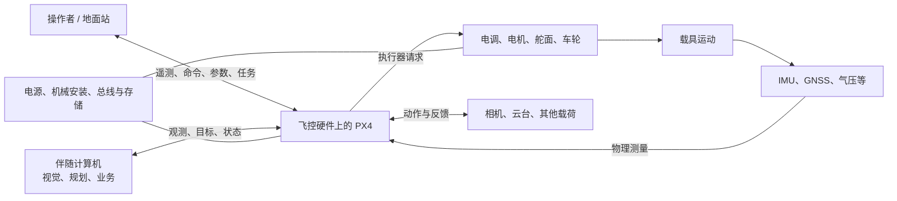
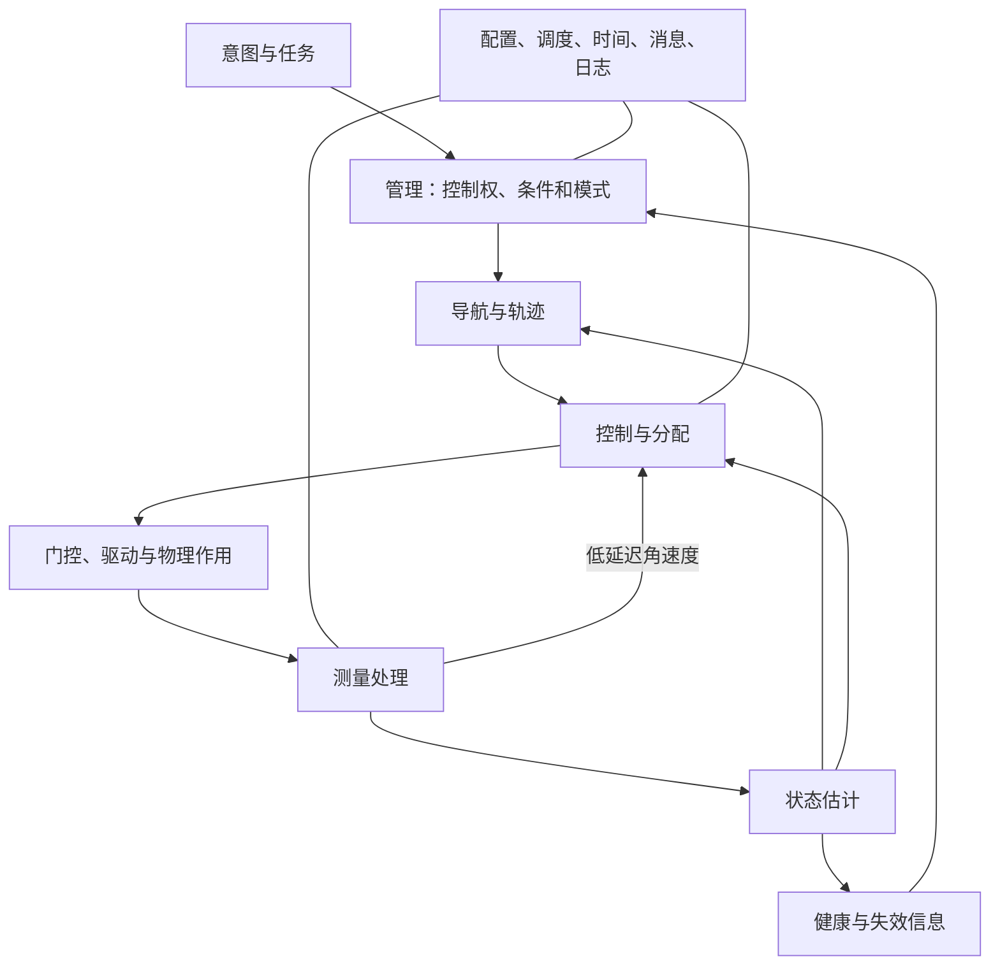

# PX4 系统架构与技术原理

[文档首页](README.md) · [代码架构与开发指南](DEVELOPMENT.md) · [学习路线](ROADMAP.md) · [操作与调试手册](OPERATIONS.md)

硬件支持、外设组合与仿真方案的具体对照见[技术架构详解](ARCHITECTURE.md)；源码修改、GDB 和板端故障定位步骤见[开发调试实战](DEBUGGING.md)。

PX4 是一套面向自动驾驶载具的软件系统，涵盖运行平台、设备接入、状态估计、运动控制、导航、系统管理和外部通信。本篇先建立整体架构，再从物理、硬件、软件、算法、应用与工程等方面展开。

阅读不要求已运行过仿真、使用过飞控或了解此前的实验记录。正文以系统职责、信息关系、物理约束和行为条件为主线，数学解释关键机制。代码结构、运行实现与开发方法由独立的开发指南承接，源码链接用于核对依据。具体开发环境与源码版本见操作手册附录。

## 目录

1. [PX4 整体架构](#c1)
2. [飞行原理与基础数学](#c2)
3. [硬件系统与部署](#c3)
4. [软件平台与运行机制](#c4)
5. [传感器与测量处理](#c5)
6. [状态估计](#c6)
7. [运动控制与执行器分配](#c7)
8. [导航与任务管理](#c8)
9. [系统管理与安全机制](#c9)
10. [通信与应用集成](#c10)
11. [机型体系](#c11)
12. [系统配置与工程组织](#c12)
13. [开发验证与性能优化](#c13)

<a id="c1"></a>
## 1. PX4 整体架构

### 1.1 PX4 解决的问题及系统边界

PX4 是自动驾驶载具的实时软件系统。它将操作者或任务的意图，结合对载具状态的估计、物理能力与运行条件，转换为执行器作用，并在条件恶化时调整行为。它既包含运动算法，也包含让算法在设备上持续工作所需的平台、管理、通信与诊断机制。

一套无人机还需要机械结构、动力、电源、传感器、计算硬件、通信设备和操作端。PX4 不产生实际推力，电机与螺旋桨才产生推力；PX4 不直接“知道真实位置”，而是根据观测形成估计；PX4 可以执行航点任务，但视觉识别、通用 SLAM 和复杂障碍规划需要相应的外部或专用组件。划清这些边界，才能把问题分配到正确位置。

Pixhawk 类飞控硬件提供处理器、总线和输出接口，NuttX 或受支持的 POSIX 平台提供运行资源，PX4 组织自动驾驶功能，QGroundControl 提供配置、任务与状态交互，伴随计算机承担额外感知和业务计算。Docker、编译器、仿真器和调试器属于开发验证环境。这些系统协作，但没有任何一个名称能代替其余部分。

### 1.2 物理系统与部署架构



图中存在一个持续的物理闭环：执行器改变运动，运动改变测量，PX4 根据测量调整输出。通信连接则带来操作意图、任务或观测。地面站不必逐周期参与姿态稳定，伴随计算机也不必直接驱动每个电机；它们接入的层级决定各自承担的责任。

在 SITL 中，飞控算法运行于计算机，模型替代真实载具和部分传感器/输出链；在真机上，驱动、供电、安装和硬件时序参与实际闭环。替换物理部分并不意味着所有系统行为都相同，因此仿真和实物的验证边界必须明确。

### 1.3 PX4 内部的功能架构

系统可按职责理解为六个相互配合的子系统：

| 子系统 | 负责的问题 | 主要输出 | 依赖的前提 |
|---|---|---|---|
| 测量与设备接入 | 设备实际测到了什么，数据是否可信 | 标准单位、方向和时间的观测 | 设备、电气、标定和采样正常 |
| 状态估计 | 当前姿态、速度、位置等是什么 | 状态、不确定性、有效性与重置信息 | 有足够且一致的观测约束 |
| 管理与安全 | 当前允许做什么，异常后怎样处理 | 模式、控制层启用、解锁/保护状态 | 健康、输入、配置与策略明确 |
| 导航与目标生成 | 下一步去哪里，如何形成可执行运动 | 航点关系、轨迹、各层目标 | 任务、定位与运动约束成立 |
| 控制与执行 | 如何跟踪目标并产生可实现作用 | 力矩、推力、执行器请求 | 状态及时、控制结构与动力匹配 |
| 平台与通信服务 | 功能怎样运行、交换和保存信息 | 调度、消息、参数、存储、日志、外部接口 | 资源、时序与协议满足要求 |

平台服务横跨其他子系统；管理与安全也不是控制链末尾的一道开关。它们持续影响哪些数据被使用、哪些行为可激活、哪些输出可生效。软件目录和线程划分不必与这张职责表一一对应，具体代码架构在[开发指南](DEVELOPMENT.md#d1)展开。

### 1.4 四个视角共同解释系统

**数据视角**包含两条相遇的链。测量经处理与估计形成实际状态；意图经管理、导航和目标生成形成期望状态。控制器比较二者，分配和输出把整体作用落实到执行器。这解释“系统想做什么”和“系统认为发生了什么”。

**控制权视角**决定当前由谁提供目标、需要哪些控制层、何时可解锁以及怎样接管。角速度模式不需要位置外环；外部位置控制仍需要 PX4 的下游稳定环；定位不可用可能使位置相关模式不再成立。模式变化因此会改变闭环结构和输入要求。

**执行视角**说明这些功能怎样在不同频率、不同任务和共享队列中协作。消息有采样时间和处理时间，算法有计算耗时，通信有延迟。数学关系正确但数据过期或处理超时，仍然可能使闭环失效。

**配置与证据视角**描述板型、机型、校准、参数、任务如何决定行为，以及日志、事件和资源统计如何帮助重建行为。保存参数不等于保存运行状态，日志存在也不等于所有输入都被完整记录。



这是一张职责与信息关系图，不是一个顺序调用的流程图。读架构时需要同时回答“流向哪里”“谁有权启用”“何时处理”和“依据哪套配置”。

### 1.5 一次完整任务的系统生命周期

以起飞、访问观察点、拍照、返回和降落为例，任务开始前，配置先确定板型、载具几何、传感器方向、输出映射、通信与保护条件。初始化建立设备、消息、估计及管理状态；载具能显示在地图上，只说明其中一部分功能已经成立。

任务上传后，系统还需完成存储、可行性和运行条件检查。操作者开始任务时，管理层处理模式与解锁，导航层选择当前任务项，目标生成层建立受约束轨迹。控制链连续跟踪，估计持续提供反馈，任务层根据到达与停留条件推进。

到观察点后，飞行位置保持与相机曝光是不同组件的工作。任务发出载荷动作后，需要设备反馈才能确认拍摄结果。人工取消时，系统必须交接目标与控制权；发生定位、链路或能量异常时，保护策略需结合剩余能力选择可执行动作。

返回涉及返回点、路径、高度、机型和能量条件。降落涉及受控下降和落地检测，随后按规则上锁。运行结束还需保存日志和配置，才能分析任务是否按设计完成、哪个阶段退化、后续改动应验证什么。

整个过程中，**模式、解锁状态、落地状态、任务进度与健康状态是不同维度**。例如 Hold 不必然表示空中悬停，Armed 不证明已经离地，命令 ACK 也不证明动作完成。

### 1.6 系统能力由条件组合形成

一个自动任务可执行，需要同时具备：可解释的任务目标、足够的状态信息、可实现的运动、及时的计算、正确的执行映射和可恢复的异常策略。任何一项缺失，都可能表现为“飞机没有按预期动作”，但原因属于不同子系统。

因此学习 PX4 的目标是建立这种组合判断能力。后续章节依次解释物理与硬件、信息形成、行为决策、运动执行、外部应用和工程验证；开发指南再把这些职责映射到源码。遇到实际问题时，回到上述四个视角定位，随后选择所需的代码与实验。

<a id="c2"></a>
## 2. 飞行原理与基础数学

本章建立后续算法使用的语言。向量表示方向与大小，矩阵表示线性映射，微分描述变化率，积分描述累积，概率描述对不确定量的认识。阅读时先掌握它们在系统中代表的物理量，再深入对应公式。

### 2.1 坐标系、向量与单位

PX4 常用两类坐标：

| 坐标系 | X | Y | Z | 常见数据 |
|---|---|---|---|---|
| 局部 NED | 北 North | 东 East | 下 Down | 局部位置、速度、轨迹目标 |
| 机体 FRD | 前 Forward | 右 Right | 下 Down | 角速度、机体力矩、推力 |

NED 中起飞向上运动时 `z` 变小，向上速度 `vz` 为负。机体 FRD 会随飞机旋转，NED 不跟着飞机一起转。飞机机头朝东时，机体的前向与 NED 的东向重合，不能把机体系的 x 直接当成北向量。

ROS 常见 ENU（东、北、上）和 FLU（前、左、上）。对于在同一原点表达的位置向量：

```text
NED = [ENU.y, ENU.x, -ENU.z]
FRD = [FLU.x, -FLU.y, -FLU.z]
```

姿态不能只随意交换四元数分量；它涉及参考坐标系与机体坐标系两侧的变换。真正接外部视觉时还要处理原点、时间和协方差。

### 2.2 局部坐标、相对高度与离地高度

局部坐标原点、起飞地点、Home 和地面是不同参考。假设同一次运行中，地面样本 z=-0.5 m，飞行样本 z=-3.5 m，两者参考连续，则相对上升量为：

```text
Δh = z_ground - z_air = -0.5 - (-3.5) = 3.0 m
```

这是教学算例，不要求存在任何先前飞行记录。`-z` 是相对局部原点的向上坐标，`dist_bottom` 是估计的离地距离，海拔则使用另一套高程参考。地形起伏、原点偏置和估计误差都会使这些量不同。

估计器重置可能造成位置或姿态跳变。`delta_z` 是最近一次垂直位置重置量，仅在相应 reset counter 变化时有新的重置意义；不能在每一轮循环中反复加它。长时间间隔还需考虑有限宽度计数器回绕。

定义在 [VehicleLocalPosition.msg](../msg/versioned/VehicleLocalPosition.msg)，实现见 `EKF2::PublishLocalPosition()`。读取一个数字时应同时读取它的参考、有效性和时间信息。

### 2.3 姿态表示与角速度

[VehicleAttitude.msg](../msg/versioned/VehicleAttitude.msg) 的 `q` 按 `[w, x, y, z]` 排列，采用 Hamilton 四元数，描述机体 FRD 到地理 NED 的旋转。`q` 与 `-q` 表示同一姿态；所以不能逐分量相减就当姿态误差。

对绕单位轴 `u` 转角 `θ`，四元数写成：

```text
q = [cos(θ/2), u.x sin(θ/2), u.y sin(θ/2), u.z sin(θ/2)]
```

它避免直接用欧拉角计算在某些姿态下的奇异问题，但仍然要考虑归一化和坐标约定。角速度主题 [VehicleAngularVelocity.msg](../msg/versioned/VehicleAngularVelocity.msg) 则包含机体系角速度 `xyz`（rad/s）及角加速度。旋转到 30° 后保持不动，姿态可以是 30°，角速度却接近零。

### 2.4 时间、有效性与参考连续性

`timestamp` 通常表示消息时间，`timestamp_sample` 表示样本所代表的时间，单位一般为系统启动后的微秒。字段定义和发布处共同决定具体含义；SITL 的仿真时间也不必与宿主墙上时间同速。

使用状态至少需要考虑：

1. **读到了没有**：订阅读取是否成功。
2. **是否足够新**：相对于同一时钟域的当前时间，年龄是否在允许范围。
3. **数值是否有限**：NaN、Inf 是否符合该字段的接口约定。
4. **标志是否有效**：例如 `xy_valid` 和 `z_valid`。
5. **参考是否连续**：位置、速度或航向重置有没有改变坐标意义。

这些条件互不替代。`xy_valid=true` 的旧消息可能已经过期；刚发布的消息也可能带 `xy_valid=false`。

NaN 也不总是错误。[TrajectorySetpoint.msg](../msg/versioned/TrajectorySetpoint.msg) 用 NaN 表示对应状态目标不参与控制；把本来应为 NaN 的位置写成零，会变成“回到局部原点”的真实请求。而位置消息中的限制字段为 Inf，可能表示该项没有给出有限约束，不能因此断言整个估计崩溃。

### 2.5 比力、重力与运动加速度

加速度计测的是**比力**。简化表达为：

```text
f_body = R_ned_to_body × (a_ned - g_ned)
```

水平静止时运动加速度 `a_ned≈0`，但 FRD 的 z 方向读数约为 `-g`。估计器需要结合姿态旋转并处理重力，才能把它用于速度预测。角度错一点就会把部分重力误当水平加速度，积分后产生速度与位置漂移，这也是姿态与位置估计相互关联的原因。

### 2.6 从力和力矩建立运动模型

把载具近似为质量 m、惯性矩阵 J 的刚体，忽略结构弹性，用 R 表示机体 FRD 到 NED 的旋转，可写出：

```text
位置变化：p_dot = v
平动：    m × v_dot = m × g_ned + R × f_body + f_disturbance
转动：    J × omega_dot = torque_body - omega × (J × omega)
```

这里 `g_ned=[0,0,g]`，力用 N，力矩用 N·m，角速度用 rad/s。转动式中的叉积是三维刚体不同转轴间的耦合。平动式中的 f_body 表示作用力，和上一节以小写 f 表示的单位质量比力需要区分量纲。

常规四旋翼合推力主要沿机体负 z 方向，可近似为 `[0,0,-T]`。水平悬停时 `T≈mg`；倾斜角 θ、保持高度且忽略其他垂直力时，需要 `T cosθ≈mg`。倾斜 30° 时，总推力约为水平悬停的 1.155 倍。这解释了横向加速为何占用推力余量，位置和高度控制为何存在耦合。

旋翼推力在一定工作范围内常近似与转速平方相关，电机还存在响应延迟。控制器输出的归一化推力不能直接作为 Newton，也不能未经模型换算就当作转速。机型几何和执行器模型决定控制请求怎样变成物理作用。

### 2.7 离散时间、采样与延迟

软件只在离散时刻运行。例如用 `v[k+1]≈v[k]+a[k]Δt` 做积分，Δt 必须与该样本实际覆盖时间一致。假设固定 4 ms，而实际发生丢样或排队，会积累错误。

采样率决定每秒取得多少数据，滤波带宽决定保留哪些变化，闭环带宽描述控制能跟踪多快的变化。这三个量互相关联，但不相等。提高发布频率不自动提高闭环带宽；重复发布旧值也不增加信息。

延迟会使控制器针对过去的状态施加作用。角频率为 ω 的变化经过纯延迟 τ 时，相位滞后为 `-ωτ`。因此采样、滤波、调度、通信、电调和电机延迟必须作为整体考虑。高频噪声还可能混叠到低频，不能指望采样之后任意加一个低通就恢复原始信号。

### 2.8 反馈系统中的稳定、精度和约束

稳定性关心受扰后是否收敛或保持有界，跟踪精度关心目标与实际的误差，响应速度关心完成变化需要多久。加大增益可能让响应更快，也可能放大噪声、遇到延迟后振荡或更频繁达到执行器限制。

设计控制器时必须同时考虑可达范围。例如四旋翼的推力与倾角有限，不能任意瞬间改变速度；固定翼需要维持足够空速，不能把所有路径点都当作可以停住的位置。

后续第 6 章用概率与观测讨论“状态是否可信”，第 7 章讨论“如何跟踪目标”，第 8 章讨论“怎样生成可实现目标”。三者的接口由本章的时间、坐标、单位与约束连接。

<a id="c3"></a>
## 3. 硬件系统与部署

软件闭环成立的前提是物理系统具备相应能力。处理器提供计算，传感器提供观测，动力系统提供作用，电源和总线把它们连接起来。板级支持描述计算资源，机型描述载具几何和行为，安装与校准描述具体实物；理解这三个层次，才能判断一个问题应改固件、配置还是接线。

### 3.1 硬件资源与板级支持

飞控板包含处理器、时钟、供电、内部/外部总线、传感器、输出接口和存储。板级支持包（BSP）定义这些资源如何连接和初始化，驱动把具体设备抽象成测量或执行能力，上层算法依赖这些抽象。

一颗传感器能否工作，既取决于是否编入驱动，也取决于芯片供电、总线配置、片选、中断、安装方向与启动探测。一块板能编译某个驱动，并不证明该设备实际连接在预期位置。

以 [fmu-v6x](../boards/px4/fmu-v6x) 为源码样本：

| 文件 | 解释的问题 |
|---|---|
| [default.px4board](../boards/px4/fmu-v6x/default.px4board) | 该固件启用哪些平台与功能 |
| [board_config.h](../boards/px4/fmu-v6x/src/board_config.h) | 引脚和硬件资源如何定义 |
| [spi.cpp](../boards/px4/fmu-v6x/src/spi.cpp) | 传感器总线与设备连接如何描述 |
| [timer_config.cpp](../boards/px4/fmu-v6x/src/timer_config.cpp) | 定时器与输出通道如何分配 |
| [init.cpp](../boards/px4/fmu-v6x/src/init.cpp) | 板级初始化执行什么 |
| [rc.board_sensors](../boards/px4/fmu-v6x/init/rc.board_sensors) | 启动时探测和启动哪些传感器 |

这是一个具体板型的实现，不是所有 Pixhawk 类设备共享的固定资源图。

### 3.2 启动链与固件目标

典型流程是上电、启动程序、操作系统初始化、板级初始化、PX4 平台服务、启动脚本、机型与模块。具体细节受 MCU、bootloader、启动方式和板卡配置影响。

固件目标至少包含板型、平台和功能配置。选择目标时必须匹配实际硬件，不能仅凭商品名或“都是某系列 MCU”推断兼容。bootloader、主固件、某些板上的 IO 固件也可能是不同产物。

NuttX 启动资源见 [init.d/rcS](../ROMFS/px4fmu_common/init.d/rcS) 与 [px4_init.cpp](../platforms/nuttx/src/px4/common/px4_init.cpp)。POSIX 启动路径不同，但会复用大量模块与算法。学习移植应先画出实际启动链，再追某个外设，而非从改一条编译名称开始。

### 3.3 总线与设备接口

| 接口 | 常见用途 | 主要设计约束 |
|---|---|---|
| SPI | 板内高频 IMU 等 | 片选、时序、总线占用、数据就绪中断 |
| I²C | 部分低速传感器 | 地址冲突、上拉、线长、电气与共享总线 |
| UART | GNSS、遥控、数传 | 电平、波特率、协议、收发缓冲 |
| CAN | 分布式传感器和执行器 | 物理终端、节点身份、协议版本和带宽 |
| PWM / DShot | 电调、舵机等输出 | 通道资源、更新方式、范围、遥测支持 |
| USB / 网络 | 配置、数据与开发接口 | 主机连接、传输配置与访问路径 |

DroneCAN、Cyphal 是基于 CAN 生态的不同协议组织，不能只因电气接口都是 CAN 就混用消息类型和设备配置。SPI 和 I²C 同样需要同时核对电气连接与驱动支持。

### 3.4 从逻辑输出到电气输出

[mixer_module.cpp](../src/lib/mixer_module/mixer_module.cpp) 中的 MixingOutput 管理功能映射、订阅和输出状态，设备驱动将其落实到 [PWMOut.cpp](../src/drivers/pwm_out/PWMOut.cpp)、[DShot.cpp](../src/drivers/dshot/DShot.cpp) 等具体协议。部分板卡还使用 [px4io](../src/drivers/px4io) 路径。

应区分三组编号：控制分配中的逻辑执行器、输出功能分配、板卡物理接口。再检查 disarmed/failsafe 值、最小最大范围、方向和实际接线。配置有误时，正确的控制力矩可能被送到错误电机。

PWM 常通过脉宽表达请求，DShot 使用数字编码；支持何种遥测还取决于电调、固件与配置。不能用“数字协议”推断实际电机响应一定闭环精确，也不能把电调接收值当作真实推力测量。

### 3.5 供电、安装、存储与资源预算

传感器噪声可能来自机械振动，磁干扰可能与动力电流有关，处理器重启可能来自供电压降，日志丢失可能来自存储延迟。软件诊断需要联系这些物理条件。

校准前应确认安装与机械状态，动力测试前应确认映射与门控，日志分析前应确认记录质量。校准、控制增益和滤波都不能代替正确的装配与供电设计。

资源规划还包括 Flash/RAM、任务栈、总线带宽、CPU 峰值和 SD 卡写入吞吐。增加一个视觉通信或日志功能时，需要评估它对原有实时路径的影响。

### 3.6 仿真、台架与真实部署

算法测试证明指定输入下的计算行为；软件仿真验证模块与模型的闭环；硬件在环或台架能暴露部分平台、接口和时序问题；真实飞行验证具体物理条件下的系统表现。

迁移时逐项重新建立证据：板型与固件身份、设备与方向、校准、输出映射、通信、保护、资源和真实闭环。无桨台架是识别传感器和执行器关系的阶段，真实动力与飞行则还需要相应装配检查和操作条件。

部署还应保存固件、源码提交、参数、校准与硬件信息，以便比较版本和恢复。更新代码之后能开机，仅说明启动链成立，还没有完成系统验证。

<a id="c4"></a>
## 4. 软件平台与运行机制

飞行算法依赖稳定的执行条件。本章从系统角度解释时间、通信、运行状态与资源如何支撑闭环；C++ 类、启动入口和构建实现分别见[开发指南第 3～6 章](DEVELOPMENT.md#d3)。

### 4.1 多速率系统与执行上下文

传感器采样、状态估计、内外控制环、导航、通信和存储有不同的时间尺度。内环需要低延迟测量，导航关注任务与轨迹，日志和通信需要控制带宽。给所有功能设相同频率既浪费资源，也无法自动保证一致时序。

PX4 通过任务、工作队列和消息触发组织这些功能。共享队列上的工作必须有界完成；独立任务同样受优先级、锁和系统负载影响。实时性的核心是满足截止时间与输入新鲜度，而不是只看平均 CPU 占用。

系统设计要明确主要触发信号、辅助输入年龄、最坏计算时间及异常恢复。输入到达晚、处理排队久和算法计算慢会形成不同延迟，需要分别测量。

### 4.2 消息连接与一致性

uORB 将生产者和消费者解耦：估计器发布状态，控制、导航与日志按各自需求订阅。它让模块边界清楚，但不会自动让所有消费者在同一时刻处理同一份状态。

消息必须携带可解释的单位、坐标、采样时间、有效性和参考变化。状态主题通常关注最新值，命令和事件更关注序列与是否遗漏，多实例主题还需要明确身份。系统应规定数据缺失、过期、生产者重启和估计重置时的行为。

同一消息被两个模块使用，不代表它们具有相同的可用性要求。例如任务展示可以容忍较低更新率，闭环控制可能无法容忍同样的延迟；它们对“数据可用”的定义必须服务于各自职责。

### 4.3 启动、运行与停止

启动不是把所有模块一齐打开，而是依配置逐步建立设备、平台服务、状态信息与功能。某模块成功 start 只证明实例创建，不证明所有输入已经满足需求。控制系统必须允许等待输入和健康条件建立。

运行期间，模式、输入源和参数可以变化。模块需要处理激活、失活、恢复和重置，防止旧积分、旧目标或旧参考污染新阶段。停止也必须结束调度和资源使用，重新启动时按照契约建立新状态。

这些生命周期条件解释了为什么一个算法在孤立测试中正确，接入系统后仍可能失败。完整验证应覆盖连接点与状态转移。

### 4.4 配置、持久化与历史记录

板型选择提供运行平台，机型配置提供几何与功能默认值，校准描述具体设备，运行参数提供当前选择，任务描述要执行的动作。它们的来源、保存位置、生效时机和恢复方式不同。

消息保存运行中的信息，dataman 等设施保存任务相关数据，ULog 保存历史证据。系统重启后可以恢复某些配置，却不等于恢复之前全部控制状态；读取旧日志也不意味着其中目标仍在生效。

配置管理因此属于架构的一部分。实验结果必须能追溯到源码、构建、参数、硬件或模型，才能解释前后差异。

### 4.5 资源与平台边界

NuttX 板卡受 RAM、任务栈、总线、存储和 MCU 执行能力约束；POSIX SITL 使用宿主资源和仿真时间机制。公共接口复用了上层功能，实际负载与时序仍需在目标平台验证。

增加遥测或日志频率可能造成排队和写入压力，加入阻塞业务逻辑可能拖延同队列控制任务。系统设计需要为计算、通信和存储留出可测量余量，并通过性能计数、消息间隔、栈和丢样证据验证。

<a id="c5"></a>
## 5. 传感器与测量处理

本章承接物理系统，解释“物理运动怎样成为算法可消费的信息”。测量链的交付物不仅是一个数值，还包含单位、方向、样本时间、设备身份和质量。状态估计与控制使用不同形式的测量，因而测量处理不是一条所有消费者共用的串行滤波管线。

设计这条链时，先从任务要求反推信息需要：角速度稳定需要低延迟陀螺仪，长时间定点需要能约束水平漂移的信息，近地高度还可能需要地形相关观测。然后才确定设备、安装、采样、标定与处理方式。下文将这些要求连接到设备状态机、IMU 双路径及误差预算。

### 5.1 测量能力与误差来源

| 传感器 | 直接测量 | 不能单独解决的问题 |
|---|---|---|
| 陀螺仪 | 角速度 | 偏置积分会造成姿态漂移 |
| 加速度计 | 比力 | 运动时不能简单把读数都当重力方向 |
| 气压计 | 气压，进一步换算气压高度 | 气流、温度、天气影响绝对高度 |
| GNSS | 位置、速度和质量信息 | 室内、遮挡、干扰、低更新率和延迟 |
| 磁力计 | 磁场向量 | 电机、电流、铁磁材料会干扰 |
| 距离传感器 | 沿测量方向的距离 | 量程、倾斜、地面材质和地形限制 |
| 光流 / 外部视觉 | 图像运动或视觉位姿 | 纹理、照明、尺度、坐标和时间对齐 |

驱动负责把具体设备变成规范消息；传感器处理负责校准、选择、滤波和积分；估计器负责融合并判断状态。这三层出现故障时的排查对象不同。

### 5.2 设备驱动、FIFO 与样本时间

打开 [BMI088_Gyroscope.cpp](../src/drivers/imu/bosch/bmi088/BMI088_Gyroscope.cpp)，先看 `RunImpl()` 的状态机：

```text
RESET → WAIT_FOR_RESET → CONFIGURE → FIFO_RESET → FIFO_READ
                 ↑          失败 / 超时 / 寄存器异常 → 恢复或重置
```

复位后芯片需要时间准备，读取 FIFO 也需要等待样本；状态机把这些等待分成多次调度，避免长时间占住工作队列。数据就绪中断只触发后续工作，不应该在中断里完成整个算法链。

FIFO 可以一次读出多个样本以降低总线开销。它同时带来时间问题：读完 SPI 的时刻不是每个样本的采样时刻。驱动需要利用中断时间、采样率、FIFO 长度重建样本时序。时间错了，数据即使数值看着正常，也会影响估计和控制。

`ConfigureGyro()` 依据量程设置比例因子，把寄存器数转换为 rad/s；后续通用驱动封装还处理发布、旋转等共性。应沿 `FIFORead()` 继续追到 [PX4Gyroscope](../src/lib/drivers/gyroscope/PX4Gyroscope.cpp)，而不是在看到 SPI 读成功后就认为“驱动完成了”。

### 5.3 IMU 积分与角速度处理链

```text
陀螺仪 / 加速度计消息
  ├─ VehicleIMU：积分、校准、增量和积分时间 → EKF2
  └─ VehicleAngularVelocity：选中陀螺仪、校准/偏置修正、滤波 → 角速度控制
```

[VehicleIMU.cpp](../src/modules/sensors/vehicle_imu/VehicleIMU.cpp) 形成 `delta_angle`、`delta_velocity` 及相应积分时长。EKF 关心一个时间段内的运动增量，不应把增量字段直接当 rad/s 或 m/s²。

[VehicleAngularVelocity.cpp](../src/modules/sensors/vehicle_angular_velocity/VehicleAngularVelocity.cpp) 为控制环提供低延迟、适当滤波的角速度及其导数。控制器没有必要先差分估计姿态再还原角速度；那会引入额外延迟与噪声。

校准解决尺度、安装方向、零偏等测量模型问题；EKF 在线估计的偏置处理运行中剩余的慢变化。低通滤波抑制高频噪声，却会增加相位滞后；陷波针对特定频段的振动。不能因为曲线更光滑就认定控制更好。

### 5.4 传感器冗余与估计器选择

一块板可有多组 IMU。每个设备有 `device_id`，消息可能有多个实例。系统需要辨认具体设备、检查错误与新鲜度、选择可用输入。还可以配置多个 EKF 实例，由选择器比较估计健康状况。

“有多个实例”不等于“随时都在自动切换”，也不等于“多传感器数据被简单平均”。检查顺序应为：设备是否发布 → 哪个实例在更新 → 哪个设备被选中 → EKF 使用哪组输入 → 是否发生估计器切换或重置。

SIH 可以用于研究消息链与有效性；它不验证实际电气连接、SPI 时序、FIFO 中断线或安装振动。真实电气与驱动行为需要在对应硬件上验证。

### 5.5 校准模型与测量饱和

把传感器原始向量记为 `y_raw`，偏置为 b，尺度/交叉轴修正为 S，安装方向旋转为 R，可用概念模型表示：

```text
y_body = R × S × (y_raw - b)
```

真实实现还可能包含温度补偿、设备厂商换算和在线偏置修正；其实际处理顺序需要沿所选设备路径确认。标定参数属于具体设备与安装，不能把另一架飞机的校准值直接作为通用配置。

陀螺仪静态标定需要载具尽量静止；加速度计多姿态标定利用重力提供方向与幅值约束；磁力计标定还受周围磁环境与安装影响。标定只能处理模型能描述的误差，松动、饱和和强时变干扰仍可能破坏测量。

传感器饱和尤其需要单独理解：超量程后信息已经丢失，后端低通或 EKF 不能凭空恢复真实峰值。工程上需要看 clipping、设备错误、振动和安装条件，再决定量程、采样和滤波。

### 5.6 传感器选型与误差预算

选型要同时考虑噪声、偏置、量程、带宽、采样时序、延迟、接口可靠性和安装条件。更高采样率可能增加总线和 CPU 负担；更低噪声的测量若延迟过大，也未必适合快速控制。

以旋转中的外置 GNSS 天线为例：它与 IMU 有空间偏移，天线速度包含旋转带来的运动；时间对齐错误还会把不同姿态下的观测混在一起。空间和时间误差应先处理，再讨论滤波噪声大小。

这套预算贯穿设备集成、校准、估计器参数和控制延迟设计。传感器数据“能显示出来”只是完成了接口的一部分。

<a id="c6"></a>
## 6. 状态估计

估计器向系统交付的是“状态及其可信条件”。控制需要及时的姿态、角速度和位置，导航需要空间参考，管理层需要判断这些能力是否可用。因此估计器同时承担数值估计、信息源管理和对下游的有效性通知。某个估计值仍在变化，并不能说明相关任务仍有足够定位能力。

### 6.1 多传感器融合与 EKF2 职责

GNSS 能约束长期位置漂移，但低频、延迟较大；IMU 高频且响应快，却有偏置，积分会积累误差。估计器利用 IMU 快速预测，再用 GNSS、气压、磁场、距离或视觉校正。

EKF 是扩展卡尔曼滤波。它维护状态及其不确定性，用运动模型预测，用传感器模型比较观测。在 PX4 中，`EKF2` 是模块封装，`src/modules/ekf2/EKF/` 是主要算法实现。模块层负责订阅、时间处理、参数、调用和发布；算法层负责预测、融合、故障与重置逻辑。

### 6.2 状态模型、观测模型与协方差

状态是系统希望估计的量，例如姿态、速度、位置、IMU 偏置，以及配置相关的风、地形等量。观测是传感器提供的信息，二者不总是一一对应：光流测的是图像角运动，气压与高度之间需要模型，磁力计测量也不能直接当偏航角。

用 x 表示状态、u 表示 IMU 输入、y 表示外部观测，概念上可写成：

```text
状态模型：x[k+1] = f(x[k], u[k]) + 过程误差
观测模型：y[k]   = h(x[k]) + 测量误差
协方差预测：P_minus = F P Fᵀ + Q
创新协方差：S = H P_minus Hᵀ + R
更新增益：K = P_minus Hᵀ S⁻¹
```

F、H 是局部线性化关系，Q 描述模型/输入的不确定性，R 描述观测不确定性。协方差的非对角项描述不同状态误差之间的关联，所以一次位置观测也可能帮助修正相关的速度或偏置。

姿态更新还需要遵守旋转空间的结构，不能把四元数当普通四维位置任意相加。这里引用的 EKF 实现的状态与误差更新应结合 [ekf.h](../src/modules/ekf2/EKF/ekf.h)、[ekf.cpp](../src/modules/ekf2/EKF/ekf.cpp) 及生成的计算函数阅读；上面的矩阵式用于理解机制，不宣称逐行等同于实现。

### 6.3 可观测性与信息条件

可观测性关心：现有运动和测量能否区分不同状态。静止时重力方向约束滚转与俯仰，但单靠重力无法确定绕重力轴的航向；没有外部位置/速度约束时，IMU 积分误差会逐渐增长。

偏置估计同样依赖信息条件。一个平稳、几乎没有激励的运动片段，未必足以分辨安装误差、传感器偏置和某些模型误差。更多传感器也不自动意味着可用信息更多：相同来源、相关误差或错误坐标的观测可能引入一致性问题。

因此设计定位方案要先问“任务需要哪些状态、哪些观测能约束它们、失去某观测后剩下什么”，再选融合开关与噪声参数。

### 6.4 标量卡尔曼更新示例

假设只估计一个高度，预测为 `h⁻=2.0 m`、预测方差 `P⁻=0.25 m²`；传感器观测为 `y=2.4 m`、观测方差 `R=0.75 m²`。标量卡尔曼更新为：

```text
残差 r = y - h⁻ = 0.4 m
残差方差 S = P⁻ + R = 1.0 m²
增益 K = P⁻ / S = 0.25
更新高度 h⁺ = h⁻ + K r = 2.1 m
更新方差 P⁺ = (1 - K) P⁻ = 0.1875 m²
```

观测不确定性较大，所以结果只向观测移动一部分。方差的单位是物理量单位的平方，不能把“标准差 0.5 m”直接填成“方差 0.5 m²”。

多状态情形把数字变成矩阵，并通过模型的雅可比描述状态之间的关系。噪声协方差 Q 影响预测不确定性如何增长，R 影响观测被信任的程度。增大 R 会减弱对应观测作用；它不能修复坐标符号错误、时间错位或持续错误测量。

PX4 某些 aid-source 的 innovation 使用“预测减观测”的符号，与上面的教学残差相反。读代码或日志必须核对定义；平方检验比不受这一符号变化影响，直接使用创新方向却会受影响。

### 6.5 创新、门限与拒绝观测

如果观测与预测差得太多，滤波器不应立即把状态拉过去。对一个标量观测，可用归一化检验理解：

```text
test_ratio = innovation² / (gate² × innovation_variance)
```

比率大于 1 表示超出所设门限，常见结果是拒绝该观测。持续拒绝可能引起融合超时、停止某项辅助，或在满足条件时重置状态。实际不同观测路径还有各自条件，不能把一次 ratio 超限等同于立即触发整机失效保护。

例如 GNSS 高度瞬间偏离 200 m：飞控不能仅因消息还在发布就信任它。应同时看质量检查、innovation、rejected、最后成功融合时间及备用高度源。

### 6.6 GNSS 高度融合实现

按这个顺序阅读：

1. [EKF2.cpp](../src/modules/ekf2/EKF2.cpp) 的 `UpdateGpsSample`：把 uORB GNSS 数据变成算法输入，确认单位、质量字段与时间。
2. [estimator_interface.cpp](../src/modules/ekf2/EKF/estimator_interface.cpp) 的 GNSS 输入处理：按配置的延迟进入缓冲。
3. [gps_control.cpp](../src/modules/ekf2/EKF/aid_sources/gnss/gps_control.cpp)：决定当前样本是否可以用于相关融合。
4. [gnss_height_control.cpp](../src/modules/ekf2/EKF/aid_sources/gnss/gnss_height_control.cpp)：高度观测、噪声、杆臂和偏置修正，开始/继续/停止条件。
5. 回到 `EKF2::PublishLocalPosition()`：算法状态怎样变成控制器看到的消息。

第 4 步值得逐个解释：

- GNSS 天线和 IMU 不在同一个位置，旋转机体时天线位置会随之变化，代码用两者安装位置差进行杆臂修正。
- GNSS 高度向上为正，NED z 向下为正，观测进入垂直位置接口时要处理符号。
- 观测方差含测量噪声及相关偏置估计不确定性。
- “可以开始融合”除了满足配置和质量条件，还要求最近确实有新数据。
- 已经融合时，持续失配会影响 `time_last_fuse`，进而进入停止或重置分支。

这说明 EKF2 不只是“跑一次矩阵计算”；它同时是一个管理不同信息源可用性的系统。

### 6.7 延迟融合与输出预测

不同传感器延迟不同。若把 100 ms 前的视觉位置与当前 IMU 状态直接比较，快速运动时会出现系统性误差。EKF 使用缓冲在合适的融合时间处理观测，并通过输出预测把结果向当前时间传播，满足控制器的低延迟需要。

多实例配置下，EKF2 可以直接接收特定 `vehicle_imu`；单实例路径也可使用 `sensor_combined`。代码中存在两条入口，不能根据某一次输出断言所有配置都只走其中一条。

### 6.8 估计重置与运动变化的辨别

先找同一时间附近的 `z`、`vz`、`z_reset_counter`、观测与 innovation。如果 z 跳变、reset 计数增加，而速度没有对应的物理变化，优先研究估计重置。再看参考源是否切换、观测是否恢复、是否发生实例切换。

若 z 连续变化且速度、IMU、目标和推力也支持该运动，再判断它是控制响应。不要看到位置曲线变化就先改 PID。

源码中的 [test_EKF_height_fusion.cpp](../src/modules/ekf2/test/test_EKF_height_fusion.cpp) 提供可控的模拟测量和时间推进。阅读测试的 `SetUp`、输入扰动和断言，比直接拿真实飞行噪声猜算法更容易建立确定认识。

### 6.9 为完整任务设计估计能力

室外航点任务通常同时需要姿态、局部运动、全局定位和高度参考；室内相对位置任务可以没有 GNSS，却仍需能约束位置漂移的视觉、测距或其他观测组合。光流提供的图像角运动也需要尺度与姿态等条件，不能直接替代全部全球定位职责。

应为任务建立三种信息状态：正常时哪些观测约束哪些状态；失去某源后剩余约束能支撑哪些模式；观测恢复时如何处理不一致与参考重置。例如 GNSS 断续时，短期惯性传播可以让输出继续，但误差会增长；是否还能维持任务，需要结合有效性、其他观测和模式需求判断。

恢复观测可能改变位置或航向参考。估计器发布重置信息，下游控制与轨迹需要按接口处理这一变化，管理层再根据恢复条件决定可用行为。由此形成跨子系统的契约：估计负责说明状态，控制负责在参考变化下保持目标语义，管理负责决定允许的行为。把这三件事只归结为“EKF 调得好不好”，无法解释完整系统。

<a id="c7"></a>
## 7. 运动控制与执行器分配

控制子系统把当前模式允许的目标转换为可实现的作用。它的输入不仅有目标和反馈，还包括控制层启用、起飞/落地状态、限制和估计重置；输出也不仅是电机数值，还包含实现不足和状态信息。本章以多旋翼解释串级控制，再连接分配、物理输出及资源约束；其他机型在第 11 章比较。

### 7.1 串级控制结构

四旋翼要改变位置，先要有速度；改变速度需要加速度；产生水平加速度要改变推力方向；改变推力方向需要机体旋转；旋转由电机力矩造成。因此 PX4 使用嵌套控制环，把一个慢的空间目标逐步转换为快的执行器作用。

外环的输出成为内环的目标。内环不稳定时，外环再“聪明”也无法准确执行。学习和调试通常从角速度环向外展开，同时始终记住它在整条链中的位置。

完整位置控制通常沿“轨迹 → 位置/速度控制 → 姿态目标 → 角速度目标 → 力矩/推力 → 分配”执行。角速度控制模式从链条中部提供目标，姿态控制模式启用更多上层环，自动任务再增加导航与轨迹。各模块可以持续调度，但当前模式决定哪一层的输入有效、哪些计算被启用。

跨环连接还需要一致的时间和参考：姿态目标不能在参考跳变后沿用错误坐标，积分状态不能无限延续到不允许输出的阶段，外环不能要求内环提供已饱和的能力。下面的限幅、重置和抗饱和机制，正是这些系统条件在算法中的体现。

### 7.2 角速度控制与抗积分饱和

[RateControl::update](../src/lib/rate_control/rate_control.cpp) 的核心可写为：

```text
e = ω_sp - ω
u = Kp ⊙ e + I - Kd ⊙ α_measured + Kff ⊙ ω_sp
```

符号 `⊙` 表示按轴相乘；`ω` 是 rad/s，`α` 是 rad/s²。这里 D 项使用测得的角加速度，带负号；并不是简单对整条误差差分。这可以避免目标突然变化直接造成很大的微分冲击。FF 是目标前馈。

单轴例子：`ω_sp=1`、`ω=0.8`、`Kp=0.1`、`I=0.02`、`Kd=0.01`、`α=0.5`、`Kff=0`，本轮输出为：

```text
u = 0.1 × 0.2 + 0.02 - 0.01 × 0.5 = 0.035
```

这是控制链中的归一化力矩请求，不能直接读成 0.035 N·m。外层模块还会做参数缩放、限制和滤波，真实输出以整个调用路径为准。

源码先计算本轮输出，再更新积分供下一轮使用。落地时不继续正常累积积分；积分有幅值限制，大误差还会降低积分因子。分配器报告某方向无法实现更多力矩时，积分器会抑制把该方向继续推向饱和的误差。

### 7.3 姿态控制与推力方向优先

[AttitudeControl::update](../src/modules/mc_att_control/AttitudeControl/AttitudeControl.cpp) 比较当前姿态 `q` 与期望姿态 `qd`：

```text
qe = inverse(q) × qd
e_att = 2 × imaginary(canonical(qe))
ω_sp = K_att ⊙ e_att + yaw 前馈
```

`canonical` 用于处理 q 与 -q 的等价表示。实现还先对齐推力方向，再按权重混入偏航误差，避免偏航需求抢占保持推力方向的重要性，最终限制目标角速度。

如果姿态目标没跟上，先检查角速度目标是否已达到限制、实际角速度是否能跟踪、分配是否饱和。不能只增加姿态增益。

### 7.4 位置、速度与推力控制

[PositionControl.cpp](../src/modules/mc_pos_control/PositionControl/PositionControl.cpp) 内的位置环主要是 P 控制，加上速度前馈：

```text
v_sp = Kp_position ⊙ (p_sp - p) + v_feedforward
```

速度环形成加速度请求：

```text
a_sp = Kp_velocity ⊙ (v_sp - v) + I_velocity
       - Kd_velocity ⊙ a_measured + a_feedforward
```

位置、速度、加速度目标哪些有效，由 NaN 约定和输入校验共同决定。水平轴需要成对满足要求，每个轴必须有可控制的目标；状态也必须满足对应控制层的需要。

随后 `_accelerationControl()` 把加速度转为期望推力向量，考虑重力、悬停推力比例、倾角和总推力限制；`ControlMath::thrustToAttitude()` 再把推力方向与航向转换为姿态目标。

请求水平加速度越大，通常需要更大倾角，同时需要更多总推力维持高度。推力有限时，源码会按约束处理垂直和水平需求。速度环还要做抗积分饱和，防止目标无法实现时积分一直增长，解除限制后造成过冲。

### 7.5 起飞状态与目标平滑

“上升到 3 m”是行为目标；轨迹生成器会考虑速度、加速度、jerk（加速度变化率）等约束，让控制输入随时间变化。位置控制模块本身还有起飞状态管理、倾角/推力限制和异常输入处理。

因此需要区分导航终点、`trajectory_setpoint`、控制器内部 `vehicle_local_position_setpoint` 和实际位置。实验中“目标已经是 3 m，但实际还没到”可能是正常的受限上升；要结合时间和约束判断，而非把瞬时差值都当稳态误差。

### 7.6 控制有效性矩阵与执行器分配

控制器给出期望整体作用，分配器知道机型几何和执行器能力。简化关系为：

```text
w = B u
```

`u` 是各执行器命令，`w` 是期望力矩与推力，B 是控制有效性矩阵。一个旋翼的安装位置 r、推力方向 F 会产生 `r × F` 的力矩，旋转阻力还产生反扭矩。改变旋翼方向或力臂就会改变 B。

[ControlAllocationPseudoInverse](../src/lib/control_allocation/control_allocation/ControlAllocationPseudoInverse.cpp) 提供伪逆分配；[ControlAllocationSequentialDesaturation](../src/lib/control_allocation/control_allocation/ControlAllocationSequentialDesaturation.cpp) 处理限幅与去饱和。伪逆不能创造电机没有的能力，超出约束后某些请求仍无法完全实现。

`control_allocator_status.unallocated_torque` 等信息把未实现部分反馈回控制链。最终 [ActuatorMotors.msg](../msg/versioned/ActuatorMotors.msg) 表示逻辑电机的归一化推力请求，不是物理引脚上的 PWM 微秒值，也不保证等同于实际转速。

### 7.7 输出功能、物理通道与门控

`Motor 1` 是逻辑功能，`PWM_MAIN_FUNC1=101` 把某个输出通道分配给这个功能。实际输出还涉及解锁门控、最小/最大值、停止值、斜率、推力模型以及 PWM、DShot、CAN 等协议。

所以排查“电机顺序不对”要分清：机型几何、逻辑电机编号、功能到通道映射、接线、旋转方向。只改控制矩阵补偿错误接线，会让系统越来越难以理解。

### 7.8 分配中的秩、冗余与故障

常规四旋翼有四个主要执行器，通常控制总推力和三个旋转方向，无法独立实现任意三维力与三维力矩。矩阵 B 的可实现子空间决定控制能力，伪逆不会改变这个物理事实。

增加执行器可能提供冗余，但还要看安装几何、方向、约束和控制算法是否利用它。某个电机失效后，剩余分配能力、稳定条件和软件故障处理必须重新评估，不能从“有六个电机”直接推导出“坏一个仍一定安全”。

读取分配实现时，应同时分析有效性矩阵、限幅/优先级、故障掩码、未分配残差和下游门控。普通悬停下输出正常，只覆盖了这些行为的一小部分。

### 7.9 控制设计与调参的边界

设计决定结构、状态和约束；调参在结构有效、测量可信、输出映射正确的前提下选择增益与限制。位置漂移由估计偏差造成时，单纯加位置增益可能让飞机更努力地追踪错误状态。

控制分析应看目标、反馈、误差、积分、饱和和频率内容。上升时间、超调、稳态误差、抗扰恢复分别回答不同问题。自动调参可以辅助某些控制环的参数辨识，但仍依赖机体、估计、执行器和试验条件成立。

工程顺序通常从机械与传感器、执行器、滤波和时延条件开始，再验证内环，最后处理外环及轨迹约束。具体实施方法在第 13 章与操作手册中展开。

<a id="c8"></a>
## 8. 导航与任务管理

导航处于意图与运动之间：它必须把任务描述转换为当前可执行行为，并在状态变化后推进、取消或重建目标。任务存储、导航状态机、轨迹生成和闭环跟踪分属不同层；本章沿任务从规划到完成的生命周期组织这些关系。管理层决定是否允许执行，估计器提供空间依据，控制器提供实现能力，任何一项退化都可能改变导航行为。

### 8.1 导航、轨迹与控制的职责

导航负责“下一步去哪里、何时完成、之后做什么”，轨迹生成负责“从当前位置怎样平滑到达”，控制负责“怎样跟踪轨迹”。这三层的输入、时间尺度和失败条件不同。

一个航点包含位置与高度语义，还可能涉及航向、接受半径、停留、速度或其他任务要求。航点本身不是按控制周期采样的轨迹。直接把一串不连续位置依次送给控制器，会把路径设计、轨迹约束和任务完成条件混在一起。

在 PX4 中，Navigator 组织自动导航行为；多旋翼的 FlightModeManager/FlightTask 将行为和输入转换为运动目标；底层控制器根据相应启用条件执行。固定翼采用对应的模式管理和侧向/纵向控制组织，不能机械套用多旋翼的全部调用关系。

### 8.2 Mission 的生命周期

任务从地面站进入飞控，需要经过接收、存储、可行性检查、激活、执行与结果报告：


[mavlink_mission.cpp](../src/modules/mavlink/mavlink_mission.cpp) 处理任务协议，[dataman.cpp](../src/modules/dataman/dataman.cpp) 提供相应数据存储，[mission_feasibility_checker.cpp](../src/modules/navigator/mission_feasibility_checker.cpp) 检查可执行条件，[mission.cpp](../src/modules/navigator/mission.cpp) 与相关基类执行任务逻辑。

任务上传成功不等于进入 Mission 模式，进入 Mission 模式也不等于所有航点已经完成。任务项还可能是相机动作、速度修改、跳转或其他行为，应看具体命令含义，不能假定每一项都是空间点。

### 8.3 目标序列与到达判定

`position_setpoint_triplet` 为导航提供前后关系。只知道当前目标点，很难判断应该停止还是继续经过；知道下一段方向，轨迹生成可以规划转弯速度和连续通过方式。

接受半径描述到达条件的一部分，路径跟踪误差描述沿路径的偏离，最终悬停误差描述稳定时目标偏差。这些指标不是同一个东西。将接受半径改得很小，不会自动得到更高的定位精度，还可能改变任务推进或导致持续追逐不可达条件。

阅读 [mission_block.cpp](../src/modules/navigator/mission_block.cpp) 中的到达判断，再连接任务中的停留、自动继续与后续目标处理，才能解释“为什么地图上看似到了，任务还没有推进”。

### 8.4 轨迹的速度、加速度与 jerk

轨迹包含连续位置、速度和加速度。jerk 是加速度变化率，限制它有助于避免突变的运动请求。速度上限决定运动快慢，加速度限制决定提速/刹车能力，jerk 限制决定加速度建立多快。

例如在理想一维、恒定减速度 a 且忽略时延的条件下，从速度 v 停止至少需要 `d=v²/(2a)`。实际系统还有 jerk、时延、姿态和推力约束，停止距离会受更多条件影响。航点间距太短却要求高速通过，目标本身就可能超出能力。

多旋翼相关实现见 [FlightTaskAuto.cpp](../src/modules/flight_mode_manager/tasks/Auto/FlightTaskAuto.cpp)、[PositionSmoothing.cpp](../src/lib/motion_planning/PositionSmoothing.cpp)、[VelocitySmoothing.cpp](../src/lib/motion_planning/VelocitySmoothing.cpp)。源码根据距离、转弯与各轴约束生成目标，还会考虑载具落后于计划轨迹时的处理。

因此调节轨迹速度与调整控制增益属于不同层的工作。系统运动显得缓慢，可能是轨迹设计限制，也可能是执行能力不足，需要先分清目标和反馈。

### 8.5 起飞、降落与返航

起飞包含目标建立和离地过程，降落包含下降目标与着陆条件，返航包含目的地选择和返回过程。这些行为共享估计与控制设施，但状态机和前提不同。

RTL 不总是“直线飞到起飞点并立即降落”。[rtl.cpp](../src/modules/navigator/rtl.cpp) 和 [rtl_params.c](../src/modules/navigator/rtl_params.c) 根据配置考虑 Home、安全点、任务着陆路径、直接返回或任务路径等选项，且与机型和 VTOL 状态有关。返航高度、下降高度和落地等待也有各自参考与条件。

设计自动任务必须明确目的地、坐标与高程参考、可用定位、能量、路径约束和着陆条件。仅在地图上连出一条线，不能证明返航计划可执行。

### 8.6 围栏、避障与路径规划

地理围栏描述允许或禁止的空间范围，可以用于任务检查和运行中的越界处理。它不等同于完整的障碍物地图，也不自动计算绕过建筑物的安全路径。

碰撞防护需要可用的障碍物信息和对应模式支持；全局规划、局部避障、轨迹执行也可能由不同组件承担。外部规划器应把其假设、约束和失效行为与 PX4 接口对齐，不能只检查目标消息是否送达。

导航专题的核心是把“任务可接受、路径可实现、状态可观测、执行可控”这几层条件同时建立起来。使用层行为可补充参考 [多旋翼任务说明](https://docs.px4.io/v1.17/en/flight_modes_mc/mission)。

<a id="c9"></a>
## 9. 系统管理与安全机制

管理子系统维护全机的运行规则。它把操作者意图、载具状态、健康条件和保护策略结合起来，决定当前控制权、行为与输出许可。它既参与启动和解锁，也参与正常模式交接、异常降级、恢复与结束；不能仅把它理解为“故障发生后的几个参数”。

一次状态转换需要四个要素：触发原因、进入条件、执行动作、退出/恢复条件。研究任何保护功能都应找到这四项，同时说明检测信息从何处产生、动作由哪个组件执行。下文从职责和模式进入，依次解释可用性、仲裁、落地、能量及最终输出。

### 9.1 管理、导航与控制的职责边界

| 组件 | 负责的问题 | 不应放进这一层的事情 |
|---|---|---|
| Commander | 能否解锁、当前模式、健康要求、保护动作 | 每个电机的 PID 计算 |
| Navigator | Mission、Takeoff、Land、RTL 等自动导航行为 | 传感器寄存器读取 |
| FlightModeManager / FlightTask | 多旋翼当前模式怎样生成轨迹目标 | 绕过解锁检查直接驱动电机 |
| 控制器 | 根据启用标志和状态跟踪目标 | 擅自决定所有失效后的飞行策略 |
| LandDetector | 根据运动与控制信号判断接地/落地 | 仅凭高度低就自动认定安全 |

它们之间由 `vehicle_status`、`vehicle_control_mode`、目标和检测结果连接。源码入口分别位于 [commander](../src/modules/commander)、[navigator](../src/modules/navigator)、[flight_mode_manager](../src/modules/flight_mode_manager)、[land_detector](../src/modules/land_detector)。

### 9.2 飞行模式与控制层级

| 模式 | 用户主要给什么 | PX4 主要负责什么 |
|---|---|---|
| Acro | 角速度与推力意图 | 角速度稳定 |
| Stabilized | 姿态与推力意图 | 姿态和角速度稳定 |
| Altitude | 姿态与垂直运动意图 | 增加高度/垂直速度控制 |
| Position | 水平/垂直运动意图 | 增加水平位置/速度控制 |
| Hold | 保持当前位置的行为 | 生成保持目标并运行所需控制环 |
| Mission / RTL | 航点任务 / 返航意图 | 导航规划及轨迹执行 |
| Offboard | 外部程序持续提供目标 | 按所选目标层级启用下游控制 |

这是理解控制职责的表，不替代各模式对操纵杆、可用估计和机型的精确定义。四旋翼的 Hold 可以原地悬停；固定翼通常需要盘旋。

### 9.3 模式请求与失效保护仲裁

`user intended navigation mode` 表示用户想要的模式，实际 `navigation mode` 可能因失效保护而变化。外部程序发出模式请求后，不能只检查“发送成功”；还要检查命令确认、实际模式、解锁状态和目标是否真正被执行。

多种异常同时发生时，保护逻辑会结合严重程度、模式需求、可执行能力和延时作出选择。比如没有可用位置时，要求 Hold 未必可执行；返航也依赖定位和返航条件。

阅读顺序是 [HealthAndArmingChecks](../src/modules/commander/HealthAndArmingChecks/HealthAndArmingChecks.cpp) → [mode_requirements](../src/modules/commander/ModeUtil/mode_requirements.cpp) → [failsafe.cpp](../src/modules/commander/failsafe/failsafe.cpp)。先找异常标志如何形成，再看策略怎样使用它。

### 9.4 健康检查与解锁条件

预检失败本身就是一条诊断信息：哪一种估计不可用、哪项配置缺失、哪个模式的前提不成立。强制解锁可能绕过本来需要学习的输入问题。

实验中应先复现一个具体失效，例如模拟 GNSS 卫星数降低，再观察“测量质量 → 融合状态 → 位置有效性 → 模式需求 → 行为”的传递过程。不同配置的备用观测不同，触发的动作也可能不同；记录实际链路比背“掉 GPS 就降落”更有价值。

### 9.5 落地检测与自动上锁

多旋翼落地检测会结合低推力、垂直/水平运动、旋转、接地等条件，形成 ground contact、maybe landed、landed 等状态。Commander 再根据状态与延时处理自动上锁。

落地检测、自动上锁、运动停止需要由相应的状态与事件共同确认。单独一个 `z≈0` 不足以证明落地。

### 9.6 电池模型与剩余能力

电池管理不仅看瞬时电压。负载电流会造成压降，电流积分可估计消耗容量，容量、串数和内阻模型又影响荷电状态与剩余时间判断。

简化地，电压关系可写为 `V_terminal≈V_open-I×R_total`，消耗容量为 `ΔQ[mAh]=I[A]×1000×Δt[s]/3600`。这些关系依赖测量校准和模型假设；回落后的电压升高不表示充回了能量。

[battery.cpp](../src/lib/battery/battery.cpp) 计算电池状态与告警相关信息，[batteryCheck.cpp](../src/modules/commander/HealthAndArmingChecks/checks/batteryCheck.cpp) 等检查把状态纳入系统决策。低电量返回/降落策略还需考虑可用位置、任务状态及其他故障，不能只凭某个百分比推断最终动作。

### 9.7 人工接管、链路与多故障

遥控输入丢失、地面站数据链丢失、Offboard 目标流中断是不同故障。一个地面站连接正常，不会自动代替遥控或外部控制所需的信号。不同模式依赖的输入也不同。

系统需要明确模式请求来源、操作者接管方式、故障超时、动作优先级和恢复条件。故障已经消失，是否立即回到原来的意图模式，是状态机的问题；不能假设所有保护都会无条件自动恢复。

设计时可以用“位置有效/无效 × 控制链路存在/中断 × 能量正常/不足”建立场景矩阵，再逐项检查哪些行为可执行。保护策略的价值在于条件恶化时仍选择合理动作，而非在所有条件下执意完成原任务。

### 9.8 输出门控与终止语义

解锁是允许进入某类输出状态，安全开关、预解锁、lockdown、终止及驱动门控还可能影响最终输出；具体组合依板型与配置而定。某个模块算出了非零推力，并不意味着引脚已经输出该作用。

Land、Hold、Return 是有控制过程的行为；终止或立即停止动力具有不同语义与风险。理解这些区别是开发保护功能和执行器接口的前提，不能把所有异常处理统一写成“disarm”。

<a id="c10"></a>
## 10. 通信与应用集成

外部应用可以接入不同层：地面站管理配置和任务，伴随计算机提供业务决策或运动目标，外部定位系统提供观测，载荷设备执行具体动作。每种接入都应先确定责任和反馈闭环，再选择 MAVLink、DDS 或设备协议。网络连接成功只完成传输条件，系统级成功还需要身份、数据语义、控制权和结果确认。

### 10.1 外部通信架构


uORB 是内部消息机制；MAVLink 是载具通信协议；DDS 是另一类分布式数据通信体系。ROS 2 可以经 DDS 与 PX4 交换消息，但 PX4 的核心控制模块并不因此变成 ROS 节点。

### 10.2 MAVLink 传输、身份与协议

1. **传输**：UDP/串口通不通，端口和目标地址对不对。
2. **身份**：消息来自哪个 system/component，目标指向谁。
3. **协议**：消息类型、字段、坐标系、掩码和 ACK 是否正确。
4. **飞控行为**：请求是否符合当前状态，实际模式/目标是否改变。

例如一个 SITL Onboard 实例可以配置为本地 UDP 14580、远端 14540。客户端通常监听远端 14540，PX4 实例在本地 14580 接收返回数据。“PX4 用 14540”这样的简称容易混淆方向；应以 `mavlink status` 为准。

`HEARTBEAT` 能说明通信和部分模式状态；它不证明位置估计有效。`COMMAND_ACK` 说明对应命令处理结果；它不保证请求的飞行动作已完成。

代码入口：[mavlink_main.cpp](../src/modules/mavlink/mavlink_main.cpp) 管理实例与流，[mavlink_receiver.cpp](../src/modules/mavlink/mavlink_receiver.cpp) 处理接收，[streams](../src/modules/mavlink/streams) 把内部状态编码成输出消息。

### 10.3 MAVLink 目标接收路径

在 `MavlinkReceiver::handle_message_set_position_target_local_ned()` 中：

1. 检查是否允许外部 setpoint、system/component 是否匹配。
2. 根据 `coordinate_frame` 解释位置、速度和加速度。
3. 根据 `type_mask` 把忽略字段设为 NaN。
4. 从有效目标推导 `offboard_control_mode` 并更新时间。
5. 只有在实际 Offboard 状态中，才按该路径发布 `trajectory_setpoint`。

所以预先持续发送目标，能够建立 Offboard 可用信号；还没切入 Offboard 时不一定能看到该消息成为当前轨迹。这是代码中的门控行为，不应误判为 UDP 丢包。

### 10.4 DDS 桥接、消息版本与 QoS

[dds_topics.yaml](../src/modules/uxrce_dds_client/dds_topics.yaml) 明确列出 PX4 与 DDS 之间桥接哪些消息，不是所有 uORB 主题都会自动暴露。ROS 工作区的 `px4_msgs` 必须与 PX4 消息结构对应；名称相同但字段布局不同也会产生兼容问题。

参考实现根据 `MESSAGE_VERSION` 生成主题版本后缀。版本大于 0 时带 `_vN`；版本 0 或没有该字段时使用无后缀名称。例如：

| PX4 消息 | 参考实现对应 ROS 主题 |
|---|---|
| VehicleLocalPosition，version 1 | `/fmu/out/vehicle_local_position_v1` |
| VehicleStatus，version 1 | `/fmu/out/vehicle_status_v1` |
| VehicleAttitude，version 0 | `/fmu/out/vehicle_attitude` |
| TrajectorySetpoint，version 0 | `/fmu/in/trajectory_setpoint` |
| OffboardControlMode | `/fmu/in/offboard_control_mode` |

命名空间会进一步改变完整主题名，具体实现见 [dds_topics.h.em](../src/modules/uxrce_dds_client/dds_topics.h.em) 和 [utilities.hpp](../src/modules/uxrce_dds_client/utilities.hpp)。订阅还需要匹配 QoS；实时传感器流常使用 best effort，不能只看到 topic list 就认为已经收到数据。

ROS 环境搭建和兼容策略以 [PX4 的 ROS 2 接入指南](https://docs.px4.io/v1.17/en/ros2/user_guide.html) 为补充；本教材的行为分析以本地源码为准。

### 10.5 Offboard 控制权与信号时效

外部程序可以提供位置、速度、姿态、角速度等不同层级的目标。选择越靠内的控制层级，外部程序需要自己承担的职责越多。第一次实验选**位置保持**，保留 PX4 的位置、姿态和角速度控制器。

工作顺序是：取得可信当前位置 → 连续发送可实现目标 → 请求 Offboard → 确认实际状态 → 持续监测 → 正常退出或触发已验证的断流处理。

[offboardCheck.cpp](../src/modules/commander/HealthAndArmingChecks/checks/offboardCheck.cpp) 检查信号新鲜度和对应估计需求。`COM_OF_LOSS_T` 与失效策略相关；[commander_params.c](../src/modules/commander/commander_params.c) 中 `COM_OBL_RC_ACT=4` 是 Land，`5` 是 Hold。不要凭其他版本文章记一个数字。

ROS 路径中保活的 OffboardControlMode 与目标消息可以分开发；MAVLink setpoint 路径同时建立对应控制信号。无论哪条路径，程序退出之前都应该有可理解的模式转移。操作手册给出仅用于 SIH 的保持与断流实验。

### 10.6 遥测、命令、参数与任务协议

遥测通常是连续状态流，允许用更新值覆盖旧值；命令需要确认是否接受；参数操作需要确认最终配置；任务上传需要序号、数量及完整传输状态。把四者都当成“发一条消息”会遗漏可靠性和重复执行问题。

命令重发需要考虑幂等性，任务下载需要避免把部分结果当完整任务，参数修改需要确认类型和生效时机。消息的 system/component ID 用于寻址与识别，不应被误当作完整的授权机制。

实现入口包括 [mavlink_parameters.cpp](../src/modules/mavlink/mavlink_parameters.cpp) 和 [mavlink_mission.cpp](../src/modules/mavlink/mavlink_mission.cpp)。MAVSDK 等客户端库可以封装部分协议状态机，但应用仍需处理超时、拒绝、断线和动作完成。

### 10.7 通信带宽与控制时效

假设串口采用 8N1，每个字节通常消耗 10 bit。115200 bit/s 的理论字节吞吐约为 11520 byte/s，还要扣除协议、链路与其他消息开销。高频姿态、位置、日志和任务传输共享链路时，需要规划频率与优先级。

控制输入需要关注新鲜度，日志传输需要关注完整性，大文件传输需要关注吞吐。单纯把所有主题设为高频，可能反而增加排队延迟。系统设计应明确在哪个时钟域标记数据、何时判定过期、是否允许重传和如何降级。

### 10.8 外部视觉与观测集成

视觉里程计、动作捕捉或其他定位系统可以给 EKF 提供位姿/速度观测。它们必须说明坐标系、参考原点、采样时间、时延、协方差、重置以及质量条件。一个定位系统的坐标在重定位后跳变，应通过明确机制让飞控处理，而非继续假装参考未变。

相关消息见 [VehicleOdometry.msg](../msg/versioned/VehicleOdometry.msg)，输入处理见 `EKF2::UpdateExtVisionSample()` 及 [external_vision](../src/modules/ekf2/EKF/aid_sources/external_vision) 下的融合实现。

Offboard 目标告诉系统“希望怎样运动”，视觉观测告诉系统“测到了怎样的运动”。把估计位置错发为目标，或把目标错当观测，都会改变系统含义。ROS 的坐标命名与 TF 本身也不会使所有 PX4 接口自动完成变换。

### 10.9 载荷与业务应用

相机、云台和投放设备需要与飞行任务协调，但不应挤占稳定控制的实时资源。相机触发命令、实际曝光时刻、曝光时的位姿、文件保存完成是不同事件；测绘和定位后处理需要可靠的时间对应关系。

相关入口包括 [camera_trigger](../src/drivers/camera_trigger)、[gimbal](../src/modules/gimbal)、[payload_deliverer](../src/modules/payload_deliverer)。开发业务应用时，应明确 PX4 负责的飞行动作、伴随计算机负责的计算和载荷设备负责的执行反馈。

<a id="c11"></a>
## 11. 机型体系

机型变化会改变动力学、可实现运动和安全行为，同时保留大量平台设施。因此学习其他机型最有效的方法是逐项比较“模型、状态、目标、执行器、模式、保护”，而不是再次背一套启动命令。以下用固定翼、VTOL 和车辆说明哪些抽象可复用、哪些假设必须重建。

### 11.1 机型分类与共用平台

| 机型 | 关键物理差异 | 应额外学习的控制问题 |
|---|---|---|
| 四旋翼 | 推力方向受姿态约束，可悬停 | 姿态/角速度、位置、推力分配 |
| 固定翼 | 依赖空速和机翼升力，通常必须持续前飞 | 空速、能量、航迹、起降 |
| VTOL | 多旋翼和固定翼能力随过渡变化 | 状态协调、控制权重与执行器分配 |
| Ackermann 车辆 | 转向几何限制、不能横向平移 | 曲率、速度、转向与前后运动 |
| 差速 / 麦克纳姆车辆 | 左右轮速或全向轮结构不同 | 对应运动学及执行器约束 |

### 11.2 固定翼：总能量与能量分配

高度对应势能，空速对应动能。简化为单位质量的：

```text
E_p = g h
E_k = 0.5 V²
E_total = E_p + E_k
```

TECS 用油门和俯仰协调总能量与能量分配，不能把四旋翼的“竖直推力控制高度”照搬过来。横向导引把路径与风、空速条件转换为转弯需求。

本仓库参考实现的启动脚本 [rc.fw_apps](../ROMFS/px4fmu_common/init.d/rc.fw_apps) 启动 `fw_mode_manager`、`fw_lat_lon_control`、`fw_att_control`、`fw_rate_control` 等。核心入口为 [FwLateralLongitudinalControl.cpp](../src/modules/fw_lateral_longitudinal_control/FwLateralLongitudinalControl.cpp)、[TECS.cpp](../src/lib/tecs/TECS.cpp) 和 [npfg](../src/lib/npfg) 中的导引组件。旧文章中的文件结构可能不同。

### 11.3 VTOL 过渡与控制协调

[vtol_att_control](../src/modules/vtol_att_control) 管理多旋翼/固定翼状态、过渡以及相关目标协调。速度建立、推力方向变化、舵面逐渐有效、旋翼作用变化，都影响什么时候可以把控制职责交给另一套控制链。

读取某个 VTOL 类型时，先画状态转换图，再找每个状态下哪些执行器有效、哪些目标被混合、失败时何种条件触发回退。只验证两个端点都能运行，还没有验证过渡。

### 11.4 固定翼的航迹、风与转弯

地速决定相对地面的运动，空速决定相对空气的运动与气动条件，二者通过风向量关联。在有风条件下，机头航向、空速方向和地面航迹可能不同。导航和失速约束需要使用正确的速度量。

理想水平协调转弯、忽略风时，`tan(bank)≈V²/(gR)`。速度更高或半径更小，需要更大滚转角和相应升力能力。这说明固定翼航点间距、转弯半径、空速和高度不能独立随意设定。

TECS 与侧向导引协同处理这些需求。研究固定翼要同时跟踪空速目标、能量状态、滚转/俯仰/油门目标、舵面与机体响应。

### 11.5 车辆的运动学约束

Ackermann 转向车辆可以用简化自行车模型理解：航向角速度约为 `yaw_rate=v×tan(steering_angle)/wheelbase`。轴距、速度和转向限制共同约束曲率，车体不能像全向平台一样直接横向移动。

差速车辆通过左右轮速度差转向，麦克纳姆车辆通过轮组方向获得不同的平面运动能力。对应实现位于 [rover_ackermann](../src/modules/rover_ackermann)、[rover_differential](../src/modules/rover_differential)、[rover_mecanum](../src/modules/rover_mecanum)。

共用的位置目标接口不意味着共用相同的运动能力。轨迹需要匹配车型，控制分配需要匹配轮组，状态估计需要匹配传感器及地面运动假设。

### 11.6 跨机型接口与行为差异

比较对象应包括状态与观测、轨迹约束、控制器层级、执行器有效性、模式语义和保护动作。例如 Hold 对多旋翼可表示原地保持，对固定翼通常涉及盘旋；降落对不同机型也具有不同过程。

平台服务、消息机制和工程方法能够复用，物理模型与安全条件必须重新建立。这是学习多机型支持时真正需要掌握的边界。

<a id="c12"></a>
## 12. 系统配置与工程组织

### 12.1 一个可运行系统的配置层次

配置把通用 PX4 转为具体载具。它包含硬件身份、构建功能、机型几何、设备安装和校准、控制与轨迹参数、通信关系、安全策略及任务。这些层次分别回答“能运行什么”“连接什么”“如何运动”“何时允许”和“执行什么”。

同一块板可以服务不同机型，但需要匹配执行器和控制结构；同一机型可以部署到不同板卡，但资源和驱动不同。复制参数不能完成板级移植，复制 airframe 也不能证明动力和传感器匹配。

| 配置层 | 主要内容 | 验证依据 |
|---|---|---|
| 平台身份 | 板卡、工具链、功能集合 | 构建与实际设备身份 |
| 设备与几何 | 总线、安装、输出、推力方向 | 台架和设备反馈 |
| 测量模型 | 校准、时间、噪声和来源 | 静态/动态测量与一致性 |
| 运动能力 | 控制结构、增益、速度/加速度限制 | 模型、响应与饱和 |
| 行为策略 | 模式、接管、返航、保护 | 正常与异常场景 |
| 应用任务 | 任务项、载荷、外部接口 | 完整传输和动作完成 |

### 12.2 配置变化的影响范围

改变质量或载荷可能同时影响悬停推力、惯量、可用加速度和续航；改变传感器位置可能影响杆臂与安装旋转；改变通信频率可能影响数据年龄和带宽。因此配置调整也需要像代码改动一样分析影响。

先确定变化属于校准、辨识、调参还是功能选择，再选择证据。校准修正测量模型，辨识估计动态特性，调参选择控制系数，功能配置决定哪些能力启用。把四者合成“调参数”，会使排错失去稳定前提。

### 12.3 源码与依赖的工程身份

一个可重现结果由主源码提交、依赖提交、工具链、目标配置、模型/硬件、实际参数和输入场景共同定义。镜像标签、固件文件名或某个 release 名称都不能单独表达全部条件。

子模块应采用主仓库锁定的提交，升级时核对消息、API、构建与行为兼容。个人学习仓库保留源码、历史和依赖指针；环境、实验数据和硬件记录按各自用途管理。目录和构建结构的完整说明见[开发指南第 2、3 章](DEVELOPMENT.md#d2)。

### 12.4 变更、验证与恢复

变更前保存明确的基线，提出能够被验证的预期；变更后先检查受影响的局部机制，再检查系统场景。若同时改传感器、滤波、PID 和任务速度，结果变化很难归因，后续迁移也没有可靠依据。

恢复需要对应层的操作：源码恢复不一定恢复保存参数，固件恢复不一定恢复设备校准，重启不一定清除任务数据。发布或保存实验结果时应写清源码、配置、产物、场景结果与恢复方法。工程便利来自这些关系清楚，而不是频繁清空环境重新安装。

<a id="c13"></a>
## 13. 开发验证与性能优化

验证把前面各层的设计连接到可观察结果：需求规定要实现什么，模型解释为什么可能实现，测试与运行证据说明在什么条件下确实实现。它需要同时覆盖功能、时序、资源和恢复行为。本章给出证据与实验设计方法，具体工具操作由[操作与调试手册](OPERATIONS.md#methods)承接。

### 13.1 ULog 与时间轴分析

ULog 保存飞行状态、目标、参数、事件及相关元信息。日志模块的主题配置见 [logged_topics.cpp](../src/modules/logger/logged_topics.cpp)。一个主题在 `listener` 中存在，不代表它已被当前日志配置记录。

起飞分析的最小组合是：

| 要回答的问题 | 对照信息 |
|---|---|
| 何时开始和结束动作 | 命令/事件、vehicle_status、vehicle_land_detected |
| 想飞到哪里 | trajectory_setpoint、vehicle_local_position_setpoint |
| 估计飞到哪里 | vehicle_local_position、valid、reset counters |
| 怎样实现动作 | 姿态/角速度目标与测量、推力力矩、执行器 |
| 有没有达到限制 | 控制限制、积分、control_allocator_status |
| 数据能否信任 | 时间戳、丢样、dropout、估计状态 |

不同主题频率不同，导出的 CSV 第 100 行通常不是同一时刻。应按时间戳对齐，遇到缺失或长时间空洞要标出来，而非跨空洞插值制造连续飞行。

### 13.2 分层测试与证据范围

| 验证层 | 适合验证 | 不能据此推断 |
|---|---|---|
| 单元测试 | 一个算法对可控输入的数学行为和边界 | 整套系统时序、真机驱动正确 |
| 功能测试 | 模块与参数、平台设施组合行为 | 真实气动、机械和电气可靠性 |
| SIH / Gazebo | 模式、数据链、控制和外部接口的集成 | 仿真模型未覆盖的现实条件 |
| 台架 | 板型、传感器方向、通信、输出映射 | 实际带载飞行性能 |
| 受控飞行 | 在已检查条件下的真实闭环表现 | 所有环境中的普遍可靠性 |

本仓库测试由 [px4_add_gtest.cmake](../cmake/px4_add_gtest.cmake) 生成名称。比如 `PositionControlTest.cpp` 对应 `unit-PositionControl`，分配去饱和对应 `functional-ControlAllocationSequentialDesaturation`。筛选表达式命中零项不能算通过。

### 13.3 功能边界与验证设计

以“伴随计算机引导载具访问观察点，完成拍摄后返回”为例，成功标准至少跨越五层：

| 层次 | 必须建立的行为 | 证据与反例 |
|---|---|---|
| 任务 | 开始、访问、拍摄、返回、取消有明确状态 | 应用状态与飞控任务进展；中途取消不能继续旧任务 |
| 接口与控制权 | 目标在正确坐标和时钟中送达，控制权交接被确认 | 实际模式、目标时间、ACK；目标流存在但模式被拒绝 |
| 估计与运动 | 状态满足需求，目标受约束，反馈可跟踪 | 有效性、目标/反馈、重置；定位退化不能继续当正常定位 |
| 执行与资源 | 分配、输出和计算时序在能力范围内 | 饱和、队列、丢样；高负载下没有持续新目标 |
| 载荷与恢复 | 拍摄有设备反馈，断流和重连有规定行为 | 曝光事件、保护转换；命令接受但未产生图像 |

为每层选择最小有效验证：状态转换可用功能测试，接口用独立客户端，运动用仿真和日志，设备输出用台架，实际成像用载荷反馈。正常完成、拒绝开始、中途取消、异常退出与恢复都应有期望结果；不必把所有问题都放在一次飞行中发现。

指标应在实验前确定，例如轨迹误差统计窗口、目标最大年龄、恢复等待条件及任务完成定义。阈值来自任务和平台要求，不能用一次结果反过来随意定义“合格”。对未覆盖的工况，保留明确边界。

局部错误再缩小到可控输入和时间，用测试或 GDB 检查内部状态。断点暂停会改变实时与链路条件，因此飞行性能使用不中断运行的证据评价。

### 13.4 从需求到改动的工程过程

开发应先明确输入、输出、状态、约束和失败行为。例如“加入外部定位”包含观测时间、坐标、协方差、重置与丢失处理；“加入一种执行器”包含功能映射、量程、时序、门控与反馈；“增加自动动作”包含激活、目标生成、完成、取消与保护条件。

然后在架构中确定责任边界，列出接口及兼容影响，选择可控测试，完成实现，逐层验证，最后保存构建与运行证据。把功能放到容易改的文件里不一定合适，职责与生命周期才是主要依据。

代码评审也需要回答同样的问题：为什么属于这一层，是否阻塞实时路径，输入失效时如何处理，旧配置与消费者是否兼容，已有场景是否回归。

### 13.5 配置、标定、辨识与调参

配置建立设备与功能关系；标定建立测量换算；辨识从数据研究系统响应；调参在给定结构下选择增益与限制。它们互相影响，但不能混为一个“调参数”的动作。

一套合理的顺序是：确认机型与输出 → 确认传感器方向/校准 → 分析噪声与延迟 → 验证内环 → 验证外环 → 设计任务速度和轨迹限制 → 检查保护与资源。这样发现问题时才有稳定前提。

若每次同时改变滤波、PID、推力模型和轨迹速度，即使结果改善，也很难解释原因和迁移到别的条件。对照实验应控制主要变量，并记录负载、电池和环境变化。

### 13.6 性能指标与可比较的实验

| 对象 | 应观察的指标 | 条件或限制 |
|---|---|---|
| 测量链 | 噪声、偏置、丢样、饱和、延迟 | 设备与运动条件、时间定义 |
| 估计器 | 有效性、创新、一致性、重置、外部误差 | 没有独立真值时不能只以平滑度评价精度 |
| 控制环 | 跟踪误差、超调、响应时间、积分与饱和 | 目标和反馈应同一时间、单位、参考 |
| 任务导航 | 路径偏差、到达行为、任务完成与退出 | 约束、模式、任务项语义 |
| 实时平台 | 执行时间分布、截止时间、栈和队列 | 宿主仿真结果不直接代表 MCU |
| 通信 | 延迟、抖动、吞吐、丢包与重连 | 网络、频率、QoS 和接收策略 |

比较两个版本时，应使用一致的场景与评价窗口，区分瞬态和稳态，标明数据空洞、重置和模式变化。一个平均误差数字不能覆盖饱和、短时失效或错误恢复。

### 13.7 仿真、台架与系统回归

SITL 表示软件在计算机上进入仿真闭环；SIH 是可在 PX4 环境运行的动力学模型，Gazebo 提供外部物理、场景和传感器模拟。选择仿真工具应由验证问题决定：算法状态机、外部接口、视觉场景或硬件时序需要的工具不同。

模型也有适用范围。气动、电机、地形、传感器噪声和时延的简化，会限制结论。良好实践是说明模型假设，覆盖正常与异常条件，再通过相应硬件或实测补足。

自动回归可按算法测试、模块功能测试、仿真任务、资源与配置检查分层组织。版本发布应保留产物和配置、已验证场景、已知限制与回退方式。持续集成的价值在于反复检查有意义的行为，而不仅是显示一个绿色构建状态。

### 13.8 调试工具与问题定位

编辑器与交叉引用帮助理解实现，测试框架控制输入和时间，仿真平台验证集成，地面站用于配置和任务交互，ULog 提供历史证据，GDB 检查程序状态，PX4 Shell 用于局部状态观察和诊断。

命令行只是上述工具中的一种接口。系统理解最终要体现为模型、接口设计、行为解释和验证结果，而非掌握了多少条调试命令。
