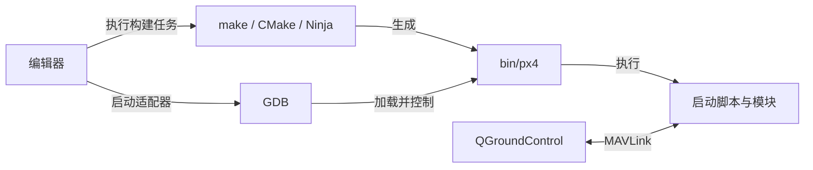

# PX4 从一次真实运行到独立开发

这本主文档直接面向你现在的情况：能启动仿真、能读数据，但还不能解释每次启动参与了哪些代码，也不能独立选择调试入口、修改功能和判断结果。

先完成一个连续任务：**确定实际程序 → 追到启动脚本 → 观察模块生命周期 → 在源码中停下来 → 将变量和消息对应 → 修改一个行为并验证。** 前六章把这一过程做完，后续章节沿同一系统展开测量、估计、控制、模式、通信、仿真与硬件。每章中的命令必须在注明的环境执行；GDB 的 run/next/continue 后等待提示符，不能整段混贴。

你只需要把本文件作为主线。术语或算法需要更深入时才打开链接的既有专题。可执行材料在 `labs/`；作者实际证据在[实施记录](records/IMPLEMENTATION.md)。不需要先读建设方案、填写多份表格或遍历全部模块目录。

## 先用一个具体事实纠正理解

本次实际启动中，`mc_pos_control_main` 收到 `argv[1]="start"`，模块框架创建对象；后来调用栈来自工作队列。未解锁时，位置控制使能仍为 true，代码进入 `_control.update(dt)`，但起飞状态仍为未起飞，目标被改写为抑制推力的特殊目标。这说明“编入、启动、调度、算法执行、输出允许、机体运动”必须分别判断。

第 5 章会展示真实变量、对应代码和推理，不能先把“未解锁”猜成“控制代码完全没运行”。这正是调试必须结合当次状态和代码条件的原因。

<a id="course-map"></a>
## 阅读顺序与每一步的实际用途

| 当前工作问题 | 章节 | 完成后能做什么 |
|---|---|---|
| 不知道每次启动执行哪些代码 | [1 程序身份](#c01)、[2 启动链](#c02)、[3 调度](#c03)、[5 真实控制分支](#c05) | 用自己的启动命令反查程序、脚本、模块与分支 |
| 不知道数据从哪来、怎样被使用 | [4 uORB](#c04)、[7 测量](#c07)、[8 估计](#c08) | 解释单位、坐标、时间、有效性与消费条件 |
| 不知道打开哪些工具、怎样调试和改代码 | [6 完整开发实验](#c06)，含[构建](#build-example)、[GDB](#debug-lab)、[日志](#logging-lab) | 独立完成编译、断点、参数/消息变更、验证与恢复 |
| 需要理解飞行行为和故障 | [9 控制](#c09)、[10 分配](#c10)、[11 模式](#c11)、[15 诊断](#c15) | 从现象定位目标、估计、控制、执行与保护责任层 |
| 要进行仿真或写外部程序 | [12 仿真](#c12)、[13 MAVLink](#c13)、[14 DDS/Offboard](#c14) | 选模型与接口，检查控制权、丢失和恢复 |
| 要扩展硬件、设备或机型 | [16 平台](#c16)、[17 固定翼/VTOL](#c17)、[18 设备](#c18)、[19 其他机型](#c19) | 分析资源、动力学与接口差异，并制定可执行验证 |
| 要独立承担一个功能 | [20 综合开发](#c20)、[综合验收](#assessment) | 交付需求、实现、测试、根因和重建记录 |

第一次按 1→6 连续推进。已有仿真能运行，就沿用它；只有第 6 章的自定义模块需要独立教学构建。完成标准是一项具体工作能否独立复现，所有个人等级留待实际验证。


<a id="c01"></a>
## 1. 一次启动究竟运行了什么


**目标**：给出你实际使用的一条命令或调试配置，能解释使用了哪个程序、构建、模型、运行目录与参数。前提是已经能启动一次仿真；这一能力直接复用。

### 四种对象与工具关系

源代码是 `.cpp`、`.hpp` 和构建输入；构建目录保存生成代码、编译规则和产物；可执行程序是操作系统实际启动的文件；运行目录是程序解析相对文件的位置。这四者可以位于不同路径。

默认 SITL 的源码选择来自 [default.px4board](../boards/px4/sitl/default.px4board)，常规产物位于 `build/px4_sitl_default/bin/px4`。程序在 `rootfs` 中运行时，保存参数和日志不会因为关闭编辑器自动消失。

| 对象 | 谁读取 | 何时生效 | 修改或删除的影响 |
|---|---|---|---|
| `.px4board`、Kconfig、CMake | 构建配置工具 | 配置与构建 | 改变源码/依赖选择，需要重建 |
| `.cpp`、`.hpp` | 编译器 | 构建 | 保存不会改变已运行进程 |
| `compile_commands.json` | 编辑器/分析工具 | 索引 | 可以重生成，不证明运行身份 |
| `bin/px4` | 操作系统/调试器 | 启动新进程 | 重建不会替换旧进程中的代码 |
| 参数文件 | 参数系统 | 装载或显式操作 | 改变运行配置，需要记录后再修改 |
| `.vscode/launch.json` | VS Code 调试适配器 | 开始调试 | 当前 PX4 CMake 可能重新生成它 |
| `.code-workspace` | VS Code 与扩展 | 按工作区打开 | 可选；不参与飞控算法编译 |

之前的 `px4-sih-debug.code-workspace` 已不存在，本章程不依赖它。字段解释保留在[调试参考](DEBUGGING.md#workspace-explained)。



QGC 通过协议交互，不负责把 C++ 编译进程序。SIH 可在 PX4 内部提供模型；Gazebo 使用外部模型与桥接。是否出现三维窗口不能单独判断 PX4 是否运行。

容器提供工具和库。编辑器连接到容器后，路径按容器视角解析；工作区文件没有创建容器的能力。宿主 `/home/yiyi/Workspace/px4/PX4-Autopilot` 与 lab 中 `/workspaces/PX4-Autopilot` 可以是同一份挂载源码，构建缓存中的绝对路径仍须匹配。

### 构建命令怎样展开

在具备依赖的源码根目录 Shell：

```bash
make -j6 px4_sitl_default PX4_CMAKE_BUILD_TYPE=Debug PX4_MAKE_ARGS=-j6
```

`px4_sitl_default` 选择平台与模块集合；`Debug` 选择构建类型；`-j6` 是并行资源设置。根 [Makefile](../Makefile) 将配置交给 CMake，再由底层工具编译和链接。正常增量构建复用未变化的产物，不等于忽略改动。

这条命令构建程序。后续 `make px4_sitl_default sihsim_quadx` 选择 SIH，`gz_x500` 进入 Gazebo 路径。模型选择和构建目标是两层配置。

本章程的外部教学模块使用独立 `build/px4_course`，命令见[实验入口](#build-example)。目录不同用于产物隔离，源码仍来自当前仓库。

### 实验：给实际会话确定身份

沿用已经跑通的入口。在**源码根目录 Shell**：

```bash
git rev-parse HEAD
git status --short
rg 'CMAKE_BUILD_TYPE:|CMAKE_HOME_DIRECTORY:' build/px4_sitl_default/CMakeCache.txt
```

实际使用其他目录时替换路径。在**运行中的 PX4 Shell**：

```text
ver all
param show SYS_AUTOSTART
```

记录启动命令，或调试配置展开后的 `program`、`args`、`cwd`、环境变量与预启动任务。使用[记录模板](#experiment-record)。源码 HEAD 与 `ver all` 都不能单独代表所有未提交差异或旧二进制，还需记录相关改动。

**预期**：能解释程序路径、构建类型、工作目录与机型编号的关系。本章不预设你必须使用 10040 或 SIH。

| 现象 | 先区分什么 | 下一项证据 |
|---|---|---|
| 编辑器红线但构建成功 | 索引与真实编译宏/头文件是否一致 | 实际 provider 与编译数据库 |
| 保存后行为没变 | 是否重建、新进程是否使用该产物、分支是否执行 | 构建记录、程序路径、断点 |
| 换入口后行为不同 | 环境、模型、保存参数和运行目录 | 两次身份记录的差异 |

本章主要只读。不要同时清理缓存、重置参数和换模型来处理一个问题；按证据改变相关因素并比较。

<a id="module-anatomy"></a>
### 把工程文件对应到一个真实模块


本章回答一个具体问题：**项目里的一组 C++ 文件，怎样成为可以在 PX4 中使用的功能？** 学完后，你能把源文件、编译配置和运行命令对应起来。你现在只需要知道函数里可以写处理逻辑；CMake、Kconfig、工作队列等名称在出现时解释。

#### 第一步：先分清源码、构建和运行

你在仓库里看到的 `.cpp`、`.hpp` 是源码文件，不能因为它们存在就认为对应功能已经在执行。

**构建**是把选中的源码编译，再把需要的代码和库链接成程序。在当前 SITL 目标下，主要可执行文件是 `build/px4_sitl_default/bin/px4`。

**运行**是操作系统启动这个程序，程序完成初始化，再根据启动脚本或命令启动具体功能。SITL 表示在计算机上运行飞控软件；具体的机体和传感器由仿真模型提供。本章先研究功能如何被组织和编入。

```text
源码和配置
    │  构建：选择代码、编译、链接
    ▼
bin/px4 可执行程序
    │  启动：初始化、执行启动脚本
    ▼
正在运行的 PX4
    │  脚本或命令启动某个模块
    ▼
模块开始处理数据
```

图中每一条箭头都有自己的实现。第一课先识别这些边界，下一章再沿构建脚本深入。

#### 第二步：打开一个小模块，知道正在看什么

在编辑器展开 `src/examples/work_item/`。本章关注四个文件：

```text
src/examples/work_item/
├── CMakeLists.txt          构建规则：用哪些文件、叫什么名字
├── Kconfig                 选择规则：怎样声明这个功能开关
├── WorkItemExample.hpp     C++ 类声明：有哪些成员和方法
└── WorkItemExample.cpp     C++ 实现：方法具体做什么
```

“模块”在这里就是围绕一项功能组织的代码。这个示例会读取一些消息，并发布一条教学消息。我们用它认识工程结构，之后将相同方法应用到位置控制、估计器等真实功能。

先打开 [CMakeLists.txt](../src/examples/work_item/CMakeLists.txt)，跳过顶部版权注释，找到 `px4_add_module(`。也可以在宿主项目目录运行下面的只读命令显示这一段：

```bash
sed -n '/^px4_add_module(/,$p' src/examples/work_item/CMakeLists.txt
```

下面摘录其中与当前问题有关的部分，省略未启用的调试选项注释：

```cmake
px4_add_module(
    MODULE examples__work_item
    MAIN work_item_example
    SRCS
        WorkItemExample.cpp
        WorkItemExample.hpp
    DEPENDS
        px4_work_queue
)
```

`CMakeLists.txt` 是供构建工具读取的规则文件。`px4_add_module` 是 PX4 提供的构建辅助函数，用来登记模块的源文件、名称与依赖。先按下面的含义读这段规则：

| 代码 | 这里是什么意思 | 用一句话读出来 |
|---|---|---|
| `MODULE examples__work_item` | 构建系统内部使用的目标名称 | “把这组代码登记为 examples__work_item” |
| `MAIN work_item_example` | 登记 PX4 内部命令所使用的名称 | “用户通过 work_item_example 进入这个模块” |
| `SRCS ...` | 这个目标包含的源码文件 | “实现位于这两个文件中” |
| `DEPENDS px4_work_queue` | 该模块依赖的工作队列支持库 | “运行调度要使用工作队列框架提供的能力” |

`.hpp` 列在这里并不表示它会像 `.cpp` 一样独立编译成程序；头文件主要通过包含关系参与编译。`DEPENDS` 也不表示运行时按这个列表顺序启动其他模块。

#### 第三步：为什么目录名、构建名和命令名不同

这三个名称描述三个不同位置：

```text
在文件系统中找代码：src/examples/work_item/
在构建系统中找目标：examples__work_item
在 PX4 Shell 中调用：work_item_example
```

因此，`work_item` 是目录名，不能据此推断 Shell 命令也叫 `work_item`。运行命令要看 `MAIN`。例如以后的运行步骤会使用 `work_item_example start`，而不是 `examples__work_item start`。

`start` 是传给模块入口的动作，表示请求启动。它不属于 CMake 构建操作。实际开始运行的代码由模块框架和实现负责，阶段 2 会展开。

#### 第四步：找到这个模块真正做事情的代码

打开 [WorkItemExample.cpp](../src/examples/work_item/WorkItemExample.cpp)，搜索 `void WorkItemExample::Run()`，再在这个函数内部找到以下几行：

```cpp
orb_test_s data{};
data.val = 314159;
data.timestamp = hrt_absolute_time();
_orb_test_pub.publish(data);
```

这几行依次做四件事：

1. `orb_test_s data{}` 创建一份教学消息，并将其成员初始化。
2. `data.val = 314159` 把教学数值写入消息。这个数字没有高度或推力含义。
3. `hrt_absolute_time()` 取得当前 PX4 时钟的时间，单位为微秒，写入消息时间戳。
4. `publish(data)` 把这份数据发布到 PX4 内部消息系统，让需要它的代码能够读取。

这里先把消息理解为“带有约定字段的一份数据”。`uORB` 是 PX4 内部传递这类数据的机制；消息的生成、缓存和订阅会在阶段 2 学习。

这段逻辑在 `Run()` 内部，所以只有模块得到执行机会时才会发布。当前示例的 `init()` 注册了加速度消息回调，由工作队列安排处理；本章只需记住：**函数写在文件里，与函数正在执行，是两件需要分别确认的事。**

#### 第五步：功能文件存在，怎样知道当前目标选择了它

打开 [boards/px4/sitl/default.px4board](../boards/px4/sitl/default.px4board)，搜索：

```text
CONFIG_EXAMPLES_WORK_ITEM=y
```

这是当前 SITL 构建配置中的功能选择。`y` 表示启用；它告诉构建系统把这个示例纳入当前配置。这个文件回答“这次构建选择什么”，模块的 `CMakeLists.txt` 回答“选中以后怎样构建”。

到这里，可以把第一张关系图补完整：

```text
default.px4board：选中 work_item 示例
          ↓
work_item/CMakeLists.txt：登记名称、源码和依赖
          ↓
WorkItemExample.cpp：提供实际处理逻辑
          ↓ 编译、链接
bin/px4：包含已选择的模块代码
          ↓ 启动 PX4，再请求启动模块
work_item_example start
          ↓ 模块获得调度
Run() 发布教学消息
```

当前 SITL 中许多模块共同进入一个 PX4 程序，运行时使用相应的任务或工作队列。不能按一个目录对应一个独立 Linux 进程来理解它们。

这张图省略了选择规则如何解析、命令表如何生成，以及线程怎样调度。省略的部分是接下来的学习对象：1.2 展开选择与构建，1.3 检查真实产物，1.4 实验验证，阶段 2 展开运行。

#### 第六步：照着参考答案，检查是否建立了对应关系

先看问题，再用上面的文件核对；第一次不会回答时直接读解释即可。

| 问题 | 参考答案与依据 |
|---|---|
| 这项功能的代码放在哪里？ | `src/examples/work_item/`，由文件系统目录确定 |
| 它在 PX4 中的命令名称是什么？ | `work_item_example`，由 CMake 的 `MAIN` 指定 |
| 教学数值在哪里产生？ | `WorkItemExample.cpp` 的 `Run()` 内部，给 `data.val` 赋值 |
| 当前 SITL 为什么会包含这个模块？ | 配置启用了 `CONFIG_EXAMPLES_WORK_ITEM`，模块构建规则提供了实现 |
| 构建成功能证明它正在发布吗？ | 不能；还要启动 PX4 和模块，并让 `Run()` 获得执行机会 |

**本章完成条件**：能在实际文件中指出表中前三项的位置，并理解最后两项的区别。第一次不要求自己推导整套构建系统，也不要求完成一份架构报告。

**现在做什么**：先打开 `work_item/CMakeLists.txt`，读到能够区分 `MODULE`、`MAIN`、`SRCS` 为止，再继续本章下一步。读完本章后进入 1.2；那时你已经知道为什么要研究 Kconfig 和根构建文件。


### 独立任务与参考分析

解释“删除调试工作区后，保存参数是否恢复默认”，给出验证方法。

<details><summary>参考分析</summary>

工作区组织开发工具；参数由运行时参数系统与运行目录管理。删除工作区不会重写参数文件。应在同一运行目录读回参数并追保存来源。换运行目录后读到不同值是另一项条件变化。

</details>

**完成标准**：能为实际运行给出身份，说明配置文件的读取者、作用和删除影响，为身份不一致选择证据。

<a id="c02"></a>
## 2. 从程序入口追到本次启动的模块


**目标**：解释启动集合怎样产生，区分“命令被编入”“脚本选择启动”“启动成功”。前提是能记录运行身份。

### 入口与脚本

电脑端入口是 [main.cpp](../platforms/posix/src/px4/common/main.cpp) 的 `main()`：解析资源、目录、脚本和实例，建立命令服务，初始化平台设施。`run_startup_script()` 调用系统 Shell 执行脚本。随后 PX4 Shell 与已建立的任务和工作队列共同运行。

工作队列、参数和 uORB 等基础设施由平台初始化建立；业务模块由脚本和命令启动。C++ 单步跨过 Shell 调用，不会自动逐行调试 `.sh`。

```text
实际启动命令
 → bin/px4 的 main()
 → 平台、参数、uORB、工作队列初始化
 → run_startup_script()
 → rcS：模型、保存参数、机型配置
 → 模拟器、传感器、估计和管理模块
 → rc.vehicle_setup 按机型选择应用脚本
 → 模块入口创建任务或工作项
```

这是选择和启动关系。具体集合还受构建配置、环境、参数及命令返回影响。

### 机型与参数的选择

默认 SITL 脚本 [rcS](../ROMFS/px4fmu_common/init.d-posix/rcS) 包含最小 Shell、回放与普通启动分支。正常 `PX4_SIM_MODEL=sihsim_quadx` 对应 [10040_sihsim_quadx](../ROMFS/px4fmu_common/init.d-posix/airframes/10040_sihsim_quadx)。`PX4_SYS_AUTOSTART` 等入口会影响优先级，应沿当前条件顺序阅读。

脚本导入保存参数，设置默认值或强制值。`param set-default` 与 `param set` 含义不同，保存值也可能保留。源码默认值不能代替运行值；先读回，再追设置顺序。

多旋翼配置确定 `VEHICLE_TYPE=mc`，[rc.vehicle_setup](../ROMFS/px4fmu_common/init.d/rc.vehicle_setup) 选择 [rc.mc_apps](../ROMFS/px4fmu_common/init.d/rc.mc_apps)。相关命令摘录如下，条件模块见完整文件：

```sh
control_allocator start
mc_rate_control start
mc_att_control start
mc_hover_thrust_estimator start
flight_mode_manager start
mc_pos_control start
land_detector start multicopter
```

控制分配可以先完成初始化再等待输入。启动顺序不是位置到电机的计算顺序；数据作用方向由发布订阅关系决定。

### 命令怎样进入 C++

CMake 的 `MAIN mc_pos_control` 登记运行命令。构建生成命令表，对应构建目录的 `platforms/posix/apps.cpp` 可用于观察。字符串映射到 `mc_pos_control_main()`，再进入模块框架。

启动脚本借助命令别名/客户端把命令送到运行实例；[Pxh::process_line](../platforms/posix/src/px4/common/px4_daemon/pxh.cpp) 完成相应分发。start/status/stop 都会经过入口，因此入口命中后还需检查参数。

默认 SITL 编入 `work_item_example`，默认脚本没有启动它。这是已编入但未自动运行的对照。

### 实验：四个模块的证据

**源码根目录 Shell**：

```bash
rg -n 'CONFIG_(EXAMPLES_WORK_ITEM|MODULES_MC_POS_CONTROL|MODULES_EKF2)' boards/px4/sitl/default.px4board
rg -n 'start|rc.vehicle_setup' ROMFS/px4fmu_common/init.d-posix/rcS
rg -n 'start' ROMFS/px4fmu_common/init.d/rc.mc_apps
```

**普通多旋翼 PX4 Shell**：

```text
param show SYS_AUTOSTART
commander status
ekf2 status
mc_pos_control status
work_item_example status
```

分别记录编入依据、启动来源、条件、实际结果和未确认项。EKF2 的启用和实例按本次配置记录。

需要命令轨迹时，可以在保留已有差异的实验中临时启用 rcS 顶部的 `set -x`，重新构建和启动，记录后恢复这一行。轨迹证明发出了哪些命令；启动返回和模块状态用于确认成功。轨迹不是全部算法的执行历史。

| 观察 | 可支持的判断 | 后续检查 |
|---|---|---|
| help 中有命令 | 命令已注册 | 启动源和状态 |
| 脚本存在 start | 静态可能路径 | 条件和实际轨迹 |
| start 报错 | 创建/初始化可能失败 | 第一条错误、资源、依赖 |
| status 显示运行 | 框架报告实例状态 | 调度和业务条件 |

观察本身无需重置参数。启用了脚本轨迹时，只恢复该处实验改动。

### 独立任务与参考分析

反查 `mc_att_control` 的入口，并解释为什么在 `main.cpp` 中看不到“位置控制依次调用姿态控制”的完整链。

<details><summary>参考分析</summary>

中间经过脚本、命令表和框架；模块启动后由执行上下文调度，跨模块通过消息协作。从脚本命令查 CMake MAIN，再查 `_main()`、`task_spawn()`。数据方向另查订阅和发布，不能由启动先后推出。

</details>

**完成标准**：解释自动与手动模块的差别，能从新命令找到入口，把静态路径和运行结果分别记录。

<a id="c03"></a>
## 3. 对象、任务、工作队列与执行时机


**目标**：解释模块如何从启动走到重复执行、停止和重启。前提是能从命令追到模块入口。

### 对象与执行上下文

C++ 对象保存状态和方法。`new WorkItemExample()` 分配对象、执行构造函数，尚不能证明 Run 会重复执行。线程有自己的执行流和栈；工作队列在线程中依次运行工作项，多项工作可以共享一个线程。

[WorkItemExample.cpp](../src/examples/work_item/WorkItemExample.cpp) 的 `task_spawn()` 创建对象并保存实例指针，以 `task_id_is_work_queue` 标记工作项。构造函数选择 test1 队列，`init()` 注册 sensor_accel 更新回调。

```text
命令上下文：start → task_spawn → 构造 → init → 返回
                                         │ 注册回调
消息路径：sensor_accel 更新 ──────────────┘
                                         ↓ 安排工作
队列线程：取出工作项 → Run() → 返回队列
```

安排工作不等于在发布者里同步执行全部消费者。多次更新可能合并，实际执行次数不能直接等于发布次数。

### 三类调度与备用执行

| 机制 | 含义 | 需要观察 |
|---|---|---|
| ScheduleNow | 尽快执行一次 | 首次与后续如何衔接 |
| ScheduleOnInterval | 按周期安排 | 调度延迟、工作耗时、参数更新 |
| 消息回调 | 指定主题更新后安排 | 实例、注册、发布和队列负载 |

`ScheduleDelayed()` 还可用于备用调度和状态机等待。位置控制注册局部位置回调、安排首次执行，Run 中安排 100 ms 备用执行；这不代表正常算法固定为 10 Hz。

进一步实现看 [工作队列](../platforms/common/px4_work_queue/WorkQueue.cpp) 与 [SubscriptionCallback.hpp](../platforms/common/uORB/SubscriptionCallback.hpp)。

### Run 内部与停止

原始示例处理退出、性能、参数、载具状态和加速度更新，再发布 `orb_test.val=314159`。数值没有高度或推力含义。真实模块还会检查模式、时间和数据有效性；Run 入口命中只证明得到执行机会，业务证据要看计算或发布位置。

共享队列中一项阻塞会让同队列其他工作等待。不能按“一个类就是一个线程”判断隔离性。验证这一概念可使用隔离示例或调用栈，不在飞行控制队列插入长睡眠。

stop 通过框架设置退出请求。工作项下一次执行时检查 `should_exit()`，清理调度、回调和对象；注销位置要连同基类/析构阅读。本章程定时教学模块的最大周期是 2 秒，正常停止可能等待下一次调度。重启创建新对象，计数重新开始。

### 实验：调用栈与生命周期

**多旋翼 PX4 Shell**：

```text
work_item_example status
work_item_example start
work_queue status
listener orb_test -n 3
```

预期看到发布。没有消息时检查 sensor_accel；原示例依赖加速度触发，第 6 章的 learn_status 则采用定时器。

按[基础 GDB 操作](#debug-lab)在 `WorkItemExample::Run()` 停一次，在 **GDB**查看：

```text
bt
info threads
print this
```

记录线程和调用栈，随后禁用高频断点并继续。在 **PX4 Shell**：

```text
work_item_example stop
work_item_example status
listener orb_test -n 1
work_item_example start
work_item_example stop
```

停止后还读到最后一个样本不代表停止失败，要看时间是否继续更新。调试器暂停时控制台也可能不响应，先恢复执行。实验完成后正常停止模块。

### 独立任务与参考分析

对 mc_pos_control 标出创建对象、执行 Run、触发消息与备用调度。解释一个断点为什么会不断命中。

<details><summary>参考分析</summary>

对象由 start 路径建立，Run 在指定工作队列运行。主要触发是 vehicle_local_position，另有首次和备用安排。保留高频断点会在后续调度再次暂停，不一定是模块重启或死循环。只研究首次调用时用一次性断点或观察后禁用。

</details>

**完成标准**：画出对象寿命与执行上下文，解释旧消息、回调合并和共享队列阻塞，并为相似模块选择观测点。

<a id="c04"></a>
## 4. 一条消息怎样连接两个模块


**目标**：从一个字段追到消息定义、发布者、消费者与执行条件。前提是理解工作队列和回调。

### 消息是数据契约

uORB 是 PX4 内部的发布订阅机制。主题名标识接口，结构体定义字段，发布者写入样本，消费者读取需要的主题。它没有要求发布者直接调用每个消费者的算法。

[msg](../msg) 中的定义经过构建生成 `uORB/topics/*.h` 和元数据。源码改变后应重建；直接编辑生成头会在下次生成时丢失。普通结构体声明也不等于自动注册了一个可运行主题。

[WorkItemExample.hpp](../src/examples/work_item/WorkItemExample.hpp) 的声明：

```cpp
uORB::Publication<orb_test_s> _orb_test_pub{ORB_ID(orb_test)};
```

模板参数确定结构体类型，花括号指定主题 ID。`Run()` 创建 data、填写 val 与微秒时间戳，然后 `publish(data)`。`listener orb_test` 是另一个消费者，它显示被发布的样本，不是读取当前栈上的局部变量。

### 三种订阅的区别

| 接口 | 含义 | 不能据此推断什么 |
|---|---|---|
| Subscription | 在调用处检查/读取 | 本身不会创建循环线程 |
| SubscriptionInterval | 限制读取更新节奏 | 不会降低发布者的原始发布频率 |
| SubscriptionCallbackWorkItem | 更新时安排工作项 | 不保证每个样本对应一次完整算法调用 |

`updated()` 检查相对该订阅的更新状态；`copy()` 复制样本；`update()` 常用于在有更新时复制。具体消费代数与队列行为继续看 [Subscription.hpp](../platforms/common/uORB/Subscription.hpp)。多个订阅者有各自的读取状态，一个消费者读过，不代表其他消费者也已读过。

许多状态主题用于最新值，部分主题配置多样本队列。慢消费者可能遗漏中间样本。连续历史应使用适当配置的 Logger，并分析记录频率和丢样。

### 字段除了类型还必须解释什么

以 [VehicleLocalPosition](../msg/versioned/VehicleLocalPosition.msg) 为例：位置使用局部 NED 米，速度单位为米/秒；时间、xy/z 有效性、参考原点和重置计数分别表达不同事实。NED 的 z 向下，所以 z=-3 表示参考原点上方 3 米，不自动等于离地 3 米。

| 项目 | 为什么要看 |
|---|---|
| 单位/坐标/参考 | 同一个数字可能描述不同物理状态 |
| 采样与发布时间 | 延迟与同步不能只用一个 timestamp 判断 |
| 有效性/NaN | 有数值不表示可以用于控制，0 与未启用不同 |
| 实例/设备身份 | 实例 0 有数据不证明它是被选中的来源 |
| 重置语义 | 坐标跳变可能是参考重置，不是物体瞬间运动 |
| 生产者与控制权 | 同名主题可能有模式相关或外部发布路径 |

`trajectory_setpoint` 也可能有不同生产路径：FlightModeManager、外部接口、内部 GotoControl 等。通过搜索找到全部候选后，还要结合模式与当前配置判断实际来源。

### 实验：存在、更新与消费

在**源码根目录 Shell**：

```bash
rg -n 'ORB_ID\(vehicle_local_position\)' src/modules/ekf2 src/modules/mc_pos_control
rg -n 'trajectory_setpoint' src/modules/flight_mode_manager src/modules/mc_pos_control src/modules/uxrce_dds_client/dds_topics.yaml
```

在**多旋翼 PX4 Shell**：

```text
listener vehicle_local_position -n 3
listener trajectory_setpoint -n 1
uorb top
```

记录实际更新情况与字段含义。缺少目标不一定是传输故障，可能当前模式不需要该目标；估计无效也可能在启动阶段出现。连续三次不同主题读取不是同步快照。

用教学示例观察停止：

```text
work_item_example start
listener orb_test -n 2
work_item_example stop
listener orb_test -n 1
```

**预期**：停止后可能读到最后样本，但时间不再随示例更新。不能把缓存值当成当前发布。恢复：实验结束保持本次启动的示例停止；若进入实验前示例已运行，先保留其状态并使用独立会话。没有必要改控制参数。

### 定位消息问题

先确认生产者运行，再确认它实际发布；确认消费者订阅的主题/实例，再看是否读取新样本；最后检查是否通过有效性和模式条件。只有在前一环有证据时，才把问题归到下一环。

新增消息还需分别处理生成、消费者重建、日志选择和外部桥接。uORB、ULog、MAVLink 和 DDS 不是同一个注册表。

### 独立任务与参考分析

为 vehicle_attitude 制作一份接口说明：生产者选择、四元数顺序、坐标变换、采样时间、重置、消费者。分析“能 listener 到姿态，但控制不工作”还缺什么证据。

<details><summary>参考分析</summary>

按当前 [VehicleAttitude](../msg/versioned/VehicleAttitude.msg) 定义核对 q 的 w,x,y,z 顺序和 FRD 到 NED 旋转。还需核对实例、时间、有效状态、控制模式、目标和消费者更新路径；单次读到四元数不能证明控制分支启用。多实例 EKF 要继续追选择器。

</details>

**完成标准**：独立追一个主题的完整契约，能区分未发布、旧缓存、实例不匹配、未消费和未用于算法。

<a id="position-walkthrough"></a>
<a id="c05"></a>
## 5. 位置控制显示运行，为何算法还没有执行


**目标**：用真实控制模块连接启动、调度、输入、模式、算法和输出。适用于当前普通多旋翼位置控制路径，VTOL 和其他模式需另查分支。

### 先建立完整关系

[rc.mc_apps](../ROMFS/px4fmu_common/init.d/rc.mc_apps) 执行 `mc_pos_control start`，模块框架进入 [MulticopterPositionControl.cpp](../src/modules/mc_pos_control/MulticopterPositionControl.cpp) 的 task_spawn、构造、init。构造函数选择 nav_and_controllers 队列，init 注册局部位置回调并安排首次运行。

[头文件](../src/modules/mc_pos_control/MulticopterPositionControl.hpp) 定义三项关键输入：vehicle_local_position 是状态和主要触发来源，trajectory_setpoint 是目标，vehicle_control_mode 是控制启用条件。其他输入还包括落地状态、约束、悬停推力估计等。

```text
状态 + 目标 + 模式与约束
          ↓
MulticopterPositionControl：管理输入、时间、起飞和回退
          ↓
PositionControl：控制计算与推力/姿态结果
          ↓ vehicle_attitude_setpoint
姿态控制 → 角速度控制 → 控制分配 → 输出与模型
```

跨模块箭头是数据关系；不是同一线程依次调用所有控制器。

### Run 中三个诊断入口

Run 首先处理退出，安排 100 ms 备用执行，检查参数。主体先要求局部位置有更新，然后更新状态、模式、目标和重置处理，再检查控制条件。以下仅是条件摘录：

```cpp
if (_local_pos_sub.update(&vehicle_local_position)) {
    // 中间还处理模式变化、状态、目标、重置和后备目标
    if (_vehicle_control_mode.flag_multicopter_position_control_enabled
        && (_setpoint.timestamp >= _time_position_control_enabled)) {
        // 起飞、约束、目标和状态准备后才调用 _control.update(dt)
    }
}
```

三个入口回答“这次是否取得新位置”“当前是否启用相应控制”“目标是否满足启用时间要求”。它们不是全部算法有效性条件。

例如备用调度触发 Run，但没有新位置，主体可以不执行；有新位置而模式不启用，也可以不计算。目标时间不满足时，前面的逻辑还可能产生后备目标，因此不能忽略中间代码，只拿一次 listener 的目标时间推断执行结果。

### 算法成功、失败与输出

模块将状态和目标传入 [PositionControl](../src/modules/mc_pos_control/PositionControl/PositionControl.cpp)，根据起飞状态、速度、推力和倾角限制设置约束。`update(dt)` 返回是否获得有效控制结果。

当前实现会保存有效目标；更新失败时，在允许时间内尝试上一次有效目标，仍失败再使用保护目标和相应限制。随后提取局部位置控制目标与姿态目标并发布。输入组合、回退和输出要在同一次执行中观察。

因此“Run 被调用”“算法被调用”“算法成功”“发布输出”“下游使用输出”是不同结论。姿态目标还不是 PWM；后续仍要经过反馈控制、分配和输出映射。

### 完整实测：一次启动怎样走进位置控制

下面不是假设输出。作者在本次 SIH 10040、Debug 构建、实例 81 中设置断点，记录了命令分发、对象创建、工作队列与算法分支。原始输出见[控制链断点记录](records/evidence/control-trace.txt)，后续状态见[状态记录](records/evidence/control-status.txt)。

**第一站：启动脚本发出的 start，到哪里变成 C++ 调用？**

在 `mc_pos_control_main` 停住，跨过函数序言后读到：

```text
argc = 2
argv[0] = "mc_pos_control"
argv[1] = "start"

mc_pos_control_main
  ← px4_daemon::Pxh::process_line
  ← px4_daemon::Server::_handle_client
```

`argv` 是命令参数数组；第一项是命令名，第二项是动作。这条栈说明启动脚本的客户端请求由当前 PX4 服务处理，再分发到模块入口。不是 Shell 直接运行一个独立的“位置控制程序”，也不是 main 中写了一个无限循环直接调用位置算法。

`mc_pos_control_main` 的主要语句是：

```cpp
return MulticopterPositionControl::main(argc, argv);
```

这里的 `main` 来自 `ModuleBase<MulticopterPositionControl>` 模板框架。模板参数让同一份通用 start/status/stop 逻辑调用具体模块的 task_spawn。框架处理掉命令名后，下一层的参数数量可能从 2 变为 1；这不是参数丢失。

**第二站：start 创建了什么？**

在 `MulticopterPositionControl::init` 停住时，实际调用链是：

```text
mc_pos_control_main
  → ModuleBase<...>::main
  → ModuleBase<...>::start_command_base
  → MulticopterPositionControl::task_spawn
  → MulticopterPositionControl::init
```

task_spawn 已分配对象并运行构造函数；init 注册局部位置主题的回调、安排首次运行。此时得到的是一个有状态的对象，尚不能由这条栈推断它以后始终在同一线程执行。init 返回后启动命令可以结束，工作项仍由队列管理。

**第三站：Run 究竟由谁调用？**

在 Run 内的控制条件处停住，调用链已经变成：

```text
px4::WorkQueueRunner (context = wq_configurations::nav_and_controllers)
  → px4::WorkQueue::Run
  → MulticopterPositionControl::Run
```

这个栈和启动栈不同：前一个解释创建对象，后一个解释重复执行。GDB 在这个很早的启动时刻曾显示线程名 `wq:manager`；判断配置时，以栈里的 `context=nav_and_controllers` 和对象构造配置交叉确认，不能只凭一个线程显示名称下结论。

**第四站：未解锁，是否就不会执行位置算法？**

本次在控制条件行读到的值：

| 变量 | 实测值 | 此时能够说明什么 |
|---|---|---|
| `flag_armed` | false | 尚未解锁 |
| `flag_multicopter_position_control_enabled` | true | 当前允许这条位置控制路径 |
| `vehicle_local_position.timestamp` | 248000 us | 已读取到一份本次局部状态样本 |
| `vehicle_local_position.xy_valid` | false | 启动早期水平位置尚无效 |
| `_setpoint.timestamp` | 248000 us | 模块当前内部目标的时间 |
| `_time_position_control_enabled` | 244000 us | 本次控制使能记录时间 |

当前使能为 true，248000≥244000，因此通过这两个条件。继续运行确实命中了 `_control.update(dt)`。所以本例不能解释成“没有解锁，算法不运行”；也不能因水平位置无效就断定整个模块没有做任何计算。

**第五站：为什么进入算法却没有要求飞机飞走？**

继续向上看起飞状态处理。本次 `not_taken_off=true`、`flying=false`，执行了下面的源码：

```cpp
if (not_taken_off || flying_but_ground_contact) {
    _setpoint = PositionControl::empty_trajectory_setpoint;
    _setpoint.timestamp = vehicle_local_position.timestamp_sample;
    Vector3f(0.f, 0.f, 100.f).copyTo(_setpoint.acceleration);
    _control.resetIntegral();
}
```

这段先清空正常轨迹字段，设置较大的向下加速度请求，用于确保起飞前不产生推力，并清除积分以避免积累；后续还设置起飞阶段的倾角、爬升和推力限制。`100` 不是“要让飞机向下以 100 m/s² 飞行”的任务目标，它属于这一特殊控制路径。

在算法调用前，实际读到：

```text
dt ≈ 0.04 s
states.position / velocity / acceleration = NaN
_setpoint.position / velocity = NaN
_setpoint.acceleration = {0, 0, 100}
```

随后 `next` 到了保存 `_last_valid_setpoint` 的成功分支，说明这次 update 返回成功。NaN 在这里必须按“哪些目标/状态字段需要参与当前计算”分析，不能认为看到一个 NaN 就一定崩溃。也不能把此次成功推广为正常位置跟踪已经就绪。

这一次记录说明：启动入口执行了；对象已创建；队列执行了 Run；算法被调用；起飞前处理改变了算法输入。它没有证明完成了位置保持或飞行任务。后续若研究真正的目标跟踪，要在估计有效、对应模式和飞行状态下另做连续日志实验。

### 亲自复现这条链：两个终端，各做一件事

前提：按第 1 章构建命令获得普通 `build/px4_sitl_default` Debug 产物，开发环境已有 GDB。这里直接调试真实飞行模块，不需要先完成第 6 章。作者实测使用的 `build/px4_course` 额外编入了教学模块，但本节位置控制源码相同；若使用作者产物，把下面两个终端中的构建目录一起替换。在源码根目录的**终端 A**执行：

```bash
PX4_TRACE_RUN=$(mktemp -d /tmp/px4-control-trace.XXXXXX)
env PX4_SIM_MODEL=sihsim_quadx PX4_SIMULATOR=sihsim \
  gdb -nx --args build/px4_sitl_default/bin/px4 -d -i 81 \
  -w "$PX4_TRACE_RUN" "$PWD/ROMFS/px4fmu_common"
```

`-d` 关闭 PX4 交互 Shell，这个终端只用于 GDB；另一个终端通过客户端命令观察 PX4。实例 81 必须空闲。标准已有 Debug 产物也可以替换 program，但两个终端的路径与实例必须一致。

在终端 A 的 **GDB 提示符**逐条执行：

```text
set pagination off
set print thread-events off
handle SIGCONT nostop noprint nopass
tbreak mc_pos_control_main
tbreak MulticopterPositionControl::init
run
```

命中第一个断点后，`next` 一次到入口的业务语句，等待 `(gdb)` 返回，再执行 `print argc`、`print argv[0]`、`print argv[1]`、`bt`。执行 `continue` 进入 init，读 `bt`，核对上面的第二条链。

现在在源码编辑器搜索 Run 中 `flag_multicopter_position_control_enabled` 与 `_setpoint.timestamp` 连在一起的 if，给这条语句设置一次性断点。本基线是：

```text
tbreak MulticopterPositionControl.cpp:452
continue
```

行号只是当前版本定位辅助；修改文件后应重新按语句查找。命中后逐项执行：

```text
bt
print _vehicle_control_mode.flag_armed
print _vehicle_control_mode.flag_multicopter_position_control_enabled
print vehicle_local_position.xy_valid
print _setpoint.timestamp
print _time_position_control_enabled
```

再在 `_control.update(dt)` 调用处设一次性断点，本版行 574。若前面的条件为 false，不要无期限等待，先解释哪个条件阻止了执行；必要时 Ctrl+C 返回 GDB，重新选择上游观测点。条件满足并命中时，读取 states、_setpoint、dt、not_taken_off，再单步观察返回后的实际分支。

完成后 continue，让整个启动过程完成。在**终端 B 的系统 Shell**逐条执行：

```bash
build/px4_sitl_default/bin/px4-mc_pos_control --instance 81 status
build/px4_sitl_default/bin/px4-work_queue --instance 81 status
build/px4_sitl_default/bin/px4-listener --instance 81 vehicle_control_mode -n 1
build/px4_sitl_default/bin/px4-work_item_example --instance 81 status
```

每条 `px4-命令` 都是发给实例 81 的客户端调用；它不是另开一套飞控。仅在终端 A 已 continue 时执行，否则 PX4 被暂停，客户端可能等待。这次观察中位置模块运行，而默认未人工启动的 work_item_example 不运行，构成“编入≠启动”的直接对照。

退出时，终端 B 执行：

```bash
build/px4_sitl_default/bin/px4-shutdown --instance 81
```

终端 A 应显示 inferior exited normally，再 `quit`。客户端 shutdown 可能因服务先退出返回非零，结合 GDB 的退出状态判断；不能只凭这一客户端返回值声称飞控崩溃。恢复只涉及本次实例、断点和临时运行目录，不重置其他仿真会话。

### 你的结果与实测不同，怎样继续查

实际模式、参数、估计与调试时机可能不同。不要照抄上面的数值作为自己的结果，按这张表确定下一项证据：

| 观察 | 候选解释 | 下一项证据 |
|---|---|---|
| status 运行，Run 未停 | 符号/程序不一致、断点未绑定或调度异常 | 当前程序身份、绑定状态、队列 |
| Run 停了，位置分支未进 | 没有新样本 | 订阅更新、实例、发布时序 |
| 有新位置，算法没进 | 模式或目标时间条件不满足 | 同次运行的标志、目标及中间处理 |
| 算法调用但进入回退 | 输入组合或有效性有问题 | 返回值、有限值检查、回退条件 |
| 输出更新但行为异常 | 下游反馈、模式、限制或执行问题 | 连续目标—反馈—执行器证据 |


恢复：禁用本次断点，正常结束本次实例；本章不要求为了命中断点而解锁或修改控制参数。

### 独立任务与参考分析

对 mc_att_control 独立完成同样分析：启动源、触发消息、目标与反馈、使能条件、算法位置与发布主题。

<details><summary>参考分析</summary>

入口见 [mc_att_control_main.cpp](../src/modules/mc_att_control/mc_att_control_main.cpp) 和头文件。触发、当前姿态和期望姿态的职责分别检查；输出 vehicle_rates_setpoint。控制路径由姿态控制使能、载具状态及目标时序等条件约束，不能把位置模块的三个条件原样复制。给出自己找到的变量和分支位置，才算迁移。

</details>

**完成标准**：能够用代码与运行证据解释至少一种未进入算法的情况，并把方法迁移到姿态模块。

<a id="c06"></a>
## 6. 完成一个独立模块、参数与消息


**目标**：从需求走到构建、运行、参数更新、消息、日志与恢复。材料已经提供完整实现，先理解，再进行独立修改。

### 需求与接口

教学命令叫 `learn_status`。start 后按参数 LEARN_PERIOD 指定的周期发布 LearnStatus；默认 100 ms，有效范围 20～2000 ms。运行期参数更新在下一次调度被处理；stop 后不再发布，restart 从计数 1 开始。

这是教学状态发布模块，没有执行器输出。周期参数表示调度间隔，不保证每两个实际发布时间严格相差该值；需考虑队列和观测开销。

| 文件 | 作用 |
|---|---|
| [src/CMakeLists.txt](labs/external_module/src/CMakeLists.txt) | 向 PX4 导出外部模块列表 |
| [模块 CMake](labs/external_module/src/learn_status/CMakeLists.txt) | 声明源码、构建名、命令和链接依赖 |
| [LearnStatus.cpp](labs/external_module/src/learn_status/LearnStatus.cpp) | 生命周期、参数更新、调度和发布 |
| [参数定义](labs/external_module/src/learn_status/learn_status_params.c) | 参数扫描器输入，不作为普通 SRCS 编译 |
| [消息定义](labs/external_module/msg/LearnStatus.msg) | 字段、单位、语义 |
| [消息注册](labs/external_module/msg/CMakeLists.txt) | 向 PX4 导出外部消息列表 |
| [PeriodPolicy.hpp](labs/external_module/src/learn_status/PeriodPolicy.hpp) | 先限幅再换算为微秒，避免非法周期 |

源码位于 learn/labs，通过根 CMake 的 EXTERNAL_MODULES_LOCATION 接入；不是运行时插件下载。外部列表决定这个实验是否编入。迁回 `src/examples` 时需增加 Kconfig 并在目标中选择，不能仅移动目录就假设注册完成。

### 逐步推演一次运行

start 经过 ModuleBase，task_spawn 创建对象、登记工作队列标识，再调用 init。构造时选择 test1 队列。init 读取参数，将毫秒限幅并换算为微秒，ScheduleOnInterval 安排周期工作。

Run 先检查退出，再读取 parameter_update。参数变化时 updateParams 刷新包装值，重新计算周期；只有实际周期变化才重新设置调度。最后初始化消息，填写时间、递增计数、原始参数和限幅标志，再发布。

消息中的 `requested_period_ms` 保留原始值，`period_us` 表示实际调度配置，`period_limited` 说明是否限幅。这使“参数读回正确但行为不同”具有可观察解释。元数据的 min/max 并不替代运行时防御。

例如参数为 -1，先限幅为 20，再乘 1000 得到 20000 us。若先把 -1 转为无符号再换算，会得到错误的大值；[算法测试](labs/algorithm/tests.cpp) 覆盖了这类边界。

停止时在 Run 中 ScheduleClear，再 exit_and_cleanup。变量属于工作队列线程；status 不跨线程直接读取可变计数，要求用 uORB 观察样本。

### 完整实现怎样对应需求

下面是本轮实际编译、断点和日志实验使用的实现。先沿构造/init/Run/退出读一遍，再检查各成员保存什么状态；不需要把这里的文件手工复制到主飞控目录。消息、参数和 CMake 文件就在后面的实验路径中。

```cpp
// Teaching example, using the PX4 external-module interface.
#include <px4_platform_common/module.h>
#include <px4_platform_common/module_params.h>
#include <px4_platform_common/px4_work_queue/ScheduledWorkItem.hpp>
#include <drivers/drv_hrt.h>
#include <uORB/Publication.hpp>
#include <uORB/Subscription.hpp>
#include <uORB/topics/learn_status.h>
#include <uORB/topics/parameter_update.h>

#include "PeriodPolicy.hpp"

class LearnStatus final : public ModuleBase<LearnStatus>, public ModuleParams, public px4::ScheduledWorkItem
{
public:
	LearnStatus() : ModuleParams(nullptr), ScheduledWorkItem(MODULE_NAME, px4::wq_configurations::test1) {}

	bool init()
	{
		updateParams();
		_period_us = learning::period_us(_param_period.get());
		ScheduleOnInterval(_period_us);
		return true;
	}

	static int task_spawn(int argc, char *argv[])
	{
		LearnStatus *instance = new LearnStatus();

		if (instance) {
			_object.store(instance);
			_task_id = task_id_is_work_queue;

			if (instance->init()) {
				return PX4_OK;
			}
		}

		delete instance;
		_object.store(nullptr);
		_task_id = -1;
		return PX4_ERROR;
	}

	int print_status() override
	{
		// Mutable sample fields belong to the queue thread: read them via uORB.
		PX4_INFO("running; inspect: listener learn_status -n 1");
		return 0;
	}

	static int custom_command(int argc, char *argv[])
	{
		return print_usage("unknown command");
	}

	static int print_usage(const char *reason = nullptr)
	{
		if (reason) {
			PX4_WARN("%s", reason);
		}

		PRINT_MODULE_DESCRIPTION("Teaching telemetry on a work queue; no actuator output.");
		PRINT_MODULE_USAGE_NAME("learn_status", "example");
		PRINT_MODULE_USAGE_COMMAND("start");
		PRINT_MODULE_USAGE_DEFAULT_COMMANDS();
		return 0;
	}

private:
	void Run() override
	{
		if (should_exit()) {
			ScheduleClear();
			exit_and_cleanup();
			return;
		}

		parameter_update_s update{};

		if (_parameter_update_sub.update(&update)) {
			updateParams();
			const uint32_t next_period = learning::period_us(_param_period.get());

			if (next_period != _period_us) {
				_period_us = next_period;
				ScheduleOnInterval(_period_us);
			}
		}

		learn_status_s data{};
		data.timestamp = hrt_absolute_time();
		data.sample_count = ++_sample_count;
		data.period_us = _period_us;
		data.requested_period_ms = _param_period.get();
		data.period_limited = data.requested_period_ms < 20 || data.requested_period_ms > 2000;
		_publication.publish(data);
	}

	uORB::Publication<learn_status_s> _publication{ORB_ID(learn_status)};
	uORB::Subscription _parameter_update_sub{ORB_ID(parameter_update)};
	uint32_t _sample_count{0};
	uint32_t _period_us{100000};
	DEFINE_PARAMETERS((ParamInt<px4::params::LEARN_PERIOD>) _param_period)
};

extern "C" __EXPORT int learn_status_main(int argc, char *argv[])
{
	return LearnStatus::main(argc, argv);
}
```

`_object` 与 `_task_id` 属于 ModuleBase 的实例管理；`_sample_count` 属于本模块对象，重建对象才清零。`_parameter_update_sub` 只告诉模块参数有变化，`updateParams()` 才刷新参数包装器里的值，随后还必须重算 `_period_us`。这三步缺一，就可能出现“param show 已变，实际周期没变”。

`_publication` 发布一个结构体副本，下游 listener 和 logger 通过 uORB 读取；它们不会访问 Run 栈上的 `data`。`print_status()` 因为可能从命令线程调用，不直接读取队列线程正在修改的计数，避免把一个看似方便的诊断变成共享状态竞争。

要求周期为 100→200→-1 时，有效值分别是 100000→200000→20000 us；最后一个样本同时保留原请求 -1 并标记限幅，能解释配置和行为的差异。周期变更要等下一次 Run 处理，不保证命令返回瞬间已应用。

停止由框架请求，Run 清调度后释放对象；程序没有在共享队列里阻塞等待另一个模块。主线独立任务是在这个实现上增加有效周期变化次数，而不是先写一个没有验证入口的空模块。

<a id="module-lab"></a>
### 本章完整构建、运行与恢复


从已经能运行的环境开始。下文 Bash 命令在 **PX4 源码根目录、具备编译依赖的 Linux 或容器 Shell** 执行；`pxh>` 中只执行标明 PX4 Shell 的命令。宿主路径与容器路径不可混用，同一个构建目录也不能随意跨路径复用。

<a id="build-example"></a>
#### 完整模块、参数和消息实验

实现见[第 6 章](#c06)。本实验使用 PX4 的外部源码目录机制：仍在编译时静态接入同一个 PX4，不是运行时动态加载插件。模块使用独立队列发布教学消息，没有电机输出。

前提：CMake、Ninja、C/C++ 编译器、PX4 的 Python 构建依赖已经可用。标准依赖入口是 [Tools/setup/ubuntu.sh](../Tools/setup/ubuntu.sh) 和 [requirements.txt](../Tools/setup/requirements.txt)；已有容器不必重复安装。作者本次使用的临时环境与版本在[记录](records/IMPLEMENTATION.md)，不是要求你依赖 `/tmp` 中的文件。

在仓库根目录执行：

```bash
cmake -S . -B build/px4_course -G Ninja \
  -DCONFIG=px4_sitl_default -DCMAKE_BUILD_TYPE=Debug \
  -DPYTHON_EXECUTABLE="$(command -v python3)" \
  -DEXTERNAL_MODULES_LOCATION="$PWD/learn/labs/external_module"
cmake --build build/px4_course --target px4 -j4
```

先检查配置成功再构建。CMake 缓存绑定绝对路径和 Python；切换宿主/容器或工具链时使用新的构建目录。缺 Gazebo 库可能使 GZ bridge 被跳过，SIH 仍可用；这并不说明 Gazebo 已通过检查。

在同一个仓库 Shell，为实验分配一个新运行目录：

```bash
PX4_COURSE_RUN=$(mktemp -d /tmp/px4-course-run.XXXXXX)
env PX4_SIM_MODEL=sihsim_quadx PX4_SIMULATOR=sihsim \
  build/px4_course/bin/px4 -i 77 -w "$PX4_COURSE_RUN" "$PWD/ROMFS/px4fmu_common"
```

`-i 77` 选择独立实例号，`-w` 选择参数/日志运行目录，最后一个参数提供启动资源。实例号和目录须空闲；多实例的端口仍可能有共用项，外部工具按实际 `mavlink status` 确认连接。保持本会话不解锁，关闭不需要的控制客户端。若自己的实例已用 77，换另一个未占用值并同步下列命令。

在 **PX4 Shell**：

```text
param show LEARN_PERIOD
learn_status start
learn_status status
listener learn_status -n 1
work_queue status
param set LEARN_PERIOD 200
listener learn_status -n 1
learn_status stop
```

参数变更和停止要等工作项得到调度；停止最长可能等当前周期约 2 秒再加调度开销。`listener -n 1` 取一份样本，多次取样比较时间与计数；一次读到旧样本不表示仍在发布。

另开**源码根目录 Shell**，对这套已经启动且教学模块已停止的实例运行：

```bash
python3 learn/labs/check_module.py --bin-dir build/px4_course/bin --instance 77
```

[检查程序](labs/check_module.py) 通过 `px4-命令 --instance 77` 联系已有实例，不启动或解锁飞机。它保存原周期，检查发布、参数更新、非法周期限幅、停止和重启，最后停止模块并恢复原周期。若最初模块已运行则拒绝接管。脚本超时或失败后核对模块和参数是否恢复，不把退出码以外的失败输出忽略掉。

结束实验，在 **PX4 Shell** 输入 `shutdown`；若进程不退出，先保存输出、检查仍运行的线程和客户端，再只处理本实验进程。不要用匹配所有 PX4 的批量杀进程命令。

##### 每个辅助文件为何存在

| 文件/目录 | 读取者、时机 | 改动与删除影响 |
|---|---|---|
| `external_module/src/CMakeLists.txt` | PX4 CMake 配置时读取外部模块列表 | 列表影响编入选择，变更需重新配置/构建 |
| 模块 `CMakeLists.txt` | CMake 声明 MAIN、源码和链接 | 决定 `learn_status` 命令与产物依赖 |
| `LearnStatus.cpp`、`PeriodPolicy.hpp` | C++ 编译器在构建时读取 | 保存不影响旧进程；重建后启动新程序 |
| `learn_status_params.c` | 参数生成器扫描 | 生成参数定义与元数据；不属于普通 SRCS |
| `msg/CMakeLists.txt`、`LearnStatus.msg` | 消息生成器 | 生成 uORB 头/元数据；结构变更需重建相关程序 |
| `build/px4_course` | CMake、编译器、操作系统 | 可重新生成；关闭运行/调试后才能整理产物 |
| 独立运行目录 | PX4 启动和运行时读取 | 保存参数、日志；先归档证据再删除 |
| `check_module.py` | 人工执行的 Python 检查工具 | 删除不影响 PX4 功能，只失去自动检查 |

外部模块此处不需要修改板级 Kconfig。其 `target_link_libraries` 放在模块声明之后，允许工作队列库稍后由平台 CMake 定义；直接在 `px4_add_module` 的 DEPENDS 中提前查询尚未定义的库，在本基线会配置失败。转为仓库内正式模块时要按目标补齐 Kconfig 与启用规则。

恢复普通构建时使用原来的 `build/px4_sitl_default`；若要复用教学构建目录，显式把 EXTERNAL_MODULES_LOCATION 配为空并重新配置。不要让缓存继续引用已删的外部源码。

<a id="algorithm-lab"></a>
#### 算法实验：参考限速与非法周期

需求：每次只允许参考沿目标方向移动 `最大速度 × dt`，不得越过目标。函数无跨次状态，调用者保存返回值。输入或中间结果非法时保持原值并返回 `valid=false`。当前值本身为 NaN 时也保持它并报告失败，调用者必须自行提供有效初始化。

实现是 [reference_limiter.hpp](labs/algorithm/reference_limiter.hpp)；[tests.cpp](labs/algorithm/tests.cpp) 覆盖正反方向、到达、零速度、非法 dt、NaN/Inf、溢出、连续过程及教学模块的周期转换。

```bash
cmake -S learn/labs/algorithm -B build/learn_algorithms -DCMAKE_BUILD_TYPE=Debug
cmake --build build/learn_algorithms -j2
ctest --test-dir build/learn_algorithms --output-on-failure
```

预期 CTest 执行 `learning_algorithms` 并通过。只有 1 个 CTest 条目，其中包含多项断言，不能把条目数混同断言数。独立任务：先预测取消“限制到剩余距离”之后哪个断言会失败，再在自己的实验差异中验证，最后恢复。禁止只为了通过而放宽容差。

#### 恢复与证据

恢复本次修改的参数、源码和日志配置，停止本次启动的程序，保留提交号、本地差异、实际命令和结果摘要。不要恢复掉之前已有的其他改动。测试成功后仍要说明它只覆盖哪个函数或模块条件；闭环飞行、Gazebo、ROS 2 和板端验证各需自己的记录。

<a id="debug-lab"></a>
### 在调试器中把变量和消息对应起来


本实验回答一个具体问题：`learn_status` 如何把参数变为调度周期，再发布可观察数据。先使用命令行 GDB，把输入位置和程序角色弄清；VS Code 随后提供相同动作的图形入口。已删除的 `px4-sih-debug.code-workspace` 不需要恢复。

#### 哪些窗口各做什么

| 窗口/提示符 | 输入 | 作用 |
|---|---|---|
| 源码环境 Shell，通常 `$` | cmake、gdb、git、Python | 编译、启动工具与保存证据 |
| GDB `(gdb)` | break、run、next、print、continue | 控制被调试的 PX4 进程 |
| PX4 `pxh>` | learn_status、listener、param | 调用 PX4 内置命令 |
| QGroundControl | 图形模式/参数/遥测操作 | MAVLink 客户端，不负责编译或下源码断点 |
| Gazebo 窗口 | 世界与模型操作 | 外部物理环境；本 SIH 实验无需它 |

GDB 与 PX4 可能轮流占用同一终端；先看提示符，再输入。**逐条执行命令，尤其在 next、step、run、continue 后等待对应提示符或断点结果，不能一次粘贴后续多行。** 单步期间其他线程可能读到终端输入；本次实测确认过这一点。运行时 Ctrl+C 请求中断进程，回到 `(gdb)`；暂停时输入 `listener` 不会成为 PX4 命令。

#### 构建并启动调试器

按[模块构建](#build-example)得到 Debug 产物。在同一源码环境 Shell 执行 `command -v gdb`，必须有可用 GDB；没有时在开发环境安装它或使用已含 GDB 的容器，不能在 Windows 环境中拿容器路径启动 Linux 程序。

```bash
PX4_COURSE_DEBUG=$(mktemp -d /tmp/px4-course-debug.XXXXXX)
env PX4_SIM_MODEL=sihsim_quadx PX4_SIMULATOR=sihsim \
  gdb -nx --args build/px4_course/bin/px4 -i 78 \
  -w "$PX4_COURSE_DEBUG" "$PWD/ROMFS/px4fmu_common"
```

使用未占用实例 78。`-nx` 不读取自动初始化文件，避免仓库 `.gdbinit` 提前 run。GDB 的 program 路径与构建目录必须对应；工作目录通过 PX4 的 `-w` 指定。

在 **GDB**：

```text
handle SIGCONT nostop noprint nopass
break LearnStatus::Run
run
```

在出现的 **PX4 Shell**：

```text
learn_status start
```

命中 Run 后终端回到 **GDB**：

```text
next
bt
info threads
list
print _sample_count
```

函数入口断点可能停在函数序言，先单步到第一条业务语句再读取成员，避免尚未建立的栈帧误导判断。按源码的当前位置执行 `next`，观察退出判断、参数更新与消息赋值。不要机械执行固定次数；检查 `list` 标出的下一行。遇到函数调用时 `next` 跨过调用，`step` 才进入。首次 Run 前计数为 0，填写消息时递增；若已运行多次，当前计数应按实际生命周期解释。

```text
disable 1
continue
```

这里的 `1` 是本实验第一次新建断点的编号；先用 `info breakpoints` 确认。取消高频暂停后在 **PX4 Shell** 用 `listener learn_status -n 1` 读样本。消息时间来自 PX4 时钟；墙钟暂停与模拟时间不必相等。

#### 让断点回答问题

| 现象 | 假设 | 观测与判定 |
|---|---|---|
| Run 不命中 | 没编入或没启动 | `help`/模块状态、生成命令表、真实二进制 |
| Run 命中但没消息 | 提前退出或发布分支未执行 | 调用栈、退出条件、发布行与主题状态 |
| 参数读回 200 但周期未变 | 包装值未刷新或尚未调度 | parameter_update、updateParams、有效周期 |
| 停止后仍看到数值 | 旧消息或另一实例 | 连续比较 timestamp、模块状态与实例 |
| 变量不可见 | 优化、作用域或符号不一致 | 编译选项、当前栈帧、实际加载的 ELF |

断点用于一处计算和条件判断；连续时序用日志。所有线程停止时，外部客户端仍可能超时，这个现象不能直接当成正常运行中的控制故障。实时性能实验关闭断点后重新进行。

#### 正常退出、修改和重试

先 continue 恢复，在 PX4 Shell 执行 `learn_status stop`，等清理完成，再 `shutdown`。回到 GDB 后 `quit`。若停在断点，先恢复或由 GDB 明确结束本次 inferior，不能以关闭编辑器代替恢复说明。

然后修改一个可预测的教学行为，重新构建、启动新会话；继续旧进程不会重新加载新代码。保存“源码差异—构建—断点—消息”四项证据。

#### 可选的 VS Code 操作

使用 **Open Folder** 打开源码根目录，编辑器、C/C++ 扩展、GDB 与产物位于同一环境。打开 Run and Debug，选择实际存在的 launch 条目；仓库生成的 SIH 条目依赖 CMake Tools 的目标选择，先展开确认 program/cwd/args/env。

自己整合配置时，将 `program` 指向上述 Debug 产物，`args` 对应 `-i/-w/ROMFS`，environment 对应两个模拟变量，`MIMode=gdb`、`miDebuggerArgs=-nx`。完整字段表见[配置解释](DEBUGGING.md#workspace-explained)。仓库配置阶段可能重生成 `.vscode/launch.json`，先另存自定义配置原文再合并。

在源代码行号左侧点断点；F5 开始或继续、F10 单步跨过、F11 单步进入；Variables 看当前栈帧变量，Call Stack 看调用路径，Debug Console 是调试器表达式入口，PX4 命令输入运行终端。菜单中不存在某个教程名称时，应核对配置来源，不需要找回已删除的工作区。

#### 独立练习与验收

给“参数改了但输出没变”至少两个不同解释，分别设计能区分它们的观测。以 `_period_us` 更新位置和发布位置的断点证明一次真实参数更新，再用不暂停的消息记录核对。

本次作者实测：线程为 `wq:test1`，栈为 LearnStatus::Run → WorkQueue::Run → WorkQueueRunner；首次业务语句计数为 0，发布前为 1；参数更新处 `_period_us` 从 100000 变为 200000，再由 listener 读回。完整片段见[验证记录](records/IMPLEMENTATION.md)。

通过要求：自己选择断点、解释当前执行线程和生命周期、读出关键变量、正常退出并复现。GDB 实际验证状态见[作者记录](records/IMPLEMENTATION.md)，课程提供操作不等于本环境已有调试器。

<a id="logging-lab"></a>
### 让消息真正进入日志并完成检查


目标是证明 `LearnStatus.msg` 的字段确实被记录，时间递增，并包含 100 ms→200 ms 的配置变化。uORB 发布、Logger 订阅和文件落盘是不同环节，分别检查。

#### 建立隔离的日志环境

完成[教学构建](#build-example)，停止本次其他教学实例。下列步骤在源码根目录 Shell 创建一个新的临时目录，不使用既有飞行日志配置：

```bash
PX4_COURSE_LOG_RUN=$(mktemp -d /tmp/px4-course-log.XXXXXX)
cp -a ROMFS/px4fmu_common "$PX4_COURSE_LOG_RUN/etc"
mkdir -p "$PX4_COURSE_LOG_RUN/etc/logging"
cat > "$PX4_COURSE_LOG_RUN/etc/logging/logger_topics.txt" <<'EOF'
learn_status 0
vehicle_status 100
EOF
env PX4_SIM_MODEL=sihsim_quadx PX4_SIMULATOR=sihsim \
  build/px4_course/bin/px4 -i 79 -w "$PX4_COURSE_LOG_RUN"
```

`etc` 必须是新目录内的真实副本。常规 PX4 启动会把 `etc` 链接到 ROMFS；直接修改链接中的文件可能改到源码。此处不传最后的资源目录参数，让 PX4 使用已经复制的资源。

[logged_topics.cpp](../src/modules/logger/logged_topics.cpp) 在自定义文件成功加入主题时使用该集合，代替默认 profile 主题初始化；Logger 还可能加入强制/辅助主题，因此实际文件不一定只有两项。文件第二列是记录间隔毫秒，0 不额外降频，仍受发布和 Logger 能力限制。这份最小配置用于教学，不提供完整飞行诊断数据。

#### 记录一次变化

在 **PX4 Shell**，先发布主题，再重启 Logger，使本次订阅与记录起点明确：

```text
learn_status start
logger stop
logger start -f
```

正常运行数秒，执行：

```text
param set LEARN_PERIOD 200
listener learn_status -n 1
logger status
```

再运行数秒，记录 `logger status` 中的实际文件路径。`-f` 启用持续文件记录，无需解锁；完整选项由当前 `logger help` 核对。结束：

```text
logger stop
learn_status stop
param set LEARN_PERIOD 100
shutdown
```

100 是这个新运行目录的实验初值；在既有环境中必须恢复实际原值。正常关闭 Logger 保证数据写完，再分析文件。

#### 分析实际文件

安装了 `pyulog` 与 `numpy` 的 Python 环境中，用实际日志路径替换下例末尾：

```bash
python3 learn/labs/inspect_log.py /absolute/path/to/log.ulg
```

[分析脚本](labs/inspect_log.py) 检查主题、字段、样本数、严格递增的时间/计数，以及两种有效周期。它不要求 wall time 精确等于模拟时间，也不假定 Logger 没有漏采。该脚本的通过只证明这项教学过程，不等于整套飞行记录完整。

本次实测得到 45 条 learn_status 样本，5 个业务字段，两种 period_us 分别为 100000 和 200000；开始/结束时间及日志校验值见[记录](records/IMPLEMENTATION.md)。

#### 缺数据时怎样定位

| 观察 | 检查 |
|---|---|
| listener 无主题 | 实际运行的二进制、模块状态、调度和发布 |
| listener 有但日志无 | Logger 读取哪个配置、订阅时机、实际打开哪份文件 |
| 字段是旧版本 | 消息是否重新生成、进程是否重启、日志身份是否正确 |
| 变化没有记录 | 参数是否应用、运行是否足够长、记录间隔与停止时机 |
| 时间不连续 | Logger dropouts、发布时钟、进程重启或不同实例混用 |

独立任务：新增字段后预测日志定义与数据各改变什么，再重建复现。恢复时退出教学进程，将需要的日志移到自己的记录目录；其余临时副本可删除，不影响原来的参数、Logger 配置或源码。

### 边界、日志与恢复

边界测试先运行[独立测试](#algorithm-lab)，验证负值、上下界与极大值。运行时可在隔离教学会话使用命令行设置超界值，并检查是否被参数系统接受；若被拒绝，记录拒绝，不伪造已限幅观察。接受后才观察 period_limited 和实际周期。

日志实验见[教学日志操作](#logging-lab)。只有主题生成和发布不会自动完成日志配置；自定义 topic 文件可能替代默认集合，要记录与恢复。

结束后 stop，将 LEARN_PERIOD 恢复为实验前读到的值，恢复日志文件。保持外部模块产物目录独立；退出该实验构建时不再传 EXTERNAL_MODULES_LOCATION，并核对实际 CMake 缓存。不要在缓存中仍选了外部目录时删除源文件。

### 独立改动与验收

任务：新增一个字段，报告有效发布周期自启动后发生变化的次数；仅当有效周期变化时计数，重新启动清零。说明参数从 2001 改为 3000 是否应增加计数。

<details><summary>参考分析</summary>

两个超界值都限为 2000 ms，有效周期未变，不应增加。应更新消息定义、模块状态与发布、重新生成并构建，然后验证正常变更、同值、同一限幅结果和重启。日志和外部桥接分别检查，不能声称自动全部更新。可以查源码完成，但需要自主找到修改点。

</details>

**完成标准**：提交改动差异、构建身份、消息/日志证据、边界解释与恢复记录。当前提供的完整实现与作者验证见[交付记录](records/IMPLEMENTATION.md)，不代表你的独立任务已通过。


<a id="c07"></a>
## 7. 测量怎样变成估计与控制的输入


**目标**：解释驱动、校准、滤波、积分和选择的责任，追通 IMU 的两条消费路径。前提是消息契约、调度和坐标基础；深入数学见[基础计算](TECHNICAL.md#c2)。

### 从物理量到软件字段

加速度计测量比力，陀螺仪测量角速度。静止加速度计并不读零：在水平、常见 FRD 约定下，比力 z 约为 -g，具体还需检查安装旋转和驱动坐标。控制和估计消费的是校准、旋转及相应处理后的数据。

设备寄存器/FIFO → 原始整数 → 量程与单位换算 → 时间戳与设备身份 → sensor_accel/sensor_gyro → 系统处理。驱动成功通信只证明设备可访问，不证明样本有效或被选中。

[传感器模块](../src/modules/sensors) 组织相关处理；[BMI088 驱动](../src/drivers/imu/bosch/bmi088/BMI088_Gyroscope.cpp) 提供一个可读状态机。沿复位、等待、配置、FIFO 读取、错误计数、恢复查条件；设备探测、数据就绪与周期调度的上下文分别看。

### IMU 两条路径

```text
传感器/模拟输入
    ├─ VehicleIMU：校准、时间和运动增量 → vehicle_imu → EKF
    └─ VehicleAngularVelocity：选择、滤波、校准/偏置处理
                               → vehicle_angular_velocity → 角速度控制
```

[VehicleIMU](../src/modules/sensors/vehicle_imu/VehicleIMU.cpp) 向估计器提供 delta_angle、delta_velocity 及积分时间。对恒定角速度 1 rad/s、采样窗口 0.01 s，理想角增量为 0.01 rad。将增量直接当角速度，会差一个时间尺度。

[VehicleAngularVelocity](../src/modules/sensors/vehicle_angular_velocity/VehicleAngularVelocity.cpp) 处理选中的角速度来源，包含 FIFO/非 FIFO 路径、滤波、校准与估计偏置等。它面向快速反馈，滤波改变噪声也改变延迟；相同 IMU 并不意味着两条路径的频率、延迟和数据表示一致。

### 数据选择与异常

多 IMU 中要核对设备 ID、实例、优先级与 sensor_selection。一个设备仍有样本，不代表系统正在使用它。温度补偿、在线偏置与静态校准作用于不同问题，不能用一次“校准成功”替代整个误差模型。

时间戳需要区分样本时间和发布时间。FIFO 一次读出多样本，要重建各样本时刻；使用读取结束时刻代表整个窗口，会影响延迟估计。

### 实验与观测

在 **PX4 Shell**中：

```text
sensors status
listener sensor_selection -n 1
listener sensor_gyro -n 1
listener vehicle_imu -n 1
listener vehicle_angular_velocity -n 1
```

先对照消息定义解释单位与时间，再观察选中设备与实例。可在已建立的仿真运动中记录数据；无运动时也能研究静态比力和更新时间。连续行为用日志，单帧不用于判断滤波相位。

| 现象 | 需要区分 | 证据 |
|---|---|---|
| 原始数据有，控制反馈没有 | 选择、处理模块、有效性、发布条件 | status、设备 ID、输入输出时间 |
| 转向后轴向不符 | 安装方向、坐标变换、符号 | 已知方向运动与变换定义 |
| 波形更平滑但控制变差 | 噪声降低与延迟增加 | 同一时间轴的原始/处理后信号 |
| 偶发跳变 | 饱和、丢样、设备切换、时钟问题 | clipping、错误计数、选择与时间 |

本章先只读；需要改变滤波时先记录原值，以单因素仿真实验比较并恢复。真实驱动时序、接线和 FIFO 中断必须留给相应设备实测。

### 用一个具体样本追完整测量链

假设某个 VehicleImu 样本报告 `delta_angle[0]=0.002 rad`、`delta_angle_dt=4000 us`。这表示 0.004 s 积分窗内绕机体 X 轴的角增量；平均角速度约为 0.002/0.004=0.5 rad/s。把 0.002 直接当 rad/s 输入控制，会小约 250 倍。这个例子是单位推演，不是本次采样记录。

真正读取一条 IMU 时按以下链检查：

| 环节 | 代码与数据 | 必须回答的问题 |
|---|---|---|
| 器件/模拟器 | 原始寄存器或模拟测量 | 传感器安装方向、量程、采样时刻从哪里来 |
| 驱动包装 | sensor_accel / sensor_gyro 及 FIFO | 原始整数怎样缩放为 SI 单位，哪个设备 ID |
| 校准和选择 | sensors 内的设备处理 | 偏置、比例、旋转、温补是否应用，选择哪个实例 |
| 惯性积分 | [VehicleIMU.cpp](../src/modules/sensors/vehicle_imu/VehicleIMU.cpp) | 角增量/速度增量怎样积累，积分窗口多长，是否 clipping |
| 快速控制支路 | [VehicleAngularVelocity.cpp](../src/modules/sensors/vehicle_angular_velocity/VehicleAngularVelocity.cpp) | 选中陀螺、滤波和导数，何时发布角速度 |
| 消费 | EKF2 或 mc_rate_control | 取的是哪条支路，有无新样本、是否通过有效性条件 |

静止在地面的加速度计也不会简单输出三轴全零，它测量的是比力；旋转、重力处理和估计的关系必须分清。不能用“静止但 z 非零”直接判定驱动坏了。

**动手时一次只回答一个问题。** 先 `listener vehicle_imu -n 1` 记录两个 device_id、采样时间、积分窗和 clipping；再看 `listener vehicle_angular_velocity -n 1`。两次读取不是同步采样，不能逐项要求相等。研究延迟时记录同一日志窗口的 timestamp_sample、timestamp 与实际消费时间，分别计算测量到发布、发布到消费的差值。

如果 IMU 有值而估计没更新，先查 EKF 选择的设备/实例和样本时间；如果角速度控制更新但估计频率较低，先比较两条预处理链的触发/积分设计。它们可以同时来自一个 IMU，却具有不同节奏，这并不自动表示丢数据。

### 独立任务与参考分析

给一个新测距仪定义输入契约：单位、方向、安装位置、采样时刻、有效范围、质量、设备身份、失联与消费者。

<details><summary>参考分析</summary>

还需说明最小/最大距离、超量程值、测量射线方向、传感器相对机体的位置，以及所测表面和高度的关系。倾斜测距不能直接当垂直高度。协议解析、消息发布、估计器是否接受是三个验证层，分别用帧样本、主题和融合状态确认。

</details>

**完成标准**：给出 IMU 双路径图和一份真实字段契约，解释一类输入异常。驱动与硬件进一步见第 16、18 课。

<a id="c08"></a>
## 8. 状态估计：从一条观测到融合、拒绝和重置


**目标**：能解释状态如何由模型和测量形成，用确定输入研究融合切换。前提是时间、坐标、测量误差和有效性。

### 先用数字理解融合

标量估计中，预测 x=2.0 m、方差 P=0.25 m²；观测 z=2.4 m、方差 R=0.75 m²。增益 K=P/(P+R)=0.25，创新 z-x=0.4 m；更新后 x=2.1 m，P=(1-K)P=0.1875 m²。

增大 R 会减小观测权重。小方差代表估计器内部不确定性假设，并不证明真实误差小。假设错误、相关误差或错误时间对齐都可能产生“很自信但错误”的结果。

多状态 EKF 用状态转移传播均值和协方差，观测模型把状态映射为预期观测，再用创新修正。创新门限会拒绝不一致观测；偏置估计、融合源切换与状态重置还会影响输出。具体创新符号按代码/消息定义核对，不能把教材符号直接套到每个日志字段。

### 实现路径

[EKF2.cpp](../src/modules/ekf2/EKF2.cpp) 是模块外壳，负责订阅、时间、参数、调用与发布；[EKF](../src/modules/ekf2/EKF) 目录实现预测与融合。GNSS 高度可沿输入缓冲追到 [gnss_height_control.cpp](../src/modules/ekf2/EKF/aid_sources/gnss/gnss_height_control.cpp)。

```text
测量收到 → 时间/质量检查与缓冲 → 融合条件
 → 预测观测与创新 → 接受或拒绝 → 状态/偏置/参考处理
 → 发布估计 → 多实例选择（如启用）→ 控制消费者
```

“收到 GNSS 消息”“打算融合”“本次融合成功”“最终状态有效”是不同事实。多实例时还要确认观察的 estimator_* 属于哪个实例，以及控制使用哪一个输出。

### 用已有确定输入测试研究高度

打开 [test_EKF_height_fusion.cpp](../src/modules/ekf2/test/test_EKF_height_fusion.cpp) 的 baroRef：测试设置气压参考，启用 GNSS/测距；给气压增加 4 m 并推进时间；检查 NED z 约向 -4 m 收敛，并检查其他高度源偏置。随后增加很大的气压跳变，测试其停止融合并转为 GNSS 参考；再改变 GNSS 高度，检查跟随与偏置行为。

这段测试把“设置输入—推进时间—检查状态”写成可重复过程。预期数值来自该测试配置与运行时长，不是任何飞行条件下都成立的通用阈值。

**已配置开发环境的源码 Shell**：

```bash
cmake -S . -B build/px4_course_test -G Ninja -DCONFIG=px4_sitl_test -DCMAKE_BUILD_TYPE=Debug
cmake --build build/px4_course_test --target unit-test_EKF_height_fusion -j6
build/px4_course_test/unit-test_EKF_height_fusion --gtest_filter=EkfHeightFusionTest.baroRef
```

确认输出确实执行了指定用例，不能把 0 tests 当成通过。依赖下载、工具和实际执行状态见[验证记录](records/IMPLEMENTATION.md)。

### 仿真观测与异常判断

在 **PX4 Shell**中查看：

```text
ekf2 status
listener vehicle_local_position -n 1
listener estimator_status_flags -n 1
```

随后按实际实例记录相应 aid-source、创新、拒绝、融合时间与 reset counter。具体主题集合按当前发布者选择，字段详解见[估计参考](TECHNICAL.md#c6)。

位置跳变时同时检查：参考/状态是否重置、观测是否改变、模式是否切换、目标是否作重置补偿、真值是否运动。不能只从位置曲线断言控制器失稳。

修改实验使用独立测试副本，只改变一个输入幅度或持续时间，运行前预测继续融合、拒绝或切换。失败时先核对时间和条件；不随意放宽容差。结束恢复本次实验输入和参数，保留可复现差异。

### 把数学变量对应到故障判断

估计器需要同时处理“物理模型并不完全准确”和“测量带误差”。简单标量公式只说明一次更新的权重，真实 EKF 还传播姿态、速度、位置、偏置等状态之间的相关性。误差会跨状态传播：陀螺偏置引起姿态误差，姿态误差改变重力投影，再污染速度和位置，不能把高度误差都归到气压计。

沿一个高度源至少分开四项状态：测量是否到达、质量是否合格、创新是否通过检验、最近是否实际融合。创新是预测观测与测量的差，创新方差综合状态和测量不确定性；很多一致性检查使用归一化残差和门限，而不是固定“误差超过几米”这一条规则。

在本章 baroRef 测试中，4 m 的变化和 200 m 的突变用于触发不同处理：前者研究跟踪和其他高度源偏置，后者研究拒绝与参考切换。要改测试，应先写“改变哪个输入、等待多久、期望哪个状态/参考/偏置改变”，再看断言。不能把测试里的 200 m 当成飞控通用切换阈值。

假设日志出现 z 从 -2 m 跳到 -1 m，同时 z_reset_counter 增加、delta_z 约 +1 m。先考虑估计坐标/状态重置；下游若保持相对目标关系，可能也补偿目标。若只把 z 的阶跃当机体瞬间下落，然后增大位置 P，会把估计事件误当成控制性能问题。继续核对真值、观测、重置来源和目标补偿才能确定。

调试分工是明确的：测试调试器检查某次融合/拒绝条件；仿真日志检查变化前后的连续因果；真值用于比较估计误差，但真机通常没有同等可靠的真值。模型真值正确也不保证模拟噪声、延迟与真实器件一致。

### 独立任务与参考分析

在气压异常后 GNSS 也缺失，能否继续把已有位置值当作可靠位置控制反馈？列出需要观察的信息。

<details><summary>参考分析</summary>

数值可继续存在但有效性、漂移和参考质量会变化。要观察实际融合源、最近融合时间、惯性传播、状态有效性、保护标志和模式条件；也可能有其他观测仍有效。没有配置与证据不能直接预测必然返航或降落。用确定输入测试逐项移除观测比等待偶然失效更容易解释。

</details>

**完成标准**：解释一次融合、拒绝、切换或重置，能将源码条件与测试断言对应，并说明证据范围。

<a id="c09"></a>
## 9. 从目标误差到姿态、角速度和力矩


**目标**：理解控制计算、目标限制与算法启用之间的边界，完成确定输入计算与测试。前提是状态语义、坐标和第 5 章的模块外壳。

### 按数据作用理解串级控制

位置误差产生速度修正，速度误差产生加速度/推力需求，再由推力方向与偏航生成姿态目标；姿态误差产生角速度目标；角速度误差产生力矩需求。每层有反馈、限幅和模式条件。外部模式可能从速度、姿态或角速度层接入，不是所有模式都使用全部外环。

[PositionControl](../src/modules/mc_pos_control/PositionControl/PositionControl.cpp) 先检查输入组合，再运行位置和速度处理。位置比例修正叠加速度前馈；水平限速优先保留位置修正方向；竖直速度使用 NED 符号和升降限制。NaN 表示对应目标未启用，0 表示有效的零目标。

例如单轴位置差 2 m、位置增益 1 s⁻¹，产生 2 m/s 速度修正；若有 1 m/s 前馈，未限幅合成为 3 m/s。实际二维限幅还涉及方向与优先级，不能逐轴截断后假设仍满足总速度限制。

### 姿态与角速度

[AttitudeControl](../src/modules/mc_att_control/AttitudeControl/AttitudeControl.cpp) 使用四元数处理姿态误差，并考虑推力轴与偏航的权重、速率限制和前馈。四元数 q 与 -q 表示同一姿态；直接逐分量相减不能替代姿态误差计算。

[RateControl](../src/lib/rate_control/rate_control.cpp) 的主要输出关系是：

```text
torque = P * (rate_sp - rate) + integral - D * angular_accel + FF * rate_sp
```

D 项使用测得角加速度，符号为负。当前输出使用已有积分值，随后在未落地等条件下更新积分；分配饱和标志会限制误差方向，避免继续向饱和方向积分。

单轴示例：目标 1 rad/s，实际 0.6 rad/s，P=0.2，积分=0.03，D=0.01，角加速度=2 rad/s²，FF=0.05，则本次力矩请求为 0.08+0.03-0.02+0.05=0.14（按接口的归一化定义理解）。不能把这个数直接当 N·m 或电机 PWM。

### 为什么需要限制与抗饱和

物理系统的总推力、倾角和电机能力有限。PositionControl 限制推力向量，并对垂直和水平积分作相应处理。目标过大时，积分无限累积会使限制解除后仍产生过度动作。

性能判断要同时看目标、反馈和输出。若目标本身被轨迹限速，飞机缓慢接近可能是正确行为；若目标变化正常但反馈跟不上，则继续看估计、控制和执行能力。

### 可执行算法实验

先运行本章程提供的[一维参考限速器](labs/algorithm/reference_limiter.hpp)及测试，命令见[算法实验](#algorithm-lab)。它不直接替换飞控算法，而是完整展示需求、单位、非法输入、实现和验证。

在 step=0.1 s、最大速度=0.7 m/s 下，每步参考变化最多 0.07 m；接近目标时使用剩余距离避免越过。实现拒绝非有限数、非正 dt、负速度及溢出。调用者保存当前参考，函数自身不保存跨次状态。

再研究 PX4 原有测试：

```bash
cmake --build build/px4_course_test --target unit-PositionControl unit-rate_control_test -j6
ctest --test-dir build/px4_course_test -R '^unit-(PositionControl|rate_control_test)$' --output-on-failure
```

前提是按第 8 章完成测试目录配置。实际目标来源见[PositionControl 测试](../src/modules/mc_pos_control/PositionControl/PositionControlTest.cpp)及[角速度测试](../src/lib/rate_control/rate_control_test.cpp)。确认所选用例实际运行。

### 系统实验与恢复

在已有起飞—保持—降落仿真基线上，记录轨迹目标、位置/速度反馈、姿态/角速度目标和执行器输出。先预测改变的是目标生成还是反馈跟踪，再单因素调整已理解的限制并恢复。

断点适合检查一次计算的变量，ULog 适合连续性能；位置误差曲线不能单独区分目标、估计和执行故障。算法实验的参数数值不直接用作真机调参建议。

### 一次参数修改为什么必须经过三层验证

假设需求是“目标移动时参考变化不超过 0.7 m/s”。第一层用本章限速器检查每步增量 ≤0.7×dt；第二层检查调用它的模块确实使用实际 dt、处理重置、启停和模式切换；第三层在仿真中比较生成目标和反馈。飞机速度小于 0.7 m/s，可能只是跟踪能力不足，不能单凭反馈速度证明目标限制实现正确。

对真实 RateControl，P、积分、D、前馈各有不同输入。目标阶跃而机体还没动时，误差 P 项立即变化；D 使用测得的角加速度，不直接对目标差分；前馈与目标直接相关；积分按后续更新和限幅逐步变化。若把所有变化归到一个 PID 数字，就无法解释输出来源。

饱和反馈也不是“输出裁掉就结束”：分配器告诉上游某方向无法继续提供控制能力，积分应避免往同方向继续积累。诊断时对齐速率目标、反馈、角加速度、积分/控制状态和分配饱和；对积分提出修改前，先确定它是错误积累还是在补偿持续偏差。

给算法加约束时还需写清单位和放置层：位置层限速与电机层限幅控制的对象不同；同样一个数字不能跨层直接复用。课堂的归一化力矩 0.14 经过机体效能和执行器映射后，才形成各个电机/舵机控制值。

### 独立任务与参考分析

给参考限速器增加一个需求：无效 dt 时必须保持参考，并明确返回失败。解释为什么只检查最终位置会漏掉速度违规。

<details><summary>参考分析</summary>

现有实现已拒绝 dt<=0 和非有限 dt，可用它作为要求与代码对应的练习。应逐步检查变化量不超过速度乘 dt、方向正确、没有越过目标、最后能到达。仅最终值正确，可能中间一步跳到目标，无法证明速度限制成立。

</details>

**完成标准**：手算一次控制输出并对应变量；解释 NaN、前馈、限幅与积分；完成一个能识别错误行为的独立算法测试。

<a id="c10"></a>
## 10. 整体力矩怎样变成每个执行器的命令


**目标**：区分控制请求、分配结果、输出映射和实际作用。前提是推力/力矩、机体系和上一章的控制输出。

### 从需求到效能矩阵

角速度控制给出整体力矩与推力请求。控制分配根据机体几何、执行器方向、旋转方向和限制，求各执行器的作用。可以用 τ=B·u 表示局部线性关系：u 是执行器作用向量，B 的列描述某个执行器对整机各轴的贡献。

以机体系 r=(x,y,0)、单电机力 F=(0,0,-T) 为例，r×F=(-yT,xT,0)。偏航还涉及旋转反扭矩，不能只由臂长推导。实际 PX4 接口存在归一化与缩放，手算物理力矩后需核对实现的单位约定。

[ControlAllocator](../src/modules/control_allocator/ControlAllocator.cpp) 接收请求、处理效能模型与方法、限制并发布执行器结果；[ActuatorEffectivenessRotors](../src/modules/control_allocator/VehicleActuatorEffectiveness/ActuatorEffectivenessRotors.cpp) 建立旋翼几何效能。不同机型还有舵面、倾转、车辆等模型。

### 分配成功不等于实际电机作用

```text
vehicle_torque_setpoint / vehicle_thrust_setpoint
 → 效能模型与分配算法
 → actuator_motors / actuator_servos
 → 输出功能映射、限制、解锁与故障状态
 → PWM / DShot / CAN / 仿真桥
 → 物理模型或真实执行器
```

actuator_motors 的数组是逻辑电机命令，不直接规定某个连接器引脚电压。输出功能映射选择物理通道，驱动负责协议。未解锁、失效或未映射的通道可能不产生预期作用。

需求超出可实现集合时，会出现饱和或未分配量。角速度控制可利用分配饱和反馈抑制积分。增加增益不能创造额外推力能力。

### 实验：请求、结果与饱和

在**仿真 PX4 Shell**：

```text
control_allocator status
listener vehicle_torque_setpoint -n 1
listener vehicle_thrust_setpoint -n 1
listener actuator_motors -n 1
listener control_allocator_status -n 1
```

当前模式没有控制请求时，某些主题可能未发布。先记录模式、解锁和落地状态，再解释输出。在连续任务日志中比较请求与分配状态，不用单帧不同主题计算瞬时残差。

静态任务：按实际机型脚本和效能配置画出电机位置、轴向、旋转方向和输出功能。给一个电机增加正推力，先预测滚转/俯仰/偏航方向，再与代码矩阵列核对。

动态执行器故障实验限定在支持的仿真配置，使用现有[分配测试](../test/mavsdk_tests/test_multicopter_control_allocation.cpp)研究场景和判据。故障注入接口必须核对具体模块支持，不能仅命令接受就称故障已发生。

### 故障判断与恢复

| 现象 | 检查顺序 |
|---|---|
| 力矩请求有，电机主题无更新 | 模块/控制标志、输入触发、分配配置 |
| 电机主题有，模型不动 | 输出映射、解锁、桥接、模型电机通道 |
| 特定方向控制差 | 几何、旋转方向、可实现能力、限制和反馈 |
| 限制解除后过度动作 | 饱和反馈、积分与目标变化 |

恢复本次几何或输出配置并读回，重新验证原基线。真实输出测试需要确认设备、供电与动力隔离，步骤见第 16 章。

### 手算一个分配问题，再识别不可实现的请求

用一个教学模型说明矩阵关系：两个竖直推力器相距 2l，每个向上推力 f1、f2≥0；定义总升力 F=f1+f2、俯仰力矩 M=l(f2−f1)。则 f1=(F−M/l)/2，f2=(F+M/l)/2。这是本节明确约定的简化符号，不能直接当 PX4 的电机编号或机体轴定义。

取 l=0.2 m、F=10 N、M=0.4 N·m，得到 f1=4 N、f2=6 N。若每个推力器最大为 5 N，第二个已经超限；独立裁成 4 和 5 后，总力变成 9 N、力矩变成 0.2 N·m，两个请求都没有满足。更换分配策略、调整优先级或降低总需求会给出不同结果。

PX4 用执行器效能描述各执行器对机体力/力矩的贡献，再结合机型、饱和和失效处理求可实现命令。工程上不能只问“矩阵求逆对不对”，还要问：效能来自哪套几何/参数，输出是否限幅，未分配部分是否回报上游，实际物理通道是否接到对应器件。

调试按四栏对齐：**请求 wrench → 分配后逻辑 actuator → 输出通道值 → 模型/真实响应**。若前两栏已经不一致，研究分配和限制；若逻辑命令正确而物理通道错误，研究函数映射、输出驱动、协议和接线。没有 ESC 遥测时，命令值不能证明实际转速已经达到。

### 独立任务与参考分析

解释为什么“某个电机命令达到最大值”与“整机所有方向都无法控制”不是同一结论。

<details><summary>参考分析</summary>

单个执行器饱和改变了可实现集合，其他执行器仍可能提供部分方向作用。需看效能矩阵、分配优先级、剩余余量和未分配量；丢失某一自由度与全面失控不能混为一谈。结论随几何、飞行状态和其他约束变化。

</details>

**完成标准**：给出一张物理效能与输出映射图，能沿请求—分配—通道—模型定位一个异常，并说明接口单位与验证范围。

<a id="c11"></a>
## 11. 请求、模式、任务与失效保护


**目标**：解释一次任务请求如何变成目标，以及为什么被拒绝、切换或保护。前提是控制链和数据有效性。

### 三种状态必须分别记录

解锁状态说明是否允许相应动力行为；导航/飞行模式说明当前行为选择；落地检测描述接地状态。Hold 模式、已经上锁、落在地面可以同时成立。命令被接受也不等于动作已经完成。

[Commander](../src/modules/commander/Commander.cpp) 处理载具状态、健康条件、请求和保护；[模式控制标志](../src/modules/commander/ModeUtil/control_mode.cpp) 决定启用哪些控制层。FlightModeManager 为多旋翼组织 FlightTask 与轨迹目标；Navigator 管理任务、返航和相关导航行为。职责可以穿过多个模块。

```text
请求 → 目标系统与权限/条件检查 → 接受或拒绝
  → 状态/模式改变 → 行为与任务状态机 → 连续目标
  → 控制与执行 → 到达/落地等完成条件 → 下一步
```

命令 ACK 回答请求处理结果，持续的 vehicle_status、mission_result、位置和落地状态回答实际行为。协议重试、异步处理和完成事件分别看。

### 正常任务的推演

以起飞、到达观察点、停留、返回、降落为例：起飞请求首先依赖健康、估计和状态条件；任务项经过导航和轨迹生成，形成受速度/加速度限制的目标；控制跟踪这些目标；任务完成条件推动下一项。任务接受半径与“飞到精确坐标”不是同一判据。

中途取消应明确目标行为，例如切换到保持或由操作者接管。应用停止发送消息本身不是完整取消协议；还要确认模式和飞行状态符合预期。

### 保护由条件和配置共同决定

失联、定位退化、电池或执行器异常可能触发不同保护。动作受当前模式、有效能力、参数及保护优先级影响，不能看到一条错误就断言必然返航。返航本身也可能依赖可用位置、返回点和高度信息。

建立场景表：触发条件、检测模块、状态/事件、保护动作、恢复条件、操作者控制权。对于多个故障同时发生的情形，继续阅读优先级与状态机，不能只叠加两条单故障结论。

### 实验

先沿用你已跑通的仿真任务，保留参数。**PX4 Shell**：

```text
commander status
navigator status
listener vehicle_status -n 1
listener vehicle_control_mode -n 1
listener vehicle_land_detected -n 1
listener mission_result -n 1
```

完整任务操作见[任务实验](OPERATIONS.md#mission-qgc)。记录“请求发出—ACK—模式—目标—实际运动—完成”的时间线。没有 mission_result 时先确认当前是否在执行任务，不把普通保持当作航线任务。

从已有[多旋翼保护测试](../test/mavsdk_tests/test_multicopter_failsafe.cpp)选择一个受支持场景，先读初始条件、触发、等待和断言，再运行测试。故障注入仅在隔离仿真中使用，结束恢复参数/通信并检查恢复状态；不能将同样步骤直接用于真实载具。

### 以 Offboard 准入解释“消息到了，为什么不执行”

[offboardCheck.cpp](../src/modules/commander/HealthAndArmingChecks/checks/offboardCheck.cpp) 的关键判断可以按当前实现展开为：

```text
先假定 offboard 信号丢失
  → 能否读取 offboard_control_mode
  → timestamp + COM_OF_LOSS_T 是否仍晚于当前 PX4 时间
  → position/velocity/acceleration/... 是否至少声明一种控制层
  → 该层要求的位置/速度/姿态是否有效
  → 写入 offboard_control_signal_lost
```

这个检查给模式管理提供条件，不直接替代完整的模式切换、解锁或飞行动作。请求进入 Offboard 后，还要看模式是否真正切换、目标是否进入对应消费者，以及退出/失联时谁接管。

举例说明时间条件：假设参数为 1 s，最后有效消息时间为 10 s，那么 10.8 s 时满足新鲜度，11 s 时严格的“小于”已不成立。但即使时间足够新，声明 position 控制且局部位置无效，仍不能得到 offboard_available。不要只把发送频率提高就认为所有准入条件已经解决。

状态时间线至少写五列：外部发送时刻、PX4 收到时刻、模式请求/确认、vehicle_status 的真实状态、对应目标和控制输出。发送端说“切换成功”时，需要明确它指收到 ACK，还是已观察到 PX4 状态，还是动作已完成。

### 独立任务与参考分析

应用收到“起飞请求已接受”，但位置没有明显变化。列出三个不同责任层的解释和区分证据。

<details><summary>参考分析</summary>

可能仍在起飞目标建立/斜坡阶段；估计坐标或参考解释不正确；下游输出受限或模型未响应。先看模式与起飞状态、轨迹目标、估计/真值和执行器输出，在链上找到最早分歧。ACK 不支持直接排除后续问题，位置单帧也不支持断言动力故障。

</details>

**完成标准**：交付一段任务状态时间线和一项保护场景分析，解释请求、模式和完成条件，能指出每个结论的证据。

<a id="c12"></a>
## 12. 仿真模型、接口与时间推进


**目标**：解释仿真替代哪些部分，测量与执行器怎样闭环，时间怎样推进。前提是启动、传感器和执行器链。

### SITL、SIH、Gazebo 与 HITL

SITL 描述飞控软件在电脑运行并与模型闭环。SIH 是 PX4 内部的一种模型实现；Gazebo 是外部机器人仿真系统；HITL 让真实飞控硬件参与闭环。它们分别描述部署方式、模型实现和硬件参与边界，不能按同一层次理解。

[SIH](../src/modules/simulation/simulator_sih/sih.cpp) 使用执行器作用推进动力学，生成模拟惯性测量/真值，相关模拟传感器提供其他测量。[GZBridge](../src/modules/simulation/gz_bridge/GZBridge.cpp) 将 Gazebo 数据和 PX4 主题连接；世界、模型及插件位于 [Tools/simulation/gz](../Tools/simulation/gz)。

```text
PX4 执行器输出 → 模型动力学 → 模拟测量 → PX4 估计/控制
                         └→ 真值（用于评估）
```

默认状态估计消费测量，而非自动使用完美真值。若测量有噪声、偏置或延迟，估计与真值不同可以是合理现象。

### 时间与锁步

真实时间、仿真时间和消息时间戳要分别理解。Lockstep 协调模型与参与组件推进，防止一方无限领先；运行倍率改变仿真时间和墙钟时间关系。暂停 GDB 可能使模型等待、链路超时或外部工具继续推进。

本次实测发现：默认锁步构建只运行一个没有模型的最小 Shell，定时教学模块可能没有期望的时钟推进；完整 SIH 启动后正常发布。因此第 6 章实验使用完整 SIH 或其他具备有效时钟推进的适用配置，不能省略这个条件。

### 观察与对比实验

在实际仿真 **PX4 Shell**：

```text
param show SYS_AUTOSTART
listener vehicle_attitude -n 1
listener vehicle_local_position -n 1
```

使用 SIH 时另看 `simulator_sih status`；Gazebo 时看 `gz_bridge status` 并核对外部世界和模型。没有相应命令可能是构建时未启用/依赖缺失；当前本机临时构建因缺少 Gazebo 库跳过了桥接，不能用于声称 Gazebo 验证通过。

在一次连续记录中比较估计与相应 groundtruth 主题。先对齐坐标、参考原点、时间与重置；再计算位置/姿态误差及延迟。欧拉角跨越 ±π 时直接相减可能产生假跳变，应使用适当的角差或姿态误差表示。

第二个实验保持模型与参数基线，只改变一个已理解的噪声或输入条件，预测估计与控制的变化，再观察。复杂风场、接触或传感器插件实验按所选 Gazebo 模型能力设计。

### 故障与恢复

| 现象 | 先检查 |
|---|---|
| PX4 等待测量 | 桥接启动、模型名称、时钟和消息更新 |
| 命令有输出而模型不响应 | 输出通道、模型插件、实例与坐标 |
| 模型运动但估计不变 | 传感器链、时间、估计融合与有效性 |
| 仿真变慢 | 实时倍率、CPU、图形负载、锁步等待与日志 |

恢复实验参数、世界和运行倍率，再用同一基线复测。新的运行目录与保存参数也可能改变结果，必须记录。不要把快速播放的轨迹当作计算性能提高的证据。

### 把仿真看成可替换的物理边界

在真实飞行中，电机作用于机体，机体运动被传感器采样；在仿真中，这段物理过程由模型计算，再生成模拟测量。控制器接收的仍应是具有正确坐标、单位、噪声、时间与有效性的测量，不能直接把完美真值当作所有真实传感器。

因此一次仿真异常要沿闭环分层：PX4 输出是否发布 → bridge 是否发送给正确模型 → 模型是否产生力/力矩 → 模拟传感器是否发布 → PX4 是否收到 → 估计是否选中并融合。Gazebo 有画面只证明其中一部分进程在工作。

锁步把推进条件连接起来：模拟器提供新时刻的测量，PX4 处理并产生执行器结果，再允许模型推进。暂停 GDB 可能同时阻塞模型时间，而外部程序的墙钟超时继续计时。这解释了为何断点实验、协议失联实验与实时性能实验必须分别设计。

从 SIH 转 Gazebo 时，先保留一个可对照的静止/低动态基线，记录同一类输入输出；再引入碰撞、环境、视觉等额外模型。变化包括模型与接口条件，不能把两次日志的差异全部归到飞控算法。仿真可信度由模型和验证范围决定，不由界面是否逼真决定。

### 独立任务与参考分析

把一个 SIH 位置实验迁移到 Gazebo，列出可复用内容与需重验条件。

<details><summary>参考分析</summary>

控制模块和相同消息契约可作为起点；机型几何、动力学、噪声、传感器插件、时间、输出映射和默认参数必须重新核对。相同目标坐标也需检查世界原点与方向。仿真器切换后出现差异，先建立两次运行身份，再定位最早的数据分歧。

</details>

**完成标准**：解释模型与飞控的替换边界和时间关系，给出一次可复现对比；分别标记 SIH、Gazebo 和硬件验证状态。

<a id="c13"></a>
## 13. MAVLink：遥测、命令、参数与任务


**目标**：从地面站或程序请求追到 PX4 行为与反馈。前提是消息、模式和请求生命周期。

### 链路与应用语义分层

UDP/串口承载字节；MAVLink 定义消息帧、系统/组件身份和协议；上层的命令、参数、任务、遥测拥有不同交互语义。连接存在、收到心跳、命令被接受、动作完成分别验证。

[src/modules/mavlink](../src/modules/mavlink) 中发送流把 uORB 数据编码为 MAVLink；接收器解析消息并根据具体协议转换成内部请求或数据。并非所有 uORB 主题都有默认 MAVLink 映射，也不是给字段起同名就会传出去。

系统 ID、组件 ID、目标身份、UDP 本地/远端端口和多个实例要一起记录。Docker 使用何种网络模式会影响可达性，端口号不能从示例机械推广。

### 一次命令的路径

```text
应用编码请求 → 链路 → MAVLink 接收器 → 内部命令
 → 对应模块检查状态/参数 → ACK 或处理结果
 → 模式/目标/执行变化 → 状态与遥测反馈
```

ACK 的结果需要按该命令语义解释。重复请求、超时和异步完成要由应用状态机处理，不能在未知状态下无限重试产生冲突。

参数协议负责发现、读取、设置与回读；任务协议负责列表传输、顺序和确认；持续 setpoint 是另一种数据路径。一次发起请求和持续控制流的时间要求不同。

### 实验：把连接与行为证据分开

在 **PX4 Shell**：

```text
mavlink status
listener vehicle_command -n 1
listener vehicle_command_ack -n 1
listener vehicle_status -n 1
```

记录实际端点、消息速率和 system/component 身份。然后通过已连接 QGC 读取一个已知参数或查询状态，观察协议侧结果；需要分析模式请求时，只在已建立的仿真中操作并记录请求前后状态。没有新命令时 listener 可能没有消息，不应人为发送起飞来制造数据。

接着研究 [MAVSDK 基础测试](../test/mavsdk_tests/test_multicopter_basics.cpp) 的连接、等待状态、动作和判断。命令实现如何走进内部主题，按接收器具体分支搜索 MAV_CMD 名称，不能把所有消息都当 vehicle_command。

### 常见问题

| 现象 | 可能责任层 | 区分方法 |
|---|---|---|
| 无心跳 | 网络/串口、实例、端点、发送配置 | 链路状态、实际收包、身份 |
| 有遥测但命令拒绝 | 目标身份、模式、健康、权限条件 | ACK、事件和内部状态 |
| 命令接受但未完成 | 后续状态机、目标、控制或模型 | 连续行为证据 |
| 字段改了但外部看不到 | 未映射、未启用发送流、版本不匹配 | 编码定义、流配置、接收解码 |

实验只修改已记录的链路或参数条件，恢复后回读；重启后还需确认持久化设置。自定义协议字段需同步生成和消费者，不能只改飞控结构体。

### 从一个真实 MAVLink 接收函数逐步读到 uORB

打开 [MavlinkReceiver::handle_message_set_position_target_local_ned](../src/modules/mavlink/mavlink_receiver.cpp)。这段代码能解释一个非常具体的现象：收到外部目标报文，却没有立刻发布 trajectory_setpoint。

1. 解码 SET_POSITION_TARGET_LOCAL_NED；检查是否允许转发外部目标，target_system/component 是否对应当前系统或广播目标。
2. 按 coordinate_frame 选择坐标处理。LOCAL_NED 的字段直接按本地 NED 解释；本版 BODY_NED 速度用偏航旋转到局部坐标，加速度用完整姿态旋转，不能把两者当成同一转换。
3. 按 type_mask 将忽略字段变为 NaN。忽略位置不等于给位置填 0；所有位置/速度/加速度都被忽略，会成为无效请求。
4. 从仍有效的字段生成 offboard_control_mode。加速度模式带 FORCE_SET 时当前路径拒绝，不能把“支持加速度”推广为“支持任意力输入”。
5. 发布 offboard_control_mode，提供控制层与持续信号；**只有 vehicle_status.nav_state 已为 OFFBOARD 时，才在此路径发布 trajectory_setpoint。**

因此，尚未切入 Offboard 时看到心跳/控制层更新、却没有该路径的新轨迹，是可以由源码解释的正常行为。反过来，在 DDS 路径看到轨迹不能直接套用这个 MAVLink 接收函数的条件；不同入口必须分别追到消费者。

构造位置目标 x=2、y=0、z=-3 时，先写出“局部 NED 原点北方 2 m、同东向位置、原点上方 3 m”的含义，再决定速度/加速度/偏航字段是否参与。若打算只控制位置，应使用对应 IGNORE 位；如果误把速度字段保持为有效 0，它可能参与目标组合或前馈解释，行为不再等于只填写位置。

实际调试顺序是：报文端点/目标 ID → 该函数是否命中 → 坐标与 mask 解码结果 → offboard_control_mode → 当前 nav_state → trajectory_setpoint → 位置控制分支。每一层都有明确的观测点，不能因“网络有包”就跳去调整控制器。

### 独立任务与参考分析

设计“任务取消”接口：什么表示请求已送达、已接受、已经进入保持状态？失联时怎样处理？

<details><summary>参考分析</summary>

应区分传输完成、协议 ACK、模式状态和实际运动。应用给请求设置超时并观察确认后的状态；失联由既定保护策略处理，恢复后先重新读取状态再决定下一步。取消的目标行为必须明确定义，停止发送任务消息本身不能证明取消完成。

</details>

**完成标准**：交付一张请求与反馈路径、端点身份表及一次协议观察记录，能将连接故障和业务拒绝分开定位。

<a id="c14"></a>
## 14. DDS、ROS 2 与外部控制的数据契约


**目标**：理解外部节点怎样接入 PX4，正确处理坐标、时间、模式、持续输入和失联。前提是内部消息与模式条件。

### uORB 与 DDS 之间的桥

PX4 的 uXRCE-DDS Client 与外部 Agent 协作，再连接 DDS/ROS 2。Client、Agent、ROS 节点是不同组件；节点发现主题不证明消息持续更新，也不证明飞控接受其控制目标。

[dds_topics.yaml](../src/modules/uxrce_dds_client/dds_topics.yaml) 指定桥接集合，消息定义、生成类型、版本、命名空间、Domain ID 和 QoS 都影响兼容性。新增 uORB 主题不会自动加入 DDS。

### Offboard 的四层条件

1. 传输层：数据能到达正确实例和主题。
2. 数据层：时间、字段组合、坐标、NaN 语义和有效性正确。
3. 模式层：满足外部控制进入与保持条件，相关估计可用。
4. 执行层：所选控制级别、限制和下游输出符合预期。

持续外部控制需要按所用接口提供相应存活证明与目标。具体频率、超时和进入条件应核对本版本实现及参数；不能将某个 ROS 示例的频率当作全部协议的统一规则。

### 坐标与字段推演

NED 是北东下，ENU 是东北上；FRD 是前右下，FLU 是前左上。同原点 ENU 位移 (2,3,4) m 转 NED 为 (3,2,-4) m。世界坐标与机体坐标还需姿态关系，不能仅交换 x/y 就完成所有变换。

`TrajectorySetpoint.position=[0,0,-3]` 表示局部原点上方 3 m；是否离地 3 m 要看原点和地面。position、velocity、acceleration 中的 NaN/有限值选择控制方式，零不等于禁用。姿态转换需要完整旋转，四元数约定要与双方定义对应。

### 实验：先观测，再请求控制

在 **PX4 Shell**：

```text
uxrce_dds_client status
listener offboard_control_mode -n 1
listener trajectory_setpoint -n 1
listener vehicle_control_mode -n 1
```

在已加载匹配消息和环境的 **ROS 终端**，先检查实际主题、类型与 QoS，然后观测对应输出。命名空间以本次运行配置为准，不能硬编码所有系统都是 `/fmu/...`。

完整外部应用示例与逐步操作见[Offboard 实验程序](OPERATIONS.md#offboard-example)和[DDS 实践](OPERATIONS.md#dds-practice)。先运行只读遥测，再在隔离仿真验证目标发送、模式确认、取消和恢复。

应用至少保存“连接—等待状态—提供输入—请求模式—确认模式—执行—取消/失联处理”的状态。程序退出前的正常交接与突然失联要分别测试。

### 失败判断

发现主题却没有样本：检查桥接集合、类型版本、Domain/命名空间、QoS 和发布者。内部主题更新但模式拒绝：查估计有效性、进入条件、持续输入与 ACK/事件。模式成立但运动方向错误：先检查坐标和参考，再分析控制器。

不要通过提高发送频率掩盖错误的时间戳或字段组合。日志要同时记录目标、控制标志、反馈与模式变化。恢复后先读状态，避免外部程序误以为仍拥有控制权。

### 看懂 DDS 配置的方向与一个具体缺主题问题

[dds_topics.yaml](../src/modules/uxrce_dds_client/dds_topics.yaml) 中 publication/subscription 从 PX4 client 的视角命名。例如 `/fmu/out/vehicle_local_position` 在 publications 中：PX4 读取 uORB 并向 DDS 发布；`/fmu/in/offboard_control_mode` 在 subscriptions 中：PX4 从 DDS 接收并在内部发布 uORB。

当前 vehicle_local_position 导出项设有 rate_limit=50；这限制外发节奏，不证明内部估计器只跑 50 Hz。外部 ROS 2 节点看到 50 Hz，而 work_queue 中估计器频率更高，可以是预期配置。

当前文件中 vehicle_angular_velocity 的一项是注释掉的。即使 `listener vehicle_angular_velocity` 有数据，也不能据此要求 ROS 2 必须发现 `/fmu/out/vehicle_angular_velocity`。应先检查导出配置，再修改/生成/构建 client，核对外部消息版本与 QoS，最后验证实际数据。这是一个可以沿源码完整定位的接口问题。

ROS 2 Offboard 应用通常分别提供持续的 OffboardControlMode 和具体目标。对于位置控制，明确 position=true、位置目标为 NED，未使用字段按消息/消费者约定置 NaN；先建立稳定发送与有效估计，再请求切换，并通过状态确认。只发送一次目标不会自动构成持续可用的外部控制源。

QoS 不匹配时，两端进程都运行、topic 名也出现，却可能没有匹配数据。时间戳错误时，数据可到达但被当作过期或与测量不同步。检查顺序是 Agent/transport、类型版本、QoS、namespace、时间，最后才讨论算法消费。

### 独立任务与参考分析

设计失联实验：应用已进入外部控制后停止发送，如何证明“保护检测、模式变化、实际运动”三个环节？

<details><summary>参考分析</summary>

先记录所用接口、存活信号、超时参数和预期保护动作。按已配置仿真停止输入，记录最后样本时间、事件/标志、实际模式和轨迹。不能只用节点退出时间推断飞控检测时刻；也不能在未核对策略时预设必然返航。恢复通信后重新确认状态再接管。

</details>

**完成标准**：给出接口契约、程序状态机和正常/取消/失联记录，能区分网络、数据、模式与控制问题。

<a id="c15"></a>
## 15. 根据假设选择断点、日志、测试与性能工具


**目标**：面对新问题建立诊断路径，完成一个根因明确的修复与回归。前提是能追踪模块、接口和业务条件。

### 从现象建立竞争解释

“没有运动”可能来自目标未产生、模式不允许、估计无效、控制受限或输出/模型问题。先记录实际与期望，再提出至少两个可区分假设，选择能排除其中一个的最小证据。

例如程序改动后输出不变：假设 A 是旧程序，假设 B 是相关分支未执行。程序身份与可识别符号先区分 A；正确程序的分支断点与条件再研究 B。盲目同时清缓存、改参数和重装环境会破坏对照。

### 工具与问题

| 问题 | 工具 | 证据边界 |
|---|---|---|
| 一次分支为什么这样走 | GDB、调用栈、变量 | 暂停会改变系统时序 |
| 多秒过程何时变化 | ULog、事件、连续消息 | 取决于选题、频率与丢样 |
| 确定输入的计算是否正确 | 单元测试 | 不替代调度和系统集成 |
| 采样和处理是否及时 | perf、队列统计、时间戳 | 统计窗口与观测开销要明确 |
| 崩溃发生在哪里 | 符号、栈、故障现场 | 必须匹配实际二进制 |
| 某算法改动能否重算历史 | 支持条件下的 Replay | 普通日志不自动包含所有重放输入 |

GDB 操作见[可执行调试实验](#debug-lab)。新增日志说明见[教学日志实验](#logging-lab)。

### 日志分析的顺序

先核对日志身份、机型、参数与起止窗口，再确认主题实例、字段单位、参考和时间。然后对齐目标、状态、控制输出、模式和事件，找最早分歧。曲线平滑不证明无噪声，可能是记录降采样；掉点也可能来自日志丢样而非传感器停更。

估计重置时，需要看 reset counter 和 delta，避免把参考变化误当真实加速度。控制输出饱和时，结合分配反馈与积分，避免只用位置误差推断增益太小。

### 性能与资源

记录周期、执行耗时、队列等待、CPU 负载、栈和内存。平均耗时较小不证明没有偶发长尾；某项计算变快也可能因提前退出而少做工作。优化前后必须使用相同输入与行为判据。

在 **PX4 Shell**观察：

```text
work_queue status
perf
uorb top
```

具体命令支持与输出以本构建为准。原生 SITL 的线程、系统调用和硬件资源条件不同于 NuttX，不能把电脑性能直接换算为板端预算。

### 完整诊断实验

使用第 6 章的模块做一个可恢复案例：保存原周期，改为 200 ms，预测调度和日志间隔。如果观察到的日志间隔不符，先检查有效 period_us，再查 logger 主题间隔，最后看队列/时间。完成后恢复周期与日志配置。

选择一个独立算法边界错误作为修复案例：先写能够失败的测试，再改实现并复测；检查测试是否确实执行对应输入。需要研究原项目算法时使用第 08～10 课测试入口，不把教学算法通过当作 PX4 全部算法通过。

### 独立任务与参考分析

某优化后平均执行时间减半，但输出样本也减半。如何判断它是否满足需求？

<details><summary>参考分析</summary>

需要比较同一输入窗口内处理/发布次数、漏样、延迟、控制误差和异常条件。可能是减少无用工作，也可能漏掉有效处理。只看平均耗时无法判断。用相同工作量和系统行为判据验证，然后再评价资源收益。

</details>

**完成标准**：交付现象、假设、证据、根因、修复、回归和限制；至少排除一个竞争解释，给出可重复的验证过程。

<a id="c16"></a>
## 16. 从电脑程序走向飞控板、总线和故障现场


**目标**：解释 SITL 与板端执行的共同部分和差异，完成指定板型的部署与台架设计。硬件未提供时完成源码与设计部分，实测项保持待验证。

### 平台边界

POSIX SITL 运行在电脑操作系统，使用模型、文件和网络等设施。NuttX 运行在 MCU 上，涉及板级启动、时钟、中断、DMA、有限内存、设备节点和真实总线。控制算法可以复用，资源与时序假设需要重新检查。

[boards](../boards) 指定板型和配置，[platforms/nuttx](../platforms/nuttx) 提供平台适配与 RTOS。bootloader、应用固件、IO 协处理器固件和参数存储各有职责；刷入应用不能自动更新所有组件。

### 构建与产物

选择目标前记录实际板卡型号、硬件版本、MCU、启动加载器与连接方式。示例目标 `px4_fmu-v6x_default` 仅适用于相应板型，不能把它当作所有飞控板的通用目标。

ELF 保存链接地址、代码和可能的符号，`.px4` 是面向指定板型的打包产物。SWD 通过调试探针访问芯片，串口 Shell 是运行程序提供的控制台；两者的可用条件不同。

先按[固件部署参考](DEBUGGING.md#deployment)核对交叉编译工具和目标，再构建对应板型。源码、子模块、工具链与参数都属于复现身份。电脑二进制不能直接烧到 MCU。

### 从驱动到真实接口

UART 关注波特率、帧、超时和接收缓存；I2C/SPI 关注地址或片选、总线时序、设备寄存器与中断；CAN 还涉及节点、消息类型和总线状态。驱动初始化成功、设备持续出数据、系统选择该设备是三层验证。

输出链还需要电源、接口电平、功能映射和协议配置。连接器名字、逻辑 motor index、定时器通道不是同一个标识。

### 台架实验步骤与记录

1. 根据实际设备填写板型、供电、调试探针、控制台与传感器连接图，标明动力系统隔离状态。
2. 记录现有固件身份和关键参数，准备可恢复产物；按该板型流程构建与部署。
3. 先验证控制台、启动日志、设备发现和传感器时间更新，再验证选择与下游消费。
4. 核对输出功能映射；实际输出实验按设备条件设计，观察协议和物理反馈，不能只看主题值。
5. 建立最小故障案例，如受控的设备读取失败，观察错误计数、恢复路径与模块状态。
6. 恢复接线、配置和实验固件，核对恢复结果。

操作细节见[板端调试](DEBUGGING.md#hardware-debug)。没有设备时，将步骤写为实验设计，不填写成功截图或能力等级。

### HardFault 与资源分析

故障现场要保存对应 ELF、固件身份、寄存器、栈、故障地址和触发条件。符号文件不匹配时，漂亮的调用栈也可能指向错误源码。看线程栈使用、堆、锁和中断上下文，结合最近操作缩小范围。

实时优化先量化工作周期、最坏观察耗时、长尾和资源余量；SITL 的速度不能直接证明板端满足截止时间。中断中可做的事、共享队列内可等待的事与普通任务不同。

### 把“板端不启动”拆成可以证明的阶段

电脑端执行 ELF 的入口和 MCU 从复位开始的入口不同。板端要经过向量表/启动代码、时钟与内存初始化、操作系统、板级设施，再进入 PX4 应用和脚本；在某个外设上读不到数据前，先确认已经走到哪一级。

若烧录工具成功但没有 PX4 控制台输出，优先证明镜像适合板型、bootloader 是否跳转、串口是否正确和程序是否进入早期启动。若调试器能停在 main 之前却随后 HardFault，保存故障 PC/LR、异常栈和 fault status，用**与已烧录镜像对应的 ELF**反查指令与源行；错误版本的符号会给出看似合理但完全错误的位置。

若系统已启动而某传感器失败，继续分为：设备供电/复位、总线电气、设备地址或片选、驱动 probe、采样/中断、单位与 uORB、上层选择。驱动 status 正常也不证明当前估计器使用了它；总线有波形也不证明数据校验和转换正确。

每一次板端实验必须绑定板型修订、固件/ELF、外设型号、接口、连接、参数和观测。SITL 学到的模块/消息方法可以迁移，但硬件中断、DMA、栈和物理输出的结论需要实物建立。没有这些条件时，当前成果是设计和静态定位，不填写一次虚构的烧录/台架通过。

### 独立任务与参考分析

SITL 中新增传感器工作正常，板端却周期性丢样。如何设计定位顺序？

<details><summary>参考分析</summary>

先验证同一接口契约，再检查总线/设备错误、FIFO 与中断、DMA/缓存、采样和发布时间、调度负载及队列。模拟输入通常没有真实总线竞争和中断约束。比较最早丢样位置，避免先在估计器中补偿一个驱动采样问题。

</details>

**完成标准**：源码与部署设计可审查；板端通过必须有实际板型、构建、台架与恢复证据。未具备硬件的部分单独标记。

<a id="c17"></a>
## 17. 固定翼与 VTOL：哪些机制复用，哪些必须重建


**目标**：将启动、接口、控制和验证方法迁移到固定翼与 VTOL。前提是普通多旋翼控制链和任务管理。

### 固定翼的物理约束

固定翼依靠空速产生升力，升降舵、副翼、方向舵的效能随气流和状态变化。俯仰、油门、高度与空速耦合；不能将多旋翼“姿态决定推力方向”的解释完整套用。

当前实现分布在 [fw_mode_manager](../src/modules/fw_mode_manager)、[fw_lateral_longitudinal_control](../src/modules/fw_lateral_longitudinal_control)、[fw_att_control](../src/modules/fw_att_control)、[fw_rate_control](../src/modules/fw_rate_control) 及相关库。沿具体机型脚本核对启用集合，不根据历史版本模块名推断本仓库路径。

先追目标组织、横向/纵向控制、姿态/角速度、分配与舵面输出，再深入导航制导和能量控制。状态中的地速与空速不同；顺风和逆风时相同地速可能对应不同空气动力条件。

### VTOL 过渡

[vtol_att_control](../src/modules/vtol_att_control) 协调多旋翼与固定翼控制及过渡。多旋翼虚拟姿态/推力等接口与固定翼目标需要在具体状态下选择或组合。执行器效能还可能随倾转角度与过渡状态改变。

```text
请求转换 → 条件检查 → 过渡状态机
 → 两套控制/目标的协调 → 动态执行器效能 → 完成或保护
```

模式请求、过渡开始、过渡完成是不同事件。空速、姿态、超时与机型参数会影响过渡条件，不能用一个统一时间值解释所有 VTOL。

### 对照实验

选择已有支持的固定翼或 VTOL 仿真目标，先记录机型编号、脚本、模拟器、几何与参数。复用第 01～05 课的方法，画出实际启动集合与数据关系。

在 **PX4 Shell**先观察：

```text
param show SYS_AUTOSTART
listener vehicle_status -n 1
control_allocator status
```

再按构建中实际模块名查看控制状态。不要在未启动相应机型时用“命令存在”证明固定翼控制正在运行。

使用 [VTOL 任务测试](../test/mavsdk_tests/test_vtol_mission.cpp)和[过渡飞行测试](../test/mavsdk_tests/test_vtol_figure_eight.cpp)学习初始条件、动作、等待和判据；实际运行前核对对应模型与环境。正常和转换失败条件分别设计，恢复机型/参数后再作基线对照。

### 用同一个任务说明机型迁移为何需要重做设计

任务是“到达某位置并保持”。多旋翼可在合理风和动力条件下原地保持；固定翼通常需要保持空速，通过航迹或盘旋维持区域，不能把位置目标不动解释成机体速度必须降为零。VTOL 在转换阶段还需要管理多旋翼与固定翼控制器/效能的交接。

固定翼高度与速度相互耦合：加大俯仰可能把动能转为高度并降低空速；油门改变总能量，俯仰影响能量分配。研究纵向控制时，要把高度、空速、俯仰和油门放在同一时间线，而不是只搬用多旋翼的竖直速度 PID 解释。

迁移测试先列物理约束：最小空速、转弯半径、舵面效能、过渡完成/中止条件；再设计任务是否可完成。相同接口名字只说明可以传递某类目标，并不意味着任务语义和控制权限完全相同。

### 独立任务与参考分析

把多旋翼的“到观察点停留”需求迁移到固定翼，需要怎样改写完成条件？

<details><summary>参考分析</summary>

普通固定翼无法像多旋翼悬停。可改为盘旋或经过观察区域，明确半径、空速、转弯能力、风和载荷朝向。导航目标、任务判据与传感器覆盖都要重新定义，不能只更换 airframe 并保留同一位置误差阈值。

</details>

**完成标准**：交付一张机型差异表，包含状态、目标、物理限制、控制模块、效能模型、输出和验证条件；至少追通一个新机型路径。

<a id="c18"></a>
## 18. 新设备、载荷与跨组件完成条件


**目标**：为新传感器或载荷选择接口，明确驱动、协议、消息与应用责任。前提是设备数据契约和通信基础。

### 从需求选择接入层

新增 UART 测距仪需要协议解析、设备状态、时间和消息发布；接入已有协议设备可复用驱动；相机触发、曝光反馈、云台目标与图像存储分别位于不同边界。先定义要传递的是测量、命令、目标还是完成反馈，再选择接口。

候选源码包括 [GPS 驱动](../src/drivers/gps)、[相机触发](../src/drivers/camera_trigger/camera_trigger.cpp)、[相机反馈](../src/modules/camera_feedback)、[云台](../src/modules/gimbal)、[载荷投送](../src/modules/payload_deliverer) 及 CAN 驱动。具体串口、I2C、SPI、CAN、MAVLink 或 DDS 选择取决于设备协议与部署位置。

### 协议状态机与发布契约

接收字节 → 帧同步 → 长度/校验 → 解码 → 时间与范围检查 → 消息发布。超时、错误计数、重同步和恢复都属于实现。串口读到了字节不等于收到了完整有效帧。

例如测距仪报告 1200 mm，应转换为 1.2 m，并保留方向、有效范围、质量与采样时间。超量程、断开、重复帧应有明确语义。驱动只能声明设备测量，不能默认承诺估计器接受并融合。

### 载荷的完成条件

“发出拍照命令”“设备确认收到”“曝光已发生”“图像保存成功”“应用取得图像”是不同证据。需要哪一层取决于需求；任务要求有效图像时，只有飞控触发记录是不够的。

云台目标与实际姿态也要分别记录，时间同步决定图像与飞行状态能否关联。载荷应用不要阻塞控制工作队列等待长时间 I/O。

### 实验设计

为所选设备建立以下表格，并选一条完整协议帧推演：

| 项目 | 应写出的内容 |
|---|---|
| 输入 | 字节格式、单位、标识、采样时刻 |
| 解析 | 长度、校验、端序、帧同步与错误恢复 |
| 输出 | 主题、字段、设备身份、有效性 |
| 时序 | 采样/发布频率、超时和缓存 |
| 消费 | 估计器/任务/应用需要的条件 |
| 完成 | 哪个反馈可以证明需求完成 |

没有硬件时可用合法帧、截断帧、校验错误、超时序列验证解析与状态机；总线时序和物理测量保留待实测。已有相机或云台时按对应接口观测命令与反馈，保存同一时间轴，结束恢复设备设置。

### 设备接入为什么不是只写一个串口解析函数

以一个外部测距仪为例，完整路径是：配置串口/速率 → 收帧与校验 → 解析距离/质量 → 时间与单位换算 → 设备身份和朝向 → 发布 distance_sensor → 上层选择/融合。毫米整数除以 1000 得到米只是其中一环。

假设设备发来 2500 mm，但安装朝前。把它正确换算成 2.5 m，却标成朝下，可能让高度处理使用错误方向；若数据来自 200 ms 前却填当前接收时刻，动态过程中也会引入位置误差。数据“有数值、格式合法”不能替代物理语义。

驱动状态机至少考虑等待、完整帧、CRC/长度错误、超时、重新同步和重连。错误帧不应该继续发布旧数据并伪造新采样时间；是否保留旧样本、怎样报告有效性和故障，需要在接口中约定。对上层做验证时同时注入缺帧、错误帧和恢复，检查超时与重新选中。

云台和相机还多一层动作语义：发出拍摄命令、设备确认收到、实际曝光反馈，是三个不同事件。做任务记录应以实际需要的事件定位时间，不能把命令发送时刻自动当作曝光时刻。

### 独立任务与参考分析

设备响应“OK”，但应用没有图像文件，能否判断飞控命令失败？

<details><summary>参考分析</summary>

不能直接判断。先确认 OK 的协议语义，再追曝光、存储、传输和应用读取。可能飞控请求成功而设备存储失败，也可能响应关联了另一条请求。需要序号、时间、设备状态与完成反馈建立对应关系。

</details>

**完成标准**：一份可实施的设备契约、状态机和正常/异常输入验证方案；若实现驱动，给出消息与下游接受条件的独立证据。

<a id="c19"></a>
## 19. 车辆、水下与其他可选模块的研究方法


**目标**：建立全工程覆盖，能判断新机型与可选模块的物理假设、接口和验证范围。前提是掌握一种完整主线机型。

### 车辆的不同运动约束

[rover_ackermann](../src/modules/rover_ackermann) 关注转向几何，转弯能力与轴距、转角和速度有关；[rover_differential](../src/modules/rover_differential) 通过左右轮速差产生转向；[rover_mecanum](../src/modules/rover_mecanum) 可以按轮组几何合成平移与旋转。

理想差速例子：左右轮线速度 vL、vR，轮距 b，则前向速度约为 (vL+vR)/2，偏航角速度约为 (vR-vL)/b。实际还受滑移、轮半径、编码器和控制接口缩放影响。阿克曼转向不能原地旋转，应把这一约束带进路径与验收。

### 水下、飞艇与航天器

[uuv_att_control](../src/modules/uuv_att_control)、[uuv_pos_control](../src/modules/uuv_pos_control) 需要结合浮力、阻力、推进器与定位条件；[airship_att_control](../src/modules/airship_att_control) 和 [spacecraft](../src/modules/spacecraft) 也有不同的动力学与执行器假设。

目录存在不等于成熟度、目标启用或当前仿真支持已经确认。尤其依赖外部 blob 的实现，无法从公开目录推导其内部算法；应明确可观察接口和不可审阅边界。

### 可选辅助模块也要纳入系统

电池与 ESC 状态影响能源判断；gyro_fft、温度补偿和偏置估计影响测量处理；logger、replay、events、dataman 和负载监测影响可观测性与运行支持；云台、相机和载荷属于任务链。它们需要按实际启动条件研究，不能因不在主控制环就忽略。

当前所有一级模块的职责、源码入口和静态接口线索见[模块参考](SYSTEM_GUIDE.md#module-index)，知识和实测状态见[覆盖表](records/IMPLEMENTATION.md#coverage)。接口线索来自源码检索，不能代替条件分析或实际发布证据。

### 实验与迁移步骤

选择一个已经具备模型/设备条件的新机型：先记录构建与 airframe，核对 rc.vehicle_setup 的分支，再追目标、反馈、控制、效能和输出。写出与多旋翼不同的三项物理约束，为它们分别设置正常和边界场景。

例如差速车目标为零前向速度、非零偏航时，应检查左右轮方向与速度关系；阿克曼车面对同样请求，必须结合其转弯约束判断是否可实现。没有相应模型时做公式、源码与测试输入分析，动态结果留待可运行平台。

恢复：不同机型使用独立运行目录与参数，不把四旋翼参数文件直接覆盖到车辆。实验结束停止新机型实例，恢复本次修改的目标/模型/参数并核对原有基线。

### 将机型约束变成可检查的数值

差速车轮距 b=0.4 m，左轮线速度 0.2 m/s、右轮 0.6 m/s，则前向速度为 0.4 m/s、偏航角速度为 1 rad/s。若同样的期望“原地以 1 rad/s 转动”交给阿克曼车，不能仅复制左右轮结果；其前轮转角和前进速度共同决定曲率，零前进速度不能提供相同的理想转弯运动。

用这两个输入设计迁移测试：一个检查差速计算的符号和轮距单位，另一个检查不可实现请求怎样被限制或拒绝。再增加轮速饱和和通信超时，观察结果与控制权恢复。这样研究新模块时有明确的行为问题，不会退化成记住目录名。

水下、飞艇和航天器同样需要先写出力、运动自由度和可测状态。可选神经网络控制或 blob 实现还要记录模型版本、输入归一化、输出边界和可见性；不能仅凭成功编译就宣称内部算法被完全理解。

### 独立任务与参考分析

一个控制接口仍使用“位置、速度、姿态”字段，是否意味着可以直接复用四旋翼的全部测试判据？

<details><summary>参考分析</summary>

字段名字可复用，但自由度、单位/归一化、运动约束、地面接触、反向能力和执行器不同。测试应保留接口合法性与时间要求，再根据机型定义可实现运动和完成标准。相同轨迹可能对一个机型有效，对另一个不可实现。

</details>

**完成标准**：用覆盖表识别一个陌生模块，独立说明启用、输入输出、物理假设、实现边界与验证计划。实际迁移通过需要相应运行证据。

<a id="c20"></a>
## 20. 综合项目、验收与独立问题处理


**目标**：把局部知识组合成可交付工程功能。前提按实际项目核对；硬件与其他机型结果单独验证。

### 项目需求与边界

基线项目：四旋翼起飞，访问两个观察点，停留，返回并降落；操作者可取消。先解释已有行为，再增加一项内部功能或外部应用。相机、视觉定位和其他载荷作为有明确设备契约的扩展。

需求要写出完成判据：目标参考与单位、到达条件、停留时长、取消后的模式、异常时允许的行为、记录内容和恢复方式。避免把“看起来飞了一圈”作为唯一验收。

### 从设计到验证

1. 分配职责：任务/应用、模式管理、目标生成、估计、控制、分配、载荷与日志分别负责什么。
2. 画接口：每条消息或请求标记生产者、消费者、时间、坐标、有效性和控制权。
3. 建立状态机：初始化、准备、执行、取消、异常、恢复、完成；每条转换写条件和证据。
4. 确定改动：源码、参数、消息、生成、日志和外部桥接分别列出，保留最小可审查差异。
5. 建立验证：独立计算、模块生命周期、系统正常任务、边界和异常场景按风险与行为选择。
6. 复现交付：另一工作目录或恢复环境中用记录重新构建运行，处理一个未逐步教过的新问题。

### 三次综合验收

| 验收 | 独立任务 | 必需证据 |
|---|---|---|
| A 模块开发 | 给第 6 章模块增加有效周期变更计数 | 注册、构建、消息、日志、边界、停止/重启和恢复 |
| B 行为分析 | 解释任务中一次行为变化，排除至少一个竞争原因 | 同一时间轴的模式、目标、估计、控制和必要执行证据 |
| C 综合交付 | 实现功能与异常处理，重建并迁移或处理新问题 | 需求、设计、实现、回归、恢复、范围和未验证项 |

查源码和参考文档是允许的；独立性体现在自己选择分析路径与判据。不能由教师或自动化工具替读者完成后，就把读者等级记为 L3/L4。

### 示例故障评审

现象：第二观察点到达时间明显增长。候选原因包括目标速度限制、估计参考变化、执行能力饱和或模式变化。先对齐目标与估计：若目标本身变慢，继续追导航/轨迹与限制；若目标正常而反馈慢，检查输出、饱和、模型与估计。使用最早分歧减少搜索范围。

修复后复测原问题，还要检查取消、恢复和边界条件是否退化。一个局部测试通过不能证明任务交付完成。

### 交付目录与记录

使用[记录模板](#experiment-record)保存身份、预测、操作、证据、结论和恢复；用[个人能力表](#mastery-record)更新已证实能力；代码与参数差异保留可审查形式。大日志保存实际位置与必要身份，不无选择地加入仓库。

对没有设备或无法运行的条件，写出完整实验设计和缺失证据。项目的可验收范围以实际完成部分为准，不把设计文档当硬件实测。

### 独立任务与参考分析

交给同伴或隔一段时间自行复现，加入一个新问题：主题存在但不更新、模式请求拒绝、计数重启不清零或执行输出不符预期。先给出诊断方案，再看参考资料。

<details><summary>参考分析</summary>

从身份、生命周期、输入、使能、算法、输出依次寻找证据；不要求每次机械查全部层。根据已成立证据收窄范围，记录排除的解释。复现者应仅凭交付材料找到正确入口、重建产物、恢复参数和确认成功。

</details>

**完成标准**：需求有实现、异常有处理、结论有证据、修复有回归、环境可复现。后续继续按覆盖表扩展陌生模块和平台，已通过的能力不重复从零开始。

<a id="assessment"></a>
## 用三项独立工作验收能力


每次先提交自己的分析与证据，再展开参考。评分按任务，不给整个 PX4 一个笼统的“已掌握”。源码查阅允许，未经解释照抄命令不足以达到独立开发。

### 验收一：启动、模块与接口闭环

前置课程 01～06。任务：在独立构建中扩展 `learn_status`，记录有效周期变化次数；为每次启动画出“编入→启动→调度→发布”的来源。要求首次发布、参数正常更新、两个原值限为同一有效值、停止、重启均可解释。

交付：相关源码差异，生成消息和参数证据，构建/运行身份，断点或同等源码执行证据，消息与日志结果，异常原因及恢复操作。至少换一个参数序列，不重复教材中的唯一例子。

| 维度 | 通过要求 |
|---|---|
| 身份与入口 | 能证明运行包含本次改动，指出启动来源与调度源 |
| 接口与实现 | 字段有单位/生命周期；只在有效变化时递增；线程访问合理 |
| 验证 | 正常、边界、停止/重启均有证据；失败时可定位责任层 |
| 迁移 | 解释换到另一工作项所需变更，能独立完成小改动 |

<details><summary>参考分析与常见误判</summary>

变化次数属于模块对象状态。保存旧有效周期，更新参数并计算新有效周期，比较后计数，再发布；初始化是否计为一次必须在接口中约定。2001→3000 均限为 2000 ms，不算有效变化。消息结构变更要求生成/编译；日志与桥接分别配置。状态命令返回 running 只证明对象存在，不证明每次 Run 到了发布行。停止后主题消失和保留旧样本都要按时间增量判断。

</details>

达到要求可分别记录运行追踪 L2、局部模块开发 L3；断点未实际执行时仍保留该技能待验证。

### 验收二：从飞行现象定位责任层

前置课程 07～15。在纯仿真中选择已建立基线的起飞—保持—降落任务。案例一：外部目标改变而位置不动；案例二：位置反馈跳变。先列至少三个可区分原因，再通过记录排除，不能一开始就改 PID 或放宽估计门限。

要求记录同一时间窗口的命令/确认、模式与控制权、轨迹目标、状态有效性/重置、控制输出和模型响应。选择一项低影响因素制造可恢复异常，例如暂停教学外部发送端；具体保护动作以本次参数和代码为准。恢复后重复相同基线。

| 维度 | 通过要求 |
|---|---|
| 机制 | 解释当前模式从哪一层接入控制，哪些外环不参与 |
| 证据 | 消息实例、时间、坐标一致；区分收到、有效、选中与消费 |
| 定位 | 至少排除两个竞争解释，根因落到配置或具体源码条件 |
| 修复/恢复 | 改动针对根因，有能识别原故障的回归与正常路径检查 |

<details><summary>参考分析与常见误判</summary>

目标不动可能是外部消息未到、Offboard 未取得控制权、目标字段使用错误、估计无效、分配/输出受限，或只是观察了错误实例。位置跳变可能是估计重置、参考改变、真值运动或错误输入；应看 reset counter、delta、融合状态与目标补偿。命令 ACK 只说明协议处理结果；模式已切换也不证明飞机已经完成动作。断点期间外部超时不宜当作正常运行中的失联性能证据。

</details>

要求同时包含一个确定输入算法测试和一个连续仿真过程；前者解释计算，后者解释系统条件。测试可以采用本仓库已有测试，但必须自主预测一个输入变更的结果。

### 验收三：综合交付与机型/平台迁移

前置课程 16～20。选一个范围明确的需求：外部定位质量监测、有限速/取消/恢复的轨迹应用、传感器接入，或机型控制链迁移。先写需求、接口、单位/坐标/时间、超时和状态转换，再决定修改模块。

交付需包含设计取舍、完整实现、构建清单、正常/边界/失败测试、日志、回滚、从新运行目录复现步骤，以及一个未事先演练的问题的诊断。选板端项目时必须绑定真实板型和设备；没有实物时先交付静态设计，板端成绩保留未验证。

<details><summary>参考分析与评价方法</summary>

综合设计的重点是控制权、接口和异常行为完整。例如外部定位应用必须处理时间源、坐标旋转、协方差、掉线、重置和融合确认；只出现 ROS 2 topic 不足以成立。迁移固定翼须重新研究空速、升力、舵面与不可原地悬停约束；迁移真机须研究时钟、总线、输出和资源，不能把 SIH 的通过直接当作板端通过。设计范围小但链路完整，可以作为 L4 项目证据；范围大且关键条件无证据，仍需补齐。

</details>

### 共同否决项与反馈

无法识别运行程序、无法解释接口单位/坐标、没有失败恢复、把未执行验证写为通过，这些情况先补证据再评等级。其余每项记录“独立完成 / 提示后完成 / 尚未完成”，指出下一次换什么条件验证迁移，避免只给一个总分。

<a id="experiment-record"></a>
## 附录：一份实验记录怎样写


复制本模板建立自己的记录，并链接到[学习进度](#mastery-record)。没有执行的项目写“未执行”；预测与实测分开填写。

### 问题与预测

- 课程、模块、接口与希望达到的能力：
- 当前现象、可区分的假设：
- 预期输出、单位、时间与通过条件：
- 对应源码、公式或接口定义：

### 实验身份

- 日期、操作者、源码提交、本地相关差异、依赖提交：
- 工具版本与运行环境（宿主/容器/板卡）：
- 配置目标、构建类型、构建命令和产物路径：
- 启动命令、运行目录、实例、模型/机型：
- 参数原值、初始模式/解锁状态、日志选择、外部客户端：

### 操作与结果

| 步骤/唯一变化因素 | 预期 | 实际证据与时间范围 | 判断 |
|---|---|---|---|
| 基线 | 待填 | 待填 | 待填 |
| 正常输入 | 待填 | 待填 | 待填 |
| 边界输入 | 待填 | 待填 | 待填 |
| 失败与恢复 | 待填 | 待填 | 待填 |

### 结论与恢复

- 根因或得到支持的结论，排除了什么、凭什么：
- 测试覆盖范围、仍缺什么证据、下一项区分实验：
- 归档的差异、命令输出、日志文件及摘要/校验值：
- 参数/配置/源码恢复、进程退出与检查结果：
- 是否能脱离参考答案复现，能力等级变化及理由：

<a id="mastery-record"></a>
## 附录：自己的能力怎样记录


已知起点：你能够启动仿真、读取数据。具体入口和独立诊断/修改能力仍需自己的证据。作者运行过示例不作为你的成绩。L0 未建立，L1 能解释，L2 能追踪，L3 能独立开发，L4 能综合设计；各项分别评价。

| 能力 | 对应课程 | 当前状态 | 需要提交的证据 |
|---|---|---|---|
| 启动与读取数据 | 01、04、12 | 用户确认可操作；具体等级待评 | 实际程序、模型、参数、主题身份 |
| 构建/启动/调度追踪 | 01～03、05 | 待评 | 四层证据与一次分支解释 |
| 模块/消息/参数开发 | 04、06 | 待评 | 自主差异、正常/边界/重启验证 |
| 传感器与估计 | 07～08 | 待评 | 数据语义、融合/拒绝/重置证据 |
| 控制与执行 | 09～10 | 待评 | 手算、算法测试、闭环时间线 |
| 模式与保护 | 11 | 待评 | 请求/确认/模式/状态分层分析 |
| MAVLink/DDS/Offboard | 13～14 | 待评 | 接口约定、失联与恢复记录 |
| 调试与性能 | 15 | 待评 | 断点、日志、根因、回归与开销 |
| 平台与硬件 | 16、18 | 待实物条件及验证 | 板型、资源、设备、部署与台架 |
| 其他机型与综合设计 | 17、19～20 | 待评 | 模型差异、设计取舍、迁移证据 |

每次完成实验后新增记录链接，写清哪项从什么程度进步到什么程度。若需要参考答案才能定位，先记为有指导追踪，再换一个条件做独立任务；不靠阅读时长或文件数量打分。
