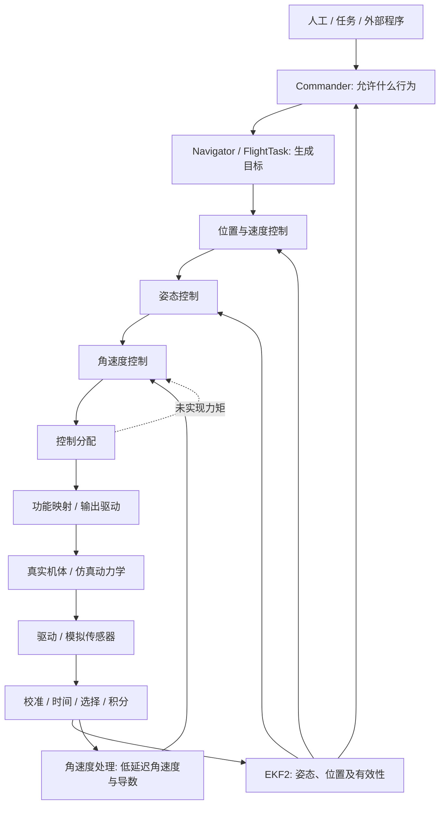
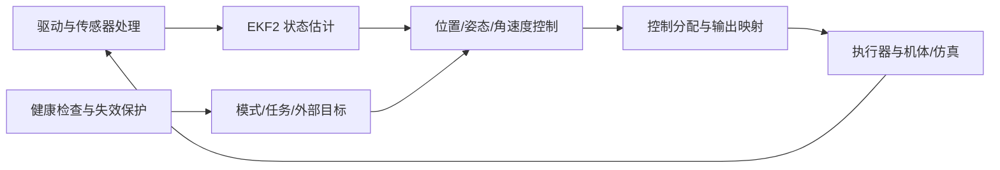

# 技术说明：PX4 v1.17.0 架构与实现

[仓库首页](../README.md) · [学习路线](ROADMAP.md) · [操作手册](OPERATIONS.md)

这份手册围绕一个目标展开：理解PX4怎样把传感器测量和飞行意图变成受控运动，并能沿现有实现定位问题、修改代码和验证结果。正文按知识依赖连续展开，操作示例放在相应原理之后，读到哪里就可以对照哪里的源码。

具体实现以PX4 v1.17.0、提交 `d6f12ad1c4f70ad3230afd7d86e971421e02fef4` 为依据。源码链接指向本仓库相应文件；本文解释以该标签为基线，官方版本文档用于补充概念。路径、参数和消息定义发生变化时，以你实际检出的代码为准。

本文件集中解释已有实现：系统职责、数据接口、算法、状态机、源码和故障原因。学习顺序见学习路线，日常命令统一查操作手册；下文保留与原理直接相关的计算和代码例子。

**命令约定：** 标为“WSL”的Bash命令在 `/home/yiyi/Workspace/px4/PX4-Autopilot` 执行；标为“pxh”的命令只在运行中的PX4 Shell输入。示例复用你已有的 `~/embedded-lab/bin/lab` 环境。ROS终端需要其原有环境已经配置，硬件命令需要与实际板型对应。本文中的数值模型用于解释机制，和PX4完整实现的区别会在相应位置说明。

## 目录

- [1. 全系统架构：一次起飞如何成为真实运动](#ch01)
- [2. 理解数据：坐标、单位、时间、有效性与重置](#ch02)
- [3. 工程基础：源码、子模块、Docker 与构建](#ch03)
- [4. 运行机制：从启动脚本到 Task 和 WorkQueue](#ch04)
- [5. 模块开发：uORB、参数与一个完整观察模块](#ch05)
- [6. 设备驱动：以 BMI088 为例读通硬件到消息](#ch06)
- [7. 传感器处理：校准、积分、滤波、选择与冗余](#ch07)
- [8. 状态估计：从卡尔曼滤波走到 EKF2 实现](#ch08)
- [9. 多旋翼控制：位置、姿态、角速度与控制分配](#ch09)
- [10. 飞行行为：Commander、导航、模式与失效保护](#ch10)
- [11. 其他机型：固定翼、VTOL 与地面车辆](#ch11)
- [12. 对外通信：MAVLink、DDS、ROS 2 与 Offboard](#ch12)
- [13. 开发验证：测试、ULog、调试与故障定位](#ch13)
- [14. 硬件系统：板级启动、资源、传感器与执行器](#ch14)
- [15. 长期开发：设计改动、管理仓库与升级版本](#ch15)
- [附录A：核心源码导航](#source-map)
- [附录B：主模块职责](#modules)
- [附录C：直接子模块与版本](#submodules)

<a id="ch01"></a>
## 1. 全系统架构：一次起飞如何成为真实运动

设想你已经输入 `commander takeoff`。如果有人问“哪个函数让电机转起来”，答案不会只有一个函数：系统首先接受一个行为，再建立目标，经过估计反馈、串级控制、分配和输出才作用到机体。传感器随即测到运动，下一轮控制再使用更新的状态。这是一条闭环，不是一条执行完就结束的函数调用链。

### 1. 两股信息在控制器相遇

一股信息描述实际状态：驱动或仿真产生测量，传感器层处理时间、坐标与校准，估计器提供姿态/位置等状态及有效性。另一股信息描述意图：人工输入、自动任务或外部程序请求行为，模式与导航生成目标。控制器比较目标和反馈，计算需要的作用。



图中专门画出角速度处理直接进入角速度环。不能把所有控制反馈都画成“从 EKF 出来”，否则会误解滤波、延迟与故障定位。推力目标也会沿控制链传到分配器；图中的箭头表示职责关联，并不表示 C++ 同步调用。

### 2. 模式是控制链的开关与目标提供者

位置模式需要位置/速度反馈；姿态模式可以绕过位置外环；角速度模式还可绕过姿态环。外部控制根据声明的控制层选择相应接口。模式切换因此不只是显示字符串变化，还可能改变谁发布目标、哪些控制环运行、哪些估计必须有效。

Commander 管理用户意图、当前模式、解锁和保护决策；Navigator 处理自动行为；FlightModeManager 等根据模式形成连续目标。给它们分别赋予职责，才能解释：为什么模式请求被拒绝，为什么起飞达到高度后转 Hold，为什么处于 Hold 又可能未解锁。

### 3. 用实际接口把图落到源码

| 连接 | 主要接口 | 要先解释的含义 |
|---|---|---|
| 测量→估计 | vehicle_imu 及各观测源 | 积分量、采样时刻、设备身份 |
| 估计→位置控制 | vehicle_local_position | NED、valid、reset 与参考原点 |
| 估计→姿态控制 | vehicle_attitude | FRD 到 NED 的四元数及重置 |
| 目标→位置控制 | trajectory_setpoint | 哪些状态受控、NaN、前馈与坐标 |
| 姿态→角速度 | vehicle_rates_setpoint | 机体轴角速度及推力 |
| 测量处理→角速度 | vehicle_angular_velocity | rad/s、导数、采样时间 |
| 角速度→分配 | vehicle_torque_setpoint 等 | 归一化要求与构型 |
| 分配→输出 | actuator_motors / actuator_servos | 逻辑执行器与限值 |
| 请求→决策 | vehicle_command / vehicle_command_ack | 请求、结果与实际完成的区别 |

每条接口都要找三个源码位置：定义、发布、消费。这个最小三角形比孤立读一个巨大 cpp 更容易形成系统认识。开始时只追一条字段，随后把时间、valid 和异常路径补全。

### 4. 数据面之外还有运行基础

平台层提供任务、工作队列、时钟、同步与设备 API。uORB 在执行上下文间传递消息；参数改变行为；事件说明状态变化；logger 保存选定历史；dataman 等负责结构化持久数据。它们贯穿整条飞行链。

因此同一种表象可能有不同根因：控制跟踪慢，可能是目标被限制，也可能是计算队列阻塞、消息过时、滤波延迟或执行器饱和。分层不是为了把问题推给别的模块，而是为了给每一层找能判定对错的证据。

### 5. 把你的日志翻译成系统事件

`SYS_AUTOSTART=10040` 证明启动选择了相应 airframe；`Simulation loop with 250 Hz` 描述 SIH 循环配置，并不证明所有模块都是 250 Hz；`Ready for takeoff` 说明当时满足相关准备条件。

`Armed by internal command` 对应解锁处理；默认 2.5 m 来自导航起飞高度；`Takeoff detected` 来自离地检测；稍后的 Hold 是行为完成/切换后的模式。降落时 land detection 与自动上锁又分别发生。消息先后可以用来建立时间线，但要用源码确认每条日志究竟在哪个分支打印。

你位置从 -0.59442 变到 -2.88696，对应同一参考下约上升 2.29254 m；地面距离约 2.30908 m。两者接近，但参考定义不同。这个小算例把估计、导航、控制与落地条件连在了一起。

### 6. 开发环境同样有边界

WSL 保存 Git 源码；镜像提供工具；lab 把源码和状态目录挂进容器；编译生成程序；PX4 在自己的运行根目录载入参数、保存日志。远程仓库保存提交，不保存容器正在运行的进程。

因此你的 CMake 绝对路径错误发生在构建状态层，APT 502 发生在镜像依赖获取，Gazebo 找不到库发生在可选组件发现，模式拒绝发生在飞控行为层。四种故障可以同时出现，但不能用一个“重装 PX4”来解释它们。

### 7. 用同一种方法阅读不同子系统

阅读一个模块时，先确定它负责的物理量或状态，再找到输入、输出和执行时机。接着看正常路径怎样改变状态，最后看无数据、无效数据、超时、停止和重新启动的路径。这样的阅读顺序能把大文件拆成有因果关系的部分。

例如研究起飞，可以从 `Commander::custom_command` 找到请求，沿 `vehicle_command` 看谁处理，再看 Navigator 的高度目标和位置控制器的轨迹输入。研究高度跳变，则反过来从 `vehicle_local_position` 出发，追查 EKF 的重置、观测和时间。两者共用一套系统结构，但阅读起点由问题决定。

后续章节就按这个顺序展开：先解决数据和工程语言，再理解运行与消息机制，然后沿测量、估计、控制和执行深入，最后把模式、通信、测试与硬件接回整个系统。

<a id="ch02"></a>
## 2. 理解数据：坐标、单位、时间、有效性与重置

你已经成功完成 SIH 起降，下一步需要建立能够解释输出的语言。本节从你的数据开始，引出后面估计与控制共同使用的坐标、时间、状态和误差。读完后，应能在看到一个负数、一个 NaN 或一次位置跳变时，先提出可验证的解释。

### 从两次位置输出算出飞机升高了多少

你起飞前读到 `z=-0.59442`，空中读到 `z=-2.88696`。`vehicle_local_position` 的 z 是局部 NED 坐标的向下轴，因此这段时间相对高度变化为：

```text
上升量 = -(z_after - z_before)
       = -(-2.88696 + 0.59442)
       = 2.29254 m
```

这个计算假设两个时刻使用同一个局部参考，期间没有未补偿的位置重置。检查 `z_reset_counter`，你的两份输出均为 2，支持这个假设。若计数变化，先分析 `delta_z` 和时间区间，不能直接把两点之差当成真实运动。

空中的 `dist_bottom=2.30908` 接近刚才的相对上升量，却不等于 `-z=2.88696`。原因是两种量的参考不同：z 的原点由估计器建立，地面距离还涉及地形估计。起飞前 z 本来就不是零。实际场地有坡度时，即使绝对高度不变，地面距离也能变化。这个例子已经包含了完整工程推理：先核对定义和参考，再计算，最后检查使计算成立的条件。

### 三类坐标不能混着用

NED 的 x、y、z 分别向北、向东、向下；机体 FRD 的 x、y、z 分别向前、向右、向下。前者相对地理参考，后者跟着机身转。飞机朝东、保持水平时，机体前向速度 1 m/s 对应 NED 近似 `[0,1,0]`，而非 `[1,0,0]`。

定义 `R_nb` 为“把机体系向量变到导航系”的旋转矩阵，则 `v_n=R_nb v_b`，反向变换用转置 `v_b=R_nb^T v_n`。转置可以当逆，是因为理想旋转矩阵正交。一个仅有航向角 ψ 的水平旋转是：

```text
R_nb = [ cosψ  -sinψ  0
         sinψ   cosψ  0
          0      0    1 ]
```

令 ψ=90°，把 `[1,0,0]` 代入，就能得到朝东的结果。以后看见 `R * measurement`，先给 R 的下标补上物理含义，再做矩阵运算。用“旋转一下”描述代码，会漏掉最容易出错的方向。

ROS 中常见 ENU 与 FLU。ENU 到 NED 的位置变换为 `[x_n,y_n,z_n]=[y_e,x_e,-z_e]`；FLU 到 FRD 的机体向量变换为 `[x,-y,-z]`。姿态需要同时处理世界坐标和机体坐标，不能只交换四元数的两个分量。第12章 通信节会把这个条件放进接口契约。

### 四元数记录旋转，角速度描述旋转有多快

PX4 的 [VehicleAttitude.msg](../msg/versioned/VehicleAttitude.msg) 明确写出 q 表示 FRD 机体到 NED 世界的旋转。四元数按 `[w,x,y,z]` 使用。绕单位轴 u 转动 θ 的四元数是 `[cos(θ/2), u sin(θ/2)]`。零旋转为 `[1,0,0,0]`；q 与 -q 表示同一个物理旋转。这是姿态控制要处理符号选择的原因。

角速度单位是 rad/s，它不是欧拉角导数的简单三元组。只有某些小角度或特定姿态条件下两者接近。机体发生明显倾斜时，直接用 yaw 的差分当机体 z 轴角速度会引入耦合错误。第9章 控制节会用 `q^-1 * q_desired` 计算误差，避免直接把三轴欧拉角相减。

### 加速度计为什么静止时仍有约一个 g

加速度计测量的是比力。忽略偏置和噪声，有 `f_b=R_bn(a_n-g_n)`，因此 `a_n=R_nb f_b+g_n`。NED 中 `g_n=[0,0,+g]`。水平静止时 `a_n=0`，故 FRD 中测得的比力约为 `[0,0,-g]`。自由落体时比力接近零，却不表示惯性系加速度为零。

这解释了为何不能把原始加速度直接积分成位置：你还必须知道姿态，去除重力，补偿偏置，再进行两次积分。仅 0.02 m/s² 的恒定残余偏置，在 10 秒后也会形成约 `0.5*b*t²=1 m` 的位置误差。EKF 使用其他观测约束这种漂移。

### 时间是数据的一部分

`timestamp_sample` 描述样本对应的采样时刻，`timestamp` 描述消息时间，单位通常是启动后的微秒；字段的具体约定仍以消息定义为准。用一个 200 ms 前的姿态配合当前加速度进行旋转，两个字段都有限，也可能得到错误运动方向。

`dt=(t_now-t_prev)*1e-6` 将微秒变成秒。若把微秒直接放进积分式 `I+=Ki*e*dt`，数值会放大一百万倍。仿真中的时间还可能由 lockstep 推进，宿主墙钟和仿真时钟不能直接做差。实验使用消息自己的时钟，并记录是否加速仿真。

一个数据可用通常需要同时回答：收到过没有；是否足够新；数值是否有限；对应 valid 标志是否成立；参考系有没有变化。`seen`、`fresh`、`finite`、`valid` 和 `reset_counter` 各回答一个问题，任何一个都不能独自替代其他问题。

### 从物理量进入控制器

位置误差单位 m，乘位置增益 s⁻¹ 得到速度要求 m/s；速度误差乘增益得到加速度要求 m/s²；角速度误差再由控制器转成归一化力矩要求。不同环节的输出并不都直接以牛顿或 N·m 表示。量纲检查既能发现公式错误，也能发现把一个模块输出接到错误接口的错误。

控制的目标是使输出跟随参考，但参考本身也要可实现。要求飞机在 1 ms 内横移 10 m，不能靠更大增益解决；需要轨迹限制、推力能力和姿态能力共同约束。估计器给出“在哪里”，模式决定“允许去哪里”，轨迹生成器决定“怎样给出可跟踪目标”，控制器决定“需要怎样的作用”。

### 用实际数据核对原理

下面的 Python 片段可以直接在 WSL 计算，结果也能用纸笔复核：

```bash
python3 - <<'PY'
import math
print('相对上升/m:', -(-2.88696 - (-0.59442)))
print('机头朝东的前向单位速度:', math.cos(math.pi/2), math.sin(math.pi/2), 0)
print('水平静止的惯性加速度z:', -9.80665 + 9.80665)
PY
```

预期看到相对上升 `2.29254 m`、机头朝东的导航速度约 `[0,1,0]`、静止惯性加速度约为零。再在已启动的 SIH 的 `pxh>` 读取：

```text
listener vehicle_local_position
listener vehicle_attitude
listener vehicle_angular_velocity
```

用三条消息解释坐标、时间与物理量，不要求瞬时数值与示例相等。若某主题没有发布，先确认模块与机型，不用零值补成“正常”。

**练习一：** 同一局部原点下 z 从 -2 变为 -3，vz=-0.5，飞机在做什么？答案：上升了 1 m，当前向上的速度约 0.5 m/s；不能仅凭此判断是否达到导航目标。

**练习二：** 消息刚发布，`z_valid=False`，能否用它做高度控制？答案：新鲜不等于有效，应检查消费者需要的状态与其拒绝/降级路径。

**练习三：** 一次位置跳变与 reset_counter 增长同时发生，如何继续？答案：先区分估计坐标修正和真实运动，检查 delta 与下游 setpoint 的重置补偿，再比较连续物理轨迹。

这些计算的共同前提是参考、时间和有效性已经明确。后面遇到高度误差、姿态突变或控制方向错误时，先回到这些定义，再讨论算法与参数。

<a id="ch03"></a>
## 3. 工程基础：源码、子模块、Docker 与构建

一次编译成功只能证明某个工具环境能生成程序。要长期开发，还要能回答：别人怎样得到相同程序；本次实验到底改了什么；旧日志对应哪个版本；为什么刚才能编译，换一种入口就失败。本节用你遇到的路径错误和子仓库困惑建立这套工程方法。

### 一次实验实际上由五组输入共同定义

源码提交决定算法和接口；子模块提交决定外部实现；镜像决定编译器和依赖；构建配置决定哪些代码进入程序；运行参数与机型决定程序怎样工作。再加上设备/仿真条件，才构成可比较的实验。只写“PX4 1.17”不够，例如同一个标签配不同的机架几何，控制分配结果就可以完全不同。

你的任务名 `px4-main` 只是 lab 的登记名，并不要求源码在 main 分支。当前 `learn/px4-v1.17.0` 是开发分支；起点为 v1.17.0。镜像标签含 v1.18，也不自动把源码切到 v1.18。实际兼容性要由目标构建和对应运行验证确认。已经通过的核心 SIH 验证不能顺带证明 Gazebo、所有板卡和所有第三方接口都通过。

WSL 中记录版本时用：

```bash
git rev-parse HEAD
git describe --tags --always --dirty
git status --short --branch
git submodule status --recursive
~/embedded-lab/bin/lab info px4-main
```

`dirty` 告诉你受跟踪文件有未提交修改，不能把它理解为源码已经损坏。当前 README 学习入口就会使它出现。记录差异能让后续日志有可追溯来源。

### 子仓库版本为什么由主仓库决定

Git 子模块在主仓库中记录的是一个 gitlink，即 mode 160000 加某个提交 SHA。`.gitmodules` 给出路径、URL 等登记信息；其中 `branch=main/master` 并不覆盖主仓库锁定的提交。常规 `git submodule update --init --recursive` 按 gitlink 检出；加 `--remote` 会追踪远端分支，改变依赖组合，学习基线时不要混用。

先读一个实际例子：

```bash
git ls-tree HEAD src/modules/mavlink/mavlink
git -C src/modules/mavlink/mavlink rev-parse HEAD
```

第一条是主仓库要求的提交，第二条是实际子模块 HEAD。两者相同，才证明这一级版本匹配。`submodule status` 前缀 `-` 表示未初始化，`+` 表示检出的提交与主仓库记录不同，`U` 表示冲突。状态相同仍不代表子模块内部无未提交修改，可对相关路径再运行 `git status --short`。

你最初的五个 untracked 目录来自其他版本残留，它们不会因为名字像 PX4 模块就自动成为当前标签的正式组成部分。确定目录属于谁，应检查 `git ls-tree HEAD 路径` 与 `.gitmodules`，不要一次 `git add .` 全部提交，也不要为获得“干净输出”直接删除未知内容。

### 每类依赖应学到哪一层

[主模块目录](#modules)、[子模块目录](#submodules) 是检索表。阅读时按边界分工：NuttX 提供平台、调度和驱动底座；GPSDrivers 处理设备协议；MAVLink 库描述消息编解码；DDS Client 处理 XRCE 通信；Gazebo 模型提供环境和机体模型；矩阵/数学库支持算法；事件、加密、压缩库服务运行与维护。你先掌握 PX4 调用边界，遇到该边界内的问题再进入依赖内部。

例如 GPS 没有数据，先判定总线字节有没有到，再判定协议解析有没有生成有效测量，再判定 PX4 驱动有没有发布。尚未证明字节到达时，就深入 EKF 的 GPS 融合公式，排错顺序已经错了。这也是“系统掌握”比记住目录更多的内容。

### 构建链不是一条编译命令那么简单

[Makefile](../Makefile) 将目标交给 CMake；[default.px4board](../boards/px4/sitl/default.px4board) 用 Kconfig 选择功能；模块的 CMake 文件登记源码与依赖；消息、参数等生成器创建派生文件；Ninja 完成编译与链接。最终 SITL 程序在 `build/px4_sitl_default/bin/px4`。

把它拆成三类故障：配置失败通常是目标、依赖或生成器问题；编译失败通常是类型、头文件、宏和接口问题；链接失败通常是符号未提供、依赖未连接或重复定义。看到最后的 `make Error 1` 没有定位意义，应该向上找到第一个实际错误。

跟做一个源码定位：

```bash
rg -n 'px4_sitl|CMAKE_ARGS|PX4_MAKE_ARGS' Makefile
rg -n 'CONFIG_MODULES_(EKF2|MC_POS_CONTROL|CONTROL_ALLOCATOR)' boards/px4/sitl/default.px4board
cat src/examples/px4_simple_app/CMakeLists.txt
```

第二条回答是否选择模块；第三条回答怎样将一个模块登记成目标。后面的观察模块实验会亲手经过这些层次。

### 源码与工具环境如何配合

源码保存在WSL，lab将它绑定挂载到容器，工具链在容器中编译同一份文件。任务登记控制源码路径、镜像、资源与运行环境；Git控制源码和依赖版本。`px4-main`是任务名，不能从名字推断源码在main分支。

当前任务与容器路径的核对方法、实际构建命令见[操作手册：环境与编译](OPERATIONS.md#build)。

### Docker 镜像、容器与路径分别是什么

镜像是工具和文件系统的模板，容器是使用镜像运行起来的进程环境。你原先看到一个上游 `ghcr.io/px4/px4-dev` 镜像和一个 `embedded-lab/px4` 镜像：前者提供工具链，后者在其上增加 lab 用户与默认设置。镜像层可以共享，列表中两个大小不能直接相加成实际额外占用。

早先手动运行的 `docker run` 命令里，`--rm` 在退出后删除该容器，`-it` 保留交互终端，`--user` 选择数值用户与组，`--volume` 绑定宿主源码，`--workdir` 选择进入目录，`--entrypoint /bin/bash` 进入 Shell。绑定挂载的源码不会因为容器删除而消失。容器用户名显示 `lab`、宿主叫 `yiyi` 并不矛盾，文件权限实际按 UID/GID 判断。

你目前已有 lab 管理任务，日常直接使用其命令即可。需要进入容器时，在 WSL 执行 `~/embedded-lab/bin/lab shell px4-main`；进入后 `pwd` 应为登记的工作目录。不要再交替使用不同的 `/workspace` 与 `/workspaces` 挂载路径构建同一个目录。

### 构建状态与仿真依赖的边界

CMakeCache和Ninja文件记录生成时的绝对路径。源码从容器/workspace改挂到/workspaces后，旧构建仍访问旧路径，错误发生在配置重新生成阶段。长期做法是固定路径；确认缓存不兼容后重新生成，而不是修改算法或手工改几条缓存文本。清理还会影响rootfs内的参数与日志，具体处理见[操作手册：排错](OPERATIONS.md#troubleshooting)。

SIH在PX4内提供简化动力学和模拟传感器，不以三维窗口作为运行条件。Gazebo需要额外的库、模拟器进程和桥接；GUI又涉及显示环境。核心SITL通过、Gazebo依赖就绪、模拟器连接成功、窗口出现，分别证明不同环节。实际启动见[SIH](OPERATIONS.md#sim)和[Gazebo](OPERATIONS.md#gazebo)。

### 四种常见问题应从哪里查起

| 现象 | 第一份有效证据 | 推理 |
|---|---|---|
| `lab` 找不到 | 完整脚本路径是否存在、任务登记是否正确 | 属于宿主命令解析 |
| `gz-sim_DIR-NOTFOUND` | 容器依赖与 CMake 配置输出 | 属于可选仿真组件发现，核心 SITL 通过不代表该组件可用 |
| 新模块命令不存在 | 板级配置、构建结果、实际运行二进制 | “源码文件存在”不代表编入并运行新程序 |
| 子模块显示 `+` | gitlink SHA 与子模块 HEAD | 存在版本偏移，需要先理解原因 |

参考解法共同点是：先找到失败层，再检查该层输入。完成本节后，你应能在不修改环境的前提下解释你历史中三次问题：路径不一致、Buildx 缺失、APT 代理 502。它们分别不是同一类错误。

<a id="ch04"></a>
## 4. 运行机制：从启动脚本到 Task 和 WorkQueue

编译器产生的是程序，运行中的飞控则是一组受到时序约束的协作任务。你看到 `pxh>` 时，前台只是命令入口，后台传感器、估计、控制和记录已经在运行。本节先解释启动，再解释“模块”与“线程”的关系，最后讨论时间预算。

### 沿你的一次 SIH 启动读脚本

启动命令的仿真目标为 px4 程序设置 `PX4_SIM_MODEL=sihsim_quadx`、`PX4_SIMULATOR=sihsim` 等环境。程序运行 [rcS](../ROMFS/px4fmu_common/init.d-posix/rcS)，根据模型找到 airframe 文件，得到你看到的 `SYS_AUTOSTART=10040`。脚本导入参数、选择机型、启动数据管理和仿真、再启动飞行模块与日志。

在 WSL 搜索这些节点：

```bash
rg -n 'PX4_SIM_MODEL|SYS_AUTOSTART|parameters|autostart_file|sensors start|commander start|ekf2 start|navigator start' ROMFS/px4fmu_common/init.d-posix/rcS
rg --files ROMFS | rg '10040|rc\.mc_apps|rc\.vehicle_setup|rc\.simulator'
```

第二条会找到被主脚本继续引用的配置和启动文件。不要只在 rcS 找 `mc_pos_control start`，找不到就断言位置控制未启动；主脚本经常把某个机型的启动交给另一个脚本。读脚本和读 C++ 一样，需要沿调用边走一层。

参数导入解释了一个常见现象：重新运行同一条 make 命令，行为仍可能不同，因为 rootfs 留存了上次参数。启动脚本中的默认设置与用户保存值如何共同作用，必须查 `param set`/`set-default` 的使用，不能把 airframe 文件看作每次都强制覆盖所有运行值。

### 逻辑模块与执行资源是两个维度

模块是功能和生命周期的组织方式，例如 EKF2、MAVLink 或你将编写的观察模块。Task 是具有栈和调度身份的执行资源；WorkItem 是排到某个共享工作线程上执行的一份工作。一个模块可以采用独立任务，也可以使用工作队列，名称本身不能告诉你采用哪种方式。

独立 Task 常见模式是 `while (!should_exit())` 中等待、处理、再等待。WorkItem 常见模式是一次 `Run()` 处理有限工作后返回，由消息回调或时间调度再次触发。它们解决不同需求：独立 Task 可以承担有界的阻塞等待；工作队列减少线程/栈开销并组织实时工作，但同队列上的一项阻塞会影响其他项。

读 [template_module](../src/templates/template_module) 与 [work_item](../src/examples/work_item)，搜索：

```bash
rg -n 'task_spawn|run_trampoline|instantiate|should_exit|px4_poll' src/templates/template_module
rg -n 'ScheduledWorkItem|Schedule|registerCallback|Run\(|exit_and_cleanup' src/examples/work_item
```

先回答“谁安排下一次执行”，再看算法主体。这比从构造函数第一行开始逐句背诵更快建立运行模型。

### 工作队列回调不等于在发布者线程里完成控制

`SubscriptionCallbackWorkItem` 收到主题更新后可以安排对应 WorkItem。实际算法在队列线程执行。阅读 [SubscriptionCallback.hpp](../platforms/common/uORB/SubscriptionCallback.hpp) 时，区分通知路径与 `Run()` 的执行路径。发布频率高于处理能力时，调度与队列深度共同决定哪些数据被处理，不能假设“发布一次必然完整执行一次控制”。

本版本角速度控制从 `vehicle_angular_velocity` 更新触发工作。它以采样相关时间计算 dt，并限制异常 dt 的范围。这个限制防止某次调度间隔过大直接破坏数值，但不会凭空恢复漏掉的物理信息。若你的改动使执行长期落后，即使 dt 被裁剪、数值没有 NaN，闭环时序仍然可能失效。

### 用一个预算算例理解实时性

假设某工作队列每 4 ms 需要服务一次工作。三项工作在一个周期内分别耗时 0.4、0.6、0.3 ms，剩余预算为 2.7 ms；再加入一次 6 ms 的同步文件操作，该周期已经不可能按时完成。平均 CPU 利用率低也不能挽救这次截止时间违约。

所以你需要分清运行耗时、触发间隔、等待延迟和端到端延迟。`perf` 计数通常只覆盖埋点范围；它没有计到的等待不能按零处理。你历史中 SIH 的 commander 性能输出显示 0 us，并不能证明真实 CPU 执行时间为零；锁步仿真的时钟语义和埋点方式需要一起分析。

高频路径应避免无界等待、反复分配内存和海量文本输出。调试时加入一条每周期 `PX4_INFO` 也会改变被观察系统。先用计数和降频状态输出，再用日志做连续数据分析。

### 生命周期为什么比 start 命令更重要

一个模块至少经历创建、注册/初始化、运行、请求退出、释放资源。退出时遗漏订阅回调注销，可能在对象释放后收到回调；重新 start 后订阅重复、参数没有初始化，也会形成“第一次正常，第二次异常”。

在独立 Task 示例中，框架的 `run_trampoline` 建立实例并驱动 run，停止请求通过 `should_exit` 被循环检查。若循环一次阻塞数十秒，stop 的响应就被拖延。WorkItem 则需要在退出路径取消调度、注销回调并完成清理，不能机械复制 Task 的循环结构。

第5章使用简单独立 Task 观察状态，之后才做 WorkItem 变体。学习目标是解释这两种实现的调度和停止差异，而不是让同一个 `while` 循环换一个类名。

### 在运行中观察：建立运行中的模块图

WSL 启动 SIH：

```bash
~/embedded-lab/bin/lab exec px4-main -- make px4_sitl sihsim_quadx -j2 PX4_MAKE_ARGS=-j2
```

在 `pxh>` 执行：

```text
commander status
ekf2 status
mc_rate_control status
work_queue status
uorb top
```

`uorb top` 是交互观察工具；按 q 退出后再输入其他命令。若本配置未编入某个状态命令，记录这点并从源码配置查原因。观察 topic 的发布速率以及工作队列列表，把“模块在哪个执行上下文运行”补到架构图中。退出仿真用 `shutdown`。

**推理题：** 观察模块每 100 ms 检查数据，每秒打印一次，位置消息更新更快。终端每秒一行是否意味着估计器只有 1 Hz？答案是否定的：至少存在生产、消费、打印三种速率。提高打印频率不一定增加控制带宽。

**设计题：** 你想在角速度控制的 Run 里上传 ULog。正确方案是把数据/请求交给后台处理路径，而不是在共享控制队列里等待网络。然后分别验证控制时序与上传可靠性。

理解上述机制后，就能在任意模块里找到触发方式、停止路径和时钟依据。下一节开始讨论这些任务交换的消息具有什么契约。

<a id="ch05"></a>
## 5. 模块开发：uORB、参数与一个完整观察模块

飞控模块不能直接依赖彼此的内部变量，否则一处重构就会牵动整个系统。uORB 用消息把生产者和消费者隔开；代价是双方必须对时间、坐标、单位、有效性和更新规则达成一致。本节用一个只读状态模块建立这些认识，完成你第一次有边界的源码扩展。

### 从一个字段追到生产者和消费者

打开 [VehicleLocalPosition.msg](../msg/versioned/VehicleLocalPosition.msg)。它不仅定义 x、y、z，还包含 valid、reset_counter、参考原点和时间。它是接口契约，不是一个“装几个 float 的结构体”。

在 WSL 执行：

```bash
rg -n 'PublishLocalPosition|_local_position_pub' src/modules/ekf2/EKF2.cpp
rg -n 'ORB_ID\(vehicle_local_position\)' src/modules/mc_pos_control src/modules/navigator src/modules/commander
```

从发布函数选择一个字段，查它由哪个 EKF 内部状态计算。再选择一个消费者，查读取之后怎样使用。如果消费者在取值前检查 valid，而你自己的模块没有检查，两者行为差异来自接口使用方式，不一定来自算法。

有多个估计器实例时，实例编号与最终选中的状态还要通过 selector 理解。驱动的 `device_id` 用来识别设备，uORB 的 instance 用来区分主题实例，两者不能随意互换。换传感器或重启后“实例 0”未必代表你以为的那颗器件。

### 发布订阅的实际语义

[Subscription.hpp](../platforms/common/uORB/Subscription.hpp) 中 `update()` 仅在有新代数的数据时复制，`copy()` 请求复制而不要求同样的“必须更新”条件。返回 false 时，调用者已有结构体不会因此自动变成无效值。旧数据仍留在内存，所以消费者必须维护时间与是否收到过的状态。

uORB 的队列有界。默认深度与特定主题配置决定能保留多少代消息；慢订阅者不能无限追赶历史。控制状态通常关心最新值，命令和事件则可能需要队列以保留一串事件。队列长度仍不能保证在任意阻塞下不丢消息。读具体消息的 `ORB_QUEUE_LENGTH` 定义与实际消费循环，才能知道该路径的行为。

一个简化例子：生产者在 0、10、20、30 ms 发布，消费者到 35 ms 才读取。深度 1 时它不能还原四次测量的全过程。为了估计积分量，有的路径使用 FIFO 或已积分消息；为了观察趋势，logger 记录历史；不能指望普通状态订阅自动成为数据库。

### 五种检查怎样落实到代码

观察模块先将结构体零初始化，这只避免未初始化内存，不能证明系统处于 landed=false 或 armed=false 的真实状态。它使用非零时间戳表示收到过，再检查发布时间与当前时刻的差，最后把估计 valid 单独输出。

工程上还应区分：`fresh` 的阈值是消费者需求；消息里的 valid 是生产者判断。观察工具允许 500 ms 的年龄，不代表角速度控制也可以容忍 500 ms。对日志显示可以接受的滞后，对闭环控制可能不可接受。

NaN 也有两类含义。[TrajectorySetpoint.msg](../msg/versioned/TrajectorySetpoint.msg) 明确允许用 NaN 表示某状态不控制；状态估计中的 NaN 则可能表示未初始化或不可用。看到 NaN 就统一置零，会把“无位置目标”变成“目标原点”，造成完全不同的控制意图。

### 参数是配置状态，更新通知是另一条数据流

参数定义文件给出名称、类型、默认值和元数据；编译时生成相应信息。运行时 `param set` 修改参数存储并可能发送 `parameter_update` 通知；模块消费通知后刷新自己缓存的参数。模块还需要在启动时做一次初始化，否则若一直没有参数变化，就可能永远不读取默认值。

参数的 min/max 元数据不能代替所有调用路径上的运行时保护。观察模块检查 `LEARN_MON_HZ` 是否有限且位于 0.2～5 Hz 后，才计算 `1e6/rate`，避免零、负值或异常数据进入周期计算。

持久化还要看参数系统的自动保存配置。当前 [parameters.cpp](../src/lib/parameters/parameters.cpp) 含 autosave 路径，因此“没有手动 param save，重启肯定恢复”是不可靠的。做实验先抄下原值，完成后明确恢复，再查询确认。若故障是“代码中的默认值改了但运行没变”，应同时检查保存值、airframe 默认值与启动脚本覆盖。

### 从模板理解一个模块如何进入系统

先阅读 `src/templates/template_module`，不要从一份复杂控制器中删代码来猜最小结构。`ModuleBase` 处理 start、stop、status 等公共命令；`task_spawn` 创建执行任务；`instantiate` 创建对象；`run` 完成自己的循环；`should_exit` 将停止请求传入循环。

一个自定义模块需要两种注册。Kconfig 使功能成为可选择项，CMake 把具体源码注册成编译目标；板级配置选择它是否进入本次固件。源码目录存在、功能编入、模块启动是三个不同状态。参数定义还会进入元数据生成过程，不应机械地把参数文件再当普通 C++ 源码重复编译。

下面给出完整的只读状态观察示例。它只订阅和打印，不发布飞行目标。代码用独立 Task，每100 ms读取一次，默认每秒输出一次。示例可用于理解各个接口；这里没有替你运行真实构建。

### 四个源文件怎样配合

在 `src/examples/learn_state_monitor/` 下创建以下四个文件。如果你已经在旧材料中放入了同名示例，直接对照阅读现有文件即可。

`Kconfig`：

```kconfig
menuconfig EXAMPLES_LEARN_STATE_MONITOR
    bool "learn_state_monitor"
    default n
    ---help---
        Read-only monitor for flight state and local position.
```

`CMakeLists.txt`：

```cmake
px4_add_module(
    MODULE examples__learn_state_monitor
    MAIN learn_state_monitor
    SRCS learn_state_monitor.cpp
)
```

`learn_state_monitor_params.c`：

```c
/**
 * State monitor output frequency
 *
 * @unit Hz
 * @min 0.2
 * @max 5.0
 * @decimal 1
 * @group Learning
 */
PARAM_DEFINE_FLOAT(LEARN_MON_HZ, 1.0f);
```

`learn_state_monitor.cpp`：

```cpp
/* SPDX-License-Identifier: BSD-3-Clause */

#include <px4_platform_common/module.h>
#include <px4_platform_common/posix.h>
#include <px4_platform_common/defines.h>
#include <drivers/drv_hrt.h>
#include <parameters/param.h>
#include <uORB/Subscription.hpp>
#include <uORB/topics/parameter_update.h>
#include <uORB/topics/vehicle_land_detected.h>
#include <uORB/topics/vehicle_local_position.h>
#include <uORB/topics/vehicle_status.h>
#include <errno.h>
#include <math.h>
#include <new>

extern "C" __EXPORT int learn_state_monitor_main(int argc, char *argv[]);

class LearnStateMonitor final : public ModuleBase<LearnStateMonitor>
{
public:
	static int task_spawn(int argc, char *argv[])
	{
		_task_id = px4_task_spawn_cmd("learn_state_monitor", SCHED_DEFAULT,
					    SCHED_PRIORITY_DEFAULT, 2400,
					    (px4_main_t)&run_trampoline, (char *const *)argv);

		if (_task_id < 0) {
			_task_id = -1;
			return -errno;
		}

		return 0;
	}

	static LearnStateMonitor *instantiate(int argc, char *argv[])
	{
		return new (std::nothrow) LearnStateMonitor();
	}

	static int custom_command(int argc, char *argv[]) { return print_usage("unknown command"); }

	static int print_usage(const char *reason = nullptr)
	{
		if (reason) { PX4_WARN("%s", reason); }

		PRINT_MODULE_USAGE_NAME("learn_state_monitor", "example");
		PRINT_MODULE_USAGE_COMMAND("start");
		PRINT_MODULE_USAGE_DEFAULT_COMMANDS();
		return 0;
	}

	int print_status() override
	{
		PX4_INFO("Running; output rate is configured with LEARN_MON_HZ");
		return 0;
	}

	void run() override
	{
		uORB::Subscription position_sub{ORB_ID(vehicle_local_position)};
		uORB::Subscription status_sub{ORB_ID(vehicle_status)};
		uORB::Subscription land_sub{ORB_ID(vehicle_land_detected)};
		uORB::Subscription parameter_sub{ORB_ID(parameter_update)};
		vehicle_local_position_s position{};
		vehicle_status_s status{};
		vehicle_land_detected_s land{};
		const param_t rate_handle = param_find("LEARN_MON_HZ");
		hrt_abstime interval_us = 1000000;
		hrt_abstime last_print = 0;
		bool force_parameters = true;

		while (!should_exit()) {
			position_sub.update(&position);
			status_sub.update(&status);
			land_sub.update(&land);
			parameter_update_s update{};
			const bool parameters_changed = parameter_sub.update(&update);

			if (force_parameters || parameters_changed) {
				float rate_hz = 1.0f;

				if (rate_handle != PARAM_INVALID && param_get(rate_handle, &rate_hz) == 0
				    && PX4_ISFINITE(rate_hz) && rate_hz >= 0.2f && rate_hz <= 5.0f) {
					interval_us = static_cast<hrt_abstime>(1000000.0f / rate_hz);
				}

				force_parameters = false;
			}

			const hrt_abstime now = hrt_absolute_time();

			if (now - last_print >= interval_us) {
				const bool fresh = position.timestamp != 0 && now >= position.timestamp
						   && now - position.timestamp < 500000;
				const bool armed = status.arming_state == vehicle_status_s::ARMING_STATE_ARMED;
				PX4_INFO("armed=%d landed=%d pos_seen=%d status_seen=%d land_seen=%d fresh=%d z_valid=%d z=%.2f vz=%.2f",
					 (int)armed, (int)land.landed, (int)(position.timestamp != 0),
					 (int)(status.timestamp != 0), (int)(land.timestamp != 0), (int)fresh,
					 (int)position.z_valid, (double)position.z, (double)position.vz);
				last_print = now;
			}

			px4_usleep(100000);
		}
	}
};

int learn_state_monitor_main(int argc, char *argv[])
{
	return LearnStateMonitor::main(argc, argv);
}
```

这个实现有几处值得逐行理解。订阅对象与缓存结构体放在 run 的循环外，状态才能跨循环保留；参数在首次循环主动读取，之后收到通知才刷新；时间戳为零时不能把缓存里的零值解释为真实飞行状态；打印时的 fresh 只描述位置消息年龄，不能代表另外两个主题也新鲜。

特别注意，`fresh`、`z_valid` 和数值有限性仍是不同检查。这个观察器刻意分开显示接收与有效状态，没有把它们合成“系统正常”的结论。若要将数据用于控制，还需针对每个输入检查年龄、有限性、估计状态和参考重置；500 ms 的显示阈值不能拿去当角速度环时限。

### 编入、运行和修改

查看 `src/examples/Kconfig` 对子目录的发现规则。在 `boards/px4/sitl/default.px4board` 中确保有且仅有一条：

```text
CONFIG_EXAMPLES_LEARN_STATE_MONITOR=y
```

在 WSL 编译并启动 SIH：

```bash
~/embedded-lab/bin/lab exec px4-main -- make px4_sitl_default -j2 PX4_MAKE_ARGS=-j2
~/embedded-lab/bin/lab exec px4-main -- make px4_sitl sihsim_quadx -j2 PX4_MAKE_ARGS=-j2
```

在 `pxh>` 运行：

```text
learn_state_monitor start
learn_state_monitor status
param show LEARN_MON_HZ
param set LEARN_MON_HZ 2
```

先记住 show 的原值，观察后恢复。设为2 Hz时预计每半秒输出一行，既不意味着上游估计频率变成2 Hz，也不意味着循环的100 ms间隔改变。再运行 `learn_state_monitor stop`，停止输出后尝试重新 start/stop，理解完整生命周期。

若命令不存在，检查是否编入并运行了新二进制；参数不存在，检查参数是否被生成；seen 为零，先查发布者和主题；参数更新不生效，查通知、缓存刷新与范围检查。不要把所有问题都归因于 uORB。

一个有意义的后续修改是在输出中加入 `dist_bottom` 和 `dist_bottom_valid`，再加 `z_reset_counter`。这样你能在同一行区分局部高度、地面距离和参考变化。另一个修改是分别计算 position、status、land 三个主题的年龄，避免将新位置与旧状态拼成一个看似同时发生的事件。

### 从 Task 迁移到 WorkItem 时改变了什么

独立 Task 的循环可以等待下一次处理，但 WorkItem 的一次 Run 应完成有限工作后返回。迁移时，订阅对象和缓存应成为对象成员，初始化时注册回调或定时调度；停止时注销回调、取消调度、清理对象。不要把原来的 while 循环直接放进共享工作队列。

参照 `src/examples/work_item` 阅读 Schedule、registerCallback、Run 和 exit_and_cleanup。先确定模块应由哪个数据触发，再选队列和备用调度。高频队列中的网络请求、文件写入和大批打印会影响同队列的其他模块，即使你的算法计算本身很短。

### 常见误解

`update` 返回 false 只表示这次没有新消息，不会清空原结构体。把旧值重新标成当前时间会伪装新鲜数据；零初始化也不能证明飞机已落地。参数显示新值不证明模块已刷新缓存，而参数恢复还必须考虑自动保存。

这些边界比输出格式更关键：同一套订阅代码用于显示时只是读数偏旧，用于控制时则可能造成状态与目标错位。写模块时，应先解释数据何时可用，再使用其中的数值。

<a id="ch06"></a>
## 6. 设备驱动：以 BMI088 为例读通硬件到消息

驱动开发的关键不只是把 SPI 寄存器读出来。它必须识别设备、完成初始化、维持采样时序、检测溢出、解释物理量、提供错误信息，并在设备异常后恢复。我们用 BMI088 陀螺仪路径学习这套结构，再将方法迁移到 GPS、气压计与距离传感器。

### 先确定驱动与平台各负责什么

板级配置确定总线、片选、引脚及哪些驱动可用；总线抽象提供传输；器件驱动解释寄存器和数据格式；PX4 传感器包装层发布规范化消息；sensors 再处理校准、选择和适合消费者的数据。这些层次避免每种器件都重写一整套估计接口。

首先读 [bmi088_main.cpp](../src/drivers/imu/bosch/bmi088/bmi088_main.cpp)，理解命令如何选择实例和总线。然后读 [BMI088_Gyroscope.hpp](../src/drivers/imu/bosch/bmi088/BMI088_Gyroscope.hpp) 中状态、计数器、时间成员，再进入 cpp。不要从寄存器枚举的第一项开始背数据手册。

### 状态机把硬件等待变成有界工作

[BMI088_Gyroscope.cpp](../src/drivers/imu/bosch/bmi088/BMI088_Gyroscope.cpp) 的主路径包含 RESET、WAIT_FOR_RESET、CONFIGURE、FIFO_RESET、FIFO_READ。复位后器件需要时间，驱动通过 ScheduleDelayed 安排下次工作，而不是在共享队列里忙等到复位完成。

CONFIGURE 成功后才进入 FIFO 采集；失败时有重试或回到复位的路径。运行中还检查配置与错误，避免一次启动成功就永远相信设备。把状态机画成带条件的图，箭头上必须写“什么事实触发转换”。只有状态名字的图无法解释错误恢复。

WSL 中定位：

```bash
rg -n 'case STATE|ScheduleDelayed|Configure\(|FIFOReset|FIFORead|RegisterCheck' src/drivers/imu/bosch/bmi088/BMI088_Gyroscope.cpp
```

逐个回答：何时放弃本次样本；何时只计错误；何时重置 FIFO；何时重置整个器件。它们恢复的范围和造成的数据缺口不同。

### FIFO 提高吞吐，却使时间解释更复杂

传感器可在 CPU 两次读操作之间积累多个样本。一次 SPI 传输读到 8 个值，只说明传输在现在结束，不说明 8 个值都在现在测得。驱动要结合采样周期、中断和 FIFO 长度为数据建立正确时间关系。

假设样本间隔 1 ms，最后一个样本对应 t，前 7 个就分别对应更早的时刻。如果把整批数据都标成读取时刻，滤波和积分会误解采样间隔；如果 FIFO 溢出仍按“没有丢样”解释，积分的物理含义同样错误。阅读 timestamp_sample 的赋值与超时分支，才能判断这个驱动如何近似时间。

中断与轮询是触发方式，不是精度的保证。数据就绪中断可能缺失，轮询也可能因调度延迟错过 FIFO。实际驱动同时维护超时、FIFO 状态和计数。测试应覆盖正常速率、读空、溢出、传输错误与恢复，不能只做“晃动后数值变化”。

### 从寄存器值到 rad/s 的转换

器件原始值往往是有符号整数，转换必须核对字节序、补码、量程系数和单位。若系数为 s rad/s/LSB，则 `ω=s*raw`；若数据手册给 deg/s，要先乘 π/180。旋转也可能分布在器件包装与校准层，要沿代码确认，避免上下层各旋转一次。

[PX4Gyroscope.cpp](../src/lib/drivers/gyroscope/PX4Gyroscope.cpp) 是继续追踪的接口。查看 update 与 updateFIFO 如何设置 device_id、缩放与发布。接着到 sensors 确认安装旋转、偏置和选择如何处理。不要把芯片原始坐标直接标成飞机 FRD，除非你已经证明转换发生在何处。

一个好的驱动测试既有数值依据又有时间依据。静止时陀螺均值接近偏置；绕已知轴旋转时，方向和量级应对应；采样时戳单调、间隔符合设置；错误计数在正常条件下不持续增长。每条证据覆盖不同故障，不能相互替代。

### 没有 BMI088 硬件时可以读到哪里

SIH 注入模拟测量，不会替你走真实 BMI088 的 SPI/FIFO 路径。因此在 SIH 看见 `sensor_gyro` 只证明仿真测量到消息这一段，不能登记为硬件驱动通过。没有硬件时，仍可完成状态机追踪、转换计算、错误路径分析和已有测试阅读。

制作一张驱动审阅表，逐项填实际源码位置：设备识别；配置回读；时间生成；样本转换；错误与恢复；发布。然后对照一个不同类型的驱动，例如 [GPS 驱动](../src/drivers/gps)。GPS 是字节流协议，需帧同步、长度/校验、协议状态与时间处理；IMU 的固定寄存器读取经验不能原样套用。

进入硬件阶段后，按第14章的无桨台架流程验证真实设备。一次插拔恢复实验应记录设备是否重新识别、时间是否连续或重置、消费者是否正确失效以及恢复时间。明确测量条件比写“驱动稳定”更有信息。

### 故障推演：静止时角速度突然尖峰

第一步比较原始传感器路径和处理后路径。原始样本已经尖峰，查总线、FIFO、缩放、器件状态与振动；原始正常而处理后异常，查时间、滤波重置、实例切换与偏置处理。再对照 error_count 和 device_id：错误计数跳变支持传输/器件异常；device_id 切换支持传感器切换相关假设。

不能仅凭尖峰就加更低的低通截止频率。这可能掩盖坏样本并增加控制延迟。修复应该让故障在最早出错的层被识别，且下游知道数据缺失或不可信。

**练习：** SPI 读取失败后，把上一次值重新发布并打上“当前时间”是否合理？参考答案：会把旧信息伪装为新采样，下游的超时检查可能失效。具体策略可保留最后值用于显示、停止有效发布或提供错误状态，但时间含义必须保持真实。

**练习：** 驱动采样 1 kHz、消息发布 250 Hz，是否丢失四分之三运动信息？参考答案：不能仅由两种频率判断，要查是否用 FIFO、积分或降采样；下一节会说明为 EKF 与控制准备不同信号的原因。

<a id="ch07"></a>
## 7. 传感器处理：校准、积分、滤波、选择与冗余

同一个陀螺仪既服务状态估计，也服务角速度控制，两条消费者路径对数据的要求并不完全相同。EKF 需要随时间积分的运动信息，控制器需要低延迟的角速度及导数。本节解释为什么飞控中会出现多种看似重复的 IMU 主题。

### 校准处理的是测量模型

一个简化三轴测量模型为 `m=S R f+b+n`：R 描述坐标旋转，S 描述尺度及交叉轴影响，b 是偏置，n 是噪声。真实校准实现的参数化不一定完全等同这个模型，但这个分解能帮助你判断错误性质：固定方向错误查旋转；比例错误查尺度/量程；静止非零查偏置；随机波动查噪声与机械条件。

标定和在线估计偏置也不等价。标定提供安装与长期误差修正，温度变化和工作状态仍可能改变偏置；估计器可继续估计偏置，控制数据路径要匹配正确 device_id 使用对应偏置。不同器件的偏置不能因为它们都是“gyro”就混用。

阅读 [VehicleAngularVelocity.cpp](../src/modules/sensors/vehicle_angular_velocity/VehicleAngularVelocity.cpp)，搜索 selected sensor、device_id、bias 和 calibration。你会看到处理器不仅算滤波，还要维护当前设备与估计器实例之间的一致性。

### IMU 积分量为什么适合估计器

[VehicleIMU.cpp](../src/modules/sensors/vehicle_imu/VehicleIMU.cpp) 收集采样、检查时序、校准并积分，输出 [VehicleImu.msg](../msg/VehicleImu.msg) 中的 delta_angle、delta_velocity 及各自积分时间。若匀速角速度为 1 rad/s、积分窗口 4 ms，则 delta_angle 为 0.004 rad；这个量必须和对应 dt 一起使用。

“先平均再乘时间”在理想等间隔、简单线性情形下可以工作，实际 IMU 还存在角运动组合、积分窗口不齐、削顶和丢样。代码里的积分器、时间检查和 clipping 字段正是在处理这些条件。缩短积分窗口会增加处理频率，不自动消除器件延迟和采样误差。

跟踪下面三组符号，写出输入与输出的单位：

```bash
rg -n 'timestamp_sample|integral_dt|delta_angle|delta_velocity|clipping' src/modules/sensors/vehicle_imu/VehicleIMU.cpp
rg -n 'coning|put\(|reset\(' src/modules/sensors/Integrator.hpp
rg -n 'setIMUData|delta_ang|delta_vel' src/modules/ekf2/EKF2.cpp
```

最后一组把处理后的 IMU 接到 EKF，形成下一节的入口。

### 角速度控制路径为什么不直接用姿态差分

姿态包含融合、输出预测和可能的状态重置；对姿态做差分还会放大数值噪声。角速度控制使用专门的测量处理路径，既能跟随更快的旋转动态，也能明确处理陀螺滤波和偏置。

VehicleAngularVelocity 根据选择的陀螺路径读取 FIFO 或单样本，完成校准、滤波、导数等工作，发布 `vehicle_angular_velocity`。`xyz` 是角速度，`xyz_derivative` 是角加速度；后者进入角速度控制 D 项。因此“D 项噪声”不只由 PID 系数决定，还由差分、滤波和采样共同决定。

### 滤波是噪声与延迟之间的工程取舍

用一阶离散低通作教学模型：`y[k]=y[k-1]+α(x[k]-y[k-1])`。令 `α=dt/(τ+dt)`、`τ=1/(2πfc)`。dt=0.004 s、fc=10 Hz 时 α 约 0.201；输入从 0 跳到 1，第一次输出只有约 0.201。它更平滑，同时更慢。

这只是解释延迟的简化模型，PX4 中还使用其他阶数和形式的滤波器，不能把本式直接当成所有实现。陷波用于抑制特定频段，例如旋转相关振动；滤波频率必须与实际采样率及噪声谱相容。把 fc 降到很低会改善曲线外观，却可能减少闭环相位裕度，让飞机更难控制。

混叠则发生在采样之前或采样过程中：高频振动被映射成较低频成分，后面的数字滤波不能总是恢复真实信号。解决方案需要考虑机械安装、器件滤波和采样策略，而不只是给日志曲线加平滑。

### 冗余如何转化为可用性

多颗 IMU 可以帮助发现单个器件故障，但并不保证多数票永远正确：共同振动、供电或安装错误会同时影响多个器件。数据验证器需要关注超时、错误计数、一致性等；选择器改变数据源时，消费者还要处理滤波状态和偏置的连续性。

阅读 [DataValidator.cpp](../src/modules/sensors/data_validator/DataValidator.cpp)、[voted_sensors_update.cpp](../src/modules/sensors/voted_sensors_update.cpp)。记录一个传感器从健康到被排除的条件，再看恢复条件。进入 EKF 多实例选择时，继续区分“选哪个传感器”和“选哪个估计器输出”，两者发生在不同层。

不要用实例编号推断物理安装顺序。运行证据要同时保留 device_id、instance、选择状态及时间。如果异常恰在切换时发生，这些元信息比单独看三轴曲线更能说明原因。

### 在运行中观察：同一次运行观察三种层次

在 SIH 的 `pxh>` 单次读取：

```text
listener sensor_gyro
listener vehicle_imu
listener vehicle_angular_velocity
listener estimator_sensor_bias
```

检查此机型实际发布哪些主题及实例；某主题没有数据时从 `uorb top` 和发布者状态确认。分别写出各消息的单位、采样时间含义、设备标识和消费者。SIH 中能练这条软件处理链，器件 FIFO 的真实行为留待硬件验证。

然后运行纯 Python 算例：

```bash
python3 - <<'PY'
import math
dt = 0.004
for fc in (10, 40):
    alpha = dt / (1 / (2 * math.pi * fc) + dt)
    print('截止频率/Hz:', fc, '首个采样的单位阶跃响应:', alpha)
PY
```

程序输出两种截止频率的阶跃过程。先预测哪条更慢，再看输出；对应 PX4 实现时说明差异，不能把教学算例的系数直接写进固件。

**练习：** 静止比力经旋转和加重力后，积分速度仍线性增长。优先怀疑什么？答案包括剩余偏置、姿态误差导致重力投影错误、时间尺度错误；用各轴均值、倾角与 dt 逐个验证。

**练习：** 增加低通后尖峰消失，但角速度跟随更慢。是否已经修好？答案：没有足够证据，应检查原始异常是否存在，并比较延迟、控制误差、输出和饱和。下一节将说明这种误差如何进入估计器。

<a id="ch08"></a>
## 8. 状态估计：从卡尔曼滤波走到 EKF2 实现

你已经看过位置有效、航向未对齐、位置重置和地面距离这些字段。本节把它们放回估计器的工作过程。目标是能完整解释一条测量从进入 EKF 到被采用、拒绝或触发重置的路径，再把方法迁移到其他观测源。

### 先理解为什么需要预测和观测同时存在

IMU 更新快，可以在 GPS 两次测量之间预测运动；但积分对偏置极其敏感。GPS 等观测可以约束漂移，却较慢、有噪声、有延迟，还可能暂时不可用。滤波器维护状态与对状态误差的估计，依据模型和观测共同修正。

以竖直方向的教学状态 `x=[p,v,b]^T` 为例，p、v 向下为正，b 为加速度残余偏置，输入 a 已完成坐标变换与重力处理：

```text
p_next = p + v*dt + 0.5*(a-b)*dt²
v_next = v + (a-b)*dt
b_next = b
F = [1 dt -0.5*dt²; 0 1 -dt; 0 0 1]
P_next = F*P*Fᵀ + Q
```

Q 描述传播中增加的不确定性。这是教学线性模型；PX4 的实际状态含姿态、速度、位置及按配置选择的偏置/环境状态，姿态误差和非线性传播比这个模型复杂。先把三状态模型手算清楚，再阅读 EKF 的状态定义、预测和协方差传播，才能看出每个矩阵项在表达什么。

### 观测更新可以先用一个数算明白

先验位置 x=0、方差 P=1，传感器测得 z=2、噪声方差 R=3，H=1。采用教材常用残差 `r=z-Hx`：

```text
r=2，S=H P Hᵀ+R=4
K=P Hᵀ/S=0.25
x_new=x+K*r=0.5
P_new=(1-KH)*P=0.75
```

结果没有直接跳到测量 2，因为当前认为测量比先验更不确定。将 R 从 3 减到 0.25，K 变为 0.8，x_new 变为 1.6。你现在能解释“减小测量噪声参数为什么让滤波器更信任测量”，也能理解错误设置会把坏观测放大。

不要因此把噪声参数当作使曲线变漂亮的旋钮。R 的含义是观测不确定性；模型偏差、坐标错误、重复融合和时间错位需要修对应问题。一个给错坐标但声明极小方差的观测会获得很强的错误修正权重。

### 从标量算例走到多状态 EKF

P 的对角线是各状态误差方差，非对角线描述误差之间的相关关系。高度观测直接测位置，但传播模型把位置与速度、偏置的误差联系起来，所以同一次高度更新也可能修正速度和偏置。如果只保存每个状态一个独立“可信度”，就丢掉了这种联系。

对于刚才的三状态模型，位置测量可写成 `z=H*x+noise`，H 为 `[1,0,0]`；速度测量则对应 `[0,1,0]`。非线性观测使用 `z=h(x)+noise`，在当前估计附近求 H，即 h 对误差状态的局部导数。预测矩阵 F 也来自运动模型的局部线性化。EKF 中的 extended 正与这件事有关：它把非线性问题局部近似，而不是让任意大错误都能一次修正。

姿态不能当成三个任意可相加的数。名义姿态常用满足单位范数的四元数，而小姿态误差可用三维局部量描述，再注入名义状态并维护相应协方差。阅读实际状态定义、误差注入与复位代码时，要分别确认“存储的状态是什么”和“协方差描述的误差是什么”，不要从消息里有四个 q 分量就推断协方差也一定使用四个独立姿态维度。

观测还涉及可观性：仅凭某种传感器和某种运动，不一定能区分所有误差来源。静止时一个轴的加速度偏差可能与倾斜造成的重力投影混淆；某些运动或额外观测有助于分离它们。减小 R 并不能创造缺失的信息。工程上表现为某些状态收敛慢、需要初始化条件，或者在特定运动下才变得可辨识。

单位也要带进协方差：位置方差是 m²，速度方差是 (m/s)²，位置与速度的互协方差是 m²/s。代码把标准差 noise 平方成 measurement_var，正是在做这个转换。把数据手册的标准差直接当方差输入，会改变权重与门限，而且错误程度随单位尺度变化。

### PX4 的创新符号必须按源码核对

教材残差与源码 innovation 不保证同号。本版本 [position_fusion.cpp](../src/modules/ekf2/EKF/position_fusion.cpp) 的垂直更新使用 `innovation=-_gpos.altitude()-observation`，这里 prediction 与 observation 都按该路径的垂直符号组织。后续状态修正与此约定配套。

因此日志里 innovation 为正不能脱离定义解释为“传感器偏高”。先写出 observation 的转换，确认 prediction，再讨论正负。平方后的门限检测对符号不敏感，偏置诊断却对符号非常敏感。

[ekf_helper.cpp](../src/modules/ekf2/EKF/ekf_helper.cpp) 的一维 aid status 计算：

```text
test_ratio = innovation² / (gate² * innovation_variance)
```

ratio 大于 1 或相关量非有限时，通用路径将创新标记为拒绝。以 S=4、gate=3 为例，创新 2 得 ratio=1/9，创新 8 得 ratio=64/36≈1.778。后者与当前统计假设不相容。实际特定融合路径还可能有故障保护分支；例如垂直加速度异常时，position_fusion 中存在限创新而非简单拒绝的处理，不能只读通用函数就概括全部行为。

### 延迟观测为什么不能直接修正当前状态

如果 GPS 的测量对应 150 ms 前，飞机以 5 m/s 运动，直接拿它与现在的位置比较会出现约 0.75 m 的系统性差异。加大门限能暂时隐藏拒绝，却不能修复错位。

EKF 使用缓冲数据和延迟融合时域，将不同源放到较一致的时间处理；输出预测路径再提供接近当前时刻的状态供控制使用。阅读 [ekf.cpp](../src/modules/ekf2/EKF/ekf.cpp) 的 update 与 `controlFusionModes`，同时查输入设置函数与 output predictor。区分融合时刻、最新 IMU 时刻与最终消息采样时刻，才能分析振动、时延和快速机动下的创新。

官方 [EKF2 说明](https://docs.px4.io/v1.17/en/advanced_config/tuning_the_ecl_ekf) 可辅助理解时域和观测配置；具体赋值、条件及符号仍按本地标签源码核对。

### 精读一条完整路径：GNSS 高度

按下面顺序阅读，每一步都在纸上写下“输入变成了什么”。

1. [EKF2.cpp](../src/modules/ekf2/EKF2.cpp) 中 GPS 更新构造 gnssSample，再交给 `setGpsData`。确认采样时间、位置/速度精度和状态字段。
2. [gps_control.cpp](../src/modules/ekf2/EKF/aid_sources/gnss/gps_control.cpp) 决定延迟数据是否就绪，以及整体 GNSS 检查与融合控制。
3. [gnss_height_control.cpp](../src/modules/ekf2/EKF/aid_sources/gnss/gnss_height_control.cpp) 的 `controlGnssHeightFusion` 处理观测噪声、天线与 IMU 的位置偏移、偏置估计、启用条件和超时。
4. [position_fusion.cpp](../src/modules/ekf2/EKF/position_fusion.cpp) 建立创新、方差并执行融合/拒绝；继续到状态修正与协方差更新。
5. 返回 EKF2 的 `PublishLocalPosition`，看内部结果怎样变为控制器使用的位置、valid、reset 信息。

第三步值得停下来逐段推理。代码先根据 GNSS 的垂直精度和参数形成噪声尺度，然后平方为方差；将天线相对 IMU 的机体位置偏移旋转到导航系，修正高度；将高度观测转换为垂直位置符号，并考虑高度偏置。开始融合既需要配置允许，也需要质量检查、参考原点及数据新鲜等条件。已在融合时还要检查继续条件和最后成功融合时间。

用一个几何数值检查第三步：飞机水平，GNSS 天线位于 IMU 上方 0.2 m，则机体 FRD 中天线偏移 z=-0.2。若天线测得海拔 500.2 m，代码将导航系偏移 z 加到 GNSS 高度，得到 IMU 参考处约 500.0 m。倾斜时必须先旋转杆臂，不能永远减 0.2。随后再按高度偏置与向下位置约定形成观测。这个例子能检查杆臂、旋转方向和高度符号是否一致。

如果所有高度源都失败，某些条件下会走高度重置；如果其他源仍工作，则可能停止出问题的 GNSS 高度融合。这个决策保护的是整体估计可用性，不是维持某个传感器“永远参与”。因此 `GPS 有数据`、`GPS 被选择`、`本次观测融合成功` 是三件事。

### valid 与 reset 怎样进入控制系统

位置值的变化可能来自真实运动，也可能来自观测修正或参考重置。发布 reset_counter 和 delta，目的是让消费者有机会保持目标和状态的一致性。若状态向下重置 Δz，而保持位置的目标未对应处理，控制器会误以为产生了位置误差。

在 [MulticopterPositionControl.cpp](../src/modules/mc_pos_control/MulticopterPositionControl.cpp) 中搜索 `reset_counter` 与 `delta_`，确认目标补偿的触发、计数和时序条件。不要写一个新控制器只订阅 x/y/z 而忽略接口里其他字段。

你此前 `heading_good_for_control` 从 False 变为 True，赋值来自 `isYawFinalAlignComplete()`；它不是由“飞机已经起飞”直接定义。`dist_bottom` 来源是地形相对高度估计且有自己的 valid；`delta_z` 是最近一次位置重置量，不是本次起飞高度。把这些定义连起来后，你就能解释已有输出，而无需凭数值猜含义。

### 观察估计器与运行相关测试

先用一个不依赖容器的数值例子核对更新公式：

```bash
python3 - <<'PY'
for R in (3.0, 0.25):
    x, P, measurement = 0.0, 1.0, 2.0
    K = P / (P + R)
    print('R:', R, 'K:', K, '更新位置:', x + K * (measurement-x))
print('创新8的门限比率:', 8**2 / (3**2 * 4))
PY
```

手算后核对 K、更新值和门限比率。再到现有 SIH 中读取：

```text
listener vehicle_local_position
listener estimator_status_flags
listener estimator_aid_src_gnss_hgt
```

最后一个主题是否可用取决于本次配置与发布；没有该源时，应先用 uorb top 和 EKF 状态确认，不把“未发布”等价于融合失败。单次 listener 不足以分析时间序列，完整事件用 ULog。

随后读 [test_EKF_height_fusion.cpp](../src/modules/ekf2/test/test_EKF_height_fusion.cpp)，选择一个实际 TEST_F。写出它设定的观测、运行时间、断言和未覆盖条件，再按第13章运行相应测试。要扩展时优先改变测试输入，例如一个持续偏移或停止一类测量，再分析期望的融合状态；不在首次练习中直接改真实滤波噪声或屏蔽检查。

### 参考解析：怎样定位“高度突然跳了”

先对齐异常前后位置、速度、reset_counter、各高度源观测和融合标志。reset 变化、测量本身连续，支持估计重置假设；原始气压变化且对应创新增大，支持观测扰动假设；多源都连续而时间间隔异常，转查时序；估计平稳但目标跳变，则应转导航/控制路径。

不能仅凭某个 ratio 大就认定该传感器坏了，因为预测状态也可能错。使用独立观测、IMU 状态、时间和运动条件交叉验证。掌握本节的标志是：你能把“开始、继续、拒绝、超时、重置、输出”六个动作在一条真实融合链上逐一定位，并解释为什么它们需要分开。

<a id="ch09"></a>
## 9. 多旋翼控制：位置、姿态、角速度与控制分配

现在假设估计状态已经可用，任务是让飞机按要求运动。多旋翼不能直接生成任意水平力：它通过倾斜推力方向产生水平加速度，同时还要抵消重力。因此位置、姿态、角速度、分配和执行器不是可任意交换的模块，而是一条有物理约束的串级控制链。

### 先从最靠近物理执行的环开始

位置变化慢，姿态和角速度变化快。内环如果无法及时产生外环要求的运动，外环再增加增益会放大问题。学习与诊断先理解角速度环，再姿态，最后位置/速度；这并不等于真机上可以忽略安装、传感器和输出检查直接调 PID。

一条典型多旋翼路径为：

```text
trajectory_setpoint + vehicle_local_position
 → mc_pos_control → vehicle_attitude_setpoint
 → mc_att_control → vehicle_rates_setpoint
 → mc_rate_control → vehicle_torque_setpoint / vehicle_thrust_setpoint
 → control_allocator → actuator_motors / actuator_servos
 → 输出功能映射 → PWM / DShot / CAN / 仿真
```

不同模式会绕过部分外环；VTOL 还存在 virtual_mc/fw 路径。先固定 SIH 四旋翼和位置控制模式，沿这条路径建立基准，再研究模式切换。

### 角速度 PID 的实际公式与更新顺序

[rate_control.cpp](../src/lib/rate_control/rate_control.cpp) 中先计算本次力矩要求，再更新用于下次的积分状态：

```text
e = rate_sp - rate
u = P*e + I_state - D*angular_accel + FF*rate_sp
```

D 项取测量角加速度的负反馈，而不是简单对目标误差差分。这样一个目标阶跃不会仅因目标突变在 D 路径产生同样的冲击。FF 是由目标提供的前馈，反馈与前馈角色不同。

教学数值 P=0.1、I_state=0.01、D=0.003、FF=0.02，目标 1 rad/s，实际 0.8 rad/s，角加速度 0.2 rad/s²，则本次输出 `0.02+0.01-0.0006+0.02=0.0494`。这是归一化控制计算示例，不能直接称为 0.0494 N·m，也不是推荐飞行增益。

积分更新还有四层条件。落地时不积累；正向饱和时不继续积累正误差，负向同理；较大误差时使用因子 `max(0,1-(e/rad(400))²)` 降低积累；结果必须有限并受到积分限幅。若正向饱和但误差已变成负值，允许反向消除积分是合理的，不能把“饱和”简单写成“所有积分一律冻结”。

运行模块 [MulticopterRateControl.cpp](../src/modules/mc_rate_control/MulticopterRateControl.cpp) 还负责参数、模式门控、dt、地面状态和分配反馈。算法库通过测试并不自动保证这些集成条件正确。

### 控制增益、采样与延迟为什么必须一起考虑

刚体角运动的物理模型可概括为 `J*ω_dot + ω×(J*ω)=τ`，J 是转动惯量矩阵，τ 是真实力矩。PX4 的归一化力矩要求还要通过分配、输出、推进系统变成这个 τ。机架惯量、螺旋桨/电机响应变化，会改变“同一个归一化输出”产生的角加速度，因此同一套增益不保证适合另一架飞机。这里给的是分析对象的物理模型，不声称当前 PID 显式实现了完整逆动力学。

以最简角速度对象 `J*ω_dot=τ`、比例反馈 `τ=K*(ω_sp-ω)` 为例，无延迟连续系统的误差按时间常数 J/K 衰减。用前向 Euler 离散，固定目标下近似 `e[k+1]=(1-K*dt/J)*e[k]`，这个简化模型要求 `0<K*dt/J<2` 才会收敛；若大于 1 则会交替变号。它说明增益与采样周期有关，不能只看增益数字大小。真实系统还有输出归一化、滤波、执行延迟、I/D 与饱和，不能用这个界直接设飞控参数。

延迟在频域会增加相位滞后；例如纯延迟 Td 在角频率 Ω 处引入约 -ΩTd 的相位。让测量更平滑可能同时增加延迟，控制器因此更晚纠正误差。分析振荡时应同时看原始/滤波测量、目标、输出与端到端时间，不能把一切都归为 P 太大或 D 太小。

串级设计要求内环能足够快地跟随外环要求，外环还应尊重内环与执行器的限制。读控制参数时写清它属于目标生成、反馈增益、滤波还是物理限制。改变位置速度上限和改变速度反馈增益，可能都让“到达时间”变化，但机制和风险完全不同。

### 为什么需要抗积分饱和

用一阶教学对象 `dy/dt=u-y`，输出限制为 [-1,1]，却要求 y=2。这个目标无法达到。普通积分仍把误差不断累积；当目标回到 0 时，巨大的正积分会继续要求正输出，恢复很慢。

条件积分会在输出已正饱和且误差继续向正时停止累积，反向误差则允许恢复。PX4 的角速度环使用控制分配反馈和附加规则，位置/速度环使用另一套相关策略；不能把教学对象的实现原封不动放进 PX4。

要在纸上检查这一机制，可以假设连续10个周期都存在正误差且输出已经为上限。普通积分仍增加10次，方向受限的积分则保持；第11个周期误差变负时，允许积分向回变化。再回源码查看分配器状态怎样设置积分方向限制，才能把教学模型与真实飞控连接起来。

### 姿态环如何将方向误差变成角速度目标

[AttitudeControl.cpp](../src/modules/mc_att_control/AttitudeControl/AttitudeControl.cpp) 使用四元数误差。概念上 `q_e=q_current^-1*q_desired`，选择等价四元数的适当符号后，误差向量约为 `2*imag(q_e)`。小角度时 sin(θ/2)≈θ/2，所以它接近轴角误差；乘姿态增益得到角速度目标。

实际实现先构造优先对齐推力方向的 reduced attitude，再按权重混合 yaw 差异。原因是滚转/俯仰决定推力方向，对维持飞行更直接。还要将世界 z 轴的 yaw 前馈变到机体系，最后按轴限制角速度。若只从书上抄“欧拉角差乘 P”，会遗漏四元数等价、推力方向优先与前馈坐标这三项。

做一个小角度检查：仅有 10° 滚转目标，忽略其他处理，误差量 `2sin(5°)≈0.17431`；增益 4 s⁻¹ 得约 0.697 rad/s。它应与小角度近似 4×10° 的弧度值接近，而不是 40 rad/s。

### 位置和速度环如何生成可实现推力

[PositionControl.cpp](../src/modules/mc_pos_control/PositionControl/PositionControl.cpp) 的位置环先形成位置误差带来的速度目标，再叠加已有速度前馈，并按水平/垂直限制裁剪。NED 中向上速度为负，z 速度边界是 `[-limit_up,+limit_down]`。例如向上位移目标 1 m、位置增益 0.5 s⁻¹，未限幅 z 速度要求是 -0.5 m/s；上升限制 0.3 m/s 时应裁到 -0.3。

速度环以速度误差、积分、加速度测量的 D 路径以及加速度前馈形成加速度目标。再由 `_accelerationControl` 计算机体 z 轴方向、限制倾角，并根据悬停推力近似将加速度映射到归一化推力。

在水平、零加速度情况下，NED 推力方向向上，因此 z 推力要求约为负的 hover thrust。倾斜后为保持相同竖直分量，总推力必须增加；当达到最大总推力，水平加速与保高度就发生竞争。代码中的竖直优先、水平余量和总推力限制具体决定如何分配能力。这里的饱和不是“某个数太大”这么简单，而是物理可实现集合的边界。

还要读 `_inputValid`：每轴至少有一种有限目标，水平 x/y 目标需要成对，使用某种状态必须有对应有效估计。允许 NaN 表示不控制某个状态，并不允许任何组合都随意缺失。

### 分配器为什么不只是一个固定混控表

用 `w=B*u` 建立模型：w 是所需力矩/力的向量，u 是各执行器要求，B 表达几何位置、方向和效能。理想情况下可用伪逆求近似解；但真实输出有上下界，执行器可能失效，构型也可能改变。裁剪一个电机后，原本精确满足的其他力矩分量可能被破坏。

读 [ControlAllocator.cpp](../src/modules/control_allocator/ControlAllocator.cpp)，再读 [ControlAllocationPseudoInverse.cpp](../src/lib/control_allocation/control_allocation/ControlAllocationPseudoInverse.cpp) 与 [ControlAllocationSequentialDesaturation.cpp](../src/lib/control_allocation/control_allocation/ControlAllocationSequentialDesaturation.cpp)。区分求解、去饱和、最终裁剪和未分配量计算，不把某一种算法当所有机型的唯一实现。

一个只有总推力 F 和滚转力矩 M 的双执行器教学模型是 `F=uL+uR`、`M=uR-uL`。要求 F=1、M=0.8，得到 uL=0.1、uR=0.9；要求 F=1、M=1.4，得到 -0.2 和 1.2，超出 [0,1]。简单裁剪到 0、1 后实际 M 只有 1。未实现的 0.4 必须让上游知道，否则积分器会继续追逐不可能目标。

最后 [mixer_module](../src/lib/mixer_module) 将“Motor 1”这样的功能映射到物理通道，再交给具体协议驱动。逻辑编号、几何位置、输出通道与真实接线是四个需要逐一核对的对象。

### 读测试，学习怎样定义正确行为

[PositionControlTest.cpp](../src/modules/mc_pos_control/PositionControl/PositionControlTest.cpp) 已有 VelocityLimit、TiltLimit、输入组合及无效状态等测试。选择 VelocityLimit：先从夹具看初始状态、增益和限制，再看输入与断言。你应解释测试验证的是限制后的目标、推力还是实际机体运动，不能将库函数测试称为飞行成功。

一个适合你的扩展是为已有测试增加“正好在限值两侧”的输入，验证边界连续、方向正确且输出有限。先让测试在原实现下成立，再有意改变测试副本中的预期使其失败，确认筛选确实运行了目标测试；恢复后再用于自己的实现变化。不要为了练习随机改飞控增益。

### 如何在日志中找最早偏离的环节

位置没有跟上目标时，按外环到内环查看：轨迹目标是否本来就缓慢；位置估计是否可信；姿态/推力目标是否饱和；姿态是否跟随；角速度是否跟随；分配器是否报告未实现要求；执行输出是否可用。

若角速度已经无法跟随而输出饱和，优先查能力、执行器、估计与内环；加位置增益通常无助。若实际姿态跟随得很好但位置目标方向错误，转查坐标/导航。若所有目标都正常，只有模式变更后出现跳变，查状态/目标重置和初始化。完整闭环排错需要多个主题的同一时间段，单个 listener 快照不够。

学完本节你应能独立推导上述三个数值例子、解释四层限制的位置，并提出一个能区分两种故障假设的日志对比实验。控制结构的官方图可在 [v1.17 Controller Diagrams](https://docs.px4.io/v1.17/en/flight_stack/controller_diagrams) 对照，最终调用和字段以当前源码为准。

<a id="ch10"></a>
## 10. 飞行行为：Commander、导航、模式与失效保护

你输入 takeoff 后看到 Armed、默认 2.5 m、Takeoff detected，稍后模式是 Hold。这里至少有四个过程：请求一个行为，判断是否允许，生成并跟踪目标，判断行为是否完成。把这些过程拆清楚，才能理解拒绝、模式切换和 failsafe。

### 命令接受不等于动作完成

[Commander.cpp](../src/modules/commander/Commander.cpp) 的 CLI takeoff 分支先建立 ack 订阅，发送 `VEHICLE_CMD_NAV_TAKEOFF`，等待接受后才发送 ARM 命令。因此同一行 CLI 涉及两个请求。它并不是直接调用电机函数，也不保证后续全过程不会因健康变化而中止。

WSL 搜索：

```bash
rg -n '"takeoff"|VEHICLE_CMD_NAV_TAKEOFF|wait_for_vehicle_command_reply|VEHICLE_CMD_COMPONENT_ARM_DISARM' src/modules/commander/Commander.cpp
```

阅读匹配处的完整分支，然后继续找 Commander 如何处理收到的命令、请求导航模式并发布确认。区分 `vehicle_command` 中的命令身份、参数、目标组件与来源，和 `vehicle_command_ack` 中的结果。ACK 是当前处理决定，不是飞机完成动作的证明。

### 三种状态分别回答什么

arming state 回答输出是否处于解锁状态；navigation state 回答当前行为模式；land detection 回答是否接地/落地。它们关联但不等价：可以已解锁仍在地面，可以完成降落后尚在等待自动上锁，也可以在 Hold 模式中处于未解锁状态。

你落地后的输出正好说明这一点：`Disarmed`、`Hold`、`landed=True` 并不冲突。Hold 没有单独声称飞机一定悬在空中。失败保护也是另一组状态，`in failsafe: no` 不意味着任何未来请求都允许，仍要看该模式要求。

把用户意图与实际模式分开很有用：用户请求 Position，但局部位置不可信时系统可能拒绝或降级。排错应同时查看请求、当前模式、健康条件与事件，不能只看地面站按钮显示什么。

### 起飞目标怎样生成

[Takeoff::set_takeoff_position](../src/modules/navigator/takeoff.cpp) 先看是否有明确起飞目标；没有时用当前全球高度加 `MIS_TAKEOFF_ALT`。你的日志 2.5 m 是相对当前高度增加的默认要求，不是把局部 z 设置为 -2.5，也不是目标海拔 2.5 m。

Navigator 的自动模式形成 position_setpoint_triplet 等导航要求；[FlightTaskAuto.cpp](../src/modules/flight_mode_manager/tasks/Auto/FlightTaskAuto.cpp) 等飞行任务把自动目标转换为适合多旋翼控制的轨迹/约束。继续追踪到 `trajectory_setpoint`，再接上第9章的控制链。位置、速度、加速度目标的连续性与限制在这里决定，不能把所有缓慢响应都归给 PID。

阅读一次起飞的实现时，把每一条连接写成“谁发布哪个主题，谁消费，消费后形成什么”。如果图里只有 Commander→Navigator→控制器，没有主题和触发条件，还不能解释异步运行过程。

### 起飞和落地判断有各自的时间条件

导航目标达到与 land_detector 检测离地并非同一事件。前者涉及目标完成，后者根据运动、推力和接近地面等条件判断状态。为避免噪声造成快速抖动，状态判断通常带迟滞和时间条件。

读 [MulticopterLandDetector.cpp](../src/modules/land_detector/MulticopterLandDetector.cpp)，将 ground_contact、maybe_landed、landed 的条件分开。你日志中 `ground_contact=True`、`vertical_movement=False`、`at_rest=True` 共同支持落地判断，但某一字段单独成立不等于完整判定。

地面效应、低推力慢下降、估计速度噪声都可能让状态过渡不符合肉眼预期。定位时需看时间序列及迟滞，不能用两条相隔很久的 listener 推断中间只发生了一次转换。

### 健康检查与 failsafe 是两层决策

[HealthAndArmingChecks](../src/modules/commander/HealthAndArmingChecks) 将传感器、估计、供电、链路和模式要求转成可报告的状态；[failsafe](../src/modules/commander/failsafe) 根据这些状态、参数和模式确定保护动作与时序。

“禁止开始某模式”和“已在该模式运行时失去条件”可能有不同处理。起飞前 GPS 不可用与空中失去 GPS，不应简单等价。多个故障并发时，还涉及动作优先级、延时、是否允许用户接管、条件恢复后是否自动返回。

读一个检查，例如 offboardCheck，再追踪它写入的 flags 在 failsafe 中如何消费。不要通过屏蔽检查使实验“通过”；那只改变了系统允许进入危险状态的条件，并没有恢复所需估计或链路。

### 任务、返航与围栏怎样接到主链

任务存储与传输在 dataman/MAVLink 等路径，Navigator 决定当前任务项与完成条件；返航根据 home、路径、配置和当前能力生成返回行为；围栏提出约束/故障，交给行为决策处理。它们最后仍需通过目标生成与控制来实现。

因此设计返航实验先确认 home 如何建立、当前全局/局部位置是否有效、返航高度参考与模式，之后才比较轨迹。若 home 错误而控制完美，飞机仍会飞到错误地点。对任务“已上传”也要继续确认数量、当前项、执行接受与实际推进。

### 在运行中观察：把一次已完成的起降升级成因果实验

只在 SIH 四旋翼中进行。先记录 `param show MIS_TAKEOFF_ALT` 的原值，完成一次基线起降并保留日志。随后在地面未解锁时将它设为 1.5，再完成同样起降。不要同时改控制增益、速度限制或模型。最后把参数明确恢复为记录的原值并 show 确认；自动保存可能保留改值。

在 `pxh>` 的基线观察命令为：

```text
commander check
param show MIS_TAKEOFF_ALT
listener vehicle_status
listener vehicle_local_position
commander takeoff
```

等状态与目标稳定后，读取位置、轨迹目标、land detection；再 `commander land`，确认 landed 和 Disarmed。比较应是“相对起点的上升量与目标”，不是比较两个日志的绝对 z。具体 1.5 m 不必逐位精确相等，要说明目标完成容差、观测时刻与估计误差。

预期因果链：参数改变→导航起飞高度改变→轨迹目标改变→控制跟踪→达到完成条件。若只有参数值改变而目标没变，先检查是否使用了显式起飞高度；若目标改变但实际没跟随，再转控制与估计。这种分层证据能告诉你改动到底在哪一层生效。

**自测：** NAV_TAKEOFF ACK 接受，但飞机未离地，下一步查什么？参考答案：先看 ARM 请求是否接受与解锁状态，再看导航/轨迹目标和控制门控，再看估计、分配及执行输出。不能直接用强制解锁替代诊断。

<a id="ch11"></a>
## 11. 其他机型：固定翼、VTOL 与地面车辆

熟悉多旋翼之后，不能靠更换机型名称来理解其他载具。每种载具的可实现运动、主要状态、执行器效能和失效方式都不同。共同的是模块、消息、模式、估计与验证方法；不同的是它们里面的物理假设。本节让你用已掌握的框架阅读另外几条完整链。

### 固定翼为什么不能像多旋翼那样停在空中

固定翼依靠相对空气运动产生升力。简化关系 `L=0.5*ρ*Va²*S*CL` 表明升力受空速 Va、空气密度、机翼面积和升力系数影响。地速不等于空速：迎风时地速可以很低，但仍有足够空速；顺风时地速很高，也不能保证迎角和升力安全。

所以固定翼控制必须在高度、空速、倾角、推力和失速边界之间协调。多旋翼的“位置到速度再到倾斜推力”经验只迁移一部分。固定翼 Hold 通常体现为盘旋等运动行为，不能直接按多旋翼悬停解释。

本版本从 [fw_mode_manager](../src/modules/fw_mode_manager)、[fw_lateral_longitudinal_control](../src/modules/fw_lateral_longitudinal_control)、[fw_att_control](../src/modules/fw_att_control)、[fw_rate_control](../src/modules/fw_rate_control) 顺序读。旧教程中的单一固定翼位置控制模块名称不应替代当前接口。

### 纵向控制：为什么高度与速度要一起考虑

用单位质量能量表达，势能 `Ep=g*h`，动能 `Ek=0.5*Va²`。油门主要改变总能量供给，俯仰影响能量在高度和速度间的分配；真实空气动力耦合更复杂，但这个分解解释了 TECS 的设计动机。

假设飞行器无额外能量补充，想爬升 10 m，需要约 98.1 J/kg。初始空速 20 m/s 对应动能 200 J/kg；若全部从速度交换，高度增加后空速约 `sqrt(2*(200-98.1))=14.28 m/s`。这说明猛抬机头不等于获得可持续爬升能力，可能只是在消耗空速。

阅读 [TECS.cpp](../src/lib/tecs/TECS.cpp)，先找到高度/速度误差、能量率、俯仰与油门限制，再从 [FwLateralLongitudinalControl.cpp](../src/modules/fw_lateral_longitudinal_control/FwLateralLongitudinalControl.cpp) 看谁提供高度和空速目标、什么时候直接覆盖俯仰/油门、什么时候重置状态。算法本身和机型模式集成必须一起理解。

固定翼高度误差大时，要先比较目标高度、空速与目标空速、油门是否饱和、俯仰是否受限和爬升能力。如果油门已经最大、空速还在下降，增加高度控制增益可能进一步损失空速。

### 横向控制：轨迹、地速方向与机头方向不是同一个量

无风、协调转弯的简化关系为 `a_lat=g*tan(phi)`、`R=V²/a_lat`。V=15 m/s、倾角 30° 时，转弯半径约 39.7 m。要求这个条件下在 2 m 半径内急转，首先是目标不可实现，不能只归因于控制跟踪差。

有风时，导航希望的地面航迹方向与机头/空速方向不同。引导层需要将路径误差、地速/风信息转换成可实现的横向要求。当前 [npfg](../src/lib/npfg) 目录包含 DirectionalGuidance、CourseToAirspeedRefMapper、AirspeedDirectionController 等拆分，阅读时沿调用关系确认当前控制位置，不能只搜索一个旧类名 NPFG 就停止。

一次横向实验至少要看航迹、航迹误差、地速、空速、滚转目标与实际滚转。飞机偏离航线但滚转跟随很好，和滚转本身失控，是两个不同故障层次。

### VTOL：过渡期是一个独立问题

VTOL 在多旋翼阶段和固定翼阶段使用不同升力来源；过渡时两套作用可能同时存在。控制系统需要决定什么时候开始过渡、怎样变化权重/执行器、怎样判定完成、何时中止或回退。只验证两端模式稳定，不能证明中间过程正确。

从 [vtol_att_control_main.cpp](../src/modules/vtol_att_control/vtol_att_control_main.cpp) 读命令与总体状态，再进入对应构型文件。标准 VTOL、倾转旋翼、尾座的几何与过渡策略不同。记录这四类条件：用户请求与模式限制；空速/时间/姿态等进展判断；推力和舵面的过渡安排；超时或高度异常时的恢复路径。

`vehicle_attitude_setpoint_virtual_mc/fw` 等中间接口帮助组合两条控制路径。检查哪一层最终发布执行要求、哪些积分在切换时初始化、姿态坐标如何连续。尤其尾座机身方向变化很大，不能用“水平四旋翼的 yaw”直觉直接解释整个过渡。

一个有价值的测试是过渡期间撤销请求或引入超时条件，然后验证状态机、执行要求和保护动作一致。首次实验在明确支持的仿真模型中进行，正常过渡基线还没建立前不要在实机上尝试异常过渡。

### 地面车辆：不再由推力方向决定平移

Ackermann 简化自行车模型满足 `yaw_rate=v*tan(delta)/L`。L=0.5 m、v=1 m/s、转角 20°，偏航率约 0.728 rad/s。速度为零时，普通 Ackermann 转向不能原地改变航向；这与差速车完全不同。

差速模型中 `v=(vR+vL)/2`、`yaw_rate=(vR-vL)/track`，两轮反向可以近似原地旋转。麦克纳姆轮还有侧向运动能力和各轮混合关系，但侧滑、摩擦和执行器限制影响模型准确性。

分别阅读 [rover_ackermann](../src/modules/rover_ackermann)、[rover_differential](../src/modules/rover_differential)、[rover_mecanum](../src/modules/rover_mecanum) 的模式、位置/速度与速率控制。给每种构型写一张“允许独立控制哪些自由度”的表，再追踪到分配。共用 Position 这个词不意味着它们有相同的可实现速度集合。

### 其他模块如何纳入完整学习

[airship_att_control](../src/modules/airship_att_control)、[uuv_att_control](../src/modules/uuv_att_control)、[spacecraft](../src/modules/spacecraft) 用来训练跨物理对象迁移：分别关注浮力/慢动态、水动力/阻尼、多轴推力与姿态动力学。先检查该标签实际支持的配置、启动与输入输出，不能根据目录存在就宣称已有完整产品级支持。

学习每种新机型时写一页推导：物理状态与可控输入；静态平衡条件；目标到执行器映射；主要约束；主要传感器；故障动作；能运行的配置与未验证条件。再选一条主控制路径读到公式与测试。这样能形成系统覆盖，又避免在尚未理解物理模型时机械遍历所有源码行。

自动调参和神经网络控制等扩展也按同样方法读：输入、适用假设、训练或辨识依据、切换与回退、输出约束、验证范围。一次默认仿真通过不能证明模型对新机架泛化。

### 阅读和运行固定翼模型

先在源码找到 SIH airplane 的 airframe：

```bash
rg --files ROMFS/px4fmu_common/init.d-posix/airframes | rg 'sihsim.*(airplane|standard_vtol|rover)'
rg -n 'RWTO_TKOFF|SIH|FW_' ROMFS/px4fmu_common/init.d-posix/airframes/10041_sihsim_airplane
```

本标签 airplane 配置启用了跑道起飞，不能套用多旋翼原地上升的预期。准备运行时，一次只启动一种模型：

```bash
~/embedded-lab/bin/lab exec px4-main -- make px4_sitl sihsim_airplane -j2 PX4_MAKE_ARGS=-j2
```

在 pxh 先查 commander、估计和机型配置；预检通过后，固定翼的起飞应体现向前加速、产生升力和爬升。进入 Hold 时也不应预期静止在某个空间点，它需要持续飞行。用空速、高度、俯仰、油门和横向目标一起解释行为；固定翼降落依赖进近几何，不能把四旋翼的垂直降落步骤直接当作完成方案。

### VTOL 过渡从哪里看

标准 VTOL 的 SIH 启动目标为 `sihsim_standard_vtol`。阅读对应 airframe、vtol_att_control 的状态机与具体构型实现后，再设计从旋翼起飞、进入过渡、固定翼巡航、返回旋翼的过程。先确定空速、时间、高度和姿态条件，再观察转换。

当前 Commander 的 `commander transition` 根据当前 vehicle_type 请求另一方向，不是无条件“进入固定翼”的同义命令。在过渡中反复输入会使意图难以判断；应先看 `vehicle_status`、`vtol_vehicle_status` 及实际模式，再解释转换为何继续、完成或中止。

### 车辆和特殊构型怎样继续读

对 Ackermann，追踪前轮转角与车速怎样决定航向变化；对差速车，追踪左右轮速差；对 Mecanum，追踪轮速组合与平面运动。相同的位置目标不代表相同的可实现运动，停车、倒车与零速转向条件也不同。

airship、uuv、spacecraft 等目录首先按相同方法解释输入输出、运动约束、启用配置和执行器效果。源码存在只说明本标签包含该实现，具体硬件支持和整机表现还取决于平台与运行验证。理解一种新机型，首先要替换正确的物理模型，再复用已学会的软件结构。

<a id="ch12"></a>
## 12. 对外通信：MAVLink、DDS、ROS 2 与 Offboard

连上地面站、看见 ROS 主题、发送命令成功，分别证明不同的事情。飞控对外通信的目标是把状态与请求可靠地映射到内部接口，同时保留时间、坐标、身份和模式语义。本节按传输、协议、消息、决策和控制五层拆解通信。

### 先读懂你已经看到的端口

你启动日志中 MAVLink Normal 使用本地 UDP 18570、远端 14550；Onboard 使用本地 14580、远端 14540。端口角色不能互换：日志中的本地端口是该实例在本机使用的端点，远端端口是它向外发送的目的端。不同实例的模式和消息速率还可能不同。

Docker 原始 `docker run` 使用隔离网络时，容器的 127.0.0.1 指向容器自身；你后来的 Compose 使用 `network_mode: host`，在当前 Linux/WSL 环境中与宿主网络的关系又不同。WSL 到 Windows 的网络还受 WSL 配置影响。先画出“PX4 所在进程→网络命名空间→目标程序→端口”，不要直接复制一组网上端口映射。

在 PX4 中 `mavlink status` 查看实例，在 WSL 用 `ss -lunp` 查看本侧 UDP 监听。能看见监听不等于有流量；能接收流量不等于协议解析通过。若缺少图形地面站，仍能先做源码与端点核对，不必把整个学习阻塞在 GUI 上。

### MAVLink 状态输出与命令输入是不同路径

输出路径通常订阅 uORB 状态，由 MAVLink stream 类选择字段、编码并按配置速率发送；输入路径解码报文，检查身份与字段，转成内部消息或调用对应处理。查看 [mavlink](../src/modules/mavlink) 中 streams、receiver 和 mission/parameter 相关实现，区分周期状态、命令请求和事务协议。

MAVLink 中 command 的 ACK 与第10章内部命令确认相关，但端到端还要考虑 target system/component、消息路由、重试与来源。地面站说“命令已发送”只证明发送端完成一个操作；要查飞控 ACK、实际模式和最终物理状态，才能确认整个行为。

参数协议与任务协议有自己的请求/响应和进度，不是往一个 socket 写一次完整内容就结束。自己实现上位机时需要处理超时、重复、部分完成和版本兼容，先用已有实现建立基线，再逐层替换。

### 精读一个外部速度目标怎样进入内部控制

在 [mavlink_receiver.cpp](../src/modules/mavlink/mavlink_receiver.cpp) 搜索：

```bash
rg -n 'handle_message_set_position_target_local_ned|MAV_FRAME_LOCAL_NED|MAV_FRAME_BODY_NED|type_mask|_trajectory_setpoint_pub' src/modules/mavlink/mavlink_receiver.cpp
```

本地 NED 输入按 type_mask 将不使用的字段设为 NaN；BODY_NED 分支有自己的旋转与支持范围。不要因为消息格式有 position 字段，就假定每个坐标系分支都支持它。随后代码根据有效目标形成 offboard_control_mode，并在相应条件下发布 trajectory_setpoint。

建立一个字段表：外部报文 field→单位/坐标→ignore 位→内部 field→哪个控制层消费。错误的 ignore 位会让原本不想控制的位置变成位置约束；错误地把所有未用字段填零也会引入意外目标。第5章关于 NaN 的契约在这里直接决定飞行行为。

### DDS 提供另一条桥，不会自动暴露所有 uORB

[dds_topics.yaml](../src/modules/uxrce_dds_client/dds_topics.yaml) 明确列出桥接方向和主题。`/fmu/out` 是从飞控向外输出，`/fmu/in` 是输入飞控。某个 uORB 主题在本机可见，不代表 YAML 已导出；例如当前文件中的某些条目被注释。

PX4 Client 通过 XRCE 与 Agent 通信，Agent 再参与 DDS 网络。你日志中的 `init UDP agent IP:127.0.0.1, port:8888` 仅表明客户端初始化目标，不代表 Agent 已启动或已建立通信。ROS 侧还需要匹配消息定义、命名空间、DDS domain、QoS 与时间约定。

不要分别给 PX4、px4_msgs、Client、Agent 随意选“最新”。先以当前源码的消息定义和 Client 依赖为起点，记录外部组件版本，再做消息格式与通路验证。ROS 侧可看见主题名字而收不到消息，原因还可能是 QoS 不匹配；字段布局错误则属于更深一层兼容问题。

### 消息版本如何改变 DDS 主题名

`dds_topics.yaml` 写的是基础主题名。`dds_topics.h.em` 读取消息定义中的 MESSAGE_VERSION，`utilities.hpp` 在非零版本后追加 `_vN`。当前标签中 VehicleLocalPosition 和 VehicleStatus 的版本均为1，因此默认输出分别为 `/fmu/out/vehicle_local_position_v1` 和 `/fmu/out/vehicle_status_v1`。TrajectorySetpoint版本为0，OffboardControlMode没有该常量，因此这两个输入主题不加版本后缀。

这是一种具体的“程序启动了却收不到样本”的原因：节点订阅的可能是旧主题名。先对比实际 topic list 和消息定义，再判断QoS、domain或网络。使用相同主题名也不等于字段布局匹配；PX4、px4_msgs 和可能的消息转换节点必须形成明确的兼容组合。

### 在已有 ROS 2 环境观察一条真实输出

本节不要求为了读懂架构先安装整套 ROS。已经配置 Agent 与匹配的 px4_msgs 时，在 Agent 所在终端运行：

```bash
MicroXRCEAgent udp4 -p 8888
```

PX4 的客户端目标地址和端口应与它一致，在 pxh 用 `uxrce_dds_client status` 核对。再在已经 source ROS 与消息工作区的终端执行：

```bash
ros2 topic list
ros2 topic info -v /fmu/out/vehicle_local_position_v1
ros2 topic echo /fmu/out/vehicle_local_position_v1 --qos-reliability best_effort
```

若使用命名空间，替换为实际全名。QoS选项以该ROS工具的help及实际端点配置为准。对比PX4内部 `listener vehicle_local_position`：同一时段的单位和坐标应一致，但异步采样不要求逐位相等。

### 位置保持程序应当如何实现

一个最小的外部位置保持程序可以分为三段。第一段只接收状态，确认已经获得有效局部位置、当前模式和解锁状态；第二段持续发送保持目标；第三段处理正常退出与流中断。开始时把目标设为当前有效位置，避免刚切入模式就产生大阶跃。

MAVLink路径使用 SET_POSITION_TARGET_LOCAL_NED。选择 LOCAL_NED，位置字段有效，速度、加速度、yaw和yaw_rate使用对应ignore位；位置控制的这组mask为3576。发送的零值只有在相应字段被忽略时才没有控制意义。接收端在 `mavlink_receiver.cpp` 按frame、mask和数值检查形成内部目标及控制层声明。

DDS路径分别发布 OffboardControlMode 和 TrajectorySetpoint。位置保持声明 position=true，目标位置使用NED；不使用的速度、加速度和yaw按消息与消费者约定设为NaN。PX4常见ROS位置消息本身已是NED，不能因为接收程序是ROS就再盲目执行一次ENU转换。

两条路径都需要持续的外部有效信号。常见教学实现以20 Hz发送，但真正要验证的是到达飞控的消息及其时间有效性。MAVLink的目标流同时用于相应控制存活判断；DDS将控制模式信号与目标消息分开，必须分别理解它们的作用。

先让目标流稳定到达，再在SIH中请求 `commander mode offboard`；确认实际模式后观察轨迹目标与位置。正常退出时先请求 `commander mode auto:loiter` 并确认，再停止外部流。要研究失联保护，另做一次断流实验，观察最后有效输入到保护动作的时间，不将正常退出和异常断流混为一谈。

超时和动作由参数及状态机共同决定。本标签的 COM_OF_LOSS_T 定义超时，COM_OBL_RC_ACT 的4为Land、5为Hold；实验先查询并保存原值，结束明确恢复。程序还应处理位置失效、状态过期、坐标重置和身份不匹配。仅靠 LOCAL_POSITION_NED 的x/y/z，无法得到全部EKF有效性和reset语义，因此短时教学保持程序不能直接推导成完整实机控制方案。

### Offboard 的核心是持续有效的外部控制权

Offboard 不是发一条坐标就让飞控永久相信外部程序。它需要控制意图、持续信号、对应估计以及超时后的动作。官方 [v1.17 Offboard 说明](https://docs.px4.io/v1.17/en/flight_modes/offboard) 给出持续信号和模式要求；实际检查继续看 [offboardCheck.cpp](../src/modules/commander/HealthAndArmingChecks/checks/offboardCheck.cpp)。

该检查先默认信号丢失，再查看 offboard_control_mode 是否新鲜、是否声明某个受支持的控制层，以及该层所需状态是否有效。位置控制不能仅因姿态有效就通过局部位置要求。外部循环即使仍在发数据，数据的时间戳、模式位或估计条件错了，也可能不具备控制资格。

从“先产生正常目标流→确认飞控接收→请求模式→确认当前模式→执行→主动退出→验证丢流保护”建立生命周期。调试早期只使用 SIH、小范围目标与明确退出路径；不要先发电机直接控制来绕过模式问题。

### 坐标、时间与频率构成接口合同

外部程序使用 ENU 时，向上 1 m 的目标转到 NED 应是 z=-1；如果是机体速度，还要随姿态旋转。时间戳应遵守桥接的时间同步约定，不能随意把 Unix epoch 毫秒填到要求启动微秒的字段里。频率同时涉及发布、网络到达和飞控消费，源端 50 Hz 不证明飞控收到 50 Hz。

给每个接口写六项：坐标、单位、时钟、字段启用/无效语义、期望速率、丢失后的动作。这张合同表应成为外部控制程序和飞控集成测试的输入，而不是写在脑海里。

### 一个分层实验顺序

第一阶段只读：在 PX4 中确认 vehicle_local_position，再确认 MAVLink 或 DDS 导出侧出现同一状态。取接近时刻的数据，解释时间与坐标，不要求异步采样逐位相等。

第二阶段发送一个不会移动载具的查询/配置交互，确认请求与回应身份。第三阶段在 SIH 中给出当前位置附近的合法目标流，请求 Offboard 并检查模式。第四阶段正常退出。第五阶段才停止外部流，测量最后有效消息到保护模式变化的间隔，并与参数/逻辑对照。

在每阶段保留一对边界证据：发送端发了什么，飞控内部收到了什么。例如外部发送速度 1 m/s，但内部目标为 NaN，优先查 mask/坐标/模式，而不是网络带宽或 PID。整个实验包含失败路径，才证明集成具有完整生命周期。

### 扩展到载荷与跨处理器通信

云台、相机触发、反馈、载荷投放同样需要区分请求、实际动作与确认。相机触发时间不是曝光完成时间，地理定位应使用适当反馈和时间基准。DroneCAN/Cyphal 是另一组总线和协议生态；muORB 等跨处理器机制也有平台约束。用同一张接口合同表追踪到真实驱动，避免把它们当成“换个端口的 MAVLink”。

**自测：** QGC 有遥测却无法解锁，网络通了吗？只能证明部分接收路径。继续查命令目标/ACK、健康拒绝和模式要求。

**自测：** ROS 主题存在却没有控制动作，先改什么？先不改，依次确认有效样本、桥接输入、offboard_control_mode、当前模式和内部目标，定位最早失配的边界再修。

<a id="ch13"></a>
## 13. 开发验证：测试、ULog、调试与故障定位

开发者不仅要会改算法，还要知道什么结果能支持“改动正确”。单元测试、软件仿真、日志回放和台架验证覆盖不同条件。你已经完成的 SIH 起降很有价值：它证明那次配置下整条基础闭环能够工作；它没有覆盖网络丢失、真实 IMU 时序和执行器接线。

### 按问题选择验证层次

数学与边界条件适合单元测试，因为输入可控、失败容易定位；模块生命周期与消息交互适合功能测试；模式、估计与控制闭环适合 SITL；实时资源、外设与电气问题需要目标硬件台架；真实空气动力和机械振动还需要受控整机试验。

测试层次越高，条件越接近整机，也越难隔离根因。一个位置 NaN 处理错误没必要先用真机找；一个 SPI 电气问题则不可能仅靠 Linux 单元测试证明已修复。最有效的顺序是用最低成本能暴露问题的层先复现，再做与变更风险相称的上层回归。

### 本仓库的测试命令到底做什么

Makefile 的 tests 使用 `px4_sitl_test` 配置并执行 test_results。[px4_add_gtest.cmake](../cmake/px4_add_gtest.cmake) 根据文件名生成 `unit-...` 或 `functional-...` 的 CTest 名称；TESTFILTER 交给 CTest 的正则过滤。

WSL 示例：

```bash
~/embedded-lab/bin/lab exec px4-main -- make tests -j2 PX4_MAKE_ARGS=-j2 TESTFILTER='^unit-PositionControl$'
```

这里会创建独立的测试目标目录，因为测试配置与默认 SITL 不同；它不是保留旧路径的备份副本。过滤控制执行哪些测试，test_results 的依赖仍可能要求编译其他测试可执行文件，所以首次构建耗时不能仅按一个测试估计。

运行后必须检查实际列出的测试名、数量和失败信息。零项匹配不等于通过。如果想先列出已有配置的测试，在测试目录生成后运行：

```bash
~/embedded-lab/bin/lab exec px4-main -- ctest --test-dir build/px4_sitl_test -N
```

选择与本次改动相关的测试，通过后再跑必要集成回归；没有新风险时不需要不停重复全套构建。

### 测试断言应保护行为，不是复写实现

若要修复输入无效导致积分污染，测试应构造“先正常、再无效、再恢复”的输入，并断言输出与积分可恢复且有限。把实现中的每行公式在测试里再抄一遍，可能让同一个错误同时存在于两边。

角速度环饱和测试可以检查：正向饱和且正误差时积分不继续增长；误差反向后允许卸载积分；落地时不积累。数值比较需要与浮点精度和物理意义相适应的容差。等号比较浮点输出，或随意放宽到任何值都过，都会降低测试价值。

使用已有测试夹具时先理解它是否自动运行模拟器、推进时间、提供默认传感器。一个修改后通过的测试，可能只是目标分支根本没被执行；临时破坏预期以确认测试能失败，是有意义的开发验证，完成后应恢复。

### ULog 让你把时间串起来

listener 适合确认“现在有什么”；ULog 适合回答“异常前后发生了什么”。日志不保证记录每个主题的每次更新：logger 配置、消息速率、缓冲、存储吞吐与掉点都会影响结果。首先检查主题列表、时间范围和 dropout，再讨论控制差异。

定位一段异常，至少对齐目标、实际状态、模式、有效性与执行能力。不同主题有各自时间戳和采样率，应按时间匹配/插值且说明方法，不能按 CSV 的同一行号硬拼。状态跳变和命令事件通常使用保持型对齐；连续物理量的插值还要检查间隔和失效区段。

WSL中可以直接查找日志：

```bash
rg --files --hidden --no-ignore build/px4_sitl_default/rootfs/log -g '*.ulg'
```

实际位置以启动日志和运行rootfs为准。复制该路径到已有的日志分析工具，先查看文件覆盖的时间、主题和参数。使用pyulog导出时，把 `-z` 标为相对局部原点的向上位置，不要叫离地高度；离地估计对应 `dist_bottom`，还要检查各自valid和reset。

例如一次起飞应把 `trajectory_setpoint`、`vehicle_local_position`、`vehicle_status` 和 `vehicle_land_detected` 放在同一时间线上。若想解释振荡，继续加入角速度目标/实际与分配状态。没有记录某主题时，应先调整日志配置重现，不能从“日志里没出现”推出“运行中没发生”。

### 设计一个 A/B 实验

以默认起飞高度变化为例，A 保持原值、B 只改 MIS_TAKEOFF_ALT。两次使用同一源码、镜像、机型与可比初始条件；分别记录目标、上升量、到达时间、模式和落地。评价指标先定义：上升量相对起飞前的同一参考；到达时间以目标进入既定误差带并保持一段时间定义。

如果同时更换镜像、模型、控制增益、初始位置，再观察“B 更稳”，你无法归因。确实必须同时改变时，在结论中说明不能分离影响，并设计后续实验逐项隔离。

重复实验用于估计波动，不是反复运行直到出现一次满意结果。仿真噪声、初始化和参数持久化都可能影响可重复性。记录失败结果，尤其是仅在重启或模式切换后出现的问题。

### 三个排错案例怎样组织证据

**构建失败：** 第一条实际错误→所属阶段→相关输入→最小修改→同一目标重建。你遇到的绝对路径缓存问题应能在这条链上讲清楚。

**估计跳变：** 异常时刻→状态/观测/reset→候选原因→独立证据→最小复现。若只有最终位置截图，没有观测与状态，很难区分传感器偏移和坐标重置。

**控制跟踪差：** 目标生成→状态可信度→外环要求→内环响应→分配饱和→执行能力。先找最早偏离，再选择测试；不要从“提高 P”开始。

每份案例最后写出一个被排除的假设及证据，例如“原以为位置环慢，但轨迹目标本身被速度限制，内环跟踪正常”。这种排除过程体现了系统理解。

### 调试器与回放的边界

GDB 适合查崩溃栈、变量和逻辑分支。SITL 中断点会改变线程/仿真推进，不能把断点暂停后的控制行为当作正常实时性能。实机调试还涉及 SWD、看门狗和执行输出，先在无桨台架操作。

Replay 用记录输入重演部分计算，适合比较估计等处理差异；它不必然重演完整物理闭环。改控制器后，真实机体本应走不同轨迹，简单回放旧传感器数据不能证明新控制器的闭环效果。回放验证和 SITL 闭环验证各自回答不同问题。

从观察模块的一次小修改开始，把具体输入、预期差异、相关测试和同一时段日志联系起来。编译成功说明代码能生成程序，断言通过说明某些行为成立，闭环运行才说明这些部分在相应场景中配合工作。

### 常用测试的实际名称

| 关注的问题 | TESTFILTER 可使用的完整名称 |
|---|---|
| GNSS高度融合与高度源切换 | `^unit-test_EKF_height_fusion$` |
| 角速度PID与积分 | `^unit-rate_control_test$` |
| 四元数姿态控制 | `^unit-AttitudeControl$` |
| 位置/速度输入和限制 | `^unit-PositionControl$` |
| 分配伪逆 | `^unit-ControlAllocationPseudoInverse$` |
| 分配去饱和 | `^functional-ControlAllocationSequentialDesaturation$` |
| 失效保护决策 | `^functional-failsafe_test$` |

这些名字由本标签CMake注册，仍应从实际CTest输出确认执行项。测试框架依赖失败和行为断言失败是两类问题；只匹配到零项时不要认为相关功能已经通过。

<a id="ch14"></a>
## 14. 硬件系统：板级启动、资源、传感器与执行器

SITL 给你可重复的算法与模式环境，真实飞控还增加启动链、外设时序、供电、机械安装和输出映射。将仿真经验迁移到实机时，应按“哪一条假设变了”组织验证。这里的操作先停留在与你实际板卡匹配的编译和无桨台架；本文不会把示例板卡当成你已经拥有的硬件。

### 先弄清硬件启动链和固件对象

Bootloader 负责启动/更新入口，板级初始化设置时钟、引脚和外设，NuttX 提供任务和设备框架，PX4 启动脚本再启动驱动与飞行模块。一个 USB 设备被电脑识别，只证明启动链中的某个环节工作，不代表主固件和所有传感器都正常。

用 [boards/px4/fmu-v6x](../boards/px4/fmu-v6x) 作为源码阅读样本：default.px4board 选择功能，nuttx-config 表示 OS 配置，src 中包含板级外设配置，init 脚本选择板上设备与默认参数。它只是示例目录。真实操作必须根据你手中的具体板型、修订和外设确认目标。

已确认硬件恰好匹配该目标时，WSL 编译示例是：

```bash
~/embedded-lab/bin/lab exec px4-main -- make px4_fmu-v6x_default -j2 PX4_MAKE_ARGS=-j2
```

编译成功只证明生成该目标固件。刷写、启动、驱动识别和资源检查是后续独立步骤。不要仅因连接器相似就在不同板上写入示例固件或 bootloader。

### 板级移植最容易遗漏的是资源冲突

MCU 的 UART、SPI、I²C、定时器、DMA、GPIO 复用引脚都是有限资源。启用了两个看似独立功能，却可能共享同一引脚或 DMA 通道。驱动正常启动但高负载丢样，需要同时查总线时序、调度和板级资源分配。

阅读一个 SPI 配置，沿“总线编号→片选→设备类型→驱动启动参数→device_id→uORB实例”追踪。再阅读一个输出定时器配置，沿“逻辑电机→输出功能→硬件通道→引脚”追踪。完成这两条链，才开始理解板级支持怎样连接飞行算法。

若做新板移植，先将时钟、控制台和基本启动稳定，再逐个使能存储、传感器和输出。每次新增一组资源立即验证启动与既有功能，避免一次加入全部外设后无法定位冲突。官方 [硬件移植指南](https://docs.px4.io/v1.17/en/hardware/porting_guide) 可作平台层参考，具体文件以本标签和板卡实现为准。

### 供电与测量为什么属于飞控问题

电压下降可能导致传感器/ESC/主控分别重启，而不是整个系统一起黑屏。电流标定错误会影响电量与剩余时间判断；磁干扰可能随电机负载变化，桌面校准成功也不能覆盖带载条件。

台架记录应同时包含供电来源、电压/电流测量、设备重启计数、日志是否中断和飞控启动信息。出现控制异常时，如果上游发生了电源瞬断，盯着 PID 会错过根因。battery_status、ESC 遥测和事件能补充这层证据。

存储同样影响系统：慢 SD 卡可能使日志掉点，日志掉点又影响排错；某些数据管理故障还涉及任务和参数持久化。读 logger 状态与 dataman 行为，分清“动作失败”和“只是未记录下来”。

### 传感器校准不是一次点击完成的知识点

先确认飞控安装朝向与各器件方向，再做校准和静态合理性检查。陀螺静止均值、加速度重力方向、磁场与姿态变化、气压高度、GPS 状态各有独立预期。错误的安装方向能在静止下看似正常，到机体倾斜时才暴露。

用缓慢、可预测的手动姿态变化检查三轴符号：向右滚转时哪些量变正，保持静止后角速度是否回近零，姿态是否保持连续。先在纸上画 FRD 和 NED，再解释观测。没有确认符号前，不能通过反转控制增益来“纠正”安装错误。

随后逐个核对 device_id、实例与被选中路径，多传感器时比较是否存在共同扰动。硬件触发的错误/切换应该产生可解释状态，而不是只在日志里看到一个未说明的跳点。

### 输出测试必须走完四个映射

第一层是机架几何中的执行器位置和旋转方向，第二层是分配器的逻辑输出，第三层是输出功能到端口的映射，第四层是线缆和 ESC 到真实电机/舵机的连接。四层中任一交换都会使控制“算得正确，动作却错误”。

在拆桨或对应执行器隔离的台架条件下，逐通道确认物理位置、方向、范围和停止行为。PWM、DShot 与 CAN 的输出单位、初始化和反馈机制不同；“输出数值变大”不自动证明机械力增加，更不证明方向正确。

记录每个执行器的逻辑编号、真实位置、端口和方向，形成一张可审阅的接线/功能表。然后检查解锁前、解锁后、失控保护和停机各状态下的输出行为。状态门控错误比正常飞行时的数值误差更容易被忽略。

### 把台架试验设计成逐层增加条件

第一级只启动和读状态，证明主固件、参数、日志、传感器初始化工作。第二级做传感器姿态与时间合理性。第三级做隔离的执行器映射。第四级引入通信并验证控制权与失联动作。第五级检查资源和长时间运行。之后才在合适场地与有经验人员监督下进入受控整机试验。

这些级别不是形式清单，每一级减少一种不确定性。若跳过输出映射直接试飞，第一次姿态误差会同时混合传感器、控制和接线的可能性，风险和排错成本都上升。

真实飞行的首轮目标应限制为验证基本姿态、估计、推力和模式正常，而不是同时追求激进性能。保存首次飞行日志与参数，然后再根据第9章 控制和 第13章 验证进行小步调整和回归。

### 从故障归因看整机掌握

“加油门后 yaw 漂移”至少包含磁干扰、机械扭矩、传感器振动、偏置/估计和控制饱和几类假设。比较磁测量与电流、yaw 创新/估计状态、角速度目标/实际、分配输出，能够分离这些原因。只凭飞行画面无法唯一确定。

“飞一段时间后卡顿”则查温度、资源、日志吞吐、总线错误、工作队列延迟和供电。若需要增加统计，选择有界计数与适当频率发布，避免高频 printf 再次干扰时间。

整机分析应包含：板型与源码、固件目标、接线/功能表、传感器与时间核对、正常/异常状态、日志与资源结果。没有硬件时先完成源码样本与报告设计，明确保留实际设备验证；实际设备行为需要在对应硬件上确认。

<a id="ch15"></a>
## 15. 长期开发：设计改动、管理仓库与升级版本

系统掌握的最后一步是把一个模糊需求变成可审阅修改，并证明它在边界条件下仍合理。你不必记住所有驱动寄存器，但应能快速判断功能归属、读懂接口、定位失败层、设计验证，再把结果放进可维护的分支。本节给出这套工作过程。

### 先写行为差异，再找改动文件

例如“想知道位置什么时候不可用”，可以先实现只读监测和状态报告；直接改 failsafe 决策会扩大范围。需求应写成触发、原行为、新行为和退出条件：数据年龄超过消费者要求时，报告 stale；恢复新数据后返回正常；未收到数据与有效性失败分别显示。

再画输入输出和所有权。谁提供时间，谁定义 valid，谁持有配置，谁负责保护动作，谁记录事件？如果两个模块都开始争夺同一控制主题，架构问题通常早于算法问题。模式、估计、控制和观测工具应保持清晰边界。

### 给设计写出不变量与退化路径

不变量是无论某次正常输入怎样变化都应成立的约束，例如输出必须有限、工作项执行有界、退出后不再收到回调、未收到数据不能报告健康。退化路径描述输入坏了之后如何处理，例如保持显示旧值但标 stale、拒绝使用、转安全模式或重新初始化。

把它们转为测试：时间倒退、丢样、NaN、重置、模式切换、重复 start/stop、参数越界。不是每次修改都要跑所有组合；应从被改变的接口出发选择相关条件。如果新增一个参数，还要考虑默认值、持久化、文档、更新频率与兼容。

### 用自己的仓库保留解释，而不只是补丁

个人仓库可以同时保存源码、技术说明和必要的实验结果。一项提交除了说明改了哪个文件，还应让别人看懂为什么改、什么输入下行为发生变化、哪些结果支持这个判断。具体远程操作见本章后面的示例。

把一个有独立意义的变更组织为一个提交：具体问题、实现、对应测试/记录。未跟踪的 main 残留不属于你的学习成果；需要的子模块仍以 gitlink 管理。主仓库推送不会把子模块内部未提交的修改一起带走，必须分别处理依赖的提交和可访问来源。

对一项观察模块修改，可先检查：

```bash
git diff -- boards/px4/sitl/default.px4board
git status --short
git diff --check
```

选择暂存时列出明确路径，先看 staged diff，再由你提交。ULog 等大文件通常保留在本地或专门制品位置，Git 中保存索引、参数、指标和结论；不要让几百 MB 的重复日志淹没源码历史。

### 代码审查从行为与边界出发

审查者先需要知道为什么改，以及什么输入下行为变化。说明一个触发例子，再给实现与验证。不要把调试过程的所有尝试堆进最终描述；保留能解释关键取舍的内容。

读 diff 时先检查接口与状态所有权，再看数值单位、时钟和坐标，再看线程/生命周期、异常分支和测试。高频路径引入 I/O、改消息却未同步消费者、修改参数默认值却忽略持久值，都是跨文件才能发现的问题。

编译器通过不能发现所有语义错误。例如把 NED z 当成海拔，类型仍是 float；把采样时间换成发送时间，类型仍是 uint64。审查需要利用你前面建立的物理与接口契约。

### 升级版本时先比较接口，再处理代码冲突

长期学习以 v1.17.0 为稳定参照。将来研究另一个版本，先比较目录与配置、消息定义、参数、启动、机型行为和外部协议；再决定迁移策略。不要在同一实验中同时升级所有子模块和镜像，使变化来源不可辨认。

一个 Git 合并没有文本冲突，只说明文本能拼接；消息语义、默认参数与状态机变化仍可能破坏功能。迁移报告应逐项回答：编译兼容、接口兼容、参数兼容、行为兼容、实验兼容。每项有对应证据，而不是一句“merge 成功”。

在本地查看 v1.17.0 与当前学习提交的差异：

```bash
git diff --stat v1.17.0 HEAD
git log --oneline --decorate -12
```

这两条不获取远端也不修改工作区。需要真正迁移时再建立明确目标与隔离分支，按第13章验证你自己的改动，而不是重新假定所有旧验证仍成立。

### 扩展到陌生模块的阅读方法

主飞行链读通以后，剩余模块可以沿相同方法进入。先从Kconfig/CMake和启动脚本确定启用条件，找到公开消息及参数，然后沿一个实际输入追踪到输出，再看失败、停止和恢复路径。读自动调参时需要加上激励、辨识和稳定条件；读载荷时加上机械动作、反馈与时间；读替代估计器时重新解释状态和观测假设。

附录列出本标签主模块和直接子模块的职责，目的是帮助定位代码。掌握PX4不要求背下所有器件寄存器，但需要能判断一个问题属于哪层，知道哪条消息、哪个条件或哪段日志能区分候选原因，并能把自己的修改接回现有测试与运行环境。

### 主仓库、子模块与运行状态分别保存什么

主仓库保存自己的提交历史和子模块gitlink；子模块内部的未提交修改不会随父仓库推送。修改依赖时，先使子模块新提交可从远端取得，再更新父仓库指针。官方来源与个人推送目标分别保存，具体配置、提交、推送和恢复步骤见[操作手册：Git](OPERATIONS.md#git)。

源码历史也不等于完整运行环境。镜像、任务登记、参数和大日志分别有状态，复现实验时必须知道它们与本次提交的关系。

### 文档与代码怎样相互支撑

一项改动的技术说明，写清触发条件、原有行为、修改后的行为、为何放在这一层，以及如何验证。公式、单位、时间和错误处理有变化时直接解释变化，不把调试过程逐条堆成最终说明。读者应当能从描述定位到代码，再从测试与日志判断结论是否成立。

以后研究新版本时，用这份v1.17.0结构作为参照，重点比较消息、参数、模块拆分、启动路径和机型行为。知识结构保持连续，具体结论则跟着源码和实验更新。

<a id="source-map"></a>
## 附录A：核心源码导航

以下入口按当前基线源码核对。重要版本差异：uORB 在 platforms/common/uORB；本基线固定翼目标生成/控制使用 fw_mode_manager、fw_lateral_longitudinal_control 等目录，旧教程 fw_pos_control 路径不适用于直接定位本版本。

### 整机的基本数据关系



这是学习用简图。实际为多个主题与状态关系，估计向导航和保护也提供数据；实际阅读时还要确认真实消息、分支与反馈。

| 技术节 | 本版本入口 |
|---|---|
| [第3章 工程、构建与版本依赖](#ch03) | [Makefile](../Makefile)、[CMakeLists.txt](../CMakeLists.txt)、[boards/px4/sitl/default.px4board](../boards/px4/sitl/default.px4board)、[cmake](../cmake)、[.gitmodules](../.gitmodules)、[Tools/setup/ubuntu.sh](../Tools/setup/ubuntu.sh) |
| [第4章 平台、启动、调度与时间](#ch04) | [ROMFS/px4fmu_common/init.d-posix/rcS](../ROMFS/px4fmu_common/init.d-posix/rcS)、[ROMFS/px4fmu_common/init.d/rcS](../ROMFS/px4fmu_common/init.d/rcS)、[platforms/posix](../platforms/posix)、[platforms/nuttx](../platforms/nuttx)、[platforms/common/px4_work_queue](../platforms/common/px4_work_queue)、[platforms/common/include/px4_platform_common/px4_work_queue](../platforms/common/include/px4_platform_common/px4_work_queue)、[src/modules/load_mon](../src/modules/load_mon) |
| [第5章 uORB、参数、模块与公共设施](#ch05) | [platforms/common/uORB/Subscription.hpp](../platforms/common/uORB/Subscription.hpp)、[platforms/common/uORB/Publication.hpp](../platforms/common/uORB/Publication.hpp)、[platforms/common/uORB/uORBManager.cpp](../platforms/common/uORB/uORBManager.cpp)、[msg](../msg)、[src/lib/parameters](../src/lib/parameters)、[src/templates/template_module/template_module.cpp](../src/templates/template_module/template_module.cpp)、[src/modules/logger](../src/modules/logger)、[src/modules/events](../src/modules/events)、[src/modules/dataman](../src/modules/dataman) |
| [第6章 板级支持、总线、设备与驱动](#ch06) | [boards](../boards)、[platforms/nuttx](../platforms/nuttx)、[src/drivers](../src/drivers)、[src/drivers/imu/bosch/bmi088](../src/drivers/imu/bosch/bmi088)、[src/drivers/gps/devices](../src/drivers/gps/devices)、[src/drivers/cyphal](../src/drivers/cyphal)、[src/drivers/uavcan](../src/drivers/uavcan)、[src/drivers/bootloaders](../src/drivers/bootloaders) |
| [第7章 传感器处理、坐标、滤波与同步](#ch07) | [src/modules/sensors](../src/modules/sensors)、[src/modules/sensors/vehicle_imu/VehicleIMU.cpp](../src/modules/sensors/vehicle_imu/VehicleIMU.cpp)、[src/lib/sensor_calibration](../src/lib/sensor_calibration)、[src/lib/mathlib](../src/lib/mathlib)、[src/modules/gyro_fft](../src/modules/gyro_fft)、[src/modules/airspeed_selector](../src/modules/airspeed_selector)、[msg/versioned](../msg/versioned) |
| [第8章 状态估计与 EKF2](#ch08) | [src/modules/ekf2/EKF2.cpp](../src/modules/ekf2/EKF2.cpp)、[src/modules/ekf2/EKF/ekf.cpp](../src/modules/ekf2/EKF/ekf.cpp)、[src/modules/ekf2/EKF/aid_sources](../src/modules/ekf2/EKF/aid_sources)、[src/modules/ekf2/test](../src/modules/ekf2/test)、[msg/versioned/VehicleLocalPosition.msg](../msg/versioned/VehicleLocalPosition.msg)、[msg/versioned/VehicleAttitude.msg](../msg/versioned/VehicleAttitude.msg) |
| [第9章 多旋翼控制、分配与执行输出](#ch09) | [src/modules/mc_rate_control](../src/modules/mc_rate_control)、[src/lib/rate_control](../src/lib/rate_control)、[src/modules/mc_att_control](../src/modules/mc_att_control)、[src/modules/mc_pos_control](../src/modules/mc_pos_control)、[src/modules/control_allocator](../src/modules/control_allocator)、[src/lib/mixer_module](../src/lib/mixer_module)、[src/drivers](../src/drivers) |
| [第11章 固定翼、VTOL、地面车辆与其他机型](#ch11) | [src/modules/fw_mode_manager](../src/modules/fw_mode_manager)、[src/modules/fw_lateral_longitudinal_control](../src/modules/fw_lateral_longitudinal_control)、[src/modules/fw_att_control](../src/modules/fw_att_control)、[src/modules/fw_rate_control](../src/modules/fw_rate_control)、[src/lib/npfg](../src/lib/npfg)、[src/lib/tecs](../src/lib/tecs)、[src/modules/vtol_att_control](../src/modules/vtol_att_control)、[src/modules/rover_ackermann](../src/modules/rover_ackermann)、[src/modules/rover_differential](../src/modules/rover_differential)、[src/modules/rover_mecanum](../src/modules/rover_mecanum)、[src/modules/airship_att_control](../src/modules/airship_att_control)、[src/modules/uuv_att_control](../src/modules/uuv_att_control)、[src/modules/uuv_pos_control](../src/modules/uuv_pos_control)、[src/modules/spacecraft](../src/modules/spacecraft)、[src/modules/control_allocator/VehicleActuatorEffectiveness](../src/modules/control_allocator/VehicleActuatorEffectiveness)、[ROMFS/px4fmu_common/init.d/airframes](../ROMFS/px4fmu_common/init.d/airframes) |
| [第10章 状态机、模式、导航、任务与保护](#ch10) | [src/modules/commander/Commander.cpp](../src/modules/commander/Commander.cpp)、[src/modules/commander/HealthAndArmingChecks](../src/modules/commander/HealthAndArmingChecks)、[src/modules/commander/failsafe](../src/modules/commander/failsafe)、[src/modules/navigator](../src/modules/navigator)、[src/modules/flight_mode_manager](../src/modules/flight_mode_manager)、[src/modules/fw_mode_manager](../src/modules/fw_mode_manager)、[src/modules/land_detector](../src/modules/land_detector)、[src/modules/manual_control](../src/modules/manual_control)、[src/modules/dataman](../src/modules/dataman) |
| [第12章 MAVLink、地面站、伴随计算机与 ROS 2](#ch12) | [src/modules/mavlink/mavlink_main.cpp](../src/modules/mavlink/mavlink_main.cpp)、[src/modules/mavlink/streams](../src/modules/mavlink/streams)、[src/modules/mavlink/mavlink](../src/modules/mavlink/mavlink)、[src/modules/uxrce_dds_client](../src/modules/uxrce_dds_client)、[src/modules/zenoh](../src/modules/zenoh)、[src/lib/cdrstream](../src/lib/cdrstream)、[msg/versioned](../msg/versioned) |
| [第13章 仿真、测试、调试、性能与 CI](#ch13) | [Tools/simulation](../Tools/simulation)、[src/modules/simulation](../src/modules/simulation)、[test](../test)、[src/systemcmds/tests](../src/systemcmds/tests)、[src/lib/perf](../src/lib/perf)、[src/modules/load_mon](../src/modules/load_mon)、[src/modules/logger](../src/modules/logger)、[.github/workflows](../.github/workflows) |
| [第14章 整机配置、台架、调参与系统验证](#ch14) | [boards](../boards)、[ROMFS/px4fmu_common/init.d/airframes](../ROMFS/px4fmu_common/init.d/airframes)、[src/drivers/bootloaders](../src/drivers/bootloaders)、[src/modules/sensors](../src/modules/sensors)、[src/modules/commander](../src/modules/commander)、[src/modules/control_allocator](../src/modules/control_allocator) |
| [第15章 系统改进、代码审查与版本迁移](#ch15) | [.github/workflows](../.github/workflows)、[docs/en/contribute](../docs/en/contribute)、[MAINTAINERS.md](../MAINTAINERS.md)、[LICENSE](../LICENSE) |

### 查一个实际问题的顺序

1. 从现象找到状态/消息字段与产生条件。
2. 找发布者、订阅者、配置、启动入口与触发方式。
3. 检查单位、坐标、采样/发布时间、有效性、重置与限幅。
4. 用最小实验区分输入、逻辑、时序、通信和显示问题。
5. 修改后验证原场景、正常场景和相关边界，形成案例。

<a id="modules"></a>
## 附录B：主模块职责

按当前基线 Git 跟踪目录生成，共 55 个 src/modules 一级目录；未将 main 残留的未跟踪目录纳入。目录可能包含多个模块，最终以 Kconfig/CMake 与运行入口为准。

下面按职责定位代码；具体启用条件继续查看模块Kconfig、CMake和启动脚本。

|  目录  |  技术参考  |  职责 / 阅读提示  |
| --- | --- | --- |
|  [airship_att_control](../src/modules/airship_att_control)  |  [第11章](#ch11)  |  飞艇姿态控制，核对实验配置与支持范围  |
|  [airspeed_selector](../src/modules/airspeed_selector)  |  [第7章](#ch07)  |  空速选择与校验  |
|  [attitude_estimator_q](../src/modules/attitude_estimator_q)  |  [第8章](#ch08)  |  四元数姿态估计实现  |
|  [battery_status](../src/modules/battery_status)  |  [第7章](#ch07)  |  电池测量与状态  |
|  [camera_feedback](../src/modules/camera_feedback)  |  [第12章](#ch12)  |  相机反馈与时序接口  |
|  [commander](../src/modules/commander)  |  [第10章](#ch10)  |  状态、健康检查、解锁与失效保护  |
|  [control_allocator](../src/modules/control_allocator)  |  [第9章](#ch09)  |  执行器效果与控制分配  |
|  [dataman](../src/modules/dataman)  |  [第5章](#ch05)  |  结构化持久数据  |
|  [ekf2](../src/modules/ekf2)  |  [第8章](#ch08)  |  状态估计  |
|  [esc_battery](../src/modules/esc_battery)  |  [第7章](#ch07)  |  ESC 相关电池状态来源  |
|  [events](../src/modules/events)  |  [第5章](#ch05)  |  事件与提示  |
|  [flight_mode_manager](../src/modules/flight_mode_manager)  |  [第10章](#ch10)  |  多旋翼等飞行任务与目标生成  |
|  [fw_att_control](../src/modules/fw_att_control)  |  [第11章](#ch11)  |  固定翼姿态控制  |
|  [fw_autotune_attitude_control](../src/modules/fw_autotune_attitude_control)  |  [第11章](#ch11)  |  固定翼姿态自动调参  |
|  [fw_lateral_longitudinal_control](../src/modules/fw_lateral_longitudinal_control)  |  [第11章](#ch11)  |  固定翼横向与纵向控制  |
|  [fw_mode_manager](../src/modules/fw_mode_manager)  |  [第11章](#ch11)  |  固定翼模式与目标生成  |
|  [fw_rate_control](../src/modules/fw_rate_control)  |  [第11章](#ch11)  |  固定翼角速度控制  |
|  [gimbal](../src/modules/gimbal)  |  [第12章](#ch12)  |  云台接口与控制  |
|  [gyro_calibration](../src/modules/gyro_calibration)  |  [第7章](#ch07)  |  陀螺仪校准相关处理  |
|  [gyro_fft](../src/modules/gyro_fft)  |  [第7章](#ch07)  |  陀螺频谱分析  |
|  [hardfault_stream](../src/modules/hardfault_stream)  |  [第13章](#ch13)  |  硬故障信息传输  |
|  [internal_combustion_engine_control](../src/modules/internal_combustion_engine_control)  |  [第11章](#ch11)  |  内燃机执行与状态控制  |
|  [land_detector](../src/modules/land_detector)  |  [第10章](#ch10)  |  落地状态估计  |
|  [landing_target_estimator](../src/modules/landing_target_estimator)  |  [第8章](#ch08)  |  降落目标状态估计  |
|  [load_mon](../src/modules/load_mon)  |  [第4章](#ch04)  |  资源负载监控  |
|  [local_position_estimator](../src/modules/local_position_estimator)  |  [第8章](#ch08)  |  替代局部位置估计实现与配置  |
|  [logger](../src/modules/logger)  |  [第5章](#ch05)  |  ULog 记录  |
|  [mag_bias_estimator](../src/modules/mag_bias_estimator)  |  [第8章](#ch08)  |  磁传感器偏置估计  |
|  [manual_control](../src/modules/manual_control)  |  [第10章](#ch10)  |  人工控制输入选择  |
|  [mavlink](../src/modules/mavlink)  |  [第12章](#ch12)  |  MAVLink 状态与命令接口  |
|  [mc_att_control](../src/modules/mc_att_control)  |  [第9章](#ch09)  |  多旋翼姿态  |
|  [mc_autotune_attitude_control](../src/modules/mc_autotune_attitude_control)  |  [第9章](#ch09)  |  多旋翼姿态自动调参  |
|  [mc_hover_thrust_estimator](../src/modules/mc_hover_thrust_estimator)  |  [第8章](#ch08)  |  悬停推力估计，连接控制参数与状态  |
|  [mc_nn_control](../src/modules/mc_nn_control)  |  [第9章](#ch09)  |  神经网络控制的输入输出与配置  |
|  [mc_pos_control](../src/modules/mc_pos_control)  |  [第9章](#ch09)  |  多旋翼位置/速度  |
|  [mc_rate_control](../src/modules/mc_rate_control)  |  [第9章](#ch09)  |  多旋翼角速度  |
|  [muorb](../src/modules/muorb)  |  [第12章](#ch12)  |  跨处理器 uORB 桥接，核对实际平台支持  |
|  [navigator](../src/modules/navigator)  |  [第10章](#ch10)  |  任务与自动导航  |
|  [payload_deliverer](../src/modules/payload_deliverer)  |  [第10章](#ch10)  |  载荷投放任务与状态  |
|  [px4iofirmware](../src/modules/px4iofirmware)  |  [第6章](#ch06)  |  I/O 协处理器固件  |
|  [rc_update](../src/modules/rc_update)  |  [第10章](#ch10)  |  遥控输入处理  |
|  [replay](../src/modules/replay)  |  [第13章](#ch13)  |  日志回放与复现  |
|  [rover_ackermann](../src/modules/rover_ackermann)  |  [第11章](#ch11)  |  地面车辆相关实现，核对机型与运动学  |
|  [rover_differential](../src/modules/rover_differential)  |  [第11章](#ch11)  |  地面车辆相关实现，核对机型与运动学  |
|  [rover_mecanum](../src/modules/rover_mecanum)  |  [第11章](#ch11)  |  地面车辆相关实现，核对机型与运动学  |
|  [sensors](../src/modules/sensors)  |  [第7章](#ch07)  |  传感器处理  |
|  [simulation](../src/modules/simulation)  |  [第13章](#ch13)  |  仿真模块和桥接  |
|  [spacecraft](../src/modules/spacecraft)  |  [第11章](#ch11)  |  航天器相关实验控制实现  |
|  [temperature_compensation](../src/modules/temperature_compensation)  |  [第7章](#ch07)  |  温度补偿  |
|  [time_persistor](../src/modules/time_persistor)  |  [第5章](#ch05)  |  时间持久化支持  |
|  [uuv_att_control](../src/modules/uuv_att_control)  |  [第11章](#ch11)  |  水下机型姿态控制  |
|  [uuv_pos_control](../src/modules/uuv_pos_control)  |  [第11章](#ch11)  |  水下机型位置控制  |
|  [uxrce_dds_client](../src/modules/uxrce_dds_client)  |  [第12章](#ch12)  |  uXRCE-DDS 通信  |
|  [vtol_att_control](../src/modules/vtol_att_control)  |  [第11章](#ch11)  |  VTOL 协调与过渡  |
|  [zenoh](../src/modules/zenoh)  |  [第12章](#ch12)  |  可选 Zenoh 通信  |

<a id="submodules"></a>
## 附录C：直接子模块与版本

版本由当前 PX4 提交的 gitlink 锁定。表中是 v1.17.0 主仓库直接登记的依赖，嵌套依赖继续由各子模块提交记录。文件中 branch 字段不代替锁定提交。

| 路径 | 用途 | 基线锁定提交 |
| --- | --- | --- |
| `src/modules/mavlink/mavlink` | [协议消息定义与生成依赖](https://github.com/mavlink/mavlink.git) | `33af200d25ec` |
| `Tools/simulation/jmavsim/jMAVSim` | [jMAVSim 仿真/可视化](https://github.com/PX4/jMAVSim.git) | `66b764ada522` |
| `Tools/simulation/gazebo-classic/sitl_gazebo-classic` | [Gazebo Classic 对接](https://github.com/PX4/PX4-SITL_gazebo-classic.git) | `6697ab169cea` |
| `src/drivers/gps/devices` | [GNSS 设备协议与驱动](https://github.com/PX4/PX4-GPSDrivers.git) | `0b9695881bd1` |
| `platforms/nuttx/NuttX/nuttx` | [NuttX 实时操作系统](https://github.com/PX4/NuttX.git) | `fb2fadf6f599` |
| `platforms/nuttx/NuttX/apps` | [NuttX 配套应用与组件](https://github.com/PX4/NuttX-apps.git) | `e37940d8535f` |
| `Tools/simulation/flightgear/flightgear_bridge` | [FlightGear 桥接](https://github.com/PX4/PX4-FlightGear-Bridge.git) | `f47ce7b5fbbb` |
| `Tools/simulation/jsbsim/jsbsim_bridge` | [JSBSim 桥接](https://github.com/PX4/px4-jsbsim-bridge.git) | `f37ec259bd7a` |
| `src/drivers/cyphal/libcanard` | [Cyphal/CAN 协议库](https://github.com/opencyphal/libcanard.git) | `5c69d451ab07` |
| `src/drivers/cyphal/public_regulated_data_types` | [Cyphal 公共数据类型](https://github.com/opencyphal/public_regulated_data_types.git) | `d0bd6516dac8` |
| `src/drivers/cyphal/legacy_data_types` | [兼容数据类型](https://github.com/PX4/public_regulated_data_types.git) | `36a01e428b11` |
| `src/lib/crypto/monocypher` | [密码学库，追踪实际调用者](https://github.com/PX4/Monocypher.git) | `baca5d31259c` |
| `src/lib/events/libevents` | [事件元数据与工具支持](https://github.com/mavlink/libevents.git) | `9ef591c447fe` |
| `src/lib/crypto/libtomcrypt` | [密码学库，追踪配置与调用](https://github.com/PX4/libtomcrypt.git) | `673f5ce29015` |
| `src/lib/crypto/libtommath` | [多精度数学支持](https://github.com/PX4/libtommath.git) | `fd73d7630b9d` |
| `src/modules/uxrce_dds_client/Micro-XRCE-DDS-Client` | [uXRCE-DDS 客户端](https://github.com/PX4/Micro-XRCE-DDS-Client.git) | `711aef423edd` |
| `src/lib/cdrstream/cyclonedds` | [CDR 序列化相关实现](https://github.com/px4/cyclonedds) | `314887ca403c` |
| `src/lib/cdrstream/rosidl` | [消息/类型描述相关实现](https://github.com/px4/rosidl) | `bf5682e47478` |
| `src/modules/zenoh/zenoh-pico` | [可选通信实现](https://github.com/px4/zenoh-pico) | `6ec4dc1995f1` |
| `src/lib/heatshrink/heatshrink` | [压缩支持](https://github.com/PX4/heatshrink.git) | `052e6de72f67` |
| `Tools/simulation/gz` | [现代 Gazebo 模型与场景](https://github.com/PX4/PX4-gazebo-models.git) | `b6127f4ec20d` |
| `boards/modalai/voxl2/libfc-sensor-api` | [特定板级传感器 SDK](https://gitlab.com/voxl-public/voxl-sdk/core-libs/libfc-sensor-api.git) | `85151aaf6ba8` |
| `src/drivers/actuators/vertiq_io/iq-module-communication-cpp` | [特定执行器通信](https://github.com/PX4/iq-module-communication-cpp.git) | `c488af4e8807` |
| `src/drivers/uavcan/libdronecan/dsdl` | [DroneCAN 数据类型](https://github.com/PX4/DSDL.git) | `993be80a62ec` |
| `src/drivers/uavcan/libdronecan/libuavcan/dsdl_compiler/pydronecan` | [DroneCAN 类型处理/生成支持](https://github.com/dronecan/pydronecan) | `19fdf2e5b383` |
| `test/fuzztest` | [模糊测试框架](https://github.com/google/fuzztest.git) | `1e47f9d7437d` |
| `src/lib/tensorflow_lite_micro/tflite_micro` | [嵌入式推理依赖，核对启用与使用场景](https://github.com/PX4/tflite-micro.git) | `3c0b1e3091e4` |
| `src/drivers/ins/microstrain/mip_sdk` | [MicroStrain 惯导协议 SDK](https://github.com/PX4/LORD-MicroStrain_mip_sdk.git) | `35596994b60b` |
| `src/drivers/ins/sbgecom/sbgECom` | [SBG 惯导协议 SDK](https://github.com/PX4/sbgECom.git) | `80b121c77140` |

表中共有29个直接登记子模块。它们的嵌套依赖由各自提交继续锁定；不同构建目标使用的依赖范围不同。

### 操作与阅读

WSL 中查看 `git submodule status --recursive`。前导空格表示提交一致，- 表示未初始化，+ 表示提交不匹配，U 表示冲突。目录内部的未提交修改另由 status/diff 追踪。

切换基线后按需要执行 `git submodule sync --recursive` 和 `git submodule update --init --recursive`。普通复现使用已锁定提交；update --remote 会采用远程分支状态，属于依赖升级操作。

每个依赖至少记录：为什么引入、哪些配置启用、谁调用、接口/生成物、许可证、错误如何上报、如何验证。设备和仿真器依赖结合对应目标阅读。

### 当前未跟踪残留目录

会话中出现 rl_tools、mc_raptor、Micro-XRCE-DDS-Client-v3、部分 ModalAI mpa 库和独立 PX4-OpticalFlow 目录。它们不在当前 v1.17.0 的相应登记中，可能来自此前的版本切换；不能把 ?? 当作自己新写的源码直接提交。

完整依赖备份需要分别考虑各子仓库；推送主仓库保存的是地址与提交关系。修改某个子模块时先使其新提交在可访问远程可获取，再更新父仓库指针。
